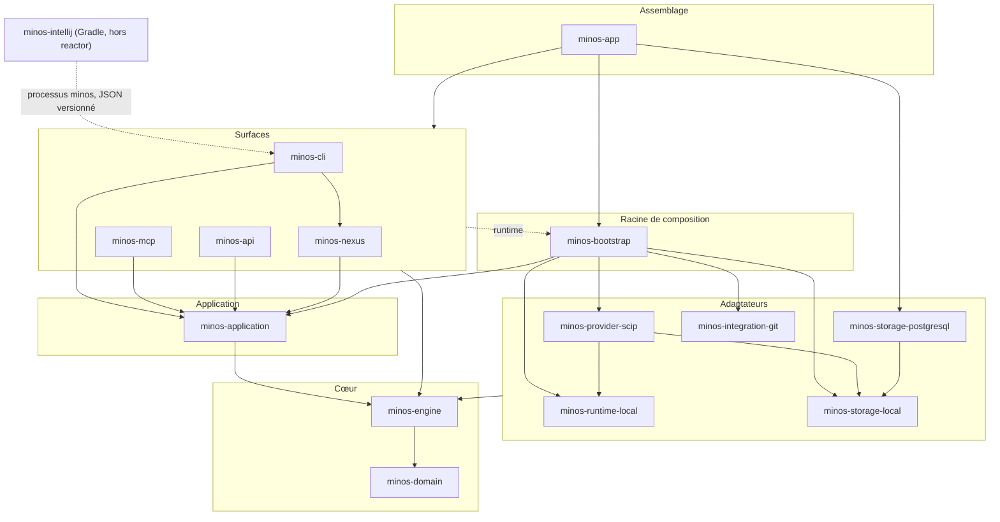

# Diagramme de composants — modules et dépendances

> **Module** : `application` · **Type** : diagramme de composants · **Question** : de quels modules MINOS est-il fait, et quel module dépend de quel autre ?

## Lecture

- Flèche pleine : dépendance Maven de portée `compile` ; pointillée `runtime` : les surfaces ne voient `minos-bootstrap` qu'à l'exécution (ServiceLoader, ADR 0042), jamais à la compilation.
- `minos-bootstrap` ne dépend de `minos-storage-postgresql` qu'en portée `test` ; le module PostgreSQL n'entre dans la distribution que par `minos-app`. Il est optionnel à l'exécution.
- Les flèches qui partent d'un cadre (« Surfaces », « Adaptateurs ») résument une arête que chaque module du cadre porte : tous dépendent de `minos-engine` (et de `minos-domain`, non redessiné).
- Le plugin IntelliJ n'a aucune dépendance `com.minos:*` : il lance le CLI comme un processus externe (`MinosCliClient`). La flèche est une relation d'usage, pas une dépendance de build.
- Graphe exhaustif généré : [module-dependencies.md](../module-dependencies.md) ; les diagrammes de détail par module restent à produire.

## Sources

- `pom.xml` — liste des 14 modules du reactor
- `minos-*/pom.xml` — dépendances `com.minos` et leur portée
- `minos-intellij/src/main/java/com/minos/intellij/protocol/MinosCliClient.java` — client CLI du plugin
- `AGENTS.md`, ADR 0022, 0042, 0044 — direction des couches et racine de composition
