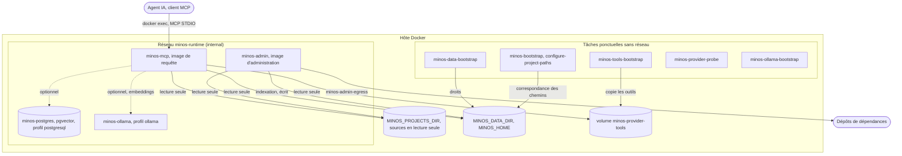

# Diagramme de déploiement — pile Docker connectée

> **Module** : `application` · **Type** : diagramme de déploiement · **Question** : quels conteneurs la pile Docker « connectée » démarre-t-elle, et par quels réseaux et volumes se parlent-ils ?

## Lecture

- Séparation lecture / écriture : `minos-mcp` ne lance aucun provider et monte tout en lecture seule ; `minos-admin` indexe (providers et chaînes d'outils) et seul il écrit dans `MINOS_HOME`.
- `minos-runtime-local` est un réseau `internal: true` : aucune sortie vers l'extérieur. Seul `minos-admin` rejoint en plus `minos-admin-egress` (téléchargement des dépendances des projets indexés).
- `minos-postgres` et `minos-ollama` ne démarrent qu'avec leur profil Compose ; `minos-mcp` en dépend avec `required: false`. La dépendance de `minos-admin` envers eux n'est pas dessinée, faute de l'avoir lue.
- Les tâches ponctuelles tournent en `network_mode: none`. Le service Compose `minos-bootstrap` est une commande du JAR, à ne pas confondre avec le module Maven du même nom.
- Le flux exact de `minos-provider-probe` et de `minos-ollama-bootstrap` (volume des modèles) est simplifié ; `compose-mcp.prod.yaml` est la variante sans PostgreSQL ni Ollama (hypothèse issue des en-têtes, non relue en entier).

## Sources

- `docker/compose-mcp.connected.yaml` — services, profils, réseaux, volumes, montages
- `docker/compose-mcp.prod.yaml` — variante de production (en-tête seulement)
- `docker/scripts/` — scripts de configuration (non relus en détail)
