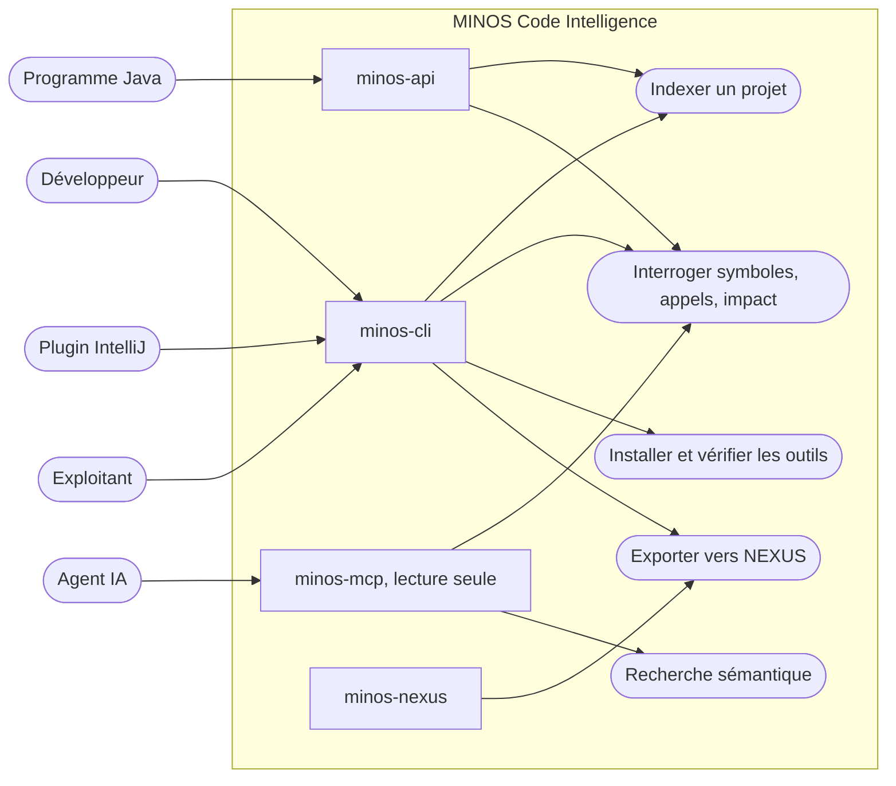

# Diagramme de cas d'utilisation — acteurs et surfaces

> **Module** : `application` · **Type** : diagramme de cas d'utilisation · **Question** : qui utilise MINOS, pour quoi faire, et par quelle surface ?

## Lecture

- Approximation : le diagramme de cas d'utilisation est rendu par un `flowchart` ; les surfaces sont dessinées entre acteurs et cas pour montrer le point d'entrée.
- Le serveur MCP est en lecture seule (ADR 0017) : un agent interroge mais n'indexe pas ; l'indexation passe par le CLI ou l'API Java.
- `minos-nexus` n'est pas un point d'entrée autonome : le CLI l'utilise pour produire l'export (dépendance `minos-cli → minos-nexus`).
- Hypothèse à confirmer : la liste des cas est un regroupement des commandes et outils, non un inventaire exhaustif (les commandes d'équipe et de plan de contrôle hébergé ne sont pas dessinées).

## Sources

- `minos-cli/src/main/java/com/minos/cli/MinosLauncher.java` — aiguillage `mcp` / autres commandes
- `minos-api/src/main/java/com/minos/api/MinosApi.java` — contrat Java public
- `minos-*/pom.xml` — descriptions des modules
- outils MCP exposés (`minos_find_callers`, `minos_impact`, `minos_semantic_search`…) — catalogue du serveur
