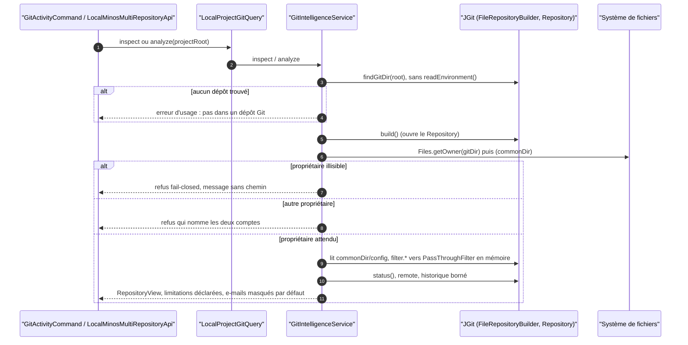

# Capacité `analyse-git` — dossier durable

Spec de référence : [openspec/specs/analyse-git/spec.md](../../../../openspec/specs/analyse-git/spec.md)
· Relevé au commit `3b516b1e` (2026-11-03).

## Objet et périmètre

[Exigence] MINOS lit l'état et l'historique d'un dépôt Git analysé (commande `git-activity`, API Java
`inspectGit` / `analyzeGitActivity`) sans exécuter de code fourni par ce dépôt, sans révéler d'identifiant ni de
chemin local, et en déclarant ce que la neutralisation des filtres change. Acteurs : l'utilisateur de la CLI ou
de l'API ; le dépôt analysé est **non fiable** (`.claude/rules/securite.md`, point 5). Hors périmètre : MCP
(aucun outil Git n'est exposé), clonage distant.

Composants : `GitActivityCommand` (`minos-cli`), `LocalMinosMultiRepositoryApi` (`minos-api`),
`LocalProjectGitQuery` (`minos-application`), port `GitIntelligence` (`minos-engine`), implémentation
`GitIntelligenceService` et `PassThroughFilter` (`minos-integration-git`), résultat `RepositoryView`
(`minos-domain`), câblage par `DefaultMinosApplicationComposer` (`minos-bootstrap`).

## Vues

### Dans quel ordre un dépôt analysé est-il ouvert, contrôlé et lu ?

Type : sequenceDiagram (UML, séquence) · Portée : existant vérifié · Exigences : « Le propriétaire du dépôt
trouvé est contrôlé avant toute lecture de son contenu », « Aucun filtre déclaré par le dépôt analysé ne
s'exécute », « L'environnement Git du processus ne redirige toujours pas l'analyse », « L'e-mail d'un auteur
n'est rendu que sur demande explicite »

L'ouverture se fait dans `GitIntelligenceService.open`
(`minos-integration-git/src/main/java/com/minos/integration/git/GitIntelligenceService.java:217-240`). Le
contrôle du propriétaire porte sur le répertoire Git **et** sur le répertoire commun d'un worktree lié
(`GitIntelligenceService.java:234-235`). Les pilotes `filter.<nom>.clean|smudge` déclarés par la configuration du
dépôt sont redirigés en mémoire vers le filtre neutre avant tout `status()` ; la limitation
`REPOSITORY_FILTERS_NOT_APPLIED` le déclare. L'appel `build()` précède le contrôle du propriétaire : voir
l'écart E1.

## Traçabilité

| Exigence | Scénarios couverts | Vue | Preuves | Statut |
|---|---|---|---|---|
| Aucun filtre déclaré par le dépôt analysé ne s'exécute | 3/3 (champ `clean` de la vue non asserté) | V1 | `minos-integration-git/src/test/java/com/minos/integration/git/GitIntelligenceTrustTest.java#aParentRepositoryTrapIsNotExecutedWhenTheProjectIsBelowIt`, `minos-integration-git/src/test/java/com/minos/integration/git/GitIntelligenceTrustTest.java#aTrapFilterReachedThroughAnIncludedFileIsNotExecuted`, `minos-integration-git/src/test/java/com/minos/integration/git/GitIntelligenceTrustTest.java#aRepositoryShippedInsideTheProjectIsNotExecutedByAnalyze` | partielle |
| Les filtres de l'utilisateur ne sont pas retirés | 1/1 (non-modification de la configuration non assertée) | V1 | `minos-integration-git/src/test/java/com/minos/integration/git/GitIntelligenceTrustTest.java#aFilterOfTheUserConfigurationIsStillApplied` | couverte |
| Le propriétaire du dépôt trouvé est contrôlé avant toute lecture de son contenu | 2/3 (refus depuis un sous-dossier non testé) | V1 | `minos-integration-git/src/test/java/com/minos/integration/git/GitIntelligenceTrustTest.java#aRepositoryOfAnotherOwnerIsRefusedBeforeAnyStatus`, `minos-integration-git/src/test/java/com/minos/integration/git/GitIntelligenceTrustTest.java#anUnreadableOwnerFailsClosedWithADistinctMessage`, `minos-integration-git/src/test/java/com/minos/integration/git/GitIntelligenceTrustTest.java#aRepositoryOfTheExpectedOwnerIsAnalysedAsBefore` | partielle |
| La remontée vers un dépôt parent légitime reste possible et visible | 2/2 | V1 | `minos-integration-git/src/test/java/com/minos/integration/git/GitIntelligenceTrustTest.java#aProjectBelowTheRepositoryRootIsReportedAsSuch` | couverte |
| L'écart de fidélité dû au retrait des filtres est déclaré | 2/2 | V1 | `minos-integration-git/src/test/java/com/minos/integration/git/GitIntelligenceTrustTest.java#aTrapFilterInTheRepositoryConfigurationIsNotExecuted`, `minos-integration-git/src/test/java/com/minos/integration/git/GitIntelligenceTrustTest.java#aRepositoryOfTheExpectedOwnerIsAnalysedAsBefore` | couverte |
| L'environnement Git du processus ne redirige toujours pas l'analyse | 1/1 (`GIT_DIR` seulement) | V1 | `minos-integration-git/src/test/java/com/minos/integration/git/GitIntelligenceServiceTest.java#theGitEnvironmentCannotRedirectTheAnalysedRepository` | couverte |
| L'e-mail d'un auteur n'est rendu que sur demande explicite | 5/5 | V1 | `minos-app/src/test/resources/characterization/cli-git.golden`, `minos-integration-git/src/test/java/com/minos/integration/git/GitIntelligenceServiceTest.java#authorEmailsAreMaskedUnlessRequestedAndStillCountDistinctAuthors`, `minos-api/src/test/java/com/minos/api/LocalMinosMultiRepositoryApiIntegrationTest.java`, `minos-app/src/test/java/com/minos/app/mcp/McpAuthorEmailGuardTest.java#noToolOfTheCatalogueRendersTheAuthorEmailOfAProject` | couverte |
| Le remote rendu ne contient ni identifiant ni chemin local | 5/5 sur `inspect` (sorties `git-activity` CLI et API non testées) | — | `minos-integration-git/src/test/java/com/minos/integration/git/GitRemoteDisclosureTest.java#aNetworkRemoteIsDisclosedWithoutCredentials`, `minos-integration-git/src/test/java/com/minos/integration/git/GitRemoteDisclosureTest.java#aLocalOrUnparsableRemoteIsWithheldAndDeclared`, `minos-integration-git/src/test/java/com/minos/integration/git/GitRemoteDisclosureTest.java#theIdentityOfARepositoryWithALocalRemoteDoesNotChange` | partielle |

Aucun gate `scripts/**/check-*.py` ne garde cette capacité : toutes les preuves sont des tests Java, exécutés par
les jobs `Verify` de `pr-ci.yml`.

## Écarts

| Id | Écart | Preuve | Suite proposée |
|---|---|---|---|
| E1 | Le titre de l'exigence dit « avant toute lecture de son contenu » ; `builder.build()` ouvre le `Repository` avant `requireExpectedOwner`. Aucun index ni statut n'est lu avant le contrôle, et rien n'est exécuté | `minos-integration-git/src/main/java/com/minos/integration/git/GitIntelligenceService.java:230` | [Question] Vérifier si l'ouverture JGit lit déjà `.git/config` (comportement de la bibliothèque, non relu ici). Si oui : contrôler le propriétaire sur le répertoire trouvé avant `build()`, ou préciser l'exigence (« avant tout statut et toute lecture d'objet ») par un changement |
| E2 | Le contrôle porte aussi sur le répertoire commun d'un worktree lié ; la spec ne nomme que « le répertoire Git » | `minos-integration-git/src/main/java/com/minos/integration/git/GitIntelligenceService.java:234` | [Proposition] Ajouter un scénario « worktree lié » par un changement (extension déjà implémentée et testée par `aTrapOfTheMainRepositoryIsNotExecutedFromALinkedWorktree`) |
| E3 | Le scénario « Propriétaire illisible » décrit une `IOException` du système de fichiers ; le test l'injecte par le fournisseur de propriétaire attendu | `minos-integration-git/src/test/java/com/minos/integration/git/GitIntelligenceTrustTest.java:202` | [Proposition] Test complémentaire sur `Files.getOwner` en échec |
| E4 | Une configuration de dépôt invalide est refusée (`IOException`), cas fail-closed non spécifié | `minos-integration-git/src/main/java/com/minos/integration/git/GitIntelligenceService.java:320` | [Proposition] Scénario de refus à ajouter par un changement |
| E5 | Un pilote déclaré par le dépôt est neutralisé même si l'utilisateur définit un pilote du même nom | `minos-integration-git/src/main/java/com/minos/integration/git/GitIntelligenceService.java:328` | [Question] Comportement voulu ? Non spécifié et non testé |

## Questions ouvertes

- `GIT_WORK_TREE` et `GIT_CEILING_DIRECTORIES` ne sont couverts que par construction (aucun `readEnvironment()`) :
  faut-il un test par variable ?
