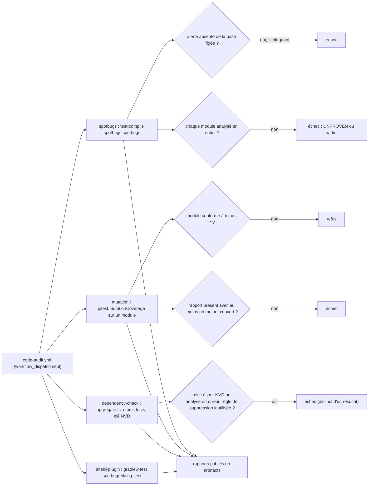

# Capacité `audit-qualite-code` — dossier durable

Spec de référence : [openspec/specs/audit-qualite-code/spec.md](../../../../openspec/specs/audit-qualite-code/spec.md)
· Relevé au commit `64d131e4` (2026-11-04).

## Objet et périmètre

[Exigence] L'audit outillé (SpotBugs, PIT, Dependency-Check, Gitleaks) produit des rapports exploitables à la
demande sans alourdir le build habituel, ne masque aucune alerte et ne compte pas comme analysé ce qui ne l'a pas
été ; des gardes statiques tiennent les conventions de code (opérations bornées, cache LRU unique, langue des
commentaires, identifiants sans jalon) et les tests d'architecture importent tout le réacteur. Acteurs : le
mainteneur qui lance l'audit, la CI. Hors périmètre : la correction des alertes trouvées.

[Existant vérifié] SpotBugs, PIT et Dependency-Check ne tournent que dans `.github/workflows/code-audit.yml`,
déclenché à la main : leurs exigences ne sont prouvées sur aucune PR. Les gardes statiques, elles, tournent à
chaque PR dans le job `invariants`.

## Vues

### Que fait l'audit outillé à la demande, et quand échoue-t-il ?

Type : flowchart (organigramme de décision, non UML) · Portée : existant vérifié · Exigences : « SpotBugs produit
des rapports exploitables et un contrôle bloquant explicite », « Le périmètre analysé par SpotBugs est prouvé par
un décompte », « Une analyse PIT sans mutation couverte n'est pas un succès », « Dependency-Check distingue une
erreur d'un résultat », « Les composants hors du réacteur Maven restent visibles »

Chaque job a son entrée booléenne et tourne indépendamment. SpotBugs bloque contre une base d'alertes figée
(`quality/spotbugs-baseline`, comparée par `scripts/quality/audit-report-summary.py`), pas par `spotbugs:check`
(écart E2). Le périmètre réellement analysé est prouvé par un second passage en ligne de commande
(`scripts/quality/spotbugs-cli.py`). La couverture JaCoCo ne fait pas partie de ce workflow : elle est jugée à
chaque PR par `scripts/quality/check-jacoco.py` (capacité `controles-de-fusion`).

## Traçabilité

| Exigence | Scénarios couverts | Vue | Preuves | Statut |
|---|---|---|---|---|
| Le build habituel n'exécute ni SpotBugs ni PIT | aucun test ; configuration conforme | — | aucune ; configuration dans `pom.xml:376` | manquante |
| SpotBugs produit des rapports exploitables et un contrôle bloquant explicite | rapports par le workflow manuel ; `spotbugs:check` jamais lancé (E2) | V1 | `.github/workflows/code-audit.yml` (job `spotbugs`) | partielle |
| Aucune alerte n'est masquée pour obtenir un résultat vert | vrai aujourd'hui, non gardé | — | aucune ; filtre vide dans `quality/spotbugs-exclude.xml` | manquante |
| PIT ne mute qu'un périmètre déclaré et ajustable sans modifier de POM | périmètre initial contredit par le POM (E1) | V1 | `.github/workflows/code-audit.yml` (job `mutation`, `-DtargetClasses`) | partielle |
| Une analyse PIT sans mutation couverte n'est pas un succès | par le workflow manuel ; pas d'auto-test du résumé | V1 | `.github/workflows/code-audit.yml` (étape « Vérifier que PIT a réellement muté du code testé »), `scripts/quality/audit-report-summary.py` | partielle |
| Les commandes documentées correspondent à la configuration | aucun ; documentation partiellement périmée (E4) | — | aucune | manquante |
| L'état de la mutation par module est écrit une seule fois | aucun gate ; formule attendue absente (E5) | — | aucune | manquante |
| Un module sans rapport complet n'est pas compté comme analysé | code présent, ni test ni étape | — | aucune ; code dans `scripts/quality/audit-report-summary.py:37` | manquante |
| Le nom d'une opération bornée dit son comportement au dépassement | tous | — | `scripts/quality/check-bounded-helpers.py` (auto-test `--self-test`) | couverte |
| Un cache LRU pondéré n'est écrit qu'une fois | tous | — | `scripts/quality/check-bounded-helpers.py` (auto-test `--self-test`) | couverte |
| Le cache partagé tient ses bornes et son poids | tous | — | `minos-engine/src/test/java/com/minos/store/cache/WeightedLruCacheTest.java#evictsLeastRecentlyReadEntriesUntilTheWeightBoundHolds`, `minos-engine/src/test/java/com/minos/store/cache/WeightedLruCacheTest.java#concurrentReadsAndWritesKeepTheBoundsAndTheWeightConsistent` | couverte |
| Le cache partagé refuse un poids ou une borne invalide | tous | — | `minos-engine/src/test/java/com/minos/store/cache/WeightedLruCacheTest.java#negativeWeightIsRefusedWithoutChangingTheCache`, `minos-engine/src/test/java/com/minos/store/cache/WeightedLruCacheTest.java#invalidBoundsAreRefusedAtConstruction` | couverte |
| La langue des commentaires de chaque module est déclarée | tous (sous Linux) | — | `scripts/quality/check-comment-language.py` (auto-test `--self-test`), `scripts/quality/comment-language.json` | couverte |
| Un fichier de production ne mêle pas deux langues hors d'une liste décroissante | tous | — | `scripts/quality/check-comment-language.py` (auto-test `--self-test`) | couverte |
| Le nombre de fichiers dont un commentaire cite un jalon ne peut que baisser | tous | — | `scripts/quality/check-comment-language.py` (auto-test `--self-test`) | couverte |
| Les verrous npm livrés sont analysés par le gate de vulnérabilités | paquet vulnérable dans un verrou : pas de copie témoin | — | `.github/workflows/pr-ci.yml` (job `vulnerability-scan`) | partielle |
| Aucun verrou npm livré n'échappe au scan | tous | — | `scripts/quality/test_check_ci_wiring.py#test_a_shipped_lockfile_missing_from_the_scan_arguments_is_refused_by_name`, `scripts/quality/test_check_ci_wiring.py#test_the_repository_passes_its_shipped_lockfiles_and_a_copy_with_a_third_one_is_refused` | couverte |
| Le catalogue des outils embarqués a une veille planifiée à couverture déclarée | tous (veille réelle planifiée, comme voulu) | — | `scripts/quality/check-embedded-tools-advisories.py` (auto-test `--self-test`), `.github/workflows/embedded-tools-advisories.yml` | couverte |
| Aucun identifiant de production ne porte un numéro de jalon | tous | — | `scripts/quality/check-milestone-identifiers.py` (auto-test `--self-test`) | couverte |
| Retirer un jalon d'un identifiant ne change aucune surface publique | tous | — | `minos-app/src/test/java/com/minos/characterization/A2SurfaceCharacterizationTest.java`, `minos-intellij/src/test/java/com/minos/intellij/PluginDescriptorActionsTest.java#aChangedActionIdIsRefusedByName` | couverte |
| Le périmètre analysé par SpotBugs est prouvé par un décompte | par le workflow manuel ; pas d'auto-test | V1 | `scripts/quality/spotbugs-cli.py`, `.github/workflows/code-audit.yml` (étape « Prouver le périmètre analysé ») | partielle |
| Les tests d'architecture importent tout le réacteur avant d'appliquer une règle | tous (pas de test négatif « module non compilé ») | — | `minos-app/src/test/java/com/minos/app/architecture/ModuleArchitectureTest.java#everyModuleIsImportedCompletely` | couverte |
| Les règles d'architecture obligatoires reprennent uniquement des décisions établies | règles hors de la liste de la spec (E6) | — | `minos-app/src/test/java/com/minos/app/architecture/ModuleArchitectureTest.java#everyPackageBelongsToOneModule`, `minos-app/src/test/java/com/minos/app/architecture/ModuleArchitectureTest.java#everyModuleOnlyUsesItsAllowedModules` | partielle |
| Dependency-Check distingue une erreur d'un résultat | configuration et runs manuels consignés ; aucun test | V1 | `pom.xml`, `.github/workflows/code-audit.yml` (job `dependency-check`) | partielle |
| Les composants hors du réacteur Maven restent visibles | matrice sans gate ; Dependency-Check du plugin absent (E7) | V1 | `docs/developer/quality/code-audit-couverture.md` | partielle |
| Gitleaks couvre l'historique complet et ne publie aucun secret | historique complet et rédaction prouvés ; clone miroir et qualification manuels | — | `.github/workflows/secret-scan.yml`, `.gitleaks.toml` | partielle |

Les gardes statiques portent leur auto-test en option (`--self-test`), exécuté par le job `invariants`.

## Écarts

| Id | Écart | Preuve | Suite proposée |
|---|---|---|---|
| E1 | Le scénario « Périmètre initial » attend trois classes `Hosted*` de `minos-engine` ; le POM mute toutes les classes `com.minos.*` du module, et la documentation suit encore l'ancien périmètre | `pom.xml:403-405`, `docs/developer/quality/code-audit.md:40` | [Proposition] Mettre le scénario et la documentation au périmètre du POM par un changement |
| E2 | La spec définit le contrôle bloquant SpotBugs comme `spotbugs:check` avec `failThreshold` ; le workflow bloque par comparaison à une base figée, qu'aucune exigence ne décrit | `.github/workflows/code-audit.yml:80-90`, `scripts/quality/audit-report-summary.py:121` | [Proposition] Spécifier la base figée (comparaison par `instanceHash`) |
| E3 | Le commentaire du POM nomme `target/spotbugs.html`, la spec et le workflow `target/reports/spotbugs.html` | `pom.xml:372` | [Proposition] Corriger le commentaire |
| E4 | La documentation dit que `code-audit.yml` n'a pas été exécuté hors du poste, alors que des runs GitHub l'ont exécuté ; elle donne aussi une commande `compile` là où le workflow exige `test-compile` | `docs/developer/quality/code-audit.md:244`, `docs/developer/quality/code-audit.md:69` | [Proposition] Mettre la documentation à jour |
| E5 | L'exigence attend la formule « modules sur 14 » une seule fois ; elle n'apparaît pas, le tableau unique utilisant une autre formulation | `docs/developer/quality/code-audit-couverture.md` | [Proposition] Ancrer le contrôle sur la structure du tableau, pas sur une phrase (GEN-0043) |
| E6 | Trois règles d'architecture obligatoires citent ARCH-0068, absent de la liste des décisions autorisées par la spec | `minos-app/src/test/java/com/minos/app/architecture/ModuleArchitectureTest.java:200` | [Proposition] Ajouter ARCH-0068 à la liste (ADR 0022 archivé, remplacé par ARCH-0068) |
| E7 | Le job du plugin n'a pas de Dependency-Check, alors que la clé NVD est désormais validée en CI | `.github/workflows/code-audit.yml:263` | [Question] À ajouter ? |

## Questions ouvertes

- Faut-il qu'une partie de l'audit (SpotBugs contre sa base, par exemple) devienne un check de PR, ou la politique
  « audit à la demande seulement » est-elle définitive ?
