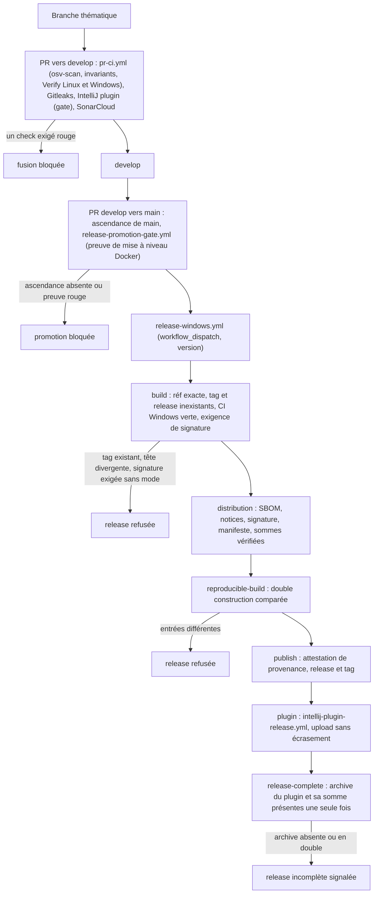

# Capacité `chaine-de-livraison` — dossier durable

Spec de référence : [openspec/specs/chaine-de-livraison/spec.md](../../../../openspec/specs/chaine-de-livraison/spec.md)
· Relevé au commit `64d131e4` (2026-11-03).

## Objet et périmètre

[Exigence] Ce que MINOS livre (jar ombré, images Docker, distribution Windows, plugin IntelliJ) conserve les
notices et licences de ses dépendances, se reconstruit à l'identique depuis le commit, porte une provenance
attestée, des sommes calculées sur les artefacts finals et une signature jamais présumée, et une release nominale
contient le plugin. Acteurs : le mainteneur qui publie, la CI qui contrôle, l'utilisateur qui vérifie un
artefact. Hors périmètre : la promotion humaine elle-même (`.claude/skills/minos-release-promotion/`).

## Vues

### Par quels contrôles passe une modification jusqu'à une release publiée ?

Type : flowchart (organigramme de décision, non UML) · Portée : existant vérifié · Exigences : « Chaque artefact
publié d'une release a une provenance attestée », « Une signature exigée ne peut pas être sautée et n'est jamais
présumée », « Les sommes publiées portent sur les artefacts finals », « Le jar distribué est reproductible à
partir du commit », « Une release publiée par le chemin nominal contient le plugin IntelliJ »

Les checks exigés sur `develop` et `main` sont ceux de `.github/required-checks.json`. Tout ce qui suit la
promotion vit dans `.github/workflows/release-windows.yml`, déclenché à la main : les contrôles qui ne tournent
qu'à ce moment (double construction réelle, attestation, présence du plugin) ne sont prouvés sur chaque PR que par
des gates statiques qui lisent les workflows (`check-workflow-pins.py`, `check-ci-wiring.py`,
`check-reproducible-build.py --self-test`).

## Traçabilité

| Exigence | Scénarios couverts | Vue | Preuves | Statut |
|---|---|---|---|---|
| Le jar ombré conserve la notice de chaque dépendance redistribuée | tous (dépendance ajoutée : par construction, sans mutation) | — | `minos-app/src/test/java/com/minos/packaging/ShadedJarNoticesIT.java#theAggregatedNoticeCarriesTheNoticeOfEveryEmbeddedDependency`, `minos-app/src/test/java/com/minos/packaging/ShadedJarNoticesIT.java#theAggregatedNoticeDoesNotAttributeMinosToTheApacheSoftwareFoundation` | couverte |
| Les textes de licence des dépendances ne sont ni supprimés ni écrasés | tous | — | `minos-app/src/test/java/com/minos/packaging/ShadedJarNoticesIT.java#everyDependencyKeepsItsLicenceAndNoticeFilesUnderItsOwnDirectory`, `minos-app/src/test/java/com/minos/packaging/ShadedJarNoticesIT.java#theTopLevelLicenceIsTheMinosLicence` | couverte |
| Les images Docker livrent les notices et licences du jar | présence prouvée par un workflow non exigé ; extraction vide : contrôle textuel seulement | — | `minos-app/src/test/java/com/minos/packaging/M29DockerReleaseCiGateContractTest.java#everyImageExtractsTheNoticesAndLicencesOfTheJarAndTheQualificationComparesThem`, `scripts/ci/qualify-docker-release.sh:123` | partielle |
| Le jar distribué est reproductible à partir du commit | écart détecté sur chaque PR ; double construction filtrée par chemins ; dates des entrées et construction sans Git non prouvées (E2) | V1 | `scripts/quality/check-reproducible-build.py`, `.github/workflows/reproducible-build.yml` | partielle |
| Tout plugin de build a une version déclarée | dépôt réel par Maven Enforcer ; aucun test de mutation | — | `pom.xml:206` | partielle |
| Chaque artefact publié d'une release a une provenance attestée | contrôle statique du workflow ; vérification d'un artefact réellement publié non faite ; sommes non attestées (E1) | V1 | `scripts/quality/test_check_workflow_pins.py#test_a_publication_without_attestation_is_refused_and_names_the_job`, `scripts/quality/test_check_workflow_pins.py#test_the_repository_attests_what_its_releases_publish` | partielle |
| Une signature exigée ne peut pas être sautée et n'est jamais présumée | tous (lecture réelle de la signature sous Windows) | V1 | `scripts/release/test-release-signature.ps1`, `scripts/release/test_release_manifest.py#test_an_unrequired_signature_is_recorded_as_unsigned` | couverte |
| Les sommes publiées portent sur les artefacts finals | tous au niveau unitaire | V1 | `scripts/release/test-release-signature.ps1:138`, `scripts/release/publish-windows-release.ps1:125` | couverte |
| Une release publiée par le chemin nominal contient le plugin IntelliJ | contrôle statique ; release réelle et job `release-complete` non testés | V1 | `scripts/quality/test_check_ci_wiring.py#test_a_release_without_the_plugin_call_is_refused`, `scripts/quality/test_check_ci_wiring.py#test_the_repository_publishes_the_plugin_with_its_release` | partielle |
| La publication du plugin se rejoue pour une release existante | aucun : implémenté dans un workflow à déclenchement manuel, sans test ni gate | V1 | aucune ; implémentation dans `.github/workflows/intellij-plugin-release.yml` | manquante |

## Écarts

| Id | Écart | Preuve | Suite proposée |
|---|---|---|---|
| E1 | L'exigence vise « chaque artefact publié » ; les fichiers `.sha256` sont publiés mais absents de `subject-path`, et seule l'archive du plugin est attestée, pas sa somme | `.github/workflows/release-windows.yml:280-284`, `.github/workflows/intellij-plugin-release.yml:190` | [Proposition] Attester aussi les sommes, ou restreindre l'exigence aux artefacts exécutables et documentés |
| E2 | La spec impose des dates d'entrées égales à la date du commit et une construction sans dépôt Git ; le contrôle compare seulement deux constructions entre elles, et la double construction n'est pas un check exigé | `scripts/quality/check-reproducible-build.py:103`, `.github/workflows/reproducible-build.yml` | [Proposition] Contrôle des dates d'entrées, ou scénarios à reformuler |
| E3 | La présence des notices dans l'image n'est prouvée que par `docker-release-validation.yml`, non exigé et filtré par chemins | `.github/workflows/docker-release-validation.yml` | [Question] Couverture voulue ? |
| E4 | Le scénario Jackson exige « les deux lignes de Jackson » ; le test exige au moins deux notices distinctes sans nommer Jackson | `minos-app/src/test/java/com/minos/packaging/ShadedJarNoticesIT.java:112` | [Proposition] Aligner le scénario sur le test |
| E5 | « Quatorze modules » : le POM racine déclare treize modules ; le compte suppose d'y ajouter le POM racine | `pom.xml:24` | [Proposition] Préciser le scénario |

## Questions ouvertes

- Aucune release réellement attestée n'a été vérifiée de bout en bout (`gh attestation verify`) : faut-il une
  preuve de release consignée avant de qualifier cette capacité ?
