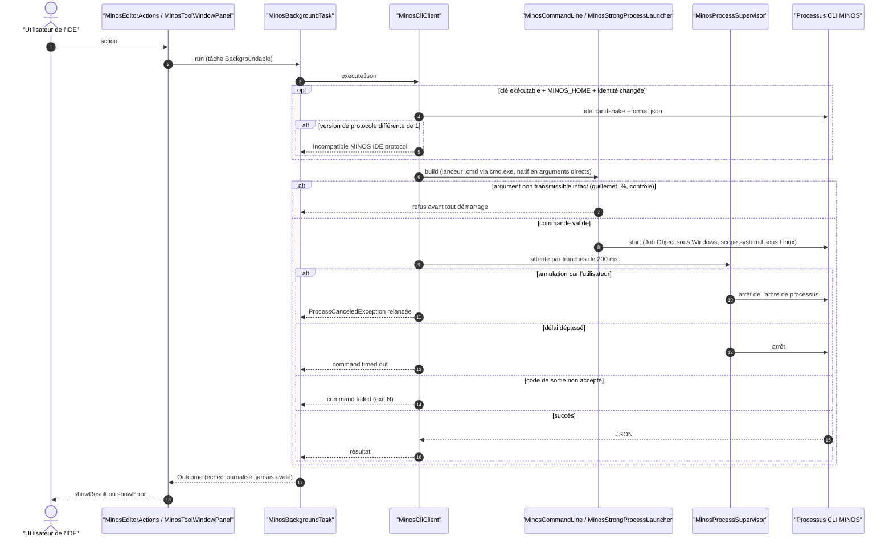

# Capacité `client-intellij` — dossier durable

Spec de référence : [openspec/specs/client-intellij/spec.md](../../../../openspec/specs/client-intellij/spec.md)
· Relevé au commit `64d131e4` (2026-11-03).

## Objet et périmètre

[Exigence] Le plugin `minos-intellij` (Gradle, Java 21, hors du reactor Maven) reste un client externe du
protocole CLI versionné : il lance la CLI MINOS sans interpréteur pour un lanceur natif et sans altérer les
arguments d'un lanceur par lots, garde la frontière de propriété du processus (Job Object, scope systemd), ne
perd aucun échec de tâche d'arrière-plan, verrouille et analyse ses dépendances, et mesure sa couverture.
Acteurs : l'utilisateur de l'IDE ; le processus CLI MINOS. Hors périmètre : le contenu des analyses rendues,
qui relève des capacités du moteur (ARCH-0027).

## Vues

### Comment une action de l'IDE devient-elle un appel de la CLI, et comment échoue-t-elle ?

Type : sequenceDiagram (UML, séquence) · Portée : existant vérifié · Exigences : « Le plugin reste un client
externe du protocole CLI inchangé », « Les arguments qu'un lanceur par lots ne peut pas recevoir sont refusés »,
« Le lancement par lots conserve la frontière de propriété du processus », « Un échec de tâche d'arrière-plan est
journalisé et jamais avalé », « Le superviseur de processus du plugin sonde à cadence bornée »

`MinosCliClient.run` (`minos-intellij/src/main/java/com/minos/intellij/protocol/MinosCliClient.java:131-176`)
résout l'exécutable, construit la commande, fixe `MINOS_HOME`, démarre par le lanceur fort et supervise. La poignée
de main n'est rejouée que si l'exécutable, `MINOS_HOME` ou l'identité binaire changent. `MinosBackgroundTask`
(`minos-intellij/src/main/java/com/minos/intellij/task/MinosBackgroundTask.java:41-50`) relance annulations et
`Error`, et journalise toute autre exception avant de la rendre. Les codes de sortie acceptés dépendent de
l'appel (`project list` : 0 et 3 ; `doctor` : 0 et 1).

## Traçabilité

| Exigence | Scénarios couverts | Vue | Preuves | Statut |
|---|---|---|---|---|
| Un lanceur par lots démarre sous Windows et reçoit ses arguments intacts | tous (Windows seulement) | V1 | `minos-intellij/src/test/java/com/minos/intellij/protocol/MinosCommandLineBatchLaunchTest.java#aBatchLauncherStartsAndReceivesItsArgumentsIntact`, `minos-intellij/src/test/java/com/minos/intellij/protocol/MinosCommandLineBatchLaunchTest.java#theExitCodeOfTheBatchLauncherIsReported`, `minos-intellij/src/test/java/com/minos/intellij/protocol/MinosCommandLineTest.java#routesWindowsCmdLaunchersThroughCmdExeWithDelayedExpansionDisabled` | couverte |
| Les arguments qu'un lanceur par lots ne peut pas recevoir sont refusés | tous (« aucun processus démarré » déduit de l'ordre) | V1 | `minos-intellij/src/test/java/com/minos/intellij/protocol/MinosCommandLineTest.java#refusesAnArgumentThatABatchLauncherCannotReceiveIntactAndNamesItWithTheWorkaround`, `minos-intellij/src/test/java/com/minos/intellij/protocol/MinosCommandLineTest.java#stillRefusesControlCharactersForABatchLauncher` | couverte |
| Le lancement par lots conserve la frontière de propriété du processus | hors indisponibilité sur hôte non qualifié | V1 | `minos-intellij/src/test/java/com/minos/intellij/protocol/MinosCommandLineBatchLaunchTest.java#stoppingABatchLaunchKillsTheLauncherAndItsChildAndLeavesNoOwnershipPlan`, `minos-intellij/src/test/java/com/minos/intellij/protocol/MinosStrongProcessLauncherTest.java#aPlanCarryingTheRawCmdModeWithAnyOtherShapeIsRefusedBeforeAnyProcessStarts` | partielle |
| Les lanceurs natifs ne passent pas par un interpréteur de commandes | tous | V1 | `minos-intellij/src/test/java/com/minos/intellij/protocol/MinosCommandLineTest.java#passesNativeWindowsAndLinuxLaunchersEveryArgumentUnchangedWithoutAnInterpreter` | couverte |
| Le plugin reste un client externe du protocole CLI inchangé | hors arguments de poignée de main construits par le client ; garde limitée (E1) | V1 | `minos-intellij/src/test/java/com/minos/intellij/protocol/MinosProtocolHandshakeTest.java#rejectsIncompatibleProtocolVersion`, `minos-cli/src/test/java/com/minos/cli/IdeCommandTest.java#exposesStableJsonHandshakeWithoutApplicationState`, `.github/workflows/intellij-plugin.yml` (étape « Verify no MINOS engine dependency leaks into plugin ») | partielle |
| Le lanceur par défaut documenté existe dans une installation standard | gate sans auto-test ; message sans ligne (E2, E3) | — | `scripts/docs/check-current-docs.py:240` | partielle |
| Un échec de tâche d'arrière-plan est journalisé et jamais avalé | tous | V1 | `minos-intellij/src/test/java/com/minos/intellij/task/MinosBackgroundTaskTest.java#anExceptionWithoutMessageIsLoggedWithItsStackAndItsType`, `minos-intellij/src/test/java/com/minos/intellij/task/MinosBackgroundTaskTest.java#anErrorIsRethrownAndNeverSwallowed`, `minos-intellij/src/test/java/com/minos/intellij/task/MinosBackgroundTaskTest.java#aCancellationIsRethrownWithoutALogEntry` | couverte |
| Une seule tâche d'arrière-plan sert toutes les actions du plugin | « aucune capture générique » vérifiée à la main (E4) | V1 | `scripts/architecture/check-module-boundaries.py` (règle A8, racine externe `minos-intellij`) | partielle |
| Le lanceur de développement ne résout pas java depuis le répertoire courant | tous | — | `scripts/install/test_dev_launcher.py#test_a_java_bat_in_the_current_directory_is_not_run`, `scripts/install/test_dev_launcher.py#test_java_home_wins_over_the_current_directory_and_the_path` | couverte |
| Les dépendances du plugin IntelliJ sont verrouillées et analysées | contrôle statique seulement ; dépendance vulnérable non prouvée | — | `scripts/quality/test_check_toolchain_baseline.py#test_a_missing_lock_file_is_refused`, `scripts/quality/test_check_toolchain_baseline.py#test_a_declaration_raised_without_its_lock_is_refused` | partielle |
| L'intégrité des artefacts résolus par le plugin est vérifiée ou sa limite déclarée | somme altérée : comportement natif de Gradle, non testé | — | `scripts/quality/test_check_toolchain_baseline.py#test_missing_verification_metadata_is_refused` | partielle |
| Les blocs communs du lanceur Job Object du plugin sont identiques à ceux du moteur | tous | — | `scripts/quality/test_check_job_object_launcher_parity.py#test_a_shared_fragment_changed_on_the_engine_side_only_is_refused`, `scripts/quality/test_check_job_object_launcher_parity.py#test_a_missing_fragment_or_template_is_refused_never_skipped` | couverte |
| Toute différence assumée entre les deux lanceurs est nommée et bornée | affichage des justifications non asserté | — | `scripts/quality/test_check_job_object_launcher_parity.py#test_a_difference_outside_the_list_is_refused_and_located`, `scripts/quality/test_check_job_object_launcher_parity.py#test_an_assumed_difference_that_grows_beyond_its_maximum_is_refused` | partielle |
| Un changement de fragment du lanceur déclenche la CI du plugin | tous | — | `scripts/ci/test_plugin_gate.py#test_the_engine_launcher_and_the_parity_gate_are_in_scope`, `scripts/ci/test_plugin_gate.py#test_a_change_elsewhere_is_out_of_scope` | couverte |
| La couverture des tests du plugin est mesurée et publiée | par les étapes du workflow | — | `minos-intellij/build.gradle.kts`, `.github/workflows/intellij-plugin.yml` (étape « Require the plugin coverage report ») | couverte |
| Une couverture du plugin sous son plancher est refusée | « test supprimé » non prouvé ; planchers évalués sous Linux seulement | — | `minos-intellij/build.gradle.kts`, `.github/workflows/intellij-plugin.yml` | partielle |
| La logique du plugin est testable sans la plateforme IntelliJ | tous (liste gardée incomplète, E5) | — | `minos-intellij/src/test/java/com/minos/intellij/PlatformFreeLogicTest.java#theExtractedLogicUsesNoIntelliJType`, `minos-intellij/src/test/java/com/minos/intellij/service/MinosSymbolRankingTest.java#theSymbolInTheCaretFileAtTheCaretLineWins` | couverte |
| Le superviseur de processus du plugin sonde à cadence bornée | survivant après arrêt forcé non testé | V1 | `minos-intellij/src/test/java/com/minos/intellij/protocol/MinosProcessSupervisorCadenceTest.java#aLiveProcessIsEnumeratedRarelyOnceTheInitialPhaseIsOver`, `minos-intellij/src/test/java/com/minos/intellij/protocol/MinosProcessSupervisorOrphanTest.java#normalRootExitStillCleansPreviouslyOwnedDetachedChildOnUnix` | partielle |
| Le lanceur du plugin ne réécrit jamais la DACL d'un dossier qui n'est pas à lui | tous (cas Windows sur le job Windows) | V1 | `minos-intellij/src/test/java/com/minos/intellij/protocol/MinosStrongProcessLauncherHomeTest.java#theProfileItsAncestorsAndAVolumeRootAreRefusedAsMinosDirectory`, `minos-intellij/src/test/java/com/minos/intellij/protocol/MinosStrongProcessLauncherHomeTest.java#aPreExistingDirectoryOfAnotherOwnerIsRefusedAndItsAclIsLeftAlone` | couverte |

Exécution : les tests du plugin tournent dans `.github/workflows/intellij-plugin.yml` (Linux et Windows) ; ceux
qui exigent Windows ne s'exécutent que sur le job Windows. Les planchers de couverture ne sont vérifiés que sur
Linux.

## Écarts

| Id | Écart | Preuve | Suite proposée |
|---|---|---|---|
| E1 | La spec interdit au plugin toute dépendance ou import `com.minos:*` ; la garde du workflow ne cherche que la chaîne `implementation("com.minos:` et ignore `compileOnly`, `testImplementation` et les imports | `.github/workflows/intellij-plugin.yml:82` | [Proposition] Garde structurelle (toutes les configurations Gradle et les imports `com.minos.` hors `com.minos.intellij`) |
| E2 | Le scénario accepte `%LOCALAPPDATA%\Programs\MINOS\minos.cmd` dans la documentation ; le gate exige la chaîne `AppData\Local\Programs\MINOS\minos.cmd`, et une documentation écrite avec `%LOCALAPPDATA%` échouerait | `scripts/docs/check-current-docs.py:246` | [Proposition] Aligner le scénario ou le gate |
| E3 | Le scénario attend un message qui nomme la ligne et l'emplacement attendu ; le gate n'affiche que la chaîne interdite | `scripts/docs/check-current-docs.py:62` | [Proposition] Enrichir le message du gate |
| E4 | « Aucune capture générique (`catch (Throwable`) » repose sur une recherche manuelle, sans gate en CI | `openspec/specs/client-intellij/spec.md` | [Proposition] Ajouter la recherche au gate du plugin |
| E5 | La liste gardée par le test « sans plateforme » ne contient pas les classes d'interprétation des réponses de la CLI, qui n'importent pourtant pas la plateforme | `minos-intellij/src/test/java/com/minos/intellij/PlatformFreeLogicTest.java:20` | [Proposition] Étendre la liste |
| E6 | Un survivant après l'arrêt forcé est signalé par le code mais aucun test ne le vérifie ; le test du superviseur est exclu de la mutation | `minos-intellij/src/main/java/com/minos/intellij/protocol/MinosProcessSupervisor.java:131` | [Proposition] Test du cas survivant |

## Questions ouvertes

Aucune.
