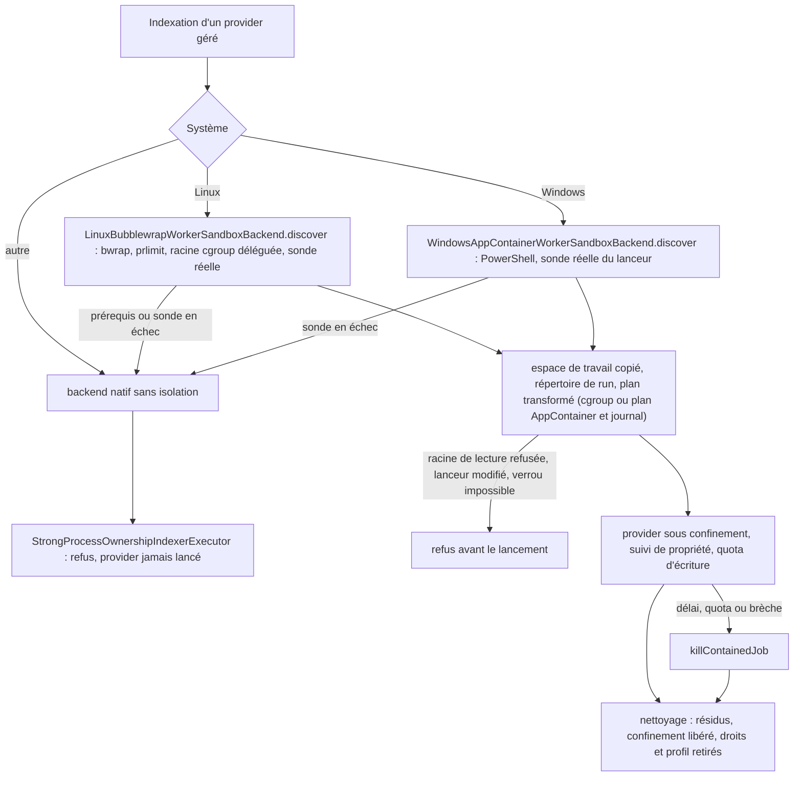
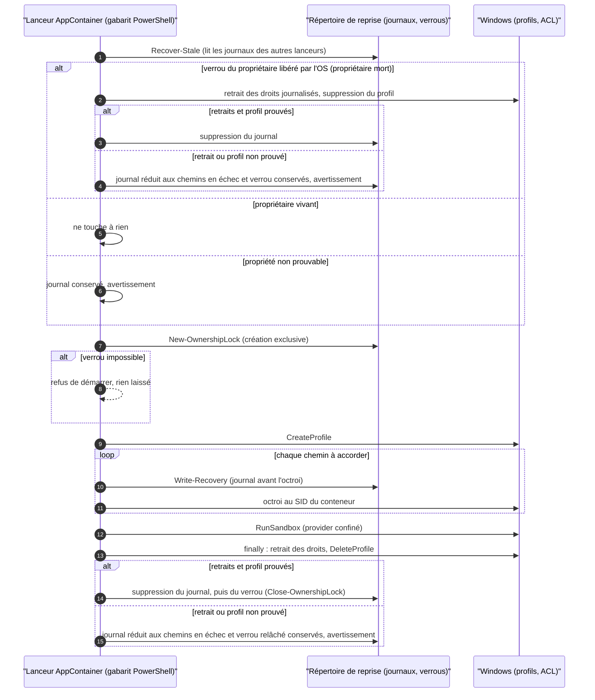

# Capacité `confinement-code-non-fiable` — dossier durable

Spec de référence : [openspec/specs/confinement-code-non-fiable/spec.md](../../../../openspec/specs/confinement-code-non-fiable/spec.md)
· Relevé au commit `64d131e4` (2026-11-04).

## Objet et périmètre

[Exigence] Le code d'un provider n'est exécuté que sous une frontière de système d'exploitation qualifiée
(bubblewrap et cgroup v2 sous Linux, AppContainer et Job Object sous Windows) ; un confinement indisponible fait
refuser l'exécution, jamais un mode dégradé. Les droits accordés à un conteneur sont retirés même après un arrêt
brutal, les résidus de travail ont une durée de vie bornée, et le bac à sable Linux ne monte que des racines de
lecture déclarées et revérifiées. Acteurs : l'utilisateur qui indexe, la CI qui qualifie le confinement sur les
deux systèmes. Hors périmètre : l'installation des outils (capacité `installation-des-providers`).

## Vues

### Comment un provider est-il confiné, et quand son exécution est-elle refusée ?

Type : flowchart (organigramme de décision, non UML) · Portée : existant vérifié · Exigences : « L'exécuteur de
processus refuse de lancer un provider sans frontière », « Un confinement indisponible fait échouer sa
qualification quand elle est exigée », « Les racines de lecture survivent à chaque transformation du plan ou font
refuser »

Le backend le plus fort disponible est choisi par `WorkerSandboxBackends`
(`minos-runtime-local/src/main/java/com/minos/runtime/local/sandbox/WorkerSandboxBackends.java:150-163`). Le
backend natif sans isolation n'exécute jamais un provider géré : `StrongProcessOwnershipIndexerExecutor` refuse
(`minos-runtime-local/src/main/java/com/minos/runtime/local/StrongProcessOwnershipIndexerExecutor.java:114-149`),
et `ProcessIndexerExecutor` refuse toujours l'exécution nue. Le résultat de la sonde Windows est mis en cache par
JVM et par `MINOS_HOME`.

### Comment le lanceur AppContainer garantit-il le retrait des droits, même après un arrêt brutal ?

Type : sequenceDiagram (UML, séquence) · Portée : existant vérifié · Exigences : « Un sandbox vivant n'est jamais
altéré par un autre lanceur », « Un sandbox dont le propriétaire est mort est récupéré », « Une propriété non
prouvable n'est jamais récupérée », « Un lanceur qui ne prouve pas sa propre propriété refuse de démarrer », « Les
autorisations accordées à un conteneur sont retirées même après un arrêt brutal »

La preuve de mort d'un propriétaire est un verrou de fichier tenu ouvert par le lanceur et libéré par le système à
sa mort (`minos-runtime-local/src/main/resources/com/minos/runtime/local/windows-fragments/appcontainer-recovery-ownership.ps1frag:29-42`),
pas une horloge ni un PID. Chaque octroi est journalisé avant d'être appliqué, pour qu'un lanceur suivant puisse le
retirer. Un retrait se prouve par le code de sortie d'`icacls` ; le journal et son verrou ne sont supprimés qu'après
le retrait prouvé de chaque droit et la suppression prouvée du profil, sinon un lanceur suivant les rejoue.

## Traçabilité

| Exigence | Scénarios couverts | Vue | Preuves | Statut |
|---|---|---|---|---|
| Un sandbox vivant n'est jamais altéré par un autre lanceur | sonde lancée depuis un autre processus non testée | V2 | `minos-runtime-local/src/test/java/com/minos/runtime/local/sandbox/WindowsAppContainerRecoveryOwnershipTest.java#aLiveSandboxIsNotAlteredWhenAnotherLauncherStartsAndRunsToCompletion` | partielle |
| Un sandbox dont le propriétaire est mort est récupéré | sortie normale en échec du provider non testée | V2 | `minos-runtime-local/src/test/java/com/minos/runtime/local/sandbox/WindowsAppContainerRecoveryOwnershipTest.java#aSandboxWhoseOwnerWasKilledIsRecoveredByTheNextLauncher`, `minos-runtime-local/src/test/java/com/minos/runtime/local/sandbox/WindowsAppContainerRecoveryOwnershipTest.java#aNormalExitLeavesNeitherJournalNorLockNorGrant` | partielle |
| Une propriété non prouvable n'est jamais récupérée | tous | V2 | `minos-runtime-local/src/test/java/com/minos/runtime/local/sandbox/WindowsAppContainerRecoveryOwnershipTest.java#aJournalWithoutAnOwnerLockIsLeftInPlaceAndReported`, `minos-runtime-local/src/test/java/com/minos/runtime/local/sandbox/WindowsAppContainerRecoveryOwnershipTest.java#anUnreadableOwnerLockIsNeverTreatedAsProofOfDeath` | couverte |
| La preuve de propriété ne dépend ni d'une horloge ni d'un identifiant réutilisable | aucun test Windows (saut d'horloge, PID réutilisé) ; équivalents Linux hors périmètre | V2 | aucune pour Windows ; équivalent Linux `minos-runtime-local/src/test/java/com/minos/runtime/local/sandbox/LinuxCgroupJobOwnershipIsolationTest.java#aJobWhoseOwnerPidWasReusedIsReclaimedOnItsKernelStartTicks` | manquante |
| Un lanceur qui ne prouve pas sa propre propriété refuse de démarrer | cas représentatif (accès refusé) | V2 | `minos-runtime-local/src/test/java/com/minos/runtime/local/sandbox/WindowsAppContainerRecoveryOwnershipTest.java#aLauncherThatCannotCreateItsOwnLockRefusesToStartAndLeavesNothing` | couverte |
| Un répertoire de reprise d'un format antérieur n'est pas balayé par le nouveau lanceur | tous | V2 | `minos-runtime-local/src/test/java/com/minos/runtime/local/sandbox/WindowsAppContainerRecoveryOwnershipTest.java#aJournalOfThePreviousFormatIsNeverExaminedAndTheNewJournalGoesElsewhere` | couverte |
| Les résidus de travail d'un run mort ont une durée de vie bornée | tous | V1 | `minos-runtime-local/src/test/java/com/minos/runtime/local/workspace/LocalProviderWorkspaceTest.java#creatingAWorkspaceReclaimsTheOrphanWorkspaceOfADeadRunOlderThanTheLifetime`, `minos-engine/src/test/java/com/minos/io/StaleScratchReclamationTest.java#anOldChildIsReclaimedWithItsWholeContentAndARecentOneIsKept`, `minos-integration-git/src/test/java/com/minos/integration/git/JGitRemoteRepositoryMaterializerTest.java#anExpiredCloneTemporaryIsReclaimedWhereAValidEntryAndARecentTemporaryAreKept` | couverte |
| Un résidu récent, protégé ou daté dans le futur n'est jamais supprimé | protection du run courant non testée | V1 | `minos-engine/src/test/java/com/minos/io/StaleScratchReclamationTest.java#theThresholdIsStrictAtTheLifetimeBoundary`, `minos-engine/src/test/java/com/minos/io/StaleScratchReclamationTest.java#aResidueDatedInTheFutureIsNeverReclaimed` | partielle |
| Le balayage des résidus ne sort jamais de sa racine et reste non fatal | tous (tests sautables selon le système) | V1 | `minos-engine/src/test/java/com/minos/io/StaleScratchReclamationTest.java#anOldSymbolicLinkIsRemovedWithoutWalkingOrTouchingItsTarget`, `minos-engine/src/test/java/com/minos/io/StaleScratchReclamationTest.java#anOldJunctionIsRemovedWithoutWalkingOrTouchingItsTarget`, `minos-engine/src/test/java/com/minos/io/StaleScratchReclamationTest.java#aResidueThatCannotBeRemovedIsReportedWithoutAnAbsolutePathAndTheSweepContinues` | couverte |
| Les autorisations accordées à un conteneur sont retirées même après un arrêt brutal | tous | V2 | `minos-runtime-local/src/test/java/com/minos/runtime/local/sandbox/WindowsAppContainerRecoveryOwnershipTest.java#aSandboxWhoseOwnerWasKilledIsRecoveredByTheNextLauncher`, `minos-runtime-local/src/test/java/com/minos/runtime/local/sandbox/WindowsAppContainerRecoveryOwnershipTest.java#aJournaledPathWhoseGrantWasNeverAppliedIsRecoveredAsANoOp`, `minos-runtime-local/src/test/java/com/minos/runtime/local/sandbox/WindowsAppContainerRecoveryOwnershipTest.java#aLiveSandboxIsNotAlteredWhenAnotherLauncherStartsAndRunsToCompletion`, `minos-runtime-local/src/test/java/com/minos/runtime/local/sandbox/WindowsAppContainerRecoveryOwnershipTest.java#aJournalWithoutAnOwnerLockIsLeftInPlaceAndReported`, `minos-runtime-local/src/test/java/com/minos/runtime/local/sandbox/WindowsAppContainerRecoveryOwnershipTest.java#aGrantThatCannotBeRemovedAtTheEndOfARunKeepsItsJournalForTheNextLauncher`, `minos-runtime-local/src/test/java/com/minos/runtime/local/sandbox/WindowsAppContainerRecoveryOwnershipTest.java#aRecoveryWhoseGrantRemovalFailsKeepsTheJournalForTheNextLauncher` | couverte |
| Les autorisations orphelines existantes sont recensées | tous | — | `minos-runtime-local/src/test/java/com/minos/runtime/local/sandbox/OrphanAppContainerGrantDiagnosticTest.java#orphanGrantsAreReportedWithoutChangeAndRemovedOnlyOnRequest`, `scripts/windows/Find-MinosAppContainerGrants.ps1` | couverte |
| Un confinement indisponible fait échouer sa qualification quand elle est exigée | racine cgroup absente non forcée par un test | V1 | `minos-runtime-local/src/test/java/com/minos/runtime/local/sandbox/SandboxTestSupportTest.java#requiredAndUnavailableFailsWithTheReason`, `minos-runtime-local/src/test/java/com/minos/runtime/local/sandbox/SandboxTestSupportTest.java#anAbsentBackendFailsOrSkipsAccordingToTheProperty` | partielle |
| La CI exige la qualification du confinement sur chacun de ses deux systèmes | aucun gate ne compte les tests sautés | — | `scripts/docs/check-current-docs.py:171`, `minos-runtime-local/src/test/java/com/minos/runtime/local/sandbox/SandboxTestSupportTest.java#requiredModeIsActiveOnThePullRequestVerificationJob` | partielle |
| Un test propre à une plateforme est compté comme sauté sur l'autre | aucun gate ; compte de tests Linux différent de la spec (E3) | — | `minos-runtime-local/src/test/java/com/minos/runtime/local/sandbox/LinuxBubblewrapWorkerSandboxBackendTest.java` | partielle |
| Les sauts d'hypothèse d'environnement des classes de confinement sont nommés | aucun gate ; cas « élevé sans CI » non testé | — | `minos-runtime-local/src/test/java/com/minos/runtime/local/WindowsNonElevatedIndexingTest.java:71` | partielle |
| L'exécuteur de processus refuse de lancer un provider sans frontière | tous | V1 | `minos-runtime-local/src/test/java/com/minos/runtime/local/process/ProcessIndexerExecutorBoundaryRefusalTest.java#executeRefusesWithoutStartingAProcessOrCreatingARunDirectory`, `minos-runtime-local/src/test/java/com/minos/runtime/local/process/ProcessIndexerExecutorBoundaryRefusalTest.java#theNativeBackendCannotRunABareProcessExecutor` | couverte |
| Aucune entrée publique ne construit un exécuteur sans politique réseau | sauts Surefire non contrôlés | — | `minos-runtime-local/src/test/java/com/minos/runtime/local/process/ProcessIndexerExecutorBoundaryRefusalTest.java#everyPublicConstructorOfTheOwnershipExecutorTakesANetworkPolicy` | partielle |
| Le suivi de propriété par sondage est espacé sans rien céder au nettoyage | tous | V1 | `minos-runtime-local/src/test/java/com/minos/runtime/local/process/ProcessOwnershipTrackerCadenceTest.java#aLiveProcessIsEnumeratedRarelyOnceTheInitialPhaseIsOver`, `minos-runtime-local/src/test/java/com/minos/runtime/local/process/ProcessOwnershipTrackerCleanupFailureTest.java#aTreeThatSurvivesForcedTerminationIsReportedAndTheInterruptionIsPreserved` | couverte |
| Le lanceur de l'AppContainer est publié sans écraser une cible existante | tous | — | `minos-runtime-local/src/test/java/com/minos/runtime/local/sandbox/SandboxLauncherScriptPublicationTest.java#aLauncherPublishedMeanwhileIsKeptNotReplaced`, `minos-runtime-local/src/test/java/com/minos/runtime/local/sandbox/WindowsLauncherScriptPlacementTest.java#aLauncherThatChangedSinceItWasMaterialisedIsRefusedBeforeEveryLaunch` | couverte |
| La sortie de la sonde de l'AppContainer est bornée et privée | tous (Windows) | — | `minos-runtime-local/src/test/java/com/minos/runtime/local/sandbox/AppContainerProbeBoundedOutputTest.java#anOutputBeyondTheBoundIsTruncatedWithTheMarkerAndTheProbeSucceeds`, `minos-runtime-local/src/test/java/com/minos/runtime/local/sandbox/AppContainerProbeBoundedOutputTest.java#theOutputFileIsPrivate` | couverte |
| Le bac à sable Linux monte en lecture seule le JDK nommé par JAVA_HOME | tous (Linux) | — | `minos-runtime-local/src/test/java/com/minos/runtime/local/sandbox/LinuxSandboxToolchainHomeTest.java#jdkRootIsMountedReadOnlyButNotItsParent`, `minos-runtime-local/src/test/java/com/minos/runtime/local/sandbox/LinuxSandboxToolchainHomeTest.java#jdkReachedThroughASymbolicLinkIsVisibleAtTheNamedPath` | couverte |
| Les liens du JDK ne montent qu'une cible exacte de la configuration Java de /etc | tous (Linux ; cas Debian sautable) | — | `minos-runtime-local/src/test/java/com/minos/runtime/local/sandbox/LinuxSandboxToolchainHomeTest.java#allowListedEtcLinkTargetIsMountedExactlyNeverItsDirectory`, `minos-runtime-local/src/test/java/com/minos/runtime/local/sandbox/LinuxSandboxToolchainHomeTest.java#plantedLinksToTheProfileOrToEtcSecretsAreNeverMounted` | couverte |
| Une racine d'outillage trop large est refusée avant le lancement | tous (Linux) | — | `minos-runtime-local/src/test/java/com/minos/runtime/local/sandbox/LinuxSandboxToolchainHomeTest.java#filesystemRootAsJavaHomeIsRefusedWithoutAPath`, `minos-runtime-local/src/test/java/com/minos/runtime/local/sandbox/LinuxSandboxToolchainHomeTest.java#etcDirectoryAsJavaHomeIsRefused` | couverte |
| Une racine d'outillage qui n'est pas un JDK est refusée | tous (Linux) | — | `minos-runtime-local/src/test/java/com/minos/runtime/local/sandbox/LinuxSandboxToolchainHomeTest.java#javaHomeLinkedToANonJdkProfileDirectoryIsRefusedAndNotMounted`, `minos-runtime-local/src/test/java/com/minos/runtime/local/sandbox/LinuxSandboxToolchainHomeTest.java#jdkInsideMinosHomeIsRefusedUnlessItIsAManagedTool` | couverte |
| Un plan déclare ses racines de lecture et le bac à sable Linux les monte exactement | tous (Linux) | V1 | `minos-runtime-local/src/test/java/com/minos/runtime/local/sandbox/LinuxSandboxReadOnlyRootTest.java#aDeclaredRootIsMountedReadOnlyAloneAfterTheWritableRootsWithoutTheNetwork`, `minos-runtime-local/src/test/java/com/minos/runtime/local/sandbox/LinuxSandboxReadOnlyRootExecutionTest.java#aProviderReadsADeclaredRootButCannotWriteIntoIt` | couverte |
| Le bac à sable Linux revérifie une racine de lecture juste avant de la monter | tous (Linux) | V1 | `minos-runtime-local/src/test/java/com/minos/runtime/local/sandbox/LinuxSandboxReadOnlyRootTest.java#aRootReachedThroughALinkedComponentIsRefusedWithoutAPath`, `minos-runtime-local/src/test/java/com/minos/runtime/local/sandbox/LinuxSandboxReadOnlyRootTest.java#aRootUnderADirectoryWritableByOtherAccountsIsRefused` | couverte |
| Les racines de lecture survivent à chaque transformation du plan ou font refuser | tous (plan sans racine prouvé sous Linux) | V1 | `minos-runtime-local/src/test/java/com/minos/runtime/local/sandbox/WindowsSandboxMountsRefusalTest.java#theAppContainerBackendRefusesBeforeWritingAPlanOrGrantingAnything`, `minos-runtime-local/src/test/java/com/minos/runtime/local/process/ProcessPlanSandboxMountsPropagationTest.java`, `minos-runtime-local/src/test/java/com/minos/runtime/local/sandbox/LinuxSandboxReadOnlyRootExecutionTest.java#cgroupOwnershipWithoutAnOsSandboxRefusesAPlanThatDeclaresARoot` | couverte |
| Ce que MINOS relit dans une zone inscriptible par le provider n'est jamais hérité | copie d'artefact conservée sous Windows non testée | — | `minos-runtime-local/src/test/java/com/minos/runtime/local/process/BoundedProcessOutputOpeningTest.java#aFileWhichReappearedUnderTheNameIsNotAdopted`, `minos-engine/src/test/java/com/minos/io/PrivateLocalStorageStreamsTest.java#aNewFileInheritsTheFolderAclAndItsDaclIsNotRewritten` | partielle |

Les tests de confinement passent par `SandboxTestSupport` : sautés si le confinement manque en local, en échec
quand la qualification est exigée (`-Dminos.sandbox.tests.required=true` sur les jobs `Verify`). Beaucoup ne
tournent que sur un système (`@EnabledOnOs`).

## Écarts

| Id | Écart | Preuve | Suite proposée |
|---|---|---|---|
| E2 | Le message de la sonde Windows annonce un repli « vers un niveau de bac à sable plus faible », alors que l'exécution est ensuite refusée : le comportement est fail-closed, l'annonce est inexacte | `minos-runtime-local/src/main/java/com/minos/runtime/local/sandbox/WindowsAppContainerWorkerSandboxBackend.java:128-131` | [Proposition] Corriger le message |
| E3 | La spec annonce quatre tests pour la classe du backend bubblewrap ; elle en compte cinq | `minos-runtime-local/src/test/java/com/minos/runtime/local/sandbox/LinuxBubblewrapWorkerSandboxBackendTest.java` | [Proposition] Corriger le scénario |
| E4 | La spec exige « aucun test sauté » pour la classe de reprise AppContainer ; un `assumeTrue` peut en sauter un, et aucun gate ne lit les rapports Surefire | `minos-runtime-local/src/test/java/com/minos/runtime/local/sandbox/WindowsAppContainerRecoveryOwnershipTest.java:145` | [Proposition] Gate qui compte les tests sautés des classes de confinement |
| E5 | Les résidus `.entry-*.tmp` et `.accept-*` d'un « processus mort » sont balayés sur leur âge seul (24 heures), sans preuve de mort | `minos-engine/src/main/java/com/minos/io/StaleScratchReclamation.java:33-37` | [Question] Borne d'âge suffisante, à écrire dans l'exigence ? |
| E6 | Le scénario « Propriétaire illisible » attend les diagnostics de la découverte dans le refus ; le test passe une raison fixe | `minos-runtime-local/src/test/java/com/minos/runtime/local/sandbox/WindowsAppContainerRecoveryOwnershipTest.java#fixture` | [Proposition] Aligner le test ou le scénario |

## Questions ouvertes

- La sonde Windows est mise en cache par JVM et par `MINOS_HOME` : un hôte dégradé après une sonde réussie n'est
  pas resondé. Faut-il une durée de validité ?
