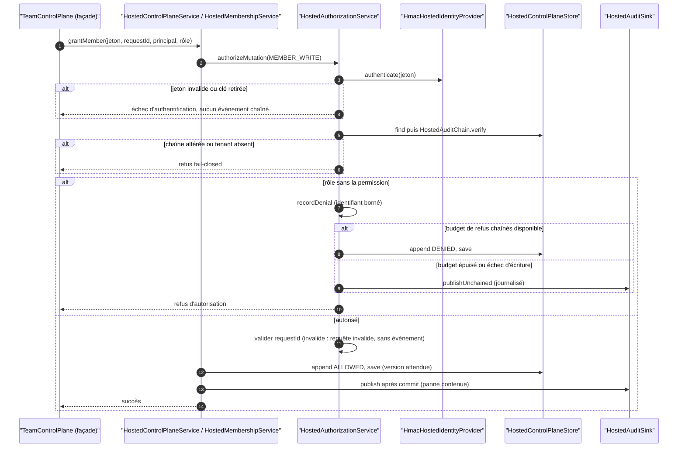
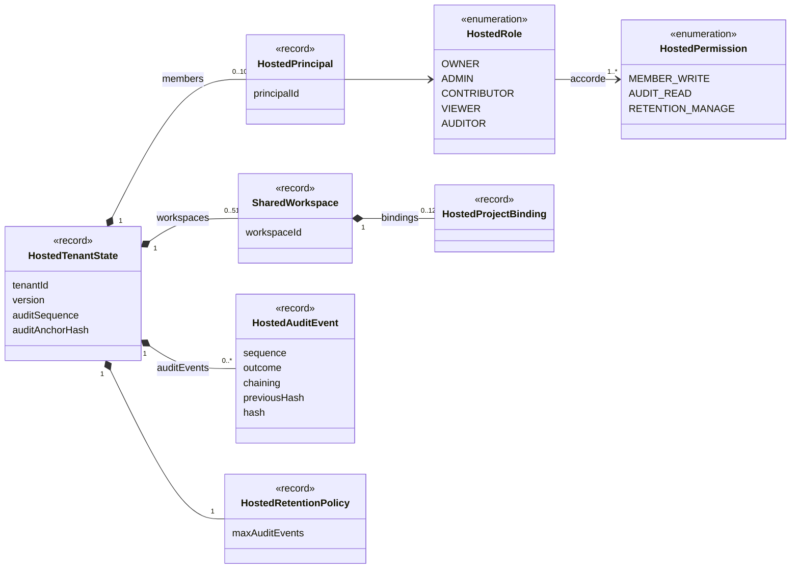

# Capacité `controle-tenant-heberge` — dossier durable

Spec de référence : [openspec/specs/controle-tenant-heberge/spec.md](../../../../openspec/specs/controle-tenant-heberge/spec.md)
· Relevé au commit `64d131e4` (2026-11-03).

## Objet et périmètre

[Exigence] Le plan de contrôle hébergé (opt-in, SEC-0071) authentifie chaque appel, autorise par rôle, garde une
chaîne d'audit HMAC qu'aucun refus ne peut corrompre, borne ce qu'un appelant refusé peut y écrire, refuse une
chaîne altérée à la lecture et ne laisse aucune panne de puits externe changer le résultat d'un appel. Acteurs :
les membres d'un tenant (OWNER, ADMIN, CONTRIBUTOR, VIEWER, AUDITOR), l'opérateur qui lit le journal serveur.
Hors périmètre : le transport réseau du plan de contrôle. Seul magasin implémenté : un fichier chiffré
(`FileHostedControlPlaneStore`).

## Vues

### Comment une mutation est-elle authentifiée, autorisée et auditée, et que devient un refus ?

Type : sequenceDiagram (UML, séquence) · Portée : existant vérifié · Exigences : « Un refus ne corrompt jamais la
chaîne d'audit », « Les refus chaînés sont bornés en octets », « Tout refus laisse une trace et reste un refus
d'autorisation », « Un jeton à clé retirée est un échec d'authentification », « L'identifiant de requête est
validé après l'autorisation », « Une panne d'un puits d'audit externe ne change pas le résultat d'un appel »

`HostedAuthorizationService` (`minos-engine/src/main/java/com/minos/hosted/HostedAuthorizationService.java`)
authentifie, recharge et vérifie la chaîne, puis autorise. Un refus chaîné est admis tant que les refus déjà
chaînés et le candidat restent sous le quart de la limite d'octets du magasin (`HostedAuthorizationService.java:167-174`) ;
au-delà, ou si l'écriture échoue, le refus est publié non chaîné et journalisé. La façade `TeamControlPlane` ne
décide rien : elle relaie le moteur.

### De quoi un tenant est-il fait ?

Type : classDiagram (UML, classes) · Portée : existant vérifié · Exigences : « La lecture de l'audit et du plan
de rétention exige la permission du rôle », « Une chaîne d'audit stockée altérée est refusée à la lecture »

`HostedTenantState` (`minos-engine/src/main/java/com/minos/hosted/HostedTenantState.java:10`) vérifie à la
construction la contiguïté de la chaîne et son ancre ; `HostedPermission` est abrégée aux trois permissions citées
par la spec. Chaque `HostedAuditEvent` porte le hash du précédent et un HMAC ; un refus non chaîné est authentifié
sur sa valeur persistée.

## Traçabilité

| Exigence | Scénarios couverts | Vue | Preuves | Statut |
|---|---|---|---|---|
| Un refus ne corrompt jamais la chaîne d'audit | tous | V1 | `minos-engine/src/test/java/com/minos/hosted/HostedAuditResourceIdCanonicalFormTest.java`, `minos-engine/src/test/java/com/minos/hosted/HostedAuditChainCanonicalFormTest.java#anEventAlteredAfterTheFactIsStillRejected`, `minos-engine/src/test/java/com/minos/hosted/HostedControlPlaneServiceTest.java#rejectsPersistedAuditEventWithInvalidHmac` | couverte |
| Les chaînes d'audit existantes restent vérifiables | chaîne antérieure déjà corrompue : non testée | V2 | `minos-engine/src/test/java/com/minos/hosted/HostedAuditChainCanonicalFormTest.java#aCanonicalChainedEventKeepsTheHmacOfEveryPreviousVersion`, `minos-engine/src/test/java/com/minos/hosted/HostedUnchainedRefusalIdentityTest.java#chainedEventsKeepThePersistedHmacFormOfTheExistingHistory` | partielle |
| Le champ de ressource d'un refus est borné | tous | V1 | `minos-engine/src/test/java/com/minos/hosted/HostedRefusalResourceIdTest.java#anOversizedIdentifierBecomesABoundedDeterministicStandIn`, `minos-engine/src/test/java/com/minos/hosted/HostedRefusalResourceIdTest.java#controlCharactersInsideTheIdentifierNeverReachTheAudit`, `minos-engine/src/test/java/com/minos/hosted/HostedRefusalResourceIdTest.java#aRefusedCallerCannotMakeTheRecordedRefusalGrowWithItsInput` | couverte |
| Les refus chaînés sont bornés en octets | tous, sur la mesure du code (E1) | V1 | `minos-storage/src/test/java/com/minos/storage/local/store/HostedDenialByteBudgetTest.java#aViewerCannotExhaustTheByteLimitAndBlockAuthorizedMutations`, `minos-engine/src/test/java/com/minos/hosted/HostedDenialByteBudgetPortTest.java#aDeclaredByteLimitCapsTheBytesOfChainedRefusalsAtAQuarterOfIt`, `minos-engine/src/test/java/com/minos/hosted/HostedUnchainedRefusalTraceTest.java#unchainedRefusalIsJournaledEvenWithTheEmbeddedNoopSink` | couverte |
| Tout refus laisse une trace et reste un refus d'autorisation | code d'erreur API d'un refus dû à un échec de persistance non testé | V1 | `minos-engine/src/test/java/com/minos/hosted/HostedRefusalTraceTest.java#anIoFailureWhileSaving`, `minos-engine/src/test/java/com/minos/hosted/HostedRefusalTraceTest.java#aRealConcurrentWriterBetweenLoadAndSaveStillYieldsATracedRefusal`, `minos-api/src/test/java/com/minos/api/LocalMinosTeamApiTest.java#aRefusalIsReportedAsAccessDeniedWhateverTheCallerSuppliedAndTheTenantStaysReadable` | partielle |
| Un identifiant invalide d'un appelant autorisé reste une requête invalide | tous | V1 | `minos-engine/src/test/java/com/minos/hosted/HostedAuthorizedInvalidIdentifierTest.java#anOwnerWithAnInvalidIdentifierIsRejectedAsAnInvalidRequestWithoutARefusalEvent`, `minos-engine/src/test/java/com/minos/hosted/HostedAuthorizedInvalidIdentifierTest.java#aCallerWithoutRightsPresentingTheSameInvalidIdentifierIsRefusedAndTraced` | couverte |
| Un jeton à clé retirée est un échec d'authentification | tous | V1 | `minos-engine/src/test/java/com/minos/hosted/HostedKeyRotationRefusalTest.java#aMutationWithATokenOfARetiredKeyIsAnAuthenticationFailureWithoutAnyChainedEvent`, `minos-engine/src/test/java/com/minos/hosted/HostedKeyRotationRefusalTest.java#theJournalOfRetiredKeyTokensIsBoundedAndNamesNeitherTheTokenNorAPrincipal`, `minos-engine/src/test/java/com/minos/hosted/HostedKeyRotationRefusalTest.java#eventsAuthenticatedBeforeTheRotationStayVerifiableWithTheRetiredKey` | couverte |
| Une chaîne d'audit stockée altérée est refusée à la lecture | au niveau du domaine ; lecture réelle par le magasin et message attendu non conformes (E2) | V2 | `minos-engine/src/test/java/com/minos/hosted/HostedAuditChainTamperingTest.java#permutedEventsAreRefused`, `minos-engine/src/test/java/com/minos/hosted/HostedAuditChainTamperingTest.java#anEventOfAnotherTenantIsRefused`, `minos-storage/src/test/java/com/minos/storage/local/store/FileHostedControlPlaneStoreRefusalTest.java#refusesAPayloadTheDomainRejects` | partielle |
| La lecture de l'audit et du plan de rétention exige la permission du rôle | tous (absence d'événement vérifiée pour VIEWER seulement) | V2 | `minos-engine/src/test/java/com/minos/hosted/HostedReadPermissionTest.java#aViewerCannotReadTheAuditTrail`, `minos-engine/src/test/java/com/minos/hosted/HostedReadPermissionTest.java#anAuditorReadsTheAuditTrailButNotTheRetentionPlan` | couverte |
| L'identifiant de requête est validé après l'autorisation | tous | V1 | `minos-engine/src/test/java/com/minos/hosted/HostedRequestIdAndSinkFailureTest.java#aCallerWithoutRightsAndAnInvalidRequestIdIsRefusedAndTraced`, `minos-engine/src/test/java/com/minos/hosted/HostedRequestIdAndSinkFailureTest.java#anAuthorizedCallerWithAnInvalidRequestIdStillGetsAnInvalidRequestWithoutEvent` | couverte |
| Une panne d'un puits d'audit externe ne change pas le résultat d'un appel | tous | V1 | `minos-engine/src/test/java/com/minos/hosted/HostedRequestIdAndSinkFailureTest.java#aSinkRuntimeFailureNeverTurnsACommittedMutationIntoAFailure`, `minos-engine/src/test/java/com/minos/hosted/HostedRequestIdAndSinkFailureTest.java#aSinkRuntimeFailureNeverTurnsARefusalIntoAnotherError` | couverte |
| La façade de l'équipe ne prend aucune décision de sécurité | tous (« sans journal propre » : affirmé par la Javadoc seulement) | V1 | `minos-application/src/test/java/com/minos/application/team/TeamControlPlaneTest.java#propagatesTheRefusalOfTheEngineUnchanged`, `minos-application/src/test/java/com/minos/application/team/TeamControlPlaneTest.java#letsTheEngineAuthorizeBeforeItRefusesAMissingInput` | couverte |

Aucun test n'est sauté sans Docker : les magasins sont en mémoire ou sur `@TempDir`.

## Écarts

| Id | Écart | Preuve | Suite proposée |
|---|---|---|---|
| E1 | La spec borne les refus chaînés par « la taille encodée du tenant après ajout » avec une réserve ; le code compare la somme des octets estimés des refus chaînés et du candidat au quart de la limite, sans calculer la taille du tenant | `minos-engine/src/main/java/com/minos/hosted/HostedAuthorizationService.java:167-174` | [Question] Aligner l'exigence sur la mesure réelle (quart de la limite) ou le code sur l'exigence ; décision de sécurité |
| E2 | Une chaîne altérée lue depuis le magasin est rejetée par le constructeur du domaine puis enveloppée en `invalid hosted tenant payload` (erreur d'E/S côté API, pas un refus d'accès) ; le message ne nomme pas une chaîne d'audit altérée comme le demande la spec | `minos-storage/src/main/java/com/minos/storage/local/store/FileHostedControlPlaneStore.java:189`, `minos-api/src/main/java/com/minos/api/MinosApiSupport.java:64` | [Proposition] Message et classification à aligner, avec test de lecture de bout en bout |
| E3 | L'exigence sur la lecture cite l'ADR 0035, remplacé par SEC-0071 | `docs/architecture/adr/archive/0035-opt-in-tenant-control-plane-with-external-keys.md` | [Proposition] Corriger la référence par un changement |
| E4 | Le Purpose ne parle que des refus ; plusieurs exigences (lecture, identifiant de requête, puits, façade) dépassent ce périmètre | `openspec/specs/controle-tenant-heberge/spec.md` | [Proposition] Élargir le Purpose (édition directe permise) |

## Questions ouvertes

Aucune.
