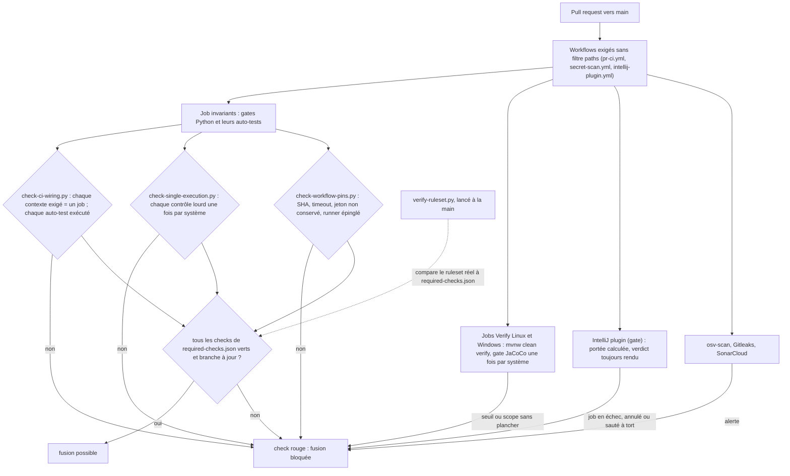

# Capacité `controles-de-fusion` — dossier durable

Spec de référence : [openspec/specs/controles-de-fusion/spec.md](../../../../openspec/specs/controles-de-fusion/spec.md)
· Relevé au commit `64d131e4` (2026-11-04).

## Objet et périmètre

[Exigence] Une pull request n'est fusionnable que si les checks déclarés dans le dépôt
(`.github/required-checks.json`) rendent tous un verdict vert ; chaque check exigé peut toujours rendre ce
verdict, chaque auto-test de gate est exécuté une fois, la couverture est jugée par scope et par système, et les
workflows sont durcis (actions et runners épinglés, délais, jeton non conservé). Acteurs : l'auteur d'une PR, la
CI, le mainteneur qui règle le ruleset GitHub. Hors périmètre : le contenu de chaque gate, couvert par la
capacité qu'il protège.

## Vues

### Comment une pull request est-elle jugée avant fusion ?

Type : flowchart (organigramme de décision, non UML) · Portée : existant vérifié · Exigences : « Les checks exigés
pour une fusion sont déclarés dans le dépôt », « Un check exigé peut toujours rendre un verdict », « Chaque
auto-test de gate est exécuté par le job des invariants », « Un auto-test n'est pas compté comme une seconde
exécution d'un gate », « Le plugin IntelliJ rend un verdict sur toute pull request »

Le ruleset GitHub « Protect main » se règle à la main ; `scripts/quality/verify-ruleset.py` mesure à la
demande l'écart entre ce ruleset et la liste déclarée (0 conforme, 1 écart, 2 lecture impossible). L'exigence
« branche à jour » ne relève que de ce réglage manuel (écart E6). Le job `gate` du plugin s'exécute toujours
(`if: always()`) et refuse un job sauté alors que la portée l'incluait.

## Traçabilité

| Exigence | Scénarios couverts | Vue | Preuves | Statut |
|---|---|---|---|---|
| Les checks exigés pour une fusion sont déclarés dans le dépôt | la liste minimale n'est imposée nulle part (E1) | V1 | `scripts/quality/test_check_ci_wiring.py#test_a_consistent_tree_passes_and_counts_what_it_resolved`, `scripts/quality/test_check_ci_wiring.py#test_a_context_without_a_job_is_refused`, `.github/required-checks.json` | partielle |
| Un check exigé peut toujours rendre un verdict | tous | V1 | `scripts/quality/test_check_ci_wiring.py#test_a_workflow_filtered_by_paths_is_refused`, `scripts/quality/test_check_ci_wiring.py#test_a_missing_workflow_file_is_refused_not_ignored`, `scripts/quality/test_check_ci_wiring.py#test_a_workflow_that_does_not_start_on_pull_request_is_refused` | couverte |
| L'écart entre le ruleset réel et la liste déclarée se mesure à la demande | comparaison testée ; exécution réelle manuelle | V1 | `scripts/quality/test_verify_ruleset.py#test_a_missing_check_is_named`, `scripts/quality/test_verify_ruleset.py#test_an_unreadable_payload_exits_two_never_zero`, `scripts/quality/test_check_ci_wiring.py#test_reading_the_ruleset_in_a_workflow_without_a_recorded_payload_is_refused` | couverte |
| Chaque auto-test de gate est exécuté par le job des invariants | une étape conditionnée compte quand même (E2) | V1 | `scripts/quality/test_check_ci_wiring.py#test_a_test_script_that_no_invariants_step_runs_is_refused`, `scripts/quality/test_check_ci_wiring.py#test_a_script_with_a_self_test_option_must_be_called_with_it`, `scripts/quality/test_check_ci_wiring.py#test_a_test_run_by_another_job_does_not_count` | couverte |
| Un auto-test n'est pas compté comme une seconde exécution d'un gate | refus « gate JaCoCo lancé dans les invariants » sans auto-test (E4) | V1 | `scripts/quality/test_check_single_execution.py#test_a_self_test_line_is_not_a_second_execution`, `scripts/quality/test_check_single_execution.py#test_a_real_second_execution_is_still_refused_next_to_a_self_test`, `scripts/remediation/check-audit-remediation-v2.py:111` | partielle |
| Le plugin IntelliJ rend un verdict sur toute pull request | `if: always()` du job gate non gardé | V1 | `scripts/ci/test_plugin_gate.py#test_a_skipped_job_although_the_plugin_is_in_scope_fails`, `scripts/ci/test_plugin_gate.py#test_a_failed_scope_computation_fails_even_when_every_job_was_skipped`, `scripts/ci/test_plugin_gate.py#test_when_in_doubt_the_plugin_is_in_scope` | partielle |
| La CI du plugin se déclenche quand change le code qui produit le JSON qu'il consomme | tous | — | `scripts/ci/test_plugin_gate.py#test_the_renderers_that_produce_the_json_the_plugin_reads_are_in_scope`, `scripts/ci/test_plugin_gate.py#test_every_scope_path_exists_in_the_repository` | couverte |
| Le rapport de couverture d'un scope est celui du module qui produit ses classes | tous (scope réel prouvé par l'exécution CI) | — | `scripts/quality/check-jacoco.py:348` (`module_report`, couvert par `--self-test`) | couverte |
| La couverture globale du reactor est bornée sur chaque système de qualification | résultat publié non lu par le test | V1 | `scripts/quality/check-jacoco.py:19` (scope `global`, couvert par `--self-test`) | partielle |
| Un scope sans plancher pour le système courant échoue | tous (raison du saut non assertée) | V1 | `scripts/quality/check-jacoco.py:567` (couvert par `--self-test`) | couverte |
| Les classes du cœur nommées sont sous un scope ciblé | présence des préfixes non gardée | — | `scripts/quality/check-jacoco.py:27` | partielle |
| Une classe propre à une plateforme est jugée sur sa plateforme | configuration nominative non gardée | — | `scripts/quality/check-jacoco.py:190` | partielle |
| Un plancher de classe empêche un store de se cacher dans son paquet | tous | — | `scripts/quality/check-jacoco.py:259`, `.github/workflows/pr-ci.yml` (étape JaCoCo Windows `--skip-scope m30-postgresql-pgvector`) | couverte |
| Les fonctions de scripts recopiées restent identiques | tous | — | `scripts/quality/test_check_twin_script_functions.py#test_a_fix_made_in_one_copy_only_is_refused`, `scripts/quality/test_check_twin_script_functions.py#test_an_undeclared_identical_copy_is_refused` | couverte |
| La vérification du câblage CI des gates n'est écrite qu'une fois | tous (définition unique vérifiée par recherche) | — | `scripts/quality/gate_cli.py:59`, `scripts/quality/test_check_twin_script_functions.py#test_the_wiring_check_is_the_one_of_gate_cli` | couverte |
| Le jeton du dépôt n'est pas conservé après le checkout | tous | V1 | `scripts/quality/test_check_workflow_pins.py#test_a_checkout_that_persists_the_token_is_refused`, `scripts/quality/test_check_workflow_pins.py#test_a_checkout_that_does_not_persist_the_token_is_accepted` | couverte |
| Chaque job a un délai maximal | tous | V1 | `scripts/quality/test_check_workflow_pins.py#test_a_job_on_a_runner_without_a_timeout_is_refused`, `scripts/quality/test_check_workflow_pins.py#test_a_step_timeout_does_not_stand_for_the_job_timeout` | couverte |
| Le runner et l'outil de build d'un workflow sont épinglés | tous | V1 | `scripts/quality/test_check_workflow_pins.py#test_a_floating_runner_image_is_refused`, `scripts/quality/test_check_toolchain_baseline.py#test_a_workflow_that_installs_the_wrapper_version_is_refused` | couverte |
| Les identifiants de registre ne restent pas exposés au code d'une pull request sans nécessité | portée du jeton Docker Hub : réglage manuel | — | `scripts/quality/test_check_workflow_pins.py#test_code_run_while_logged_in_is_refused`, `scripts/quality/test_check_workflow_pins.py#test_a_stale_entry_of_the_closed_list_is_refused` | partielle |

`check-jacoco.py` porte son auto-test en option (`--self-test`), exécuté par le job `invariants` ; ses cas sont
des étiquettes de la fonction `self_test`, d'où les preuves citées par ligne.

## Écarts

| Id | Écart | Preuve | Suite proposée |
|---|---|---|---|
| E1 | La spec énumère les checks exigés au minimum ; aucun gate n'impose cette liste : retirer un contexte de `required-checks.json` passe | `scripts/quality/check-ci-wiring.py:241` | [Proposition] Faire porter la liste minimale par le gate |
| E2 | Le câblage des auto-tests accepte toute ligne du job `invariants` qui contient le chemin, y compris une étape conditionnée ; le contrôle commun de `gate_cli` refuse, lui, les étapes à `if:` | `scripts/quality/check-ci-wiring.py:291` | [Proposition] Réutiliser `gate_cli.find_ci_wiring_violations` |
| E3 | `check-single-execution.py` déduit le système de la présence de `--skip-scope`, pas de `runner.os` : un gate JaCoCo Windows sans cette option compterait comme Linux | `scripts/quality/check-single-execution.py:100` | [Proposition] Ancrer sur la condition de l'étape (GEN-0043) |
| E4 | Le refus « gate JaCoCo lancé dans les invariants » n'a aucun auto-test, contrairement à la règle des gates | `scripts/remediation/check-audit-remediation-v2.py:111` | [Proposition] Auto-test ou reprise par un gate testé |
| E5 | Le contexte SonarCloud (`source: application`) est compté parmi les contextes « résolus » sans vérification | `scripts/quality/check-ci-wiring.py:250` | [Proposition] Compter à part les contextes d'application |
| E6 | « Branche à jour » n'apparaît ni dans la spec, ni dans la liste déclarée, ni dans `verify-ruleset.py` | `scripts/quality/verify-ruleset.py:39` | [Question] À spécifier et à mesurer ? |

## Questions ouvertes

Aucune.
