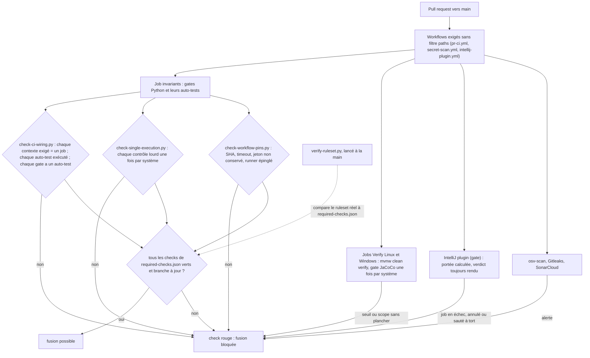

# Capacité `controles-de-fusion` — dossier durable

Spec de référence : [openspec/specs/controles-de-fusion/spec.md](../../../../openspec/specs/controles-de-fusion/spec.md)
· Relevé au commit `64d131e4` (2026-11-04).

## Objet et périmètre

[Exigence] Une pull request n'est fusionnable que si les checks déclarés dans le dépôt
(`.github/required-checks.json`) rendent tous un verdict vert ; chaque check exigé peut toujours rendre ce
verdict, chaque auto-test de gate est exécuté une fois, la couverture est jugée par scope et par système, et les
workflows sont durcis (actions et runners épinglés, délais, jeton non conservé). Acteurs : l'auteur d'une PR, la
CI, le mainteneur qui règle le ruleset GitHub. Hors périmètre : le contenu de chaque gate, couvert par la
capacité qu'il protège.

## Vues

### Comment une pull request est-elle jugée avant fusion ?

Type : flowchart (organigramme de décision, non UML) · Portée : existant vérifié · Exigences : « Les checks exigés
pour une fusion sont déclarés dans le dépôt », « Un check exigé peut toujours rendre un verdict », « Chaque
auto-test de gate est exécuté par le job des invariants », « Un auto-test n'est pas compté comme une seconde
exécution d'un gate », « Le plugin IntelliJ rend un verdict sur toute pull request »

Le ruleset GitHub « Protect main » se règle à la main ; `scripts/quality/verify-ruleset.py` mesure à la
demande l'écart entre ce ruleset et la liste déclarée (0 conforme, 1 écart, 2 lecture impossible). L'exigence
« branche à jour » ne relève que de ce réglage manuel (écart E6). Le job `gate` du plugin s'exécute toujours
(`if: always()`) et refuse un job sauté alors que la portée l'incluait.

Les portées calculées du plugin et de la qualification Docker lisent le diff sans détection de renommage
(`scripts/ci/plugin-gate.py`, fonction `changed_files`) : l'ancien chemin d'un fichier renommé compte comme le
nouveau, et déplacer une source vers `docs/` ou `src/test/` laisse la pull request concernée.

## Traçabilité

| Exigence | Scénarios couverts | Vue | Preuves | Statut |
|---|---|---|---|---|
| Les checks exigés pour une fusion sont déclarés dans le dépôt | la liste minimale n'est imposée nulle part (E1) | V1 | `scripts/quality/test_check_ci_wiring.py#test_a_consistent_tree_passes_and_counts_what_it_resolved`, `scripts/quality/test_check_ci_wiring.py#test_a_context_without_a_job_is_refused`, `.github/required-checks.json` | partielle |
| Un check exigé peut toujours rendre un verdict | tous | V1 | `scripts/quality/test_check_ci_wiring.py#test_a_workflow_filtered_by_paths_is_refused`, `scripts/quality/test_check_ci_wiring.py#test_a_missing_workflow_file_is_refused_not_ignored`, `scripts/quality/test_check_ci_wiring.py#test_a_workflow_that_does_not_start_on_pull_request_is_refused` | couverte |
| L'écart entre le ruleset réel et la liste déclarée se mesure à la demande | comparaison testée ; exécution réelle manuelle | V1 | `scripts/quality/test_verify_ruleset.py#test_a_missing_check_is_named`, `scripts/quality/test_verify_ruleset.py#test_an_unreadable_payload_exits_two_never_zero`, `scripts/quality/test_check_ci_wiring.py#test_reading_the_ruleset_in_a_workflow_without_a_recorded_payload_is_refused` | couverte |
| Chaque auto-test de gate est exécuté par le job des invariants | une étape conditionnée compte quand même (E2) | V1 | `scripts/quality/test_check_ci_wiring.py#test_a_test_script_that_no_invariants_step_runs_is_refused`, `scripts/quality/test_check_ci_wiring.py#test_a_script_with_a_self_test_option_must_be_called_with_it`, `scripts/quality/test_check_ci_wiring.py#test_a_test_run_by_another_job_does_not_count` | couverte |
| Un auto-test n'est pas compté comme une seconde exécution d'un gate | refus « gate JaCoCo lancé dans les invariants » sans auto-test (E4) | V1 | `scripts/quality/test_check_single_execution.py#test_a_self_test_line_is_not_a_second_execution`, `scripts/quality/test_check_single_execution.py#test_a_real_second_execution_is_still_refused_next_to_a_self_test`, `scripts/remediation/check-audit-remediation-v2.py:111` | partielle |
| Le plugin IntelliJ rend un verdict sur toute pull request | `if: always()` du job gate non gardé | V1 | `scripts/ci/test_plugin_gate.py#test_a_skipped_job_although_the_plugin_is_in_scope_fails`, `scripts/ci/test_plugin_gate.py#test_a_failed_scope_computation_fails_even_when_every_job_was_skipped`, `scripts/ci/test_plugin_gate.py#test_when_in_doubt_the_plugin_is_in_scope` | partielle |
| La CI du plugin se déclenche quand change le code qui produit le JSON qu'il consomme | tous | — | `scripts/ci/test_plugin_gate.py#test_the_renderers_that_produce_the_json_the_plugin_reads_are_in_scope`, `scripts/ci/test_plugin_gate.py#test_every_scope_path_exists_in_the_repository` | couverte |
| Le rapport de couverture d'un scope est celui du module qui produit ses classes | tous (scope réel prouvé par l'exécution CI) | — | `scripts/quality/check-jacoco.py:348` (`module_report`, couvert par `--self-test`) | couverte |
| La couverture globale du reactor est bornée sur chaque système de qualification | résultat publié non lu par le test | V1 | `scripts/quality/check-jacoco.py:19` (scope `global`, couvert par `--self-test`) | partielle |
| Un scope sans plancher pour le système courant échoue | tous (raison du saut non assertée) | V1 | `scripts/quality/check-jacoco.py:567` (couvert par `--self-test`) | couverte |
| Les classes du cœur nommées sont sous un scope ciblé | présence des préfixes non gardée | — | `scripts/quality/check-jacoco.py:27` | partielle |
| Une classe propre à une plateforme est jugée sur sa plateforme | configuration nominative non gardée | — | `scripts/quality/check-jacoco.py:190` | partielle |
| Un plancher de classe empêche un store de se cacher dans son paquet | tous | — | `scripts/quality/check-jacoco.py:259`, `.github/workflows/pr-ci.yml` (étape JaCoCo Windows `--skip-scope m30-postgresql-pgvector`) | couverte |
| Les fonctions de scripts recopiées restent identiques | tous | — | `scripts/quality/test_check_twin_script_functions.py#test_a_fix_made_in_one_copy_only_is_refused`, `scripts/quality/test_check_twin_script_functions.py#test_an_undeclared_identical_copy_is_refused` | couverte |
| La vérification du câblage CI des gates n'est écrite qu'une fois | tous (définition unique vérifiée par recherche) | — | `scripts/quality/gate_cli.py:59`, `scripts/quality/test_check_twin_script_functions.py#test_the_wiring_check_is_the_one_of_gate_cli` | couverte |
| Le jeton du dépôt n'est pas conservé après le checkout | tous | V1 | `scripts/quality/test_check_workflow_pins.py#test_a_checkout_that_persists_the_token_is_refused`, `scripts/quality/test_check_workflow_pins.py#test_a_checkout_that_does_not_persist_the_token_is_accepted` | couverte |
| Chaque job a un délai maximal | tous | V1 | `scripts/quality/test_check_workflow_pins.py#test_a_job_on_a_runner_without_a_timeout_is_refused`, `scripts/quality/test_check_workflow_pins.py#test_a_step_timeout_does_not_stand_for_the_job_timeout` | couverte |
| Le runner et l'outil de build d'un workflow sont épinglés | tous | V1 | `scripts/quality/test_check_workflow_pins.py#test_a_floating_runner_image_is_refused`, `scripts/quality/test_check_toolchain_baseline.py#test_a_workflow_that_installs_the_wrapper_version_is_refused` | couverte |
| Les identifiants de registre ne restent pas exposés au code d'une pull request sans nécessité | portée du jeton Docker Hub : réglage manuel | — | `scripts/quality/test_check_workflow_pins.py#test_code_run_while_logged_in_is_refused`, `scripts/quality/test_check_workflow_pins.py#test_a_stale_entry_of_the_closed_list_is_refused` | partielle |
| Un script POSIX est extrait en LF quel que soit le réglage du clone | 4/5 ; clone Windows `core.autocrlf=true` : relevé local sur un clone jetable, non rejoué en CI ; auto-tests shell sur un clone existant remis à niveau et sous WSL2 : manuels (E8) | V1 | `scripts/quality/check-posix-script-eol.py` (dépôt réel, puis cas « script without attribute », « shebang script without extension », « script recorded with CRLF », « attribute disabling text conversion » de `--self-test`), `scripts/dev/test_start_test_postgres.py`, `scripts/deploy/test_cgroup_root_validation.py`, `.gitattributes` | partielle |
| Le contrôle des fins de ligne échoue fermé | tous | V1 | `scripts/quality/check-posix-script-eol.py` (cas « repository without script », « directory outside a repository », « subdirectory of a repository », « git missing from the PATH » de `--self-test`), `.github/workflows/pr-ci.yml` (étapes du job `invariants`, câblage gardé par `scripts/quality/check-ci-wiring.py`) | couverte |
| Tout gate a un auto-test | tous ; les dix gates du constat par leur `--self-test` (étape « Literal gate self-tests » du job `invariants`) | V1 | `scripts/quality/test_check_ci_wiring.py#test_the_repository_satisfies_the_rule_with_its_closed_list`, `scripts/quality/test_check_ci_wiring.py#test_a_gate_without_a_self_test_outside_the_list_is_refused_by_name`, `scripts/quality/test_check_ci_wiring.py#test_a_gate_with_a_twin_test_is_accepted`, `scripts/quality/test_check_ci_wiring.py#test_archived_gates_are_excluded` | couverte |
| L'auto-test d'un gate littéral refuse une mutation par fait affirmé | tous ; « dépôt intact » : le pilote compare l'arbre avant et après chaque auto-test | — | `scripts/quality/test_literal_gate.py#SoundGateTest`, `scripts/quality/test_literal_gate.py#test_a_rule_that_accepts_the_mutated_copy_is_named_with_its_file_and_literal`, `scripts/quality/test_literal_gate.py#test_a_gate_without_any_fact_fails`, `scripts/quality/test_literal_gate.py#test_a_forbidden_pattern_without_witness_has_no_mutation` | couverte |
| Les gates sans auto-test sont une liste fermée qui ne peut que diminuer | tous | — | `scripts/quality/test_check_ci_wiring.py#test_a_listed_gate_that_now_has_a_self_test_is_refused`, `scripts/quality/test_check_ci_wiring.py#test_a_listed_gate_with_a_twin_test_is_refused_too`, `scripts/quality/test_check_ci_wiring.py#test_an_entry_without_a_script_is_refused` | couverte |
| Les zones créées après la mesure de référence sont sous un scope nominatif | tous ; « les trois scopes sont évalués » : `JaCoCo explorer-surface: PASS`, `JaCoCo wsl-lane: PASS` et `JaCoCo semantic-projection: PASS` dans les deux jobs `Verify` du run 43731190854 de la PR #739 | V1 | `scripts/quality/check-jacoco.py:49` (scopes `explorer-surface`, `wsl-lane`, `semantic-projection`), `scripts/quality/check-jacoco.py:612` (cas « real table declares the new zones and their class floors » et « table deprived of a zone scope is refused » de `--self-test`), cas « threshold breach », « dead prefix beside live », « dead package prefix » de `--self-test` | couverte |
| La garde de la surface HTTP locale a un plancher de classe | tous | V1 | `scripts/quality/check-jacoco.py:57` (plancher de `RequestGuard`), `scripts/quality/check-jacoco.py:637` (cas « guard class under its floor in a passing scope » et « guard class absent from the report » de `--self-test`) | couverte |
| Le budget mémoire des vues a un plancher de classe | tous ; « état du dépôt » : le rapport jacoco-gate.json de l'artefact pr-validation-Linux-1 du run 43749092436 (PR #743) porte la mesure et le plancher de `QueryViewMemoryBudget` | V1 | `scripts/quality/check-jacoco.py:41` (plancher de `QueryViewMemoryBudget`), `scripts/quality/check-jacoco.py:561` (cas « weak live prefix » de `--self-test`) | couverte |
| Aucun test ne passe à vide derrière un retour anticipé de plateforme | tous ; « test Windows sous Linux » : rapports Surefire de `Verify (ubuntu-24.04)` du run 43744069549 (PR #742), tests Windows de `CommandLocatorTest`, `ManagedPolyglotScipRuntimeManagerTest` et `M24PolyglotProviderTest` comptés sautés | V1 | `scripts/quality/check-test-platform-guards.py` (dépôt réel, puis cas « two-line guard », « local variable from os.name », « no test source » de `--self-test`) | couverte |
| Les retours anticipés de plateforme tolérés sont une liste fermée et motivée | tous | V1 | `scripts/quality/check-test-platform-guards.py` (cas « stale exception refused », « exception in a test method refused », « exception without reason refused » de `--self-test`), `.github/workflows/pr-ci.yml` (étapes du job `invariants`, câblage gardé par `scripts/quality/check-ci-wiring.py`) | couverte |
| Les deux chemins d'un renommage comptent dans une portée calculée | 4/4 | — | `scripts/ci/test_docker_gate.py#test_a_main_source_moved_under_test_sources_or_documents_is_in_scope`, `scripts/ci/test_docker_gate.py#test_a_document_renamed_within_the_excluded_list_stays_out_of_scope`, `scripts/ci/test_plugin_gate.py#test_a_renderer_moved_out_of_the_plugin_paths_is_in_scope` | couverte |
| Les classes de la frontière de confiance des providers ont un plancher de branches minimal | 4/4 | — | `scripts/quality/check-jacoco.py#trust_boundary_floor_problems`, `scripts/quality/jacoco_gate_self_test.py` (cas « lowered environment filter floor is refused », « removed class floor is refused », « eroded environment filter », « real table floors the trust-boundary classes ») | couverte |
| Les documents courants nomment les rulesets déclarés et aucun risque ouvert ne vise une branche retirée | tous (relevé daté : non lu par la règle, prouvé par le passage sur le dépôt réel) | V1 | `scripts/docs/check-current-docs.py:259` (mutations STATUS, ROADMAP, `docs/developer/quality-gates.md` et registre des risques rejouées par `--self-test`), `.github/workflows/pr-ci.yml:310`, `.github/workflows/pr-ci.yml:174`, `.github/workflows/pr-ci.yml:177` | couverte |
| Un secret n'accompagne pas la compilation du code d'une pull request | tous | V1 | `scripts/quality/test_check_workflow_pins.py#test_the_analysis_token_given_to_a_compilation_is_refused`, `scripts/quality/test_check_workflow_pins.py#test_a_step_outside_the_list_that_receives_a_secret_and_runs_a_script_of_the_repository_is_refused`, `scripts/quality/test_check_workflow_pins.py#test_the_analysis_is_the_only_step_that_receives_a_secret_and_runs_repository_code`, `scripts/quality/test_check_workflow_pins.py#test_a_listed_step_that_no_longer_receives_the_secret_is_a_stale_entry`, `scripts/quality/test_check_workflow_pins.py#test_a_secret_raised_to_the_job_or_to_the_workflow_is_refused`, `scripts/quality/test_check_workflow_pins.py#test_the_docker_hub_identifier_may_stay_in_the_job_env`, `scripts/quality/test_check_workflow_pins.py#test_a_workflow_that_no_pull_request_starts_is_not_concerned` | couverte |
| Le gate de preuve Docker rend un verdict sur toute pull request | tous | V1 | `scripts/ci/test_docker_gate.py#test_a_pull_request_out_of_scope_with_a_skipped_qualification_passes_for_that_reason`, `scripts/ci/test_docker_gate.py#test_a_concerned_pull_request_whose_qualification_fails_or_is_cancelled_fails`, `scripts/ci/test_docker_gate.py#test_a_skip_that_the_scope_does_not_justify_fails`, `scripts/ci/test_docker_gate.py#test_a_scope_computation_that_did_not_succeed_fails_whatever_it_said`, `scripts/ci/test_docker_gate.py#test_an_empty_scope_is_treated_as_in_scope`, `.github/workflows/release-promotion-gate.yml:154`, `.github/workflows/pr-ci.yml:190` | couverte |
| Un job exigé qui attend d'autres jobs s'exécute quel que soit leur résultat | tous | V1 | `scripts/quality/test_check_ci_wiring.py#test_a_required_job_with_needs_and_without_the_condition_is_refused`, `scripts/quality/test_check_ci_wiring.py#test_the_required_jobs_of_the_repository_that_wait_carry_the_condition`, `scripts/quality/test_check_ci_wiring.py#test_a_required_job_without_needs_is_not_concerned` | couverte |
| Une pull request n'échappe à la qualification Docker que par une liste fermée de chemins | tous | V1 | `scripts/ci/test_docker_gate.py#test_documentation_alone_is_out_of_scope`, `scripts/ci/test_docker_gate.py#test_a_file_of_the_image_among_documents_puts_the_pull_request_in_scope`, `scripts/ci/test_docker_gate.py#test_a_path_the_list_does_not_name_is_in_scope`, `scripts/ci/test_docker_gate.py#test_an_empty_base_an_unknown_base_and_a_git_failure_are_in_scope`, `scripts/ci/test_docker_gate.py#test_a_manual_dispatch_is_in_scope`, `scripts/ci/test_docker_gate.py#test_a_list_widened_to_a_path_of_the_image_is_refused_by_entry` | couverte |

`check-jacoco.py` porte son auto-test en option (`--self-test`), exécuté par le job `invariants` ; ses cas sont
des étiquettes de la fonction `self_test`, d'où les preuves citées par ligne.

`scripts/quality/check-test-platform-guards.py` (job `invariants`, auto-test `--self-test`) refuse un test qui
passe à vide derrière un retour anticipé de plateforme, et n'en tolère que la liste fermée hors méthode de test
(AUD-TST-04).

Tout gate a un auto-test (`check-ci-wiring.py`, règle 7, liste fermée `GATES_WITHOUT_SELF_TEST`) ; les gates
littéraux le tirent du pilote commun `scripts/quality/literal_gate.py`, qui refuse une mutation en mémoire par fait
affirmé (`scripts/quality/test_literal_gate.py`).

`.gitattributes` épingle `*.sh`, `mvnw` et `.mvn/wrapper/maven-wrapper.properties` en LF et `*.cmd` en CRLF
(AUD-DEP-02) ; `scripts/quality/check-posix-script-eol.py` et son `--self-test` (job `invariants`) refusent un
script POSIX sans attribut `eol=lf` ou enregistré en CRLF, et échouent fermés sans `git`, hors dépôt ou sur zéro
script. La remise à niveau d'un clone existant et l'exécution sous WSL2 restent des preuves manuelles (écart E8).

## Écarts

| Id | Écart | Preuve | Suite proposée |
|---|---|---|---|
| E1 | La spec énumère les checks exigés au minimum ; aucun gate n'impose cette liste : retirer un contexte de `required-checks.json` passe | `scripts/quality/check-ci-wiring.py:241` | [Proposition] Faire porter la liste minimale par le gate |
| E2 | Le câblage des auto-tests accepte toute ligne du job `invariants` qui contient le chemin, y compris une étape conditionnée ; le contrôle commun de `gate_cli` refuse, lui, les étapes à `if:` | `scripts/quality/check-ci-wiring.py:291` | [Proposition] Réutiliser `gate_cli.find_ci_wiring_violations` |
| E3 | `check-single-execution.py` déduit le système de la présence de `--skip-scope`, pas de `runner.os` : un gate JaCoCo Windows sans cette option compterait comme Linux | `scripts/quality/check-single-execution.py:100` | [Proposition] Ancrer sur la condition de l'étape (GEN-0043) |
| E4 | Le refus « gate JaCoCo lancé dans les invariants » n'a aucun auto-test, contrairement à la règle des gates | `scripts/remediation/check-audit-remediation-v2.py:111` | [Proposition] Auto-test ou reprise par un gate testé |
| E5 | Le contexte SonarCloud (`source: application`) est compté parmi les contextes « résolus » sans vérification | `scripts/quality/check-ci-wiring.py:250` | [Proposition] Compter à part les contextes d'application |
| E6 | « Branche à jour » n'apparaît ni dans la spec, ni dans la liste déclarée, ni dans `verify-ruleset.py` | `scripts/quality/verify-ruleset.py:39` | [Question] À spécifier et à mesurer ? |
| E8 | Deux preuves des fins de ligne ne sont pas des commandes de la CI : la remise à niveau d'un clone existant et l'exécution de `mvnw` sous WSL2 sont manuelles | `scripts/quality/check-posix-script-eol.py` | [Proposition] Preuves manuelles consignées dans le suivi d'audit |

## Questions ouvertes

Aucune.
