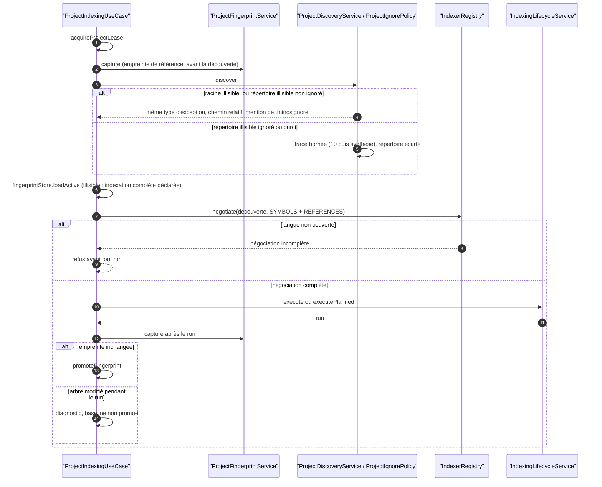
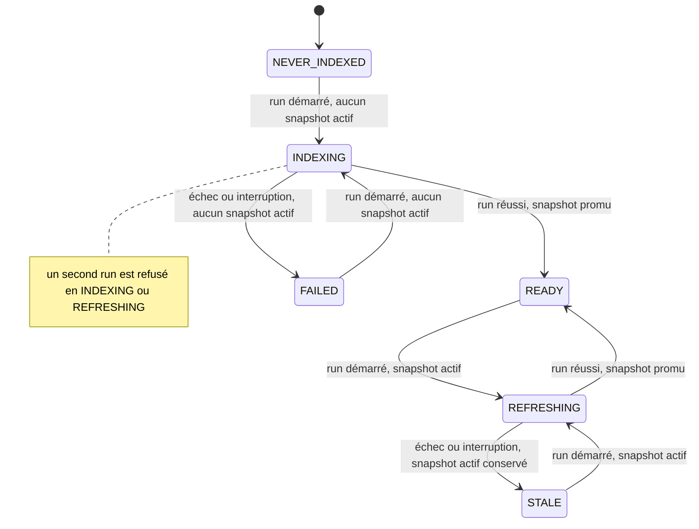

# Capacité `decouverte-et-negociation` — dossier durable

Spec de référence : [openspec/specs/decouverte-et-negociation/spec.md](../../../../openspec/specs/decouverte-et-negociation/spec.md)
· Relevé au commit `3b516b1e` (2026-11-03).

## Objet et périmètre

[Exigence] La découverte d'un projet écarte sans échec les répertoires illisibles ignorés ou durcis, échoue de
façon actionnable sur les autres, capture l'empreinte de référence avant la découverte, et le produit n'a qu'une
orchestration d'indexation. Acteurs : l'utilisateur qui indexe ou inspecte un projet (CLI, MCP, API). Hors
périmètre : l'exécution des providers eux-mêmes.

[Existant vérifié] La négociation d'un indexeur par capacités (`IndexerRegistry.negotiate`) existe et est
testée, mais la spec n'a aucune exigence à son sujet (écart E2) : la vue ci-dessous la montre comme existant, sans
qu'elle soit contractuelle.

## Vues

### Dans quel ordre une indexation capture, découvre, négocie et promeut ?

Type : sequenceDiagram (UML, séquence) · Portée : existant vérifié · Exigences : « L'empreinte de référence est
capturée avant la découverte », « Un répertoire illisible ignoré ou durci est écarté sans faire échouer le
projet », « Un répertoire illisible non ignoré échoue de façon actionnable », « Une baseline d'empreinte illisible
est déclarée », « Le produit n'a qu'une orchestration d'indexation »

`ProjectIndexingUseCase`
(`minos-application/src/main/java/com/minos/application/indexing/ProjectIndexingUseCase.java`) est la seule
orchestration ; la CLI y délègue (`minos-cli/src/main/java/com/minos/cli/operations/LocalAutonomousIndexOperations.java:38`).
L'empreinte est capturée avant la découverte (`ProjectIndexingUseCase.java:478-479`) : une structure apparue
pendant la découverte empêche la promotion de la baseline. La décision « écarter ou échouer » pour un répertoire
illisible est prise par `ProjectIgnorePolicy.onUnreadable`
(`minos-engine/src/main/java/com/minos/discovery/ProjectIgnorePolicy.java:105-118`), et la même règle s'applique
à la copie de travail d'un provider.

### Quels états de disponibilité un projet indexé traverse-t-il ?

Type : stateDiagram-v2 (UML, machine à états) · Portée : existant vérifié · Exigences : « Le produit n'a qu'une
orchestration d'indexation »

États de `ProjectIndexState.Availability`
(`minos-engine/src/main/java/com/minos/orchestration/ProjectIndexState.java:75-82`) ; transitions posées par
`IndexingRunExecutor`. Invariants : `READY` et `STALE` exigent un snapshot actif ; un run reprenable n'existe
qu'en `STALE` ou `FAILED`. Le réconciliateur d'état ramène un état incohérent à `READY`, `STALE` ou `FAILED`.

## Traçabilité

| Exigence | Scénarios couverts | Vue | Preuves | Statut |
|---|---|---|---|---|
| Un répertoire illisible ignoré ou durci est écarté sans faire échouer le projet | 3/4 (borne et absence de chemin des traces non assertées) | V1 | `minos-engine/src/test/java/com/minos/discovery/UnreadableDirectoryDiscoveryTest.java#anIgnoredUnreadableDirectoryIsSkippedAndTheProjectIsDiscovered`, `minos-engine/src/test/java/com/minos/discovery/UnreadableDirectoryDiscoveryTest.java#aHardenedUnreadableDirectoryIsSkippedWithoutAnyIgnoreRule`, `minos-bootstrap/src/test/java/com/minos/bootstrap/application/ProjectInspectionUnreadableDirectoryTest.java#aProjectWithAnIgnoredUnreadableDirectoryIsInspectedNormally` | partielle |
| Un répertoire illisible non ignoré échoue de façon actionnable | 2/3 (classification publique non traversée par l'API ou le MCP) | V1 | `minos-engine/src/test/java/com/minos/discovery/UnreadableDirectoryDiscoveryTest.java#anUnreadableDirectoryThatIsNotIgnoredStillFailsButWithAnActionableMessageOfTheSameType`, `minos-engine/src/test/java/com/minos/discovery/UnreadableDirectoryDiscoveryTest.java#addingTheDirectoryToMinosignoreAsDocumentedTurnsTheFailureIntoASkip` | partielle |
| La racine du projet ou du scope illisible échoue toujours | 1/1 | V1 | `minos-engine/src/test/java/com/minos/discovery/UnreadableDirectoryDiscoveryTest.java#anUnreadableProjectRootStillFails`, `minos-engine/src/test/java/com/minos/incremental/ProjectFingerprintUnreadableDirectoryTest.java#anUnreadableScopeRootStillFails` | couverte |
| La copie de travail d'un provider écarte les répertoires illisibles ignorés | 2/2 | — | `minos-runtime-local/src/test/java/com/minos/runtime/local/workspace/ProviderWorkspaceFilesUnreadableDirectoryTest.java#anIgnoredUnreadableDirectoryIsLeftOutOfTheCopy`, `minos-runtime-local/src/test/java/com/minos/runtime/local/workspace/ProviderWorkspaceFilesUnreadableDirectoryTest.java#anUnreadableDirectoryThatIsNotIgnoredFailsActionablyWithTheSameType` | couverte |
| Le BOM UTF-8 d'un fichier d'ignore n'altère pas sa première règle | 3/3 | — | `minos-engine/src/test/java/com/minos/discovery/ProjectIgnoreByteOrderMarkTest.java#theFirstRuleOfAGitignoreWithAByteOrderMarkStillApplies`, `minos-engine/src/test/java/com/minos/discovery/ProjectIgnoreByteOrderMarkTest.java#theFirstRuleOfAMinosignoreWithAByteOrderMarkStillApplies`, `minos-engine/src/test/java/com/minos/discovery/ProjectIgnoreByteOrderMarkTest.java#aFileWithoutAByteOrderMarkIsReadAsBefore` | couverte |
| L'empreinte de référence est capturée avant la découverte | 2/2 (module créé pendant la découverte, pas après, voir E4) | V1 | `minos-application/src/test/java/com/minos/application/indexing/IndexingBaselineAndLeaseTest.java#aStructureCreatedDuringDiscoveryPreventsThePromotionOfTheBaseline`, `minos-application/src/test/java/com/minos/application/indexing/IndexingBaselineAndLeaseTest.java#aStableTreePromotesTheBaseline`, `minos-cli/src/test/java/com/minos/cli/IndexPlanCaptureOrderTest.java` | couverte |
| scip-java écrit ses fichiers intermédiaires hors de l'arbre de build du projet | 1/2 (reactor dont le dernier module construit dans le target racine : non trouvé) | — | `minos-provider-scip/src/test/java/com/minos/adapter/scip/runtime/plan/ScipJavaProcessPlanFactoryTargetRootTest.java#theLinuxPlanGivesScipJavaATargetRootInTheRunOutsideTheWorkspace`, `minos-provider-scip/src/test/java/com/minos/adapter/scip/runtime/plan/ScipJavaProcessPlanFactoryCommandTest.java#theTargetRootIsInTheRunBesideTheArtifactAndOutsideTheWorkspace` | partielle |
| Le produit n'a qu'une orchestration d'indexation | 2/3 (« coordinateur retiré » contredit par une Javadoc de test, E1) | V1, V2 | `minos-application/src/test/java/com/minos/application/indexing/ProjectIndexingUseCaseTest.java#aCompleteThenAnUnchangedThenAnIncrementalIndexingFollowTheProductPath`, `minos-app/src/test/java/com/minos/characterization/A2SurfaceCharacterizationTest.java` | partielle |
| Une baseline d'empreinte illisible est déclarée | 2/2 | V1 | `minos-application/src/test/java/com/minos/application/indexing/IndexingBaselineAndLeaseTest.java#anUnreadableBaselineRequiresAFullIndexingAndIsDeclaredWithoutItsPath` | couverte |
| Une indexation à cible racine hache l'arbre source au plus deux fois | 2/3 (réutilisation prouvée par la valeur, aucun compte de captures) | — | `minos-application/src/test/java/com/minos/application/indexing/RootScopeFingerprintReuseTest.java#theRootScopeReusesTheReferenceFingerprintInsteadOfHashingTheTreeAgain`, `minos-engine/src/test/java/com/minos/orchestration/ReferenceFingerprintTest.java#anyOtherInstanceForcesANewCaptureOfTheRootScope`, `minos-engine/src/test/java/com/minos/orchestration/IndexingRunExecutorCheckpointTest.java#scopeFingerprintIsCapturedOncePerScopeBeforeItsFirstProvider` | partielle |
| La réutilisation ne change ni l'empreinte persistée ni la preuve de stabilité | 2/3 (reprise d'un run antérieur non rejouée) | — | `minos-application/src/test/java/com/minos/application/indexing/RootScopeFingerprintReuseTest.java#theReusedValueIsExactlyTheCaptureOfTheRootScopeSoAResumeAcceptsIt`, `minos-application/src/test/java/com/minos/application/indexing/RootScopeFingerprintReuseTest.java#aContentChangeThatKeepsSizeAndDateIsStillAChangeOfTheWorkspace` | partielle |

## Écarts

| Id | Écart | Preuve | Suite proposée |
|---|---|---|---|
| E1 | Le scénario « Coordinateur sans appelant retiré » exige qu'aucune source de test ne nomme `IncrementalIndexingCoordinator` ; une Javadoc de test le nomme encore (aucune occurrence en production) | `minos-application/src/test/java/com/minos/application/indexing/IndexingBaselineAndLeaseTest.java:31` | [Proposition] Retirer le nom de la Javadoc, ou restreindre le scénario au code exécutable |
| E2 | La capacité s'appelle « découverte et négociation » mais aucune exigence ne porte sur la négociation par capacités, pourtant implémentée et testée (`ProjectIndexingUseCaseTest#anIncompleteNegotiationIsRefusedBeforeAnyRun`) | `minos-engine/src/main/java/com/minos/orchestration/IndexerRegistry.java:60` | [Proposition] Spécifier la négociation (ordre, refus, langues non couvertes) par un changement |
| E3 | La trace de découverte dit « project file » même pour un répertoire, et y écrit le chemin relatif avec le séparateur de l'OS, alors que la copie provider le normalise en `/` | `minos-engine/src/main/java/com/minos/discovery/ProjectIgnorePolicy.java:78`, `minos-runtime-local/src/main/java/com/minos/runtime/local/workspace/ProviderWorkspaceFiles.java:118` | [Proposition] Aligner le libellé et la normalisation des séparateurs |
| E4 | Le scénario parle d'un module créé « après » la découverte ; le test le crée pendant | `minos-application/src/test/java/com/minos/application/indexing/IndexingBaselineAndLeaseTest.java:40` | [Question] Préciser le scénario |
| E5 | Un test de contrat exige la chaîne `target/scip-targetroot` dans la fabrique du plan scip-java ; elle n'y figure plus qu'en commentaire, le `--targetroot` réel étant `scip-java-targetroot` dans le run : un gate littéral protège un commentaire | `minos-app/src/test/java/com/minos/packaging/M29DockerAdministrationContractTest.java:228`, `minos-provider-scip/src/main/java/com/minos/adapter/scip/runtime/plan/ScipJavaProcessPlanFactory.java:216` | [Proposition] Faire porter l'assertion sur le comportement (racine cible hors de l'espace de travail) plutôt que sur un littéral (GEN-0043) |

## Questions ouvertes

- Le statut d'index n'appelle aucune découverte (il ne peut donc pas en échouer) : la spec, qui dit « la
  découverte ne fait pas échouer la réponse », doit-elle décrire ce mécanisme plus précisément ?
