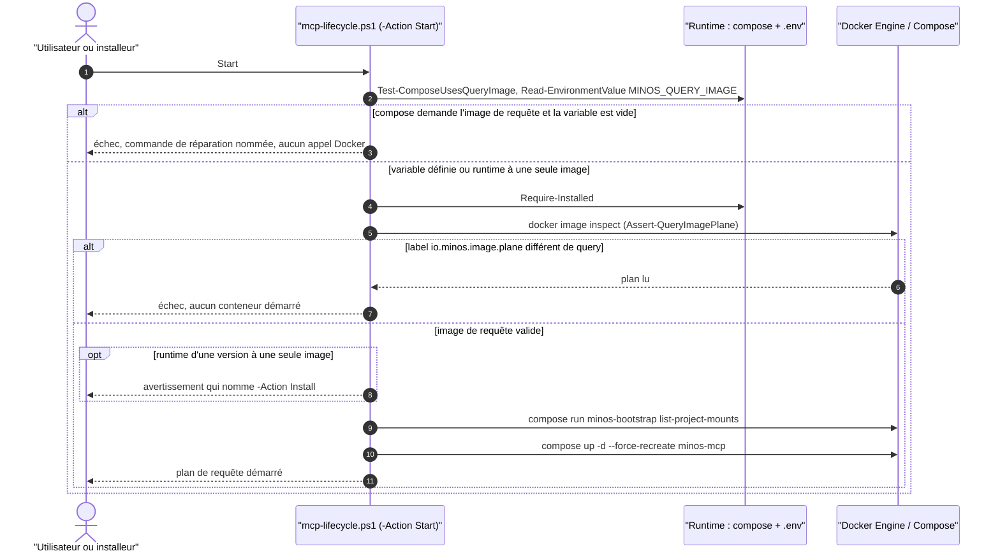
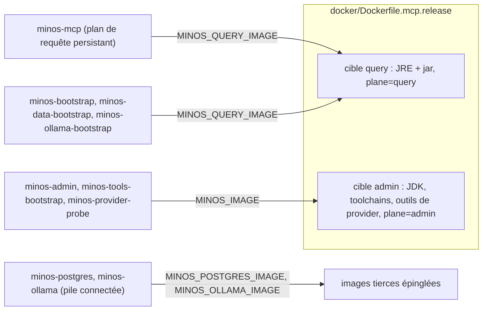

# Capacité `distribution-docker` — dossier durable

Spec de référence : [openspec/specs/distribution-docker/spec.md](../../../../openspec/specs/distribution-docker/spec.md)
· Relevé au commit `3b516b1e` (2026-11-03).

## Objet et périmètre

[Exigence] MINOS se distribue par Docker avec deux images : une **image de requête** (JRE et jar) pour le plan
de requête MCP et les amorçages, une **image d'administration** qui porte seule la chaîne de compilation et les
outils de provider. Acteurs : l'utilisateur ou l'installeur Windows (scripts de cycle de vie), la qualification
de release (CI). Hors périmètre : l'exécution des providers (la CI n'en exécute aucun dans Docker), le contenu
de l'index.

[Existant vérifié] Le changement actif `openspec/changes/exposer-seulement-les-projets-inscrits-a-docker/`
retire les deux exigences sur la racine des projets et les remplace par un montage par projet inscrit. Le code
au HEAD suit déjà ce changement (voir Écarts) ; ses exigences ne sont pas encore celles de la spec de référence.

## Vues

### Comment le cycle de vie refuse-t-il un plan de requête incohérent avant de le démarrer ?

Type : sequenceDiagram (UML, séquence) · Portée : existant vérifié · Exigences : « Une installation sans image
de requête échoue de façon actionnable », « Chaque service Docker utilise l'image qui correspond à son rôle »

Le premier refus (`Assert-QueryImageConfigured`, `docker/scripts/mcp-lifecycle.ps1:700`) précède tout appel à
Docker ; le second (`Assert-QueryImagePlane`, `docker/scripts/mcp-lifecycle.ps1:963`) lit le label de l'image
par `docker image inspect` et refuse sans démarrer de conteneur. Un runtime installé par une version à une seule
image démarre avec un avertissement (`docker/scripts/mcp-lifecycle.ps1:964-966`). Les actions Start, Validate,
Admin, AddProject et RemoveProject passent par la première garde ; Stop et Uninstall non, pour qu'un runtime non
migré puisse encore être arrêté.

### Quelle image chaque service utilise-t-il ?

Type : flowchart (vue de composants, non UML) · Portée : existant vérifié · Exigences : « L'image du plan de
requête ne contient ni compilateur ni outil de provider », « Chaque service Docker utilise l'image qui
correspond à son rôle »

Les fichiers `docker/compose-mcp.prod.yaml` et `docker/compose-mcp.connected.yaml` attribuent l'image de requête
aux services qui n'exécutent que `java` ou `sh` (`docker/compose-mcp.prod.yaml:31`, `:112`, `:155`) et l'image
d'administration aux services qui lancent un provider ou un outil embarqué (`docker/compose-mcp.prod.yaml:70`,
`:186`, `:224`). Les services `minos-postgres` et `minos-ollama` de la pile connectée utilisent leurs propres
images (voir Écarts, E3).

## Traçabilité

| Exigence | Scénarios couverts | Vue | Preuves | Statut |
|---|---|---|---|---|
| L'image du plan de requête ne contient ni compilateur ni outil de provider | 3/3 | V1, V2 | `minos-app/src/test/java/com/minos/packaging/M29DockerQueryImageContractTest.java#queryTargetOfTheReleaseDockerfileCarriesNoToolchain`, `minos-app/src/test/java/com/minos/packaging/M29DockerQueryImageContractTest.java#toolchainReintroducedInTheQueryTargetIsRefusedWithItsLine`, `scripts/ci/qualify-docker-release.sh:274` (sonde des commandes), `.github/workflows/docker-release-validation.yml` | couverte |
| Chaque service Docker utilise l'image qui correspond à son rôle | 2/2 | V2 | `minos-app/src/test/java/com/minos/packaging/M29DockerQueryImageContractTest.java#everyComposeServiceUsesTheImageOfItsRole`, `minos-app/src/test/java/com/minos/packaging/M29DockerQueryImageContractTest.java#queryServiceOnTheAdministrationImageIsRefusedWithItsName` | couverte |
| Une installation sans image de requête échoue de façon actionnable | 3/4 (avertissement non asserté) | V1 | `scripts/install/test_mcp_lifecycle_query_image.py#test_start_without_the_query_image_fails_before_any_docker_call`, `scripts/install/test_mcp_lifecycle_query_image.py#test_start_refuses_a_query_image_that_is_not_a_query_plane_image`, `scripts/install/test_mcp_lifecycle_query_image.py#test_start_of_a_single_image_runtime_still_works`, `scripts/ci/qualify-docker-upgrade.ps1` (mise à niveau, `workflow_dispatch` et promotion seulement) | partielle |
| L'installeur Windows ne propose aucune racine de projets par défaut | 0/2 | — | aucune ; le code contredit l'exigence (E1) | manquante |
| Une racine de projets dangereuse est refusée avant tout montage | 0/4 | — | aucune ; le code contredit l'exigence (E2) | manquante |
| La qualification interroge le plan de requête sur des données en lecture seule | 2/3 (pas de cas fautif) | — | `scripts/ci/qualify-docker-release.sh:333` (montage `readonly`), `minos-app/src/test/java/com/minos/packaging/M29DockerQueryImageContractTest.java#qualificationQueriesTheMcpServerWithTheDataRootMountedReadOnly` | partielle |

## Écarts

| Id | Écart | Preuve | Suite proposée |
|---|---|---|---|
| E1 | [Existant vérifié] L'installeur ne demande plus de racine des projets ; la spec exige un champ vide obligatoire | `minos-app/src/test/java/com/minos/packaging/DockerProjectsRootIgnoredContractTest.java#installerAsksForNoRootAndNamesTheCommandThatExposesAProject`, `packaging/windows/minos-installer.iss.template:859` | [Proposition] Résolu par l'archivage du changement `exposer-seulement-les-projets-inscrits-a-docker` (16/17 tâches), qui retire l'exigence. Ne pas modifier le code pour suivre l'ancienne exigence |
| E2 | [Existant vérifié] Les paramètres hérités de racine sont ignorés avec un avertissement, pas refusés ; le contrôle « racine dangereuse » n'existe plus | `minos-app/src/test/java/com/minos/packaging/DockerProjectsRootIgnoredContractTest.java#scriptsAcceptLegacyParametersWithAWarningAndForwardNoRoot`, `scripts/install/verify-installer-template.ps1:53` | [Proposition] Même suite que E1 ; le changement le remplace par le refus d'un dossier de projet dangereux |
| E3 | Le scénario « Classement des services réels » dit que chaque service utilise l'une des deux images ; `minos-postgres` et `minos-ollama` ont leurs propres images, tolérées par le test | `docker/compose-mcp.connected.yaml:285`, `minos-app/src/test/java/com/minos/packaging/M29DockerQueryImageContractTest.java:39` | [Question] Préciser le scénario (services MINOS seulement) dans un prochain changement de la capacité |
| E4 | Le scénario cite `check-compose-limits.py` comme preuve du classement ; ce gate ne contrôle aucune image (il contrôle les plafonds) | `scripts/quality/check-compose-limits.py` | [Proposition] Retirer cette commande du scénario lors du prochain changement |
| E5 | La garde contrôle 10 commandes (`cc`, `rustc`, `npm` en plus des 7 de la spec) | `scripts/ci/qualify-docker-release.sh:274` | Aucun : sur-ensemble conforme |
| E6 | L'exigence dit « avant tout appel à Docker » ; le refus « image qui n'en est pas une » vient après `docker image inspect` (le scénario dit seulement « sans démarrer de conteneur ») | `docker/scripts/mcp-lifecycle.ps1:724` | [Question] Énoncé de l'exigence plus strict que son scénario ; à préciser |

## Questions ouvertes

- Le scénario de mise à niveau n'est exercé que par `workflow_dispatch` et la promotion de release, pas par
  chaque PR : est-ce la couverture voulue ?
- Aucun test n'injecte une image dont une lecture écrirait sur le montage : faut-il un cas fautif explicite ?
