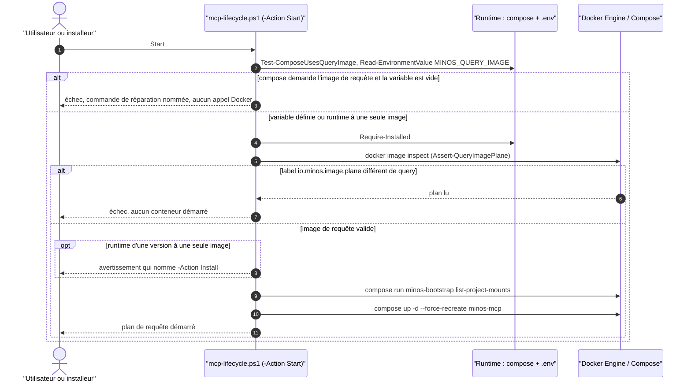
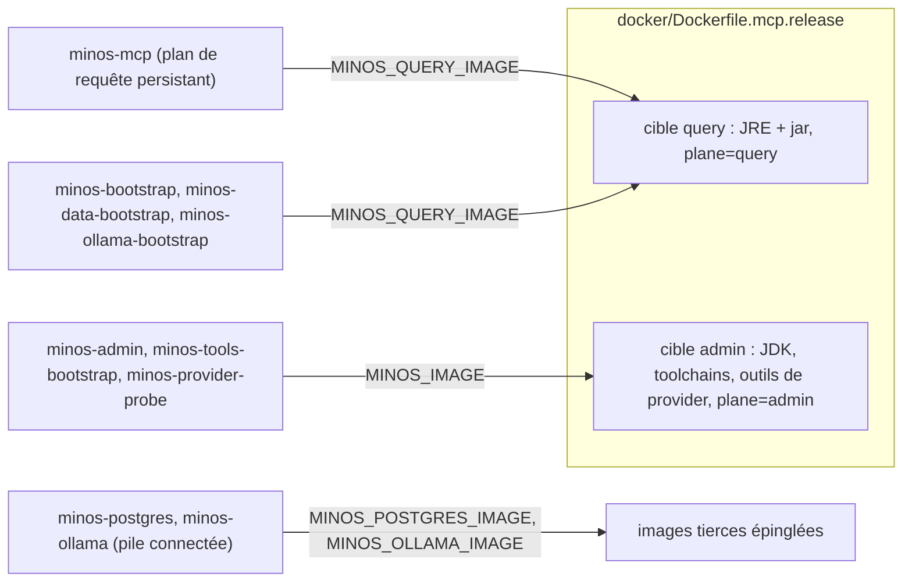
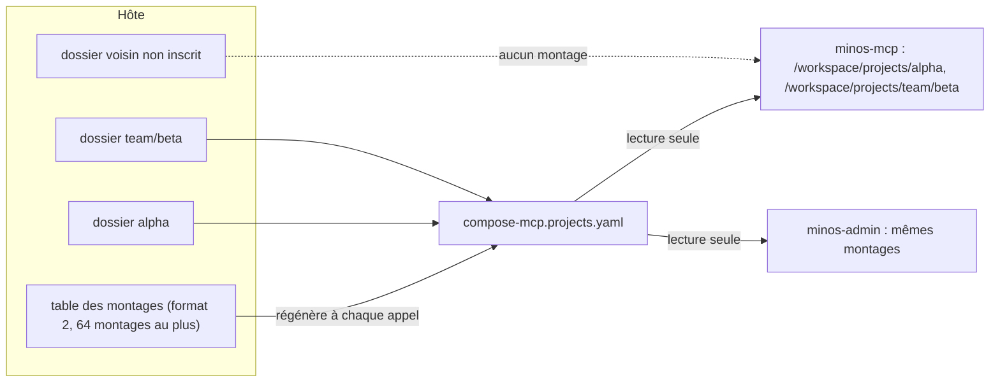
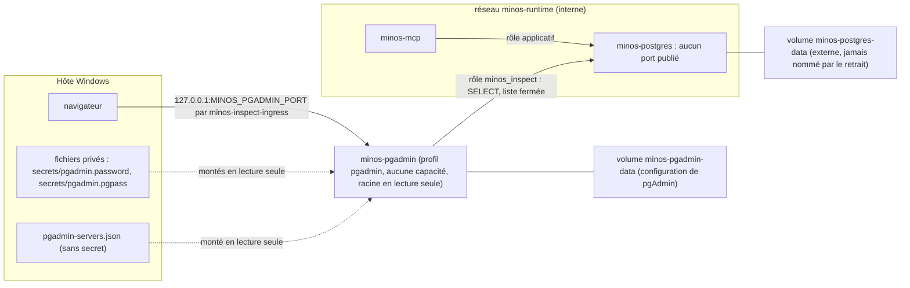

# Capacité `distribution-docker` — dossier durable

Spec de référence : [openspec/specs/distribution-docker/spec.md](../../../../openspec/specs/distribution-docker/spec.md)
· Relevé au commit `50ec096c` (2026-11-05).

## Objet et périmètre

[Exigence] MINOS se distribue par Docker avec deux images : une **image de requête** (JRE et jar) pour le plan
de requête MCP et les amorçages, une **image d'administration** qui porte seule la chaîne de compilation et les
outils de provider. Acteurs : l'utilisateur ou l'installeur Windows (scripts de cycle de vie), la qualification
de release (CI). Hors périmètre : l'exécution des providers (la CI n'en exécute aucun dans Docker), le contenu
de l'index.

[Exigence] Le runtime Docker ne monte aucune racine des projets : chaque projet inscrit a son propre montage en
lecture seule sous `/workspace/projects`, ajouté par `-Action AddProject` et retiré par `-Action RemoveProject`
(décision `SEC-0075`). Une installation à racine unique migre vers cette table au premier `Install`, sauf avec
PostgreSQL géré, où la migration est refusée.

## Vues

### Comment le cycle de vie refuse-t-il un plan de requête incohérent avant de le démarrer ?

Type : sequenceDiagram (UML, séquence) · Portée : existant vérifié · Exigences : « Une installation sans image
de requête échoue de façon actionnable », « Chaque service Docker utilise l'image qui correspond à son rôle »

Le premier refus (`Assert-QueryImageConfigured`, `docker/scripts/mcp-lifecycle.ps1:702`) précède tout appel à
Docker ; le second (`Assert-QueryImagePlane`, `docker/scripts/mcp-lifecycle.ps1:1290`) lit le label de l'image
par `docker image inspect` et refuse sans démarrer de conteneur. Un runtime installé par une version à une seule
image démarre avec un avertissement (`docker/scripts/mcp-lifecycle.ps1:1291-1293`). Les actions Start, Validate,
Admin, AddProject et RemoveProject passent par la première garde ; Stop et Uninstall non, pour qu'un runtime non
migré puisse encore être arrêté.

### Quelle image chaque service utilise-t-il ?

Type : flowchart (vue de composants, non UML) · Portée : existant vérifié · Exigences : « L'image du plan de
requête ne contient ni compilateur ni outil de provider », « Chaque service Docker utilise l'image qui
correspond à son rôle »

Les fichiers `docker/compose-mcp.prod.yaml` et `docker/compose-mcp.connected.yaml` attribuent l'image de requête
aux services qui n'exécutent que `java` ou `sh` (`docker/compose-mcp.prod.yaml:31`, `:112`, `:155`) et l'image
d'administration aux services qui lancent un provider ou un outil embarqué (`docker/compose-mcp.prod.yaml:70`,
`:186`, `:224`). Les services `minos-postgres` et `minos-ollama` de la pile connectée utilisent leurs propres
images (voir Écarts, E3).

### Que voit chaque conteneur d'un projet exposé ?

Type : flowchart (vue de déploiement, non UML) · Portée : existant vérifié · Exigences : « Le runtime Docker ne
monte aucune racine des projets », « Exposer un projet Docker ajoute son montage puis l'inscrit », « L'override
des montages est régénéré depuis la table », « Retirer un projet Docker retire son montage sans perdre son index »

`AddProject` contrôle le dossier sur l'hôte avant toute écriture, ajoute le montage à la table, régénère l'override
et recrée `minos-mcp` ; `RemoveProject` retire le montage et recrée `minos-mcp`, le projet restant inscrit avec
`rootAvailable: false` (`docker/scripts/mcp-lifecycle.ps1`, actions `AddProject` et `RemoveProject`). Relevé sur un
Docker Desktop réel le 2026-11-05 : après la mise à jour d'une installation à racine unique, `minos-mcp` et
`minos-admin` listent seulement `alpha` et `team`, le dossier voisin est absent et l'écriture dans un montage est
refusée.

### Comment pgAdmin atteint-il PostgreSQL sans l'exposer ?

Type : flowchart (vue de déploiement, non UML) · Portée : existant vérifié · Exigences : « pgAdmin est un service
optionnel publié sur la seule boucle locale », « pgAdmin se connecte par un rôle PostgreSQL limité à la lecture »,
« Retirer pgAdmin ne supprime aucune donnée MINOS »

Un conteneur attaché au seul réseau interne ne publie aucun port (relevé du 2026-11-13, Docker 29.9.3) : pgAdmin
entre par le réseau `minos-inspect-ingress` et atteint PostgreSQL par `minos-runtime`. `EnablePgAdmin` applique le
script du rôle avant de démarrer le service ; `RemovePgAdmin` retire le conteneur, le volume `minos-pgadmin-data`,
les fichiers privés et le rôle (`docker/scripts/mcp-lifecycle.ps1`, actions `EnablePgAdmin` et `RemovePgAdmin`).
Limite : hôte Windows et PostgreSQL géré seulement.

## Traçabilité

| Exigence | Scénarios couverts | Vue | Preuves | Statut |
|---|---|---|---|---|
| L'image du plan de requête ne contient ni compilateur ni outil de provider | 3/3 | V1, V2 | `minos-app/src/test/java/com/minos/packaging/M29DockerQueryImageContractTest.java#queryTargetOfTheReleaseDockerfileCarriesNoToolchain`, `minos-app/src/test/java/com/minos/packaging/M29DockerQueryImageContractTest.java#toolchainReintroducedInTheQueryTargetIsRefusedWithItsLine`, `scripts/ci/qualify-docker-release.sh:274` (sonde des commandes), `.github/workflows/docker-release-validation.yml` | couverte |
| Chaque service Docker utilise l'image qui correspond à son rôle | 2/2 | V2 | `minos-app/src/test/java/com/minos/packaging/M29DockerQueryImageContractTest.java#everyComposeServiceUsesTheImageOfItsRole`, `minos-app/src/test/java/com/minos/packaging/M29DockerQueryImageContractTest.java#queryServiceOnTheAdministrationImageIsRefusedWithItsName` | couverte |
| Une installation sans image de requête échoue de façon actionnable | 3/4 (avertissement non asserté) | V1 | `scripts/install/test_mcp_lifecycle_query_image.py#test_start_without_the_query_image_fails_before_any_docker_call`, `scripts/install/test_mcp_lifecycle_query_image.py#test_start_refuses_a_query_image_that_is_not_a_query_plane_image`, `scripts/install/test_mcp_lifecycle_query_image.py#test_start_of_a_single_image_runtime_still_works`, `scripts/ci/qualify-docker-upgrade.ps1` (mise à niveau, `workflow_dispatch` et promotion seulement) | partielle |
| Le runtime Docker ne monte aucune racine des projets | 2/2 | V3 | `minos-app/src/test/java/com/minos/packaging/M29DockerAdministrationContractTest.java#noShippedComposeFileMountsAProjectsRoot`, `minos-application/src/test/java/com/minos/application/ProjectPathMappingServiceTest.java#initializeCreatesAnEmptyTableOnceAndRefusesASingleRoot`, `scripts/install/test_mcp_lifecycle_query_image.py#test_an_empty_table_mounts_nothing` | couverte |
| Exposer un projet Docker ajoute son montage puis l'inscrit | 3/3 | V3 | `scripts/install/test_mcp_lifecycle_query_image.py#test_a_dedicated_folder_is_mounted_then_registered`, `scripts/install/test_mcp_lifecycle_query_image.py#test_the_profile_is_refused_before_the_bootstrap`, `scripts/install/test_mcp_lifecycle_query_image.py#test_a_link_to_a_project_folder_is_refused_before_the_bootstrap`, relevé Docker Desktop du 2026-11-05 (`AddProject` d'un troisième dossier : trois projets disponibles, poignée de main MCP) | couverte |
| La table des montages est bornée et sans chevauchement | 3/3 | V3 | `minos-domain/src/test/java/com/minos/domain/registry/ProjectPathMappingMountTableTest.java#withMountAddsANewNameAndRefusesInvalidOnes`, `minos-domain/src/test/java/com/minos/domain/registry/ProjectPathMappingMountTableTest.java#aHostFolderEqualToOrContainingAnotherIsRefused`, `minos-domain/src/test/java/com/minos/domain/registry/ProjectPathMappingMountTableTest.java#theTableIsCappedAtSixtyFourMounts` | couverte |
| L'override des montages est régénéré depuis la table | 3/3 | V3 | `scripts/install/test_mcp_lifecycle_query_image.py#test_an_override_edited_by_hand_is_rewritten`, `scripts/install/test_mcp_lifecycle_query_image.py#test_docker_compose_accepts_the_override_with_special_characters`, `scripts/install/test_mcp_lifecycle_query_image.py#test_a_missing_folder_is_omitted_with_a_warning_and_the_start_goes_on` | couverte |
| Retirer un projet Docker retire son montage sans perdre son index | 2/2 (index existant non mesuré) | V3 | `scripts/install/test_mcp_lifecycle_query_image.py#test_remove_project_needs_a_name_and_recreates_the_query_plane`, `minos-domain/src/test/java/com/minos/domain/registry/ProjectPathMappingMountTableTest.java#withoutMountRemovesAKnownNameAndRefusesAnUnknownOne`, relevé Docker Desktop du 2026-11-05 (`RemoveProject` : projet inscrit, `rootAvailable: false`, projet jamais indexé) | partielle |
| Une racine unique migre vers un montage par projet inscrit | 3/3 | V3 | `minos-application/src/test/java/com/minos/application/ProjectPathMappingServiceTest.java#migrationMountsEachProjectOnItsContainerPathAndSkipsTheRootAndDetachedOnes`, `minos-application/src/test/java/com/minos/application/ProjectPathMappingServiceTest.java#anUnreadableRegistryRefusesTheMigrationBeforeAnyWrite`, `minos-storage/src/test/java/com/minos/storage/local/registry/ProjectMountMigrationTest.java#theMigrationSavesTheSingleRootFileThenWritesTheTable`, `scripts/ci/qualify-docker-upgrade.ps1` (run 41541452830), relevé Docker Desktop du 2026-11-05 (v1.2.0 vers 1.3.0, deux montages, dossier voisin absent) | couverte |
| La migration d'une racine unique stockée dans PostgreSQL est refusée | 1/1 | — | `minos-application/src/test/java/com/minos/application/ProjectPathMappingServiceTest.java#aHomeWhoseProjectsAreInPostgresqlIsNotMigratedAndTheRefusalGivesTheRemedy`, `scripts/install/test_docker_script_contexts.py#test_the_migration_is_refused_before_any_change_with_the_remedy` | couverte |
| L'installeur Windows ne demande aucune racine des projets Docker | 2/2 | — | `minos-app/src/test/java/com/minos/packaging/DockerProjectsRootIgnoredContractTest.java#installerAsksForNoRootAndNamesTheCommandThatExposesAProject`, `minos-app/src/test/java/com/minos/packaging/DockerProjectsRootIgnoredContractTest.java#scriptsAcceptLegacyParametersWithAWarningAndForwardNoRoot`, parcours de l'assistant du candidat 1.3.0 par le propriétaire le 2026-11-02 | couverte |
| Un dossier de projet dangereux est refusé avant tout montage | 3/3 | V3 | `scripts/install/test_mcp_lifecycle_query_image.py#test_the_profile_is_refused_before_the_bootstrap`, `minos-application/src/test/java/com/minos/application/ProjectPathMappingServiceTest.java#aDryRunWritesNothingAndARefusedFolderIsNotMounted`, `scripts/install/test_mcp_lifecycle_query_image.py#test_a_dedicated_folder_is_mounted_then_registered` | couverte |
| La qualification interroge le plan de requête sur des données en lecture seule | 2/3 (pas de cas fautif) | — | `scripts/ci/qualify-docker-release.sh:333` (montage `readonly`), `minos-app/src/test/java/com/minos/packaging/M29DockerQueryImageContractTest.java#qualificationQueriesTheMcpServerWithTheDataRootMountedReadOnly` | partielle |
| Le plan de requête Docker fixe le tas de sa JVM en proportion de sa limite mémoire | contrat des fichiers livrés testé ; tas effectif mesuré à la main sur l'image locale sous `--memory 3g` (1 076 Mio), sans test automatique | — | `minos-app/src/test/java/com/minos/packaging/M29DockerQueryImageContractTest.java#theQueryPlaneSetsOneMaxRamPercentageEverywhereAndOnlyThere`, `minos-app/src/test/java/com/minos/packaging/M29DockerQueryImageContractTest.java#theDefaultQueryHeapGivesAViewBudgetThatHoldsTheHeaviestPersistableView` | partielle |

## Exigences en attente d'archivage

Changement `inspecter-postgresql-avec-pgadmin`. Ces trois exigences entrent dans la spec de référence à l'archivage
du changement ; leurs lignes rejoignent alors la table de traçabilité (le contrôle des dossiers refuse une ligne
dont l'exigence n'est pas encore dans la spec).

| Exigence | Scénarios couverts | Vue | Preuves | Statut |
|---|---|---|---|---|
| pgAdmin est un service optionnel publié sur la seule boucle locale | 3/3 | V4 | `scripts/install/test_mcp_lifecycle_pgadmin.py#test_compose_resolves_no_pgadmin_and_no_port_without_the_profile`, `scripts/install/test_mcp_lifecycle_pgadmin.py#test_compose_resolves_one_loopback_port_with_the_profile`, `scripts/install/test_mcp_lifecycle_pgadmin.py#test_a_missing_password_file_variable_is_refused_by_name`, `scripts/install/test_mcp_lifecycle_pgadmin.py#test_secrets_come_from_read_only_files_and_never_from_the_environment`, relevé Docker Desktop du 2026-11-13 (seul port publié : `127.0.0.1` vers pgAdmin) | couverte |
| pgAdmin se connecte par un rôle PostgreSQL limité à la lecture | 2/2 | V4 | `minos-storage/src/test/java/com/minos/storage/postgresql/PostgresInspectionRoleTest.java#writesAreRefusedByThePrivilegesOnceTheSessionIsNoLongerReadOnly`, `minos-storage/src/test/java/com/minos/storage/postgresql/PostgresInspectionRoleTest.java#theRootOfAProjectIsNotReadableWhileItsOtherColumnsAre`, `minos-storage/src/test/java/com/minos/storage/postgresql/PostgresInspectionRoleTest.java#onlyTheClosedListOfTablesIsReadable` | couverte |
| Retirer pgAdmin ne supprime aucune donnée MINOS | 1/1 | V4 | `scripts/install/test_mcp_lifecycle_pgadmin.py#test_removal_takes_pgadmin_and_the_role_and_nothing_else`, `minos-storage/src/test/java/com/minos/storage/postgresql/PostgresInspectionRoleTest.java#removingTheRoleLeavesTheDataUntouched`, relevé Docker Desktop du 2026-11-13 (après `RemovePgAdmin` : conteneur, volume et rôle absents, 5 lignes de `semantic_documents` inchangées) | couverte |

## Écarts

| Id | Écart | Preuve | Suite proposée |
|---|---|---|---|
| E5 | La garde contrôle 10 commandes (`cc`, `rustc`, `npm` en plus des 7 de la spec) | `scripts/ci/qualify-docker-release.sh:274` | Aucun : sur-ensemble conforme |
| E6 | L'exigence dit « avant tout appel à Docker » ; le refus « image qui n'en est pas une » vient après `docker image inspect` (le scénario dit seulement « sans démarrer de conteneur ») | `docker/scripts/mcp-lifecycle.ps1:726` | [Question] Énoncé de l'exigence plus strict que son scénario ; à préciser |

## Questions ouvertes

- Le scénario de mise à niveau n'est exercé que par `workflow_dispatch` et la promotion de release, pas par
  chaque PR : est-ce la couverture voulue ?
- Aucun test n'injecte une image dont une lecture écrirait sur le montage : faut-il un cas fautif explicite ?
- Le maintien d'un index existant après `RemoveProject` n'est mesuré que par `rootAvailable: false` : le plan
  d'administration Docker n'indexe pas, donc aucun index réel n'a pu être produit pour le vérifier.
- Un runtime dont les projets sont dans PostgreSQL géré et qui monte encore une racine unique n'est pas migré
  (limite déclarée) : faut-il prévoir un inventaire par `minos-admin` ?
