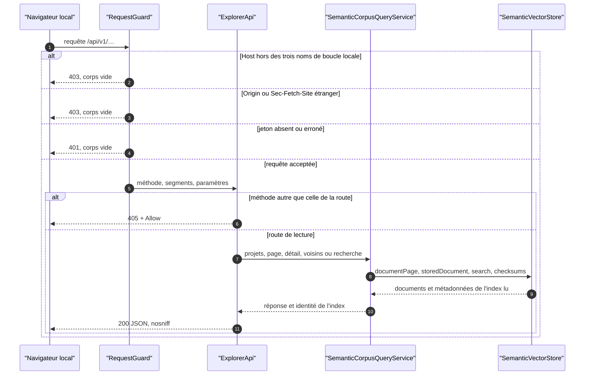
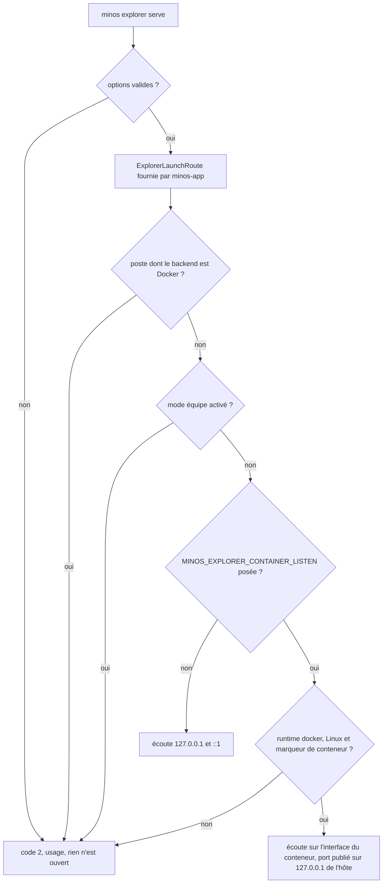
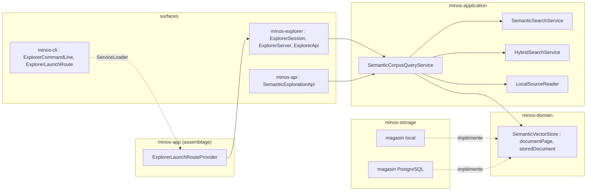
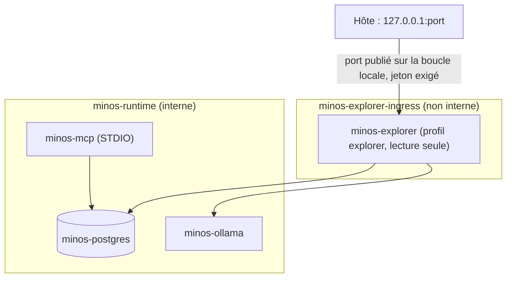
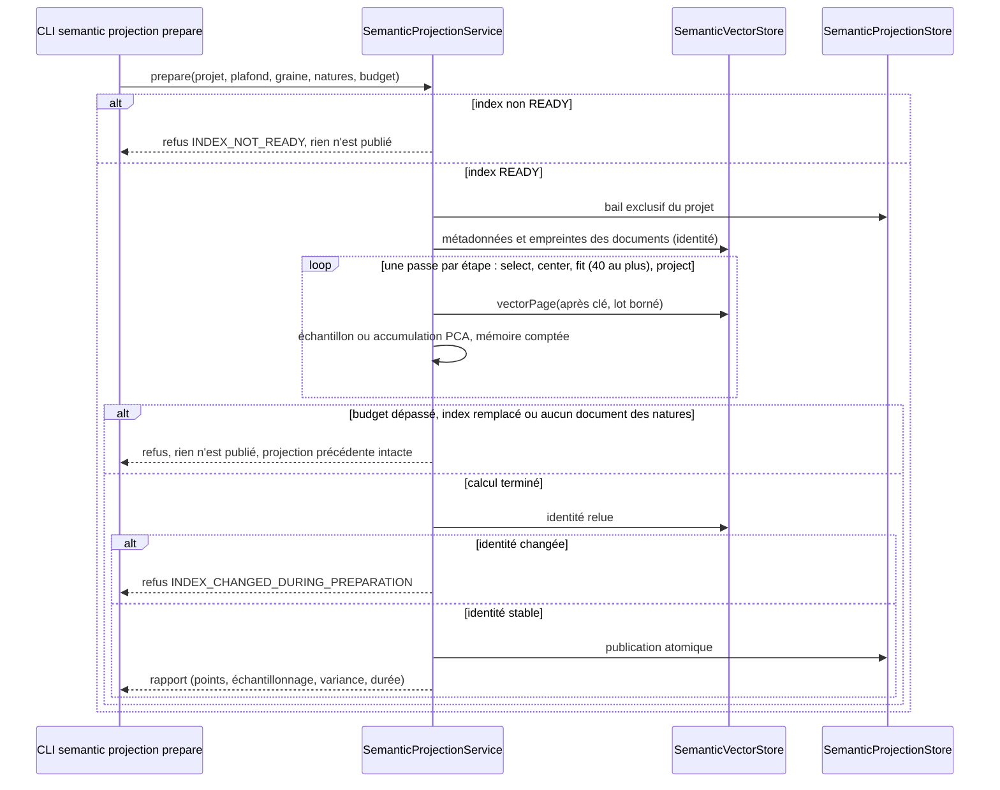
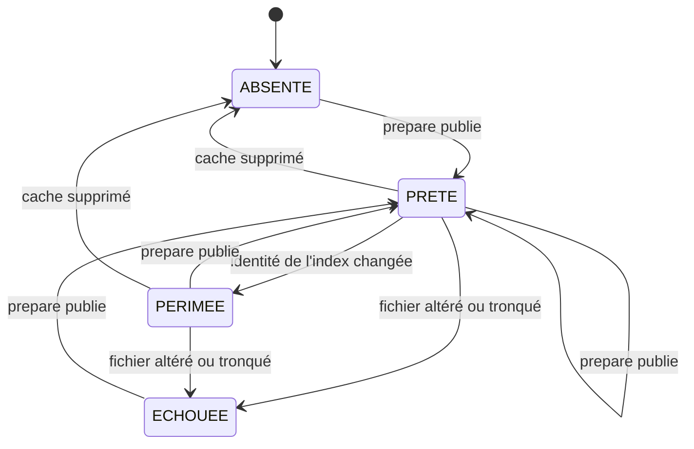

# Capacité `exploration-semantique` — dossier durable

Spec de référence : [openspec/specs/exploration-semantique/spec.md](../../../../openspec/specs/exploration-semantique/spec.md)
· Relevé au 2026-11-14, changements `explorer-l-index-semantique-dans-un-navigateur` et
`projeter-l-index-semantique-en-2d`.

## Objet et périmètre

[Exigence] L'utilisateur d'un poste consulte, depuis un navigateur local et en lecture seule, les documents
sémantiques d'un projet : liste paginée, détail, recherche, voisins. Acteurs : l'utilisateur du poste, son
navigateur. La carte 2D des documents se lit dans la même page ; sa projection est préparée par une commande,
jamais par la surface (vues V5 et V6). Hors périmètre : accès distant, toute écriture par la surface, UMAP,
WebGL, vue 3D. Décision : ARCH-0082.

## Vues

### Par où passe une requête du navigateur, et où est-elle refusée ?

Type : sequenceDiagram (UML, séquence) · Portée : existant vérifié · Exigences : « Toute requête d'API exige le
jeton de session et une origine locale », « La surface d'exploration ne modifie aucun état »

Aucun service n'est appelé avant le garde ; aucune route n'appelle `replace`, `synchronize` ni un provider
d'embeddings pour autre chose que le vecteur de la requête de recherche.

### Qui démarre la surface, et sur quelles adresses écoute-t-elle ?

Type : flowchart (organigramme de décision, non UML) · Portée : existant vérifié · Exigences : « La surface
d'exploration est optionnelle et n'écoute que sur la boucle locale »

Aucune option de ligne de commande ne choisit l'adresse d'écoute.

### Quels composants, et dans quel sens dépendent-ils ?

Type : flowchart (vue de composants, non UML) · Portée : existant vérifié · Exigences : « La surface
d'exploration ne modifie aucun état », « Les voisins d'un document sont classés depuis son vecteur stocké »

`minos-cli` ne dépend pas de `minos-explorer` : il déclare une interface que l'assemblage fournit. Les surfaces ne
voient que le service applicatif ; aucune ne nomme un adaptateur de stockage (`ModuleArchitectureTest`).

### Comment le service optionnel du runtime Docker est-il exposé ?

Type : flowchart (vue de conteneurs, non UML) · Portée : existant vérifié, non qualifié sur une installation
réelle · Exigences : « La surface d'exploration est optionnelle et n'écoute que sur la boucle locale »

Dans le conteneur, la surface écoute sur l'interface du conteneur : un port publié n'atteint pas sa boucle
locale. Cette écoute n'est accordée que par la variable interne posée par le Compose, dans un conteneur. Le
réseau d'entrée donne au conteneur une route sortante, acceptée en l'état (écart E3).

### Comment une projection est-elle préparée sans toucher au chemin de recherche ?

Type : sequenceDiagram · Portée : livré, changement `projeter-l-index-semantique-en-2d` · Vue V5 · Exigences : La
préparation d'une projection est une commande explicite et bornée ; Une projection est publiée atomiquement et
liée à l'identité de son index

Le provider d'embeddings et la recherche ne sont jamais appelés ; `load()` non plus.

### Quel état une lecture de projection rend-elle ?

Type : stateDiagram-v2 · Portée : livré · Vue V6 · Exigences : Les points d'une projection annoncent méthode,
sélection et échantillonnage ; La lecture d'une projection ne calcule rien

`PERIMEE` est calculé à chaque lecture, jamais stocké. Une préparation en cours ou en échec n'est pas un état
lu : une lecture n'écrit rien et ne sonde aucun verrou (écart E6).

## Traçabilité

| Exigence | Scénarios couverts | Vue | Preuves | Statut |
|---|---|---|---|---|
| La surface d'exploration est optionnelle et n'écoute que sur la boucle locale | 3/3, le premier par preuve structurelle | V2, V4 | `minos-explorer/src/test/java/com/minos/explorer/ExplorerServerTest.java#theSurfaceIsBoundToLoopbackAddressesOnlyAndItsUrlNamesTheIpv4Loopback`, `minos-explorer/src/test/java/com/minos/explorer/ExplorerSessionTest.java#theSurfaceRefusesToStartWhenTheTeamModeIsEnabledAndOpensNoPort`, `minos-app/src/test/java/com/minos/app/architecture/ModuleArchitectureTest.java#onlyTheExplorerRouteOfTheAssemblyStartsTheExplorationSurface` | partielle |
| Toute requête d'API exige le jeton de session et une origine locale | 3/3 | V1 | `minos-explorer/src/test/java/com/minos/explorer/ExplorerServerTest.java#anApiRequestWithoutTheTokenIsRefusedWithoutDetailAndReachesNoService`, `minos-explorer/src/test/java/com/minos/explorer/ExplorerServerTest.java#aRequestWhoseHostIsNotALoopbackNameOfThisPortIsRefusedEvenWithTheToken`, `minos-explorer/src/test/java/com/minos/explorer/ExplorerServerTest.java#aRequestFromAnotherOriginIsRefusedAndNoCorsHeaderIsEverSent` | couverte |
| La surface d'exploration ne modifie aucun état | 1/1, statut et points de projection compris | V1, V6 | `minos-explorer/src/test/java/com/minos/explorer/ExplorerRoutesTest.java#consultingEveryRouteLeavesTheHomeAndTheIndexByteForByteUnchanged`, `minos-explorer/src/test/java/com/minos/explorer/ExplorerProjectionRoutesTest.java#anyMethodButGetOnAProjectionRouteIsRefusedAndNoProjectionIsCreatedOrChanged` | couverte |
| La liste des documents est paginée et lue sur un seul index | 3/3 | V1 | `minos-engine/src/test/java/com/minos/testsupport/SemanticDocumentReadsContract.java#aFullWalkReturnsEveryDocumentOnceInStableKeyOrder`, `minos-application/src/test/java/com/minos/application/semantic/SemanticCorpusQueryServiceTest.java#aPageSizeOutOfBoundsIsAUsageErrorThatNamesTheBound`, `minos-application/src/test/java/com/minos/application/semantic/SemanticCorpusQueryServiceTest.java#aCursorIssuedForAnIndexIsRefusedOnceThatIndexIsReplaced` | couverte |
| Le détail distingue le contenu indexé de la source actuelle | 2/2 | V1 | `minos-application/src/test/java/com/minos/application/semantic/SemanticCorpusQueryServiceTest.java#theDetailOfAChunkWhoseSourceChangedShowsBothContentsAndTheDivergence`, `minos-application/src/test/java/com/minos/application/semantic/SemanticCorpusQueryServiceTest.java#theDetailOfADocumentWhoseFileWasDeletedSaysTheSourceIsMissingAndShowsNoAbsolutePath` | couverte |
| La recherche de l'explorateur rend le classement des services existants et nomme chaque score | 2/2, égalité avec le service et non avec la sortie de la commande | V1 | `minos-application/src/test/java/com/minos/application/semantic/SemanticCorpusQueryServiceTest.java#aSemanticSearchKeepsTheRanksAndScoresOfTheSearchServiceAndNamesTheScore`, `minos-application/src/test/java/com/minos/application/semantic/SemanticCorpusQueryServiceTest.java#aSearchOnAnIndexThatIsNotReadyIsEmptyAndSaysWhy` | partielle |
| Les voisins d'un document sont classés depuis son vecteur stocké | 2/2 | V1 | `minos-application/src/test/java/com/minos/application/semantic/SemanticCorpusQueryServiceTest.java#neighboursAreRankedFromTheStoredVectorWithoutAnyCallToTheProvider`, `minos-application/src/test/java/com/minos/application/semantic/SemanticCorpusQueryServiceTest.java#anUnknownStableKeyIsNotFoundForNeighboursAndForTheDetail` | couverte |
| Aucune réponse de l'explorateur n'expose de chemin absolu ni de secret | 2/2 | V1 | `minos-explorer/src/test/java/com/minos/explorer/ExplorerRoutesTest.java#noAnswerErrorOrLogLineNamesAnAbsoluteRootOrAProviderAddress`, `minos-explorer/src/test/java/com/minos/explorer/ExplorerServerTest.java#everyAnswerCarriesTheSecurityHeadersAndNoCookie`, `minos-explorer/src/test/java/com/minos/explorer/WebResourcesContentTest.java#indexedContentCanOnlyBeInsertedAsText` | couverte |
| Le provider local-hash est signalé comme référence déterministe | 1/1 | V1 | `minos-explorer/src/test/java/com/minos/explorer/ExplorerRoutesTest.java#theProjectListDescribesTheIndexAndNeverTheRootOfAProject`, `minos-api/src/test/java/com/minos/api/SemanticExplorationApiContractTest.java#theFiveReadingsDescribeOneIndexAndNeverItsRoot` | couverte |

## Exigences en attente d'archivage

Changement `projeter-l-index-semantique-en-2d`. Ces quatre exigences entrent dans la spec de référence à
l'archivage du changement ; leurs lignes rejoignent alors la table de traçabilité (le contrôle des dossiers refuse
une ligne dont l'exigence n'est pas encore dans la spec).

| Exigence | Scénarios couverts | Vue | Preuves | Statut |
|---|---|---|---|---|
| La préparation d'une projection est une commande explicite et bornée | 2/2 | V5 | `minos-application/src/test/java/com/minos/application/semantic/SemanticProjectionServiceTest.java#twoPreparationsOfTheSameIndexWithTheSameSeedGiveTheSameCoordinates`, `minos-cli/src/test/java/com/minos/cli/SemanticProjectionCommandLineTest.java#thePreparationPublishesTheSameFileTwiceAndTheStatusReadsItBack`, `minos-application/src/test/java/com/minos/application/semantic/SemanticProjectionServiceTest.java#aPreparationThatExceedsItsMemoryBudgetFailsAndLeavesThePublishedProjectionIntact`, `minos-application/src/test/java/com/minos/application/semantic/SemanticProjectionServiceTest.java#aPreparationReadsTheVectorsByBoundedPagesAndNeverLoadsTheWholeIndex` | couverte |
| Une projection est publiée atomiquement et liée à l'identité de son index | 2/2 | V5, V6 | `minos-application/src/test/java/com/minos/application/semantic/SemanticProjectionServiceTest.java#aProjectionWhoseIndexChangedIsStale`, `minos-storage/src/test/java/com/minos/storage/local/store/FileSemanticProjectionStoreTest.java#aPreparationThatEndsWithoutPublishingLeavesThePublishedProjectionAndNoPartialFile`, `minos-storage/src/test/java/com/minos/storage/local/store/FileSemanticProjectionStoreTest.java#anAlteredCutOrForeignFileIsRefusedWithoutNamingItsLocation` | partielle |
| Les points d'une projection annoncent méthode, sélection et échantillonnage | 1/1 | V6 | `minos-application/src/test/java/com/minos/application/semantic/SemanticProjectionServiceTest.java#aSampleOfTwoHundredPointsOutOfAThousandDocumentsIsAnnouncedWithItsSeed`, `minos-explorer/src/test/java/com/minos/explorer/ExplorerProjectionRoutesTest.java#aSampledProjectionAnnouncesItsMethodItsSeedAndItsCountsWithItsPoints` | couverte |
| La lecture d'une projection ne calcule rien | 2/2 | V6 | `minos-application/src/test/java/com/minos/application/semantic/SemanticProjectionServiceTest.java#aProjectWithoutProjectionIsAbsentNamesTheCommandAndReadsNoVector`, `minos-explorer/src/test/java/com/minos/explorer/ExplorerProjectionRoutesTest.java#aProjectWithoutProjectionIsAbsentAndTheAnswerNamesTheCommandThatPreparesIt`, `minos-explorer/src/test/java/com/minos/explorer/ExplorerProjectionRoutesTest.java#anyMethodButGetOnAProjectionRouteIsRefusedAndNoProjectionIsCreatedOrChanged` | couverte |

## Écarts

| Id | Écart | Preuve | Suite proposée |
|---|---|---|---|
| E1 | Le scénario « Aucune écoute sans la commande » n'est prouvé que structurellement (aucun autre code n'atteint la surface ni n'ouvre d'écoute) ; aucun test n'observe les ports d'un processus CLI ou MCP | `minos-app/src/test/java/com/minos/app/architecture/ModuleArchitectureTest.java` | [Proposition] Test de processus qui relève les ports à l'écoute |
| E2 | Le « Purpose » de la spec de référence ne cite pas la carte 2D, livrée par le changement `projeter-l-index-semantique-en-2d` | `openspec/specs/exploration-semantique/spec.md` | Compléter le « Purpose » à l'archivage de ce changement |
| E3 | En runtime Docker, la surface écoute sur l'interface du conteneur et le réseau d'entrée n'est pas interne (route sortante) | `docker/compose-mcp.connected.yaml` | Accepté par le propriétaire le 2026-11-13 (ARCH-0082, « Écarts constatés ») |
| E4 | « Même classement que la CLI » est prouvé contre `SemanticSearchService`, que la commande appelle, pas contre la sortie de `semantic-search` | `minos-application/src/test/java/com/minos/application/semantic/SemanticCorpusQueryServiceTest.java` | [Proposition] Test de bout en bout CLI contre HTTP |
| E5 | Le parcours dans un navigateur réel n'est pas automatisé | — | Parcours manuel du propriétaire (tâche 5.6) |
| E6 | Une préparation en cours ou en échec n'est pas un état rendu par une lecture (la conception commune prévoyait `EN_PREPARATION` et `ECHOUEE` après échec) | `minos-application/src/main/java/com/minos/application/semantic/SemanticProjectionService.java` | Aucune : une lecture n'écrit rien et ne sonde aucun verrou ; l'échec est rendu par le code de sortie de la commande |
| E7 | « Préparation interrompue » est prouvé par une préparation fermée sans publication et par la publication atomique, pas par l'arrêt brutal d'un processus pendant l'écriture | `minos-storage/src/test/java/com/minos/storage/local/store/FileSemanticProjectionStoreTest.java` | [Proposition] Test de processus fils tué pendant la publication |
| E8 | Les points sont rendus en JSON paginé, pas en binaire ; la couleur par module ou langage et la date de préparation ne sont pas proposées | `minos-explorer/src/main/java/com/minos/explorer/ExplorerApi.java` | Décision mesurée (tâche 7.1 du changement de projection) |
| E9 | La carte n'est qualifiée par aucun parcours dans un navigateur réel ; les mesures portent sur des corpus synthétiques `local-hash` sous Windows | `openspec/changes/projeter-l-index-semantique-en-2d/mesures-6.8.md` | Parcours et seuils du propriétaire (tâches 6.7 et 6.8) |

## Questions ouvertes

Seuils de performance et plafond de points par défaut : propositions soumises au propriétaire avec le relevé de
mesures du changement `projeter-l-index-semantique-en-2d`.
