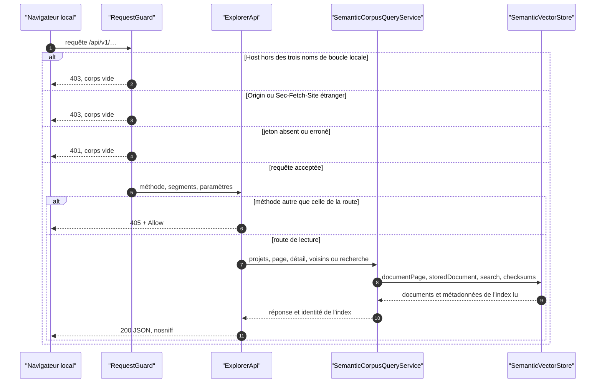
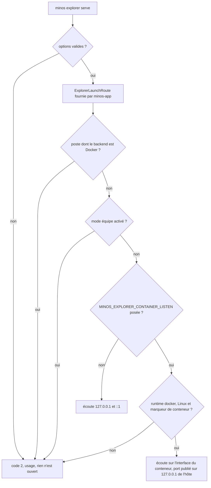
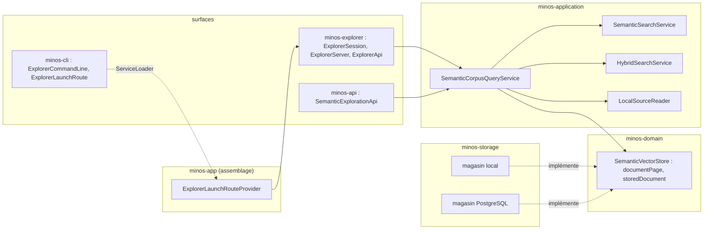
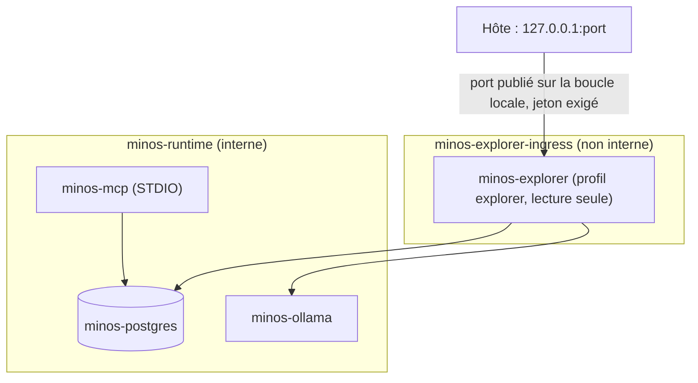
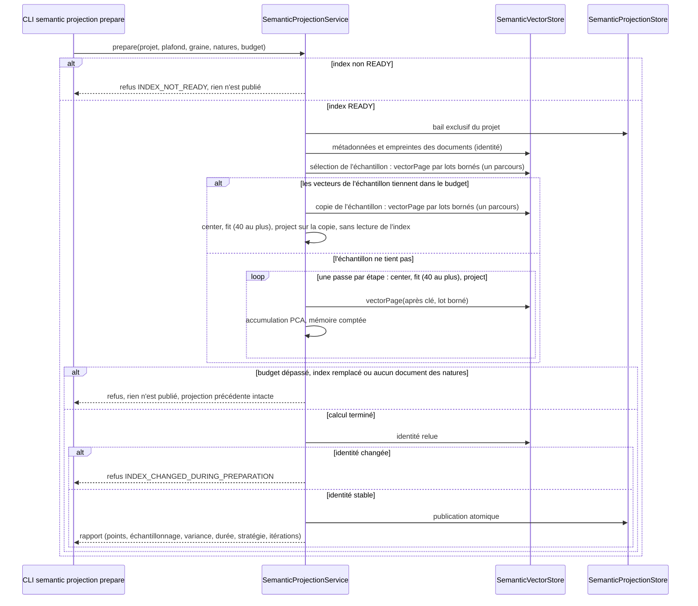
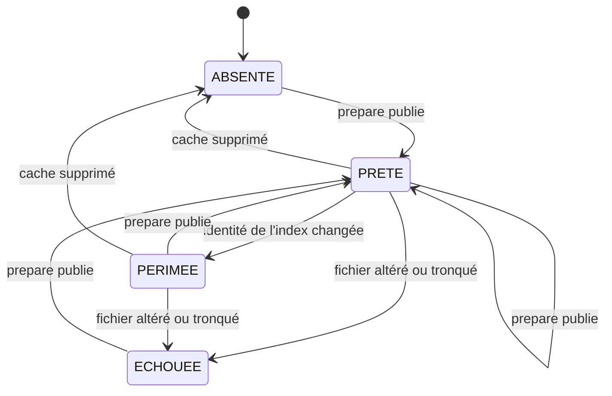
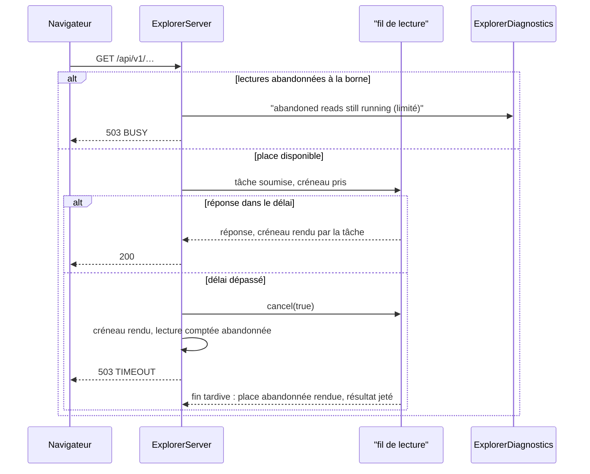
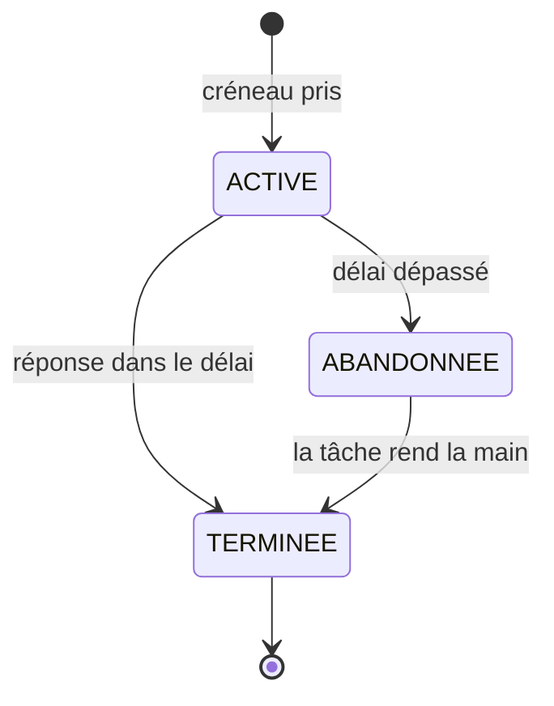

# Capacité `exploration-semantique` — dossier durable

Spec de référence : [openspec/specs/exploration-semantique/spec.md](../../../../openspec/specs/exploration-semantique/spec.md)
· Relevé au 2026-11-14, changements `explorer-l-index-semantique-dans-un-navigateur` et
`projeter-l-index-semantique-en-2d`.

## Objet et périmètre

[Exigence] L'utilisateur d'un poste consulte, depuis un navigateur local et en lecture seule, les documents
sémantiques d'un projet : liste paginée, détail, recherche, voisins. Acteurs : l'utilisateur du poste, son
navigateur. La carte 2D des documents se lit dans la même page ; sa projection est préparée par une commande,
jamais par la surface (vues V5 et V6). Hors périmètre : accès distant, toute écriture par la surface, UMAP,
WebGL, vue 3D. Décision : ARCH-0082.

## Vues

### Par où passe une requête du navigateur, et où est-elle refusée ?

Type : sequenceDiagram (UML, séquence) · Portée : existant vérifié · Exigences : « Toute requête d'API exige le
jeton de session et une origine locale », « La surface d'exploration ne modifie aucun état »

Aucun service n'est appelé avant le garde ; aucune route n'appelle `replace`, `synchronize` ni un provider
d'embeddings pour autre chose que le vecteur de la requête de recherche.

### Qui démarre la surface, et sur quelles adresses écoute-t-elle ?

Type : flowchart (organigramme de décision, non UML) · Portée : existant vérifié · Exigences : « La surface
d'exploration est optionnelle et n'écoute que sur la boucle locale »

Aucune option de ligne de commande ne choisit l'adresse d'écoute.

### Quels composants, et dans quel sens dépendent-ils ?

Type : flowchart (vue de composants, non UML) · Portée : existant vérifié · Exigences : « La surface
d'exploration ne modifie aucun état », « Les voisins d'un document sont classés depuis son vecteur stocké »

`minos-cli` ne dépend pas de `minos-explorer` : il déclare une interface que l'assemblage fournit. Les surfaces ne
voient que le service applicatif ; aucune ne nomme un adaptateur de stockage (`ModuleArchitectureTest`).

### Comment le service optionnel du runtime Docker est-il exposé ?

Type : flowchart (vue de conteneurs, non UML) · Portée : existant vérifié, non qualifié sur une installation
réelle · Exigences : « La surface d'exploration est optionnelle et n'écoute que sur la boucle locale »

Dans le conteneur, la surface écoute sur l'interface du conteneur : un port publié n'atteint pas sa boucle
locale. Cette écoute n'est accordée que par la variable interne posée par le Compose, dans un conteneur. Le
réseau d'entrée donne au conteneur une route sortante, acceptée en l'état (écart E3).

### Comment une projection est-elle préparée sans toucher au chemin de recherche ?

Type : sequenceDiagram · Portée : livré, changement `projeter-l-index-semantique-en-2d` · Vue V5 · Exigences : La
préparation d'une projection est une commande explicite et bornée ; Une projection est publiée atomiquement et
liée à l'identité de son index

Le provider d'embeddings et la recherche ne sont jamais appelés ; `load()` non plus.

### Quel état une lecture de projection rend-elle ?

Type : stateDiagram-v2 · Portée : livré · Vue V6 · Exigences : Les points d'une projection annoncent méthode,
sélection et échantillonnage ; La lecture d'une projection ne calcule rien

`PERIMEE` est calculé à chaque lecture, jamais stocké. Une préparation en cours ou en échec n'est pas un état
lu : une lecture n'écrit rien et ne sonde aucun verrou (écart E6).

### Que devient une requête d'API qui dépasse le délai ?

Type : sequenceDiagram · Portée : existant vérifié par tests (`ExplorerAbandonedReadsTest`, 50 exécutions) · Exigences :
changement `fiabiliser-la-surface-de-l-explorateur` › « Une requête de l'explorateur abandonnée au délai libère son
créneau », « Les lectures abandonnées encore en cours sont bornées et dites »

Le créneau est rendu par celui qui constate l'abandon ; la lecture qui traîne ne compte plus que dans la borne des
lectures abandonnées.

### Par quels états passe une lecture ?

Type : stateDiagram-v2 · Portée : existant vérifié par tests (`ExplorerAbandonedReadsTest`) · Exigences : idem

`ABANDONNEE` est borné (8 lectures) et visible dans le journal de la surface.

La table de symboles de l'explorateur est tenue par la vue du snapshot (`WeakHashMap`) et part avec elle. Une
projection dont le poids décodé estimé dépasse 1 % du tas est refusée avant décodage : état `ECHOUEE`, raison
`PROJECTION_TOO_LARGE` (ADR DATA-0085, point 19).

## Traçabilité

| Exigence | Scénarios couverts | Vue | Preuves | Statut |
|---|---|---|---|---|
| La surface d'exploration est optionnelle et n'écoute que sur la boucle locale | 3/3, le premier par preuve structurelle | V2, V4 | `minos-explorer/src/test/java/com/minos/explorer/ExplorerServerTest.java#theSurfaceIsBoundToLoopbackAddressesOnlyAndItsUrlNamesTheIpv4Loopback`, `minos-explorer/src/test/java/com/minos/explorer/ExplorerSessionTest.java#theSurfaceRefusesToStartWhenTheTeamModeIsEnabledAndOpensNoPort`, `minos-app/src/test/java/com/minos/app/architecture/ModuleArchitectureTest.java#onlyTheExplorerRouteOfTheAssemblyStartsTheExplorationSurface` | partielle |
| Toute requête d'API exige le jeton de session et une origine locale | 3/3 | V1 | `minos-explorer/src/test/java/com/minos/explorer/ExplorerServerTest.java#anApiRequestWithoutTheTokenIsRefusedWithoutDetailAndReachesNoService`, `minos-explorer/src/test/java/com/minos/explorer/ExplorerServerTest.java#aRequestWhoseHostIsNotALoopbackNameOfThisPortIsRefusedEvenWithTheToken`, `minos-explorer/src/test/java/com/minos/explorer/ExplorerServerTest.java#aRequestFromAnotherOriginIsRefusedAndNoCorsHeaderIsEverSent` | couverte |
| La surface d'exploration ne modifie aucun état | 1/1, statut et points de projection compris | V1, V6 | `minos-explorer/src/test/java/com/minos/explorer/ExplorerRoutesTest.java#consultingEveryRouteLeavesTheHomeAndTheIndexByteForByteUnchanged`, `minos-explorer/src/test/java/com/minos/explorer/ExplorerProjectionRoutesTest.java#anyMethodButGetOnAProjectionRouteIsRefusedAndNoProjectionIsCreatedOrChanged` | couverte |
| La liste des documents est paginée et lue sur un seul index | 3/3 | V1 | `minos-engine/src/test/java/com/minos/testsupport/SemanticDocumentReadsContract.java#aFullWalkReturnsEveryDocumentOnceInStableKeyOrder`, `minos-application/src/test/java/com/minos/application/semantic/SemanticCorpusQueryServiceTest.java#aPageSizeOutOfBoundsIsAUsageErrorThatNamesTheBound`, `minos-application/src/test/java/com/minos/application/semantic/SemanticCorpusQueryServiceTest.java#aCursorIssuedForAnIndexIsRefusedOnceThatIndexIsReplaced` | couverte |
| Le détail distingue le contenu indexé de la source actuelle | 2/2 | V1 | `minos-application/src/test/java/com/minos/application/semantic/SemanticCorpusQueryServiceTest.java#theDetailOfAChunkWhoseSourceChangedShowsBothContentsAndTheDivergence`, `minos-application/src/test/java/com/minos/application/semantic/SemanticCorpusQueryServiceTest.java#theDetailOfADocumentWhoseFileWasDeletedSaysTheSourceIsMissingAndShowsNoAbsolutePath` | couverte |
| La recherche de l'explorateur rend le classement des services existants et nomme chaque score | 2/2, égalité avec le service et non avec la sortie de la commande | V1 | `minos-application/src/test/java/com/minos/application/semantic/SemanticCorpusQueryServiceTest.java#aSemanticSearchKeepsTheRanksAndScoresOfTheSearchServiceAndNamesTheScore`, `minos-application/src/test/java/com/minos/application/semantic/SemanticCorpusQueryServiceTest.java#aSearchOnAnIndexThatIsNotReadyIsEmptyAndSaysWhy` | partielle |
| Les voisins d'un document sont classés depuis son vecteur stocké | 2/2 | V1 | `minos-application/src/test/java/com/minos/application/semantic/SemanticCorpusQueryServiceTest.java#neighboursAreRankedFromTheStoredVectorWithoutAnyCallToTheProvider`, `minos-application/src/test/java/com/minos/application/semantic/SemanticCorpusQueryServiceTest.java#anUnknownStableKeyIsNotFoundForNeighboursAndForTheDetail` | couverte |
| Aucune réponse de l'explorateur n'expose de chemin absolu ni de secret | 2/2 | V1 | `minos-explorer/src/test/java/com/minos/explorer/ExplorerRoutesTest.java#noAnswerErrorOrLogLineNamesAnAbsoluteRootOrAProviderAddress`, `minos-explorer/src/test/java/com/minos/explorer/ExplorerServerTest.java#everyAnswerCarriesTheSecurityHeadersAndNoCookie`, `minos-explorer/src/test/java/com/minos/explorer/WebResourcesContentTest.java#indexedContentCanOnlyBeInsertedAsText` | couverte |
| Le provider local-hash est signalé comme référence déterministe | 1/1 | V1 | `minos-explorer/src/test/java/com/minos/explorer/ExplorerRoutesTest.java#theProjectListDescribesTheIndexAndNeverTheRootOfAProject`, `minos-api/src/test/java/com/minos/api/SemanticExplorationApiContractTest.java#theFiveReadingsDescribeOneIndexAndNeverItsRoot` | couverte |
| La préparation d'une projection est une commande explicite et bornée | 2/2 | V5 | `minos-application/src/test/java/com/minos/application/semantic/SemanticProjectionServiceTest.java#twoPreparationsOfTheSameIndexWithTheSameSeedGiveTheSameCoordinates`, `minos-cli/src/test/java/com/minos/cli/SemanticProjectionCommandLineTest.java#thePreparationPublishesTheSameFileTwiceAndTheStatusReadsItBack`, `minos-application/src/test/java/com/minos/application/semantic/SemanticProjectionServiceTest.java#aPreparationThatExceedsItsMemoryBudgetFailsAndLeavesThePublishedProjectionIntact`, `minos-application/src/test/java/com/minos/application/semantic/SemanticProjectionServiceTest.java#aPreparationReadsTheVectorsByBoundedPagesAndNeverLoadsTheWholeIndex` | couverte |
| Une projection est publiée atomiquement et liée à l'identité de son index | 2/2 | V5, V6 | `minos-application/src/test/java/com/minos/application/semantic/SemanticProjectionServiceTest.java#aProjectionWhoseIndexChangedIsStale`, `minos-storage/src/test/java/com/minos/storage/local/store/FileSemanticProjectionStoreTest.java#aPreparationThatEndsWithoutPublishingLeavesThePublishedProjectionAndNoPartialFile`, `minos-storage/src/test/java/com/minos/storage/local/store/FileSemanticProjectionStoreTest.java#anAlteredCutOrForeignFileIsRefusedWithoutNamingItsLocation` | partielle |
| Les points d'une projection annoncent méthode, sélection et échantillonnage | 1/1 | V6 | `minos-application/src/test/java/com/minos/application/semantic/SemanticProjectionServiceTest.java#aSampleOfTwoHundredPointsOutOfAThousandDocumentsIsAnnouncedWithItsSeed`, `minos-explorer/src/test/java/com/minos/explorer/ExplorerProjectionRoutesTest.java#aSampledProjectionAnnouncesItsMethodItsSeedAndItsCountsWithItsPoints` | couverte |
| La lecture d'une projection ne calcule rien | 2/2 | V6 | `minos-application/src/test/java/com/minos/application/semantic/SemanticProjectionServiceTest.java#aProjectWithoutProjectionIsAbsentNamesTheCommandAndReadsNoVector`, `minos-explorer/src/test/java/com/minos/explorer/ExplorerProjectionRoutesTest.java#aProjectWithoutProjectionIsAbsentAndTheAnswerNamesTheCommandThatPreparesIt`, `minos-explorer/src/test/java/com/minos/explorer/ExplorerProjectionRoutesTest.java#anyMethodButGetOnAProjectionRouteIsRefusedAndNoProjectionIsCreatedOrChanged` | couverte |
| Le banc de scalabilité produit une référence pour la projection et les routes de l'explorateur | 1/4 par test ; mesure sur le stockage local et deux exécutions comparables : forme des mesures et reproductibilité prouvées sur un index minuscule, référence complète et seconde exécution manuelles, sur la machine de référence ; sortie dans le dépôt refusée : contrôle du script rejoué à la main sous PowerShell 7 et 5.1 ; banc absent du build : aucun motif d'inclusion de Surefire ne le désigne | — | `minos-explorer/src/test/java/com/minos/explorer/SemanticExplorerBenchmarkSmokeTest.java#twoRunsWithTheSameSeedGiveTheSameDocumentsPassesAndVectorsRead`, `benchmarks/scalability/run-semantic-benchmark.ps1`, `minos-explorer/src/test/java/com/minos/explorer/SemanticExplorerBenchmark.java` | partielle |
| Une mesure impossible est nommée dans le résultat | 4/4 par simulation (refus attendu des routes qui décodent l'index entier simulé par une réponse `500` de la surface) ; aucun refus réel du magasin local n'est déclaré : il ne décode plus l'index entier pour la liste, le détail, les voisins ni la recherche (E11) | — | `minos-explorer/src/test/java/com/minos/explorer/SemanticExplorerBenchmarkSmokeTest.java` | partielle |
| Le harnais du banc sémantique est gardé par un test du build | tous | — | `minos-explorer/src/test/java/com/minos/explorer/SemanticExplorerBenchmarkSmokeTest.java#everyRouteOfTheSurfaceHasAMeasuredScenario`, `minos-explorer/src/test/java/com/minos/explorer/SemanticExplorerBenchmarkSmokeTest.java` | couverte |
| La page de l'explorateur est exécutée par des tests et contrôlée avant toute fusion | tous ; version de Node du runner non relevée | — | `scripts/quality/check-explorer-front.py` (dépôt réel, puis cas « repository state passes », « broken syntax names the file », « PATH without Node names Node and the minimum », « installed Node under the minimum », « empty test folder » de `--self-test`), `.github/workflows/pr-ci.yml` (étapes du job `invariants`, câblage gardé par `scripts/quality/check-ci-wiring.py`) | couverte |
| Aucun contenu indexé n'atteint un puits de balisage, prouvé par exécution | tous | V1 | `minos-explorer/src/test/js/sinks.test.mjs#list, header, detail and neighbours render hostile values as text`, `minos-explorer/src/test/js/sinks.test.mjs#search results, the map texts and the hover render hostile values as text`, `minos-explorer/src/test/js/sinks.test.mjs#the test DOM refuses markup and the context refuses code generation`, `scripts/quality/check-explorer-front.py` (cas `insertAdjacentHTML`, attribut `onclick` et `eval` de `--self-test`) | couverte |
| La carte et la traduction des états ont un comportement caractérisé par des tests | tous | V6 | `minos-explorer/src/test/js/map.test.mjs#the point under the pointer is the nearest one inside the capture radius, on seeded sets`, `minos-explorer/src/test/js/map.test.mjs#the kind filter keeps the points of that kind in reception order, and all of them without filter`, `minos-explorer/src/test/js/map.test.mjs#the points are read page after page until the total is reached`, `minos-explorer/src/test/js/labels.test.mjs#every contract constant has a label in the page, and every label a contract constant`, `minos-explorer/src/test/js/labels.test.mjs#the header badge shows the label of every index state, never the raw constant` | couverte |
| Un échec de copie de la référence est signalé dans la page | tous | — | `minos-explorer/src/test/js/clipboard.test.mjs#a refused copy shows a message in the banner and leaves no unhandled rejection`, `minos-explorer/src/test/js/clipboard.test.mjs#a copy that succeeds writes the file and its lines and leaves the banner unchanged` | couverte |
| En stockage local, une page de documents est lue sans charger l'index | 3/3 | V1 | `minos-storage/src/test/java/com/minos/storage/local/store/FileSemanticVectorStoreWalkedReadsTest.java#documentPagesOfAnIndexTheCacheCannotHoldAreReadWithoutLoadingIt`, `minos-storage/src/test/java/com/minos/storage/local/store/FileSemanticVectorStoreWalkedReadsTest.java#aPageStartsAfterAnyKeyWhetherTheWalkIsResumedOrStartedAgain`, `minos-storage/src/test/java/com/minos/storage/local/store/FileSemanticVectorStoreWalkedReadsTest.java#aDocumentPageResumedAfterTheIndexWasReplacedReadsTheNewIndexFromItsStart`, `minos-storage/src/test/java/com/minos/storage/local/store/FileSemanticVectorStoreWalkedReadsTest.java#anIndexWhoseDocumentsAreNotInStableKeyOrderIsRefusedWithoutNamingItsLocation` | couverte |
| En stockage local, le détail lit le seul document demandé | 2/2 | V1 | `minos-storage/src/test/java/com/minos/storage/local/store/FileSemanticVectorStoreWalkedReadsTest.java#aStoredDocumentIsReadAloneWithItsVectorAndTheMetadataOfItsIndex`, `minos-storage/src/test/java/com/minos/storage/local/store/FileSemanticVectorStoreWalkedReadsTest.java#aStoredDocumentOfAnIndexTheCacheHoldsIsReadFromTheCacheWithoutWalkingTheFile` | couverte |
| En stockage local, les voisins sont classés sans retenir l'index | 2/2 | V1 | `minos-storage/src/test/java/com/minos/storage/local/store/FileSemanticVectorStoreWalkedReadsTest.java#theNeighboursOfAnIndexTheCacheCannotHoldAreTheOnesOfTheLoadedIndexWithoutRetainingIt`, `minos-storage/src/test/java/com/minos/storage/local/store/FileSemanticVectorStoreWalkedReadsTest.java#equalScoresAreRankedByStableKeyAndTheMinimumScoreIsHonoured`, `minos-storage/src/test/java/com/minos/storage/local/store/FileSemanticVectorStoreWalkedReadsTest.java#anIndexTheCacheRefusedIsRankedWithoutBeingDecodedAgain`, `minos-storage/src/test/java/com/minos/storage/local/store/FileSemanticVectorStoreWalkedReadsTest.java#aQueryOfOtherDimensionsIsRefusedWithoutAnyPartialResult` | couverte |
| Des lectures simultanées d'un index local que le cache tient ne le décodent qu'une fois | 2/2 | — | `minos-storage/src/test/java/com/minos/storage/local/store/FileSemanticVectorStoreWalkedReadsTest.java#concurrentColdLoadsOfAnIndexTheCacheHoldsDecodeItOnce`, `minos-storage/src/test/java/com/minos/storage/local/store/FileSemanticVectorStoreWalkedReadsTest.java#concurrentLoadsOfATruncatedIndexAllFailAndLeaveNothingInTheCache`, `minos-storage/src/test/java/com/minos/storage/local/store/FileSemanticVectorStoreWalkedReadsTest.java#concurrentFullLoadsOfAnIndexTheCacheRefusesStillDecodeOncePerCaller` (50 rejeux chacun, sauf le dernier) | couverte |
| Une page PostgreSQL de l'index sémantique ne recompte pas les documents | 3/3 | V1 | `minos-storage/src/test/java/com/minos/storage/postgresql/semantic/PostgresSemanticPagePlanTest.java#noPlanOfAReadStatementCountsTheRowsOfTheIndex`, `minos-storage/src/test/java/com/minos/storage/postgresql/semantic/PostgresSemanticPagePlanTest.java#everyPageAnnouncesTheCountOfTheIndex`, `minos-storage/src/test/java/com/minos/storage/postgresql/semantic/PostgresSemanticDifferentialSyncTest.java` (assertion `assertAnnouncedCountIsTheRowCount`), `minos-storage/src/test/java/com/minos/storage/postgresql/semantic/PostgresSemanticDocumentReadsContractTest.java#twoPagesReadOnEachSideOfAReplacementCarryDifferentMetadata` | couverte |
| Une page suivante PostgreSQL est bornée par la clé stable dans l'index | 2/2 | V1 | `minos-storage/src/test/java/com/minos/storage/postgresql/semantic/PostgresSemanticPagePlanTest.java#aPageThatFollowsAKeyIsBoundedByTheKeyInTheIndexEvenInAGenericPlan`, `minos-storage/src/test/java/com/minos/storage/postgresql/semantic/PostgresSemanticDocumentReadsContractTest.java#aBlankResumeKeyIsRefusedBeforeAnyStatementIsSent` | couverte |
| La migration du schéma PostgreSQL reprend le nombre de documents de chaque index sémantique | 2/2 | — | `minos-storage/src/test/java/com/minos/storage/postgresql/support/PostgresSchemaUpgradeFromV4Test.java#aV4DatabaseRecordsTheDocumentCountOfItsSemanticIndexWithoutResynchronizing`, `minos-storage/src/test/java/com/minos/storage/postgresql/support/PostgresSchemaUpgradeFromV4Test.java#theMigrationReplayedKeepsTheDocumentCountAndTheVersions` | couverte |
| La préparation ne relit pas l'index à chaque itération quand l'échantillon tient en mémoire | 2/2 | V5 | `minos-application/src/test/java/com/minos/application/semantic/SemanticProjectionServiceTest.java#aSampleThatFitsTheBudgetIsIteratedInMemoryAfterTwoWalksOfTheIndex`, `minos-application/src/test/java/com/minos/application/semantic/SemanticProjectionServiceTest.java#anIndexReplacedWhileTheSampleIsCopiedRefusesThePreparationAndKeepsThePublishedProjection`, `minos-application/src/test/java/com/minos/application/semantic/ProjectionPreparationTest.java#theLargestIndexTheProductBuildsIsIteratedInMemoryUnderTheDefaultBudget` | couverte |
| Un échantillon plus lourd que le budget garde le parcours en flux et l'annonce | 2/2 | V5 | `minos-application/src/test/java/com/minos/application/semantic/SemanticProjectionServiceTest.java#aSampleThatDoesNotFitTheBudgetKeepsTheStreamAndSaysWhichStrategyRan`, `minos-application/src/test/java/com/minos/application/semantic/SemanticProjectionServiceTest.java#aBudgetBelowTheSmallestWorkableOneIsRefusedAndPublishesNothing`, `minos-cli/src/test/java/com/minos/cli/SemanticProjectionCommandLineTest.java#aStreamedPreparationNamesTheOptionThatLiftsItsLimit`, `minos-application/src/test/java/com/minos/application/semantic/ProjectionPreparationTest.java#askingWhetherBytesFitChangesNeitherTheMemoryHeldNorThePeak` | couverte |
| Les deux stratégies de préparation rendent les mêmes coordonnées | 1/1 | V5, V6 | `minos-application/src/test/java/com/minos/application/semantic/SemanticProjectionServiceTest.java#theTwoStrategiesPublishTheSamePointsCoordinatesAndVariance` | couverte |
| La table de symboles de l'explorateur ne survit pas à sa vue | 3/3 | — | `minos-application/src/test/java/com/minos/application/semantic/SemanticCorpusQueryServiceTest.java#twoPagesReadTheViewOfTheStoreAndKeepTheSameSymbols`, `minos-application/src/test/java/com/minos/application/semantic/SemanticCorpusQueryServiceTest.java#anEvictedViewIsNoLongerReachableFromTheService`, `minos-application/src/test/java/com/minos/application/semantic/SemanticCorpusQueryServiceTest.java#anIndexOfAnotherSnapshotLeavesTheSymbolsUnresolvedWithoutAskingForTheView` | couverte |
| Une projection plus lourde que sa part du tas est refusée avant décodage | 3/3 | — | `minos-storage/src/test/java/com/minos/storage/local/store/FileSemanticProjectionStoreTest.java#aProjectionWithinItsShareIsDecodedOnceAndWeighedByItsEstimate`, `minos-storage/src/test/java/com/minos/storage/local/store/FileSemanticProjectionStoreTest.java#aProjectionHeavierThanItsShareIsRefusedBeforeDecodingWithoutAPath`, `minos-storage/src/test/java/com/minos/storage/local/store/FileSemanticProjectionStoreTest.java#aHeaderThatAnnouncesTooManyPointsIsUnreadableBeforeAnyEstimate` | couverte |
| Les valeurs d'énumération du contrat v1 de l'explorateur sont figées | tous | — | `minos-explorer/src/test/java/com/minos/explorer/ExplorerContractValuesTest.java#everySerializedFieldKeepsItsVersionOneValues`, `minos-explorer/src/test/java/com/minos/explorer/ExplorerContractValuesTest.java#theFrenchValuesFormAClosedListOfEight`, `minos-api/src/test/java/com/minos/api/SemanticExplorationApiContractTest.java#theSerializedValuesOfVersionOneAreFrozenFieldByField`, `minos-cli/src/test/java/com/minos/cli/SemanticProjectionCommandLineTest.java#theSerializedProjectionStatesOfVersionOneAreFrozen` | couverte |
| Toute erreur de l'API de l'explorateur porte un code d'une liste fermée | « Code de résolution de projet non repris » : aucune mutation exécutée | — | `minos-explorer/src/test/java/com/minos/explorer/ExplorerContractValuesTest.java#theErrorCodesAreTheClosedListOfVersionOne`, `minos-explorer/src/test/java/com/minos/explorer/ExplorerContractValuesTest.java#everyProjectResolutionCodeHasTheErrorCodeOfTheSameName`, `minos-explorer/src/test/java/com/minos/explorer/ExplorerRoutesTest.java#anUnknownProjectOrRouteIsNotFoundAndNoMethodButGetAndTheSearchPostIsAccepted` | couverte |
| La page de l'explorateur traduit le code d'erreur | tous | — | `minos-explorer/src/test/js/labels.test.mjs#every error code of the closed list has a label in the page, and every label an error code`, `minos-explorer/src/test/js/labels.test.mjs#a busy server is shown by the French label of its code, and its English message appears nowhere`, `minos-explorer/src/test/js/labels.test.mjs#a code the page does not translate, or no code, gives the generic French message inserted as text` | couverte |
| Un échec interne de l'explorateur laisse une ligne de diagnostic avec sa cause racine | 4/5 (« Journal privé actif » : l'index d'un `MINOS_HOME` factice n'est comparé que par la liste de ses chemins, pas octet pour octet) | — | `minos-explorer/src/test/java/com/minos/explorer/ExplorerDiagnosticsTest.java#anInternalFailureAnswersA500WithAReferenceThatTheLineShares`, `minos-explorer/src/test/java/com/minos/explorer/ExplorerDiagnosticsTest.java#aFailureOutsideAnApiRouteWritesTheSameShapeOfLine`, `minos-explorer/src/test/java/com/minos/explorer/ExplorerDiagnosticsTest.java#withoutTheJournalSettingAnInternalFailureLeavesTheHomeAsItWas`, `minos-explorer/src/test/java/com/minos/explorer/ExplorerDiagnosticsTest.java#withTheJournalActiveOnlyAFailureAddsTheJournalDirectory` | partielle |
| L'explorateur ne rend 400 que pour une erreur d'usage explicite | tous | — | `minos-explorer/src/test/java/com/minos/explorer/ExplorerRoutesTest.java#everyInvalidInputOfTheContractIsA400AndNeverAnInternalFailure`, `minos-explorer/src/test/java/com/minos/explorer/ExplorerRoutesTest.java#theDocumentsAreWalkedByCursorOnOneIndexAndAPageSizeOutOfBoundsNamesTheBound`, `minos-explorer/src/test/java/com/minos/explorer/ExplorerDiagnosticsTest.java#anArgumentErrorThatIsNotAUsageErrorIsAnInternalFailureOfTheApi`, `minos-explorer/src/test/java/com/minos/explorer/ExplorerUnitsTest.java#aBrokenEscapeIsAUsageErrorNotTheRawExceptionOfTheJdk` | couverte |
| Les refus de l'explorateur sont journalisés avec limitation | tous | — | `minos-explorer/src/test/java/com/minos/explorer/ExplorerDiagnosticsTest.java#aThousandRequestsWithoutTheTokenAreAllRefusedWithA401AndWriteOneLine`, `minos-explorer/src/test/java/com/minos/explorer/ExplorerDiagnosticsTest.java#aBurstOfRefusalsOfOneReasonIsOneLineThenOneSummaryPerWindowAndOtherReasonsAreWrittenAtOnce`, `minos-explorer/src/test/java/com/minos/explorer/ExplorerDiagnosticsTest.java#aSingleRefusalAfterTheWindowIsWrittenInItsFirstForm` | couverte |
| Une requête de l'explorateur abandonnée au délai libère son créneau | tous | — | `minos-explorer/src/test/java/com/minos/explorer/ExplorerAbandonedReadsTest.java#readsThatIgnoreTheirInterruptionGiveTheirSlotsBackAtTheDeadline` (traitement simulé ; lecture PostgreSQL réellement bloquée non mesurée) | couverte |
| Les lectures abandonnées encore en cours sont bornées et dites | tous | — | `minos-explorer/src/test/java/com/minos/explorer/ExplorerAbandonedReadsTest.java#atTheBoundANewRequestIsRefusedAsBusyWithoutACallAndAReturnedReadFreesAPlace`, `minos-explorer/src/test/java/com/minos/explorer/ExplorerAbandonedReadsTest.java#stoppingTheSurfaceDoesNotWaitForTheAbandonedReads`, `minos-explorer/src/test/java/com/minos/explorer/ExplorerDiagnosticsTest.java#abandonedReadsAreSaidWithTheirNumberAndTheSameLimitation` (traitement simulé ; lecture PostgreSQL réellement bloquée non mesurée) | couverte |
| Un segment de chemin point ou point-point est refusé | tous | — | `minos-explorer/src/test/java/com/minos/explorer/ExplorerServerTest.java#aDotSegmentIsRefusedBeforeAnyServiceCallWhateverItsEncoding`, `minos-explorer/src/test/java/com/minos/explorer/ExplorerUnitsTest.java#dotSegmentsAreRefusedUnderEveryEncodingAndOtherDotsAreKept` | couverte |
| Le point sous le pointeur est cherché parmi les points voisins seulement | tous | — | `minos-explorer/src/test/js/map-grid.test.mjs#the grid lookup returns the point of the full scan on 100 000 points, at every zoom and offset`, `minos-explorer/src/test/js/map-grid.test.mjs#at 800 x 600 and zoom 1 a lookup examines less than a hundredth of the displayed points`, `minos-explorer/src/test/js/map-grid.test.mjs#a position with no point in the radius selects nothing and a click there requests no detail` | couverte |
| La liste des points d'une nature n'est calculée qu'à son changement | tous | — | `minos-explorer/src/test/js/map-grid.test.mjs#the displayed list is computed once per filter and per set of points, and serves lookups and drawings`, `minos-explorer/src/test/js/map-grid.test.mjs#after a change of filter only points of the new kind are examined or selected`, `minos-explorer/src/test/js/map-grid.test.mjs#a map read again replaces the points and the lookup follows` | couverte |
| Le survol de la carte est traité au plus une fois par image | tous | — | `minos-explorer/src/test/js/map-grid.test.mjs#twenty pointer moves before the next frame are looked up once, at the last position`, `minos-explorer/src/test/js/map-grid.test.mjs#a click before the next frame requests the detail of the clicked point at once`, `minos-explorer/src/test/js/map.test.mjs#a burst of pointer moves without a frame is looked up once, by the frame, which draws once` | couverte |
| Le mode équipe est interprété par une seule règle au lancement de l'explorateur | tous | — | `minos-app/src/test/java/com/minos/app/ExplorerLaunchRouteProviderTest.java#aHomeInTeamModeIsRefusedBeforeAnythingIsOpened`, `minos-app/src/test/java/com/minos/app/ExplorerLaunchRouteProviderTest.java#aHomeWhoseTeamModeIsDisabledIsServed`, `minos-app/src/test/java/com/minos/app/ExplorerLaunchRouteProviderTest.java#aNativeHomeIsOpenedForAsLongAsTheSurfaceServesAndClosedAfterwards`, `minos-app/src/test/java/com/minos/app/ExplorerLaunchRouteProviderTest.java#anUnsupportedTeamModeIsAUsageErrorBeforeAnythingIsOpened`, `minos-application/src/test/java/com/minos/application/HostedModeTest.java#everyValueIsClassifiedByTheSingleRule`, `minos-application/src/test/java/com/minos/application/HostedModeTest.java#openingTheApplicationClassifiesEveryValueTheSameWay`, `minos-explorer/src/test/java/com/minos/explorer/ExplorerLaunchPolicyTest.java#anUnsupportedTeamModeIsRefusedWithItsOwnMessage` | couverte |
| Chaque refus de lancement de l'explorateur a un seul texte | 2/3 (« Une seule définition » : recherche manuelle, aucun test ni gate) | — | `minos-explorer/src/main/java/com/minos/explorer/ExplorerLaunchPolicy.java:22`, `minos-app/src/test/java/com/minos/app/ExplorerLaunchRouteProviderTest.java#aHomeInTeamModeIsRefusedBeforeAnythingIsOpened`, `minos-explorer/src/test/java/com/minos/explorer/ExplorerSessionTest.java#theSurfaceRefusesToStartWhenTheTeamModeIsEnabledAndOpensNoPort`, `minos-app/src/test/java/com/minos/app/ExplorerLaunchRouteProviderTest.java#theDockerBackendIsRefusedFirstWithoutReadingTheTeamMode`, `minos-explorer/src/test/java/com/minos/explorer/ExplorerLaunchPolicyTest.java#theDockerBackendIsDecidedFirstWithoutReadingTheTeamMode` | partielle |

## Écarts

| Id | Écart | Preuve | Suite proposée |
|---|---|---|---|
| E1 | Le scénario « Aucune écoute sans la commande » n'est prouvé que structurellement (aucun autre code n'atteint la surface ni n'ouvre d'écoute) ; aucun test n'observe les ports d'un processus CLI ou MCP | `minos-app/src/test/java/com/minos/app/architecture/ModuleArchitectureTest.java` | [Proposition] Test de processus qui relève les ports à l'écoute |
| E3 | En runtime Docker, la surface écoute sur l'interface du conteneur et le réseau d'entrée n'est pas interne (route sortante) | `docker/compose-mcp.connected.yaml` | Accepté par le propriétaire le 2026-11-13 (ARCH-0082, « Écarts constatés ») |
| E4 | « Même classement que la CLI » est prouvé contre `SemanticSearchService`, que la commande appelle, pas contre la sortie de `semantic-search` | `minos-application/src/test/java/com/minos/application/semantic/SemanticCorpusQueryServiceTest.java` | [Proposition] Test de bout en bout CLI contre HTTP |
| E5 | Le parcours dans un navigateur réel n'est pas automatisé | — | Parcours manuel du propriétaire (tâche 5.6) |
| E6 | Une préparation en cours ou en échec n'est pas un état rendu par une lecture (la conception commune prévoyait `EN_PREPARATION` et `ECHOUEE` après échec) | `minos-application/src/main/java/com/minos/application/semantic/SemanticProjectionService.java` | Aucune : une lecture n'écrit rien et ne sonde aucun verrou ; l'échec est rendu par le code de sortie de la commande |
| E7 | « Préparation interrompue » est prouvé par une préparation fermée sans publication et par la publication atomique, pas par l'arrêt brutal d'un processus pendant l'écriture | `minos-storage/src/test/java/com/minos/storage/local/store/FileSemanticProjectionStoreTest.java` | [Proposition] Test de processus fils tué pendant la publication |
| E8 | Les points sont rendus en JSON paginé, pas en binaire ; la couleur par module ou langage et la date de préparation ne sont pas proposées | `minos-explorer/src/main/java/com/minos/explorer/ExplorerApi.java` | Décision mesurée (tâche 7.1 du changement de projection) |
| E9 | La carte n'est parcourue que dans Chrome sous Windows ; les mesures portent sur des corpus synthétiques `local-hash` sous Windows | `openspec/changes/archive/2026-11-14-projeter-l-index-semantique-en-2d/parcours-navigateur-6.7.md`, `openspec/changes/archive/2026-11-14-projeter-l-index-semantique-en-2d/mesures-6.8.md` | [Proposition] Parcours et mesures sous Linux, sur un index réel et sur PostgreSQL |
| E10 | Le banc sémantique (`benchmarks/scalability/run-semantic-benchmark.ps1`, harnais `SemanticExplorerBenchmark`) mesure des jeux synthétiques `local-hash` écrits directement dans le magasin ; au-delà de 32 768 documents à 768 dimensions, ses jeux dépassent le budget de construction de la synchronisation (mention `beyond-build-budget`) et ne décrivent pas un index que l'utilisateur peut obtenir | `minos-explorer/src/test/java/com/minos/explorer/SemanticExplorerBenchmark.java`, `minos-application/src/main/java/com/minos/application/semantic/SemanticIndexBudget.java` | Contrôle facultatif sur corpus réel (décision D2 du changement `mesurer-la-projection-et-l-explorateur-au-banc`) |
| E11 | En stockage local, la liste, le détail, les voisins et la recherche sémantique ne décodent plus l'index entier quand le cache ne peut pas le tenir : la liste et le détail parcourent le fichier, le classement se fait en deux parcours sans rien retenir. Un index que le cache tient garde le chemin chargé pour les voisins et la recherche, et sert le détail depuis le cache s'il y est déjà ; son premier détail, avant tout chargement, est un parcours du fichier. Mesure sur un index constructible à contenu de 2 000 caractères : liste 764 → 11 ms (p50), détail 687 → 47 ms, voisins 1,37 → 0,66 s ; sur l'index que le cache tient, détail 8 → 37 ms avant le premier chargement. Mesures bruitées, jeux synthétiques `local-hash` ; le jeu de 100 000 documents n'est plus refusé et `expectRefusal` est retiré de `semantic.json` | `minos-storage/src/main/java/com/minos/storage/local/store/FileSemanticVectorStore.java`, `minos-storage/src/test/java/com/minos/storage/local/store/FileSemanticVectorStoreWalkedReadsTest.java`, `benchmarks/scalability/semantic.json` | Index d'offsets en mémoire pour le détail, seulement si le propriétaire le juge utile sur la mesure (question ouverte du changement `paginer-l-index-semantique-local-sans-le-charger`) |
| E12 | Le dessin de la carte parcourt tous les points affichés (une passe par nature) ; seule la recherche du point désigné est bornée par la grille. Les durées de recherche ont été relevées sous Node sur des jeux synthétiques (100 000 à 1 000 000 de points) ; le parcours dans un navigateur sur une projection préparée reste à faire | `minos-explorer/src/main/resources/com/minos/explorer/web/map.js`, `minos-explorer/src/test/js/map-bench.mjs` | [Proposition] Parcours manuel de la carte avec le relevé de l'outil de performance du navigateur (tâche 4.2 du changement `rendre-le-survol-de-la-carte-independant-du-nombre-de-points`) |
| E13 | La préparation copie l'échantillon en mémoire quand il tient dans le budget : au budget par défaut (256 Mio) c'est le cas de tout index que la synchronisation construit, et la mémoire de travail rapportée passe de 25-54 Mo à 102-155 Mo sur les jeux mesurés ; sous un budget abaissé qui ne contient pas la matrice, le parcours en flux est conservé et annoncé (`strategy`, `limitations`). Mesure sur ce poste (jeux synthétiques `local-hash`, une exécution, bruitée) : préparation locale 25 000 documents à 768 dimensions 20,8 → 3,2 s, 98 304 à 256 dimensions 28,6 → 4,7 s (à 64 Mio, flux : 31,1 s) ; PostgreSQL 25 000 à 768 dimensions 163,5 → 10,2 s (après le retrait du comptage par page). Les 40 itérations sont toutes faites sur ces jeux : la tolérance de `PrincipalAxes` n'est jamais atteinte | `minos-application/src/main/java/com/minos/application/semantic/ProjectionPreparation.java`, `minos-application/src/test/java/com/minos/application/semantic/SemanticProjectionServiceTest.java`, `minos-application/src/test/java/com/minos/application/semantic/ProjectionPreparationTest.java` | Convergence de l'itération : hors périmètre ; mesure sur un index réel construit par la synchronisation : manuelle |

## Questions ouvertes

Seuils de performance et plafond de points par défaut : propositions soumises au propriétaire avec le relevé de
mesures du changement `projeter-l-index-semantique-en-2d`.
