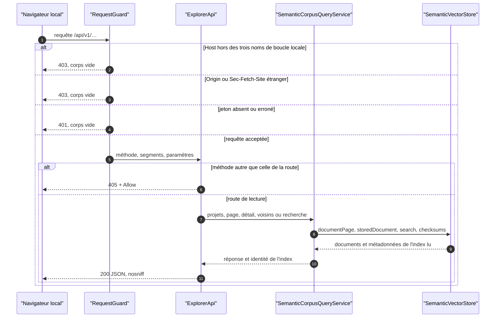
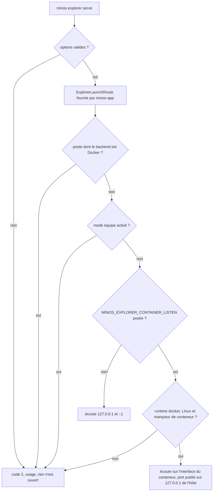
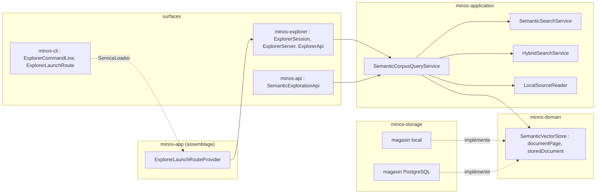
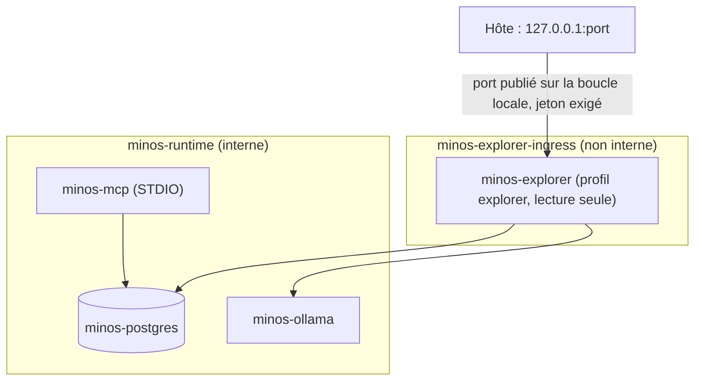

# Capacité `exploration-semantique` — dossier durable

Spec de référence : [openspec/specs/exploration-semantique/spec.md](../../../../openspec/specs/exploration-semantique/spec.md)
· Relevé au 2026-11-13, changement `explorer-l-index-semantique-dans-un-navigateur`.

## Objet et périmètre

[Exigence] L'utilisateur d'un poste consulte, depuis un navigateur local et en lecture seule, les documents
sémantiques d'un projet : liste paginée, détail, recherche, voisins. Acteurs : l'utilisateur du poste, son
navigateur. Hors périmètre : carte 2D (changement `projeter-l-index-semantique-en-2d`), accès distant, toute
écriture. Décision : ARCH-0082.

## Vues

### Par où passe une requête du navigateur, et où est-elle refusée ?

Type : sequenceDiagram (UML, séquence) · Portée : existant vérifié · Exigences : « Toute requête d'API exige le
jeton de session et une origine locale », « La surface d'exploration ne modifie aucun état »

Aucun service n'est appelé avant le garde ; aucune route n'appelle `replace`, `synchronize` ni un provider
d'embeddings pour autre chose que le vecteur de la requête de recherche.

### Qui démarre la surface, et sur quelles adresses écoute-t-elle ?

Type : flowchart (organigramme de décision, non UML) · Portée : existant vérifié · Exigences : « La surface
d'exploration est optionnelle et n'écoute que sur la boucle locale »

Aucune option de ligne de commande ne choisit l'adresse d'écoute.

### Quels composants, et dans quel sens dépendent-ils ?

Type : flowchart (vue de composants, non UML) · Portée : existant vérifié · Exigences : « La surface
d'exploration ne modifie aucun état », « Les voisins d'un document sont classés depuis son vecteur stocké »

`minos-cli` ne dépend pas de `minos-explorer` : il déclare une interface que l'assemblage fournit. Les surfaces ne
voient que le service applicatif ; aucune ne nomme un adaptateur de stockage (`ModuleArchitectureTest`).

### Comment le service optionnel du runtime Docker est-il exposé ?

Type : flowchart (vue de conteneurs, non UML) · Portée : existant vérifié, non qualifié sur une installation
réelle · Exigences : « La surface d'exploration est optionnelle et n'écoute que sur la boucle locale »

Dans le conteneur, la surface écoute sur l'interface du conteneur : un port publié n'atteint pas sa boucle
locale. Cette écoute n'est accordée que par la variable interne posée par le Compose, dans un conteneur. Le
réseau d'entrée donne au conteneur une route sortante, acceptée en l'état (écart E3).

## Traçabilité

| Exigence | Scénarios couverts | Vue | Preuves | Statut |
|---|---|---|---|---|
| La surface d'exploration est optionnelle et n'écoute que sur la boucle locale | 3/3, le premier par preuve structurelle | V2, V4 | `minos-explorer/src/test/java/com/minos/explorer/ExplorerServerTest.java#theSurfaceIsBoundToLoopbackAddressesOnlyAndItsUrlNamesTheIpv4Loopback`, `minos-explorer/src/test/java/com/minos/explorer/ExplorerSessionTest.java#theSurfaceRefusesToStartWhenTheTeamModeIsEnabledAndOpensNoPort`, `minos-app/src/test/java/com/minos/app/architecture/ModuleArchitectureTest.java#onlyTheExplorerRouteOfTheAssemblyStartsTheExplorationSurface` | partielle |
| Toute requête d'API exige le jeton de session et une origine locale | 3/3 | V1 | `minos-explorer/src/test/java/com/minos/explorer/ExplorerServerTest.java#anApiRequestWithoutTheTokenIsRefusedWithoutDetailAndReachesNoService`, `minos-explorer/src/test/java/com/minos/explorer/ExplorerServerTest.java#aRequestWhoseHostIsNotALoopbackNameOfThisPortIsRefusedEvenWithTheToken`, `minos-explorer/src/test/java/com/minos/explorer/ExplorerServerTest.java#aRequestFromAnotherOriginIsRefusedAndNoCorsHeaderIsEverSent` | couverte |
| La surface d'exploration ne modifie aucun état | 1/1 hors statut et points de projection (non livrés) | V1 | `minos-explorer/src/test/java/com/minos/explorer/ExplorerRoutesTest.java#consultingEveryRouteLeavesTheHomeAndTheIndexByteForByteUnchanged` | partielle |
| La liste des documents est paginée et lue sur un seul index | 3/3 | V1 | `minos-engine/src/test/java/com/minos/testsupport/SemanticDocumentReadsContract.java#aFullWalkReturnsEveryDocumentOnceInStableKeyOrder`, `minos-application/src/test/java/com/minos/application/semantic/SemanticCorpusQueryServiceTest.java#aPageSizeOutOfBoundsIsAUsageErrorThatNamesTheBound`, `minos-application/src/test/java/com/minos/application/semantic/SemanticCorpusQueryServiceTest.java#aCursorIssuedForAnIndexIsRefusedOnceThatIndexIsReplaced` | couverte |
| Le détail distingue le contenu indexé de la source actuelle | 2/2 | V1 | `minos-application/src/test/java/com/minos/application/semantic/SemanticCorpusQueryServiceTest.java#theDetailOfAChunkWhoseSourceChangedShowsBothContentsAndTheDivergence`, `minos-application/src/test/java/com/minos/application/semantic/SemanticCorpusQueryServiceTest.java#theDetailOfADocumentWhoseFileWasDeletedSaysTheSourceIsMissingAndShowsNoAbsolutePath` | couverte |
| La recherche de l'explorateur rend le classement des services existants et nomme chaque score | 2/2, égalité avec le service et non avec la sortie de la commande | V1 | `minos-application/src/test/java/com/minos/application/semantic/SemanticCorpusQueryServiceTest.java#aSemanticSearchKeepsTheRanksAndScoresOfTheSearchServiceAndNamesTheScore`, `minos-application/src/test/java/com/minos/application/semantic/SemanticCorpusQueryServiceTest.java#aSearchOnAnIndexThatIsNotReadyIsEmptyAndSaysWhy` | partielle |
| Les voisins d'un document sont classés depuis son vecteur stocké | 2/2 | V1 | `minos-application/src/test/java/com/minos/application/semantic/SemanticCorpusQueryServiceTest.java#neighboursAreRankedFromTheStoredVectorWithoutAnyCallToTheProvider`, `minos-application/src/test/java/com/minos/application/semantic/SemanticCorpusQueryServiceTest.java#anUnknownStableKeyIsNotFoundForNeighboursAndForTheDetail` | couverte |
| Aucune réponse de l'explorateur n'expose de chemin absolu ni de secret | 2/2 | V1 | `minos-explorer/src/test/java/com/minos/explorer/ExplorerRoutesTest.java#noAnswerErrorOrLogLineNamesAnAbsoluteRootOrAProviderAddress`, `minos-explorer/src/test/java/com/minos/explorer/ExplorerServerTest.java#everyAnswerCarriesTheSecurityHeadersAndNoCookie`, `minos-explorer/src/test/java/com/minos/explorer/WebResourcesContentTest.java#indexedContentCanOnlyBeInsertedAsText` | couverte |
| Le provider local-hash est signalé comme référence déterministe | 1/1 | V1 | `minos-explorer/src/test/java/com/minos/explorer/ExplorerRoutesTest.java#theProjectListDescribesTheIndexAndNeverTheRootOfAProject`, `minos-api/src/test/java/com/minos/api/SemanticExplorationApiContractTest.java#theFiveReadingsDescribeOneIndexAndNeverItsRoot` | couverte |

## Écarts

| Id | Écart | Preuve | Suite proposée |
|---|---|---|---|
| E1 | Le scénario « Aucune écoute sans la commande » n'est prouvé que structurellement (aucun autre code n'atteint la surface ni n'ouvre d'écoute) ; aucun test n'observe les ports d'un processus CLI ou MCP | `minos-app/src/test/java/com/minos/app/architecture/ModuleArchitectureTest.java` | [Proposition] Test de processus qui relève les ports à l'écoute |
| E2 | Le « Purpose » et le scénario « Données inchangées » citent la carte 2D, le statut et les points de projection, portés par un autre changement | `openspec/changes/projeter-l-index-semantique-en-2d` | Aucun avant l'archivage de ce changement |
| E3 | En runtime Docker, la surface écoute sur l'interface du conteneur et le réseau d'entrée n'est pas interne (route sortante) | `docker/compose-mcp.connected.yaml` | Accepté par le propriétaire le 2026-11-13 (ARCH-0082, « Écarts constatés ») |
| E4 | « Même classement que la CLI » est prouvé contre `SemanticSearchService`, que la commande appelle, pas contre la sortie de `semantic-search` | `minos-application/src/test/java/com/minos/application/semantic/SemanticCorpusQueryServiceTest.java` | [Proposition] Test de bout en bout CLI contre HTTP |
| E5 | Le parcours dans un navigateur réel n'est pas automatisé | — | Parcours manuel du propriétaire (tâche 5.6) |

## Questions ouvertes

Seuils de performance : à fixer après la mesure planifiée avec le changement de projection.
