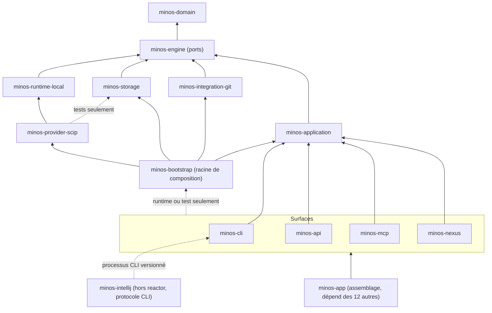

# Capacité `frontieres-de-modules` — dossier durable

Spec de référence : [openspec/specs/frontieres-de-modules/spec.md](../../../../openspec/specs/frontieres-de-modules/spec.md)
· Relevé au commit `64d131e4` (2026-11-04).

## Objet et périmètre

[Exigence] Les frontières entre les modules du reactor suivent la direction domain → engine → runtime/storage →
adapters → application → surfaces (ARCH-0068), avec `minos-bootstrap` pour racine de composition (ARCH-0042) ;
elles sont tenues par trois mécanismes : le garde Python `scripts/architecture/check-module-boundaries.py` et son
auto-test, les tests ArchUnit de `minos-app/src/test/java/com/minos/app/architecture/ModuleArchitectureTest.java`
sur le bytecode, et les règles Archgate des ADR. Les dettes encore tolérées sont des listes fermées (cliquets) qui
ne peuvent que se resserrer. Acteurs : le développeur qui ajoute une dépendance ou déplace une classe, la CI.

La vue détaillée des dépendances réelles entre POM est générée :
[module-dependencies.md](../module-dependencies.md) (par `check-module-boundaries.py --write-doc`, ne pas éditer).

## Vues

### Quelles dépendances entre modules sont autorisées ?

Type : flowchart (vue de composants, non UML) · Portée : existant vérifié · Exigences : « Les adaptateurs de
stockage forment un seul module », « `minos-nexus` ne dépend plus de `minos-engine` », « La composition et le
provider SCIP ne nomment pas le backend PostgreSQL », « Le garde de cycles couvre le plugin IntelliJ hors du
reactor »

Vue simplifiée de `ALLOWED_DEPENDENCIES` (`scripts/architecture/check-module-boundaries.py:59-85`), dont une copie
identique vit dans `ModuleArchitectureTest` (égalité contrôlée par la règle A17) ; les flèches transitives vers le
domaine et le moteur sont omises. Les surfaces n'atteignent la racine de composition qu'en portée `runtime` ou
`test`. Le plugin IntelliJ n'est pas un module : il n'entre que dans l'analyse des cycles (A8).

Règles du garde, par ce qu'elles refusent : A2 dépendance contraire aux rôles hexagonaux ; A3 package partagé
entre deux modules ; A7 liste des modules différente du reactor ; A8 nouveau cycle de packages ; A9 documentation
des dépendances différente des POM ; A10 type non exporté du runtime local nommé ailleurs ; A11 type du moteur
nommé par une surface hors liste ; A12 lancement de processus dans les couches internes ; A13 couplage entre
adaptateurs hors liste ; A14 nouvelle racine de packages ; A15 classe publique sans appelant ; A16
`ServiceLoader` sans chargeur explicite ; A17 tables Java et Python différentes ; A18 index mémoire ou port
d'écriture hors du cœur. Aucune règle ne porte les étiquettes A4 à A6.

## Traçabilité

| Exigence | Scénarios couverts | Vue | Preuves | Statut |
|---|---|---|---|---|
| Chaque règle de frontière du garde Python est couverte par un cas refusé et un cas accepté | tous | V1 | `scripts/architecture/test_check_module_boundaries.py#test_every_check_function_of_the_script_is_referenced_by_a_test`, `scripts/architecture/test_check_module_boundaries.py#test_a_surface_that_starts_depending_on_an_adapter_is_refused`, `scripts/architecture/test_check_module_boundaries.py#test_removing_a_permitted_dependency_is_accepted` | couverte |
| Une dépendance interne est reconnue par son artefact, non par un nom de groupe écrit en dur | tous | — | `scripts/architecture/test_check_module_boundaries.py#test_an_unresolved_group_is_refused`, `scripts/architecture/test_check_module_boundaries.py#test_a_look_alike_group_is_refused_instead_of_ignored_as_third_party`, `scripts/architecture/test_check_module_boundaries.py#test_the_real_root_group_is_the_one_the_modules_use` | couverte |
| Les règles de mise en page de build valent aussi dans un profil | tous | — | `scripts/architecture/test_check_module_boundaries.py#test_a_custom_source_directory_is_refused_at_the_root_and_in_a_profile`, `scripts/architecture/test_check_module_boundaries.py#test_compiler_includes_and_excludes_are_refused_at_the_root_and_in_a_profile` | couverte |
| Un cycle de packages absent de la table des cycles connus est refusé | « 4 cycles connus » contredit par l'exigence sur l'absence de cycle (E1) | — | `scripts/architecture/test_check_module_boundaries.py#test_a_new_cycle_is_refused_with_a_witness_edge_in_each_direction`, `scripts/architecture/test_check_module_boundaries.py#test_a_known_cycle_that_grows_is_refused` | partielle |
| Le cliquet des cycles de packages ne se desserre pas | tous | — | `scripts/architecture/test_check_module_boundaries.py#test_a_known_cycle_that_was_lifted_but_is_still_listed_is_refused`, `scripts/architecture/test_check_module_boundaries.py#test_a_known_cycle_that_shrinks_is_refused` | couverte |
| Le garde de cycles couvre le plugin IntelliJ hors du reactor | tous (racine synthétique, plugin réel par la configuration) | V1 | `scripts/architecture/test_check_module_boundaries.py#test_a_cycle_in_a_source_root_outside_the_reactor_is_refused`, `scripts/architecture/check-module-boundaries.py:1441` | couverte |
| Les listes de dépendances de la documentation d'architecture courante sont confrontées aux POM | tous | — | `scripts/architecture/test_check_module_boundaries.py#test_a_dependency_the_pom_does_not_declare_is_refused_with_the_expected_line`, `scripts/architecture/test_check_module_boundaries.py#test_the_current_document_matches_the_real_poms` | couverte |
| Le code de production ne contient aucun cycle de packages | tous | — | `scripts/architecture/test_check_module_boundaries.py#test_the_real_repository_has_no_package_cycle_and_no_excuse_for_one` | couverte |
| Les packages de `minos-application` sont séparables | recherche « pivot extrait » non vide (historique) ; compte de modules faux (E2) | — | `scripts/architecture/test_check_module_boundaries.py#test_the_real_repository_has_no_package_cycle_and_no_excuse_for_one`, `minos-application/src/main/java/com/minos/application/resolution/ProjectResolver.java` | partielle |
| L'incrémental ne dépend plus de l'orchestration en retour | réintroduction protégée seulement par A8 générique | — | `scripts/architecture/test_check_module_boundaries.py#test_the_real_repository_has_no_package_cycle_and_no_excuse_for_one` | partielle |
| Le plugin IntelliJ n'a pas de cycle entre `protocol`, `service` et `ui` | protégé seulement par A8 générique | V1 | `scripts/architecture/test_check_module_boundaries.py#test_a_cycle_in_a_source_root_outside_the_reactor_is_refused` | partielle |
| Le comportement observable est inchangé à l'octet | aucune étape `git diff --exit-code` sur les goldens | — | `minos-app/src/test/java/com/minos/characterization/A2SurfaceCharacterizationTest.java#cliJsonOutputsAreUnchanged`, `minos-app/src/test/java/com/minos/characterization/A2SurfaceCharacterizationTest.java#cliTextOutputsAreUnchanged` | partielle |
| Les gates et la couverture suivent les classes déplacées | un gate cité n'apparaît dans aucun workflow (E6) | — | `scripts/quality/check-jacoco.py:71` | partielle |
| Le module PostgreSQL est rangé en sous-packages sans cycle | tous (par A8 générique) | — | `minos-app/src/test/java/com/minos/packaging/ShadedJarCompositionRootIT.java#shadedJarDeclaresExactlyOneCompositionRootAndNoTestDependency`, `scripts/architecture/test_check_module_boundaries.py#test_the_real_repository_has_no_package_cycle_and_no_excuse_for_one` | couverte |
| Le module CLI est rangé en sous-packages sans cycle | tous (par A8 générique) | — | `minos-app/src/test/java/com/minos/packaging/ShadedJarMcpEntryPointIT.java#shadedJarDeclaresExactlyOneMcpEntryPoint`, `minos-app/src/test/java/com/minos/packaging/ShadedJarMcpEntryPointIT.java#realDiscoveryInsideTheShadedJarFindsTheSingleMcpEntryPoint` | couverte |
| Les types de confinement de l'exécution locale ne sont nommés que par liste fermée | tous | — | `scripts/architecture/test_check_module_boundaries.py#test_a_single_import_of_a_type_that_is_not_exported_is_refused`, `scripts/architecture/test_check_module_boundaries.py#test_an_export_entry_no_other_module_names_any_more_is_refused`, `scripts/architecture/test_check_module_boundaries.py#test_the_real_tree_names_only_exported_types` | couverte |
| Le module d'exécution locale est rangé en sous-packages sans cycle | tous (par A8 générique) | — | `minos-runtime-local/src/test/java/com/minos/runtime/local/sandbox/WindowsExecutionPathIdentityProviderTest.java#registeredRuntimeProviderEstablishesStrongAuthorization` | couverte |
| Les surfaces n'assemblent pas le cycle d'indexation | construction hors des surfaces : aucun garde automatisé | V1 | `scripts/architecture/test_check_module_boundaries.py#test_the_application_layer_may_not_depend_on_an_adapter`, `minos-app/src/test/java/com/minos/app/architecture/ModuleArchitectureTest.java#applicationOnlyKnowsPorts` | partielle |
| Une classe publique de production est référencée par la production ou déclarée | tous | — | `scripts/architecture/test_check_module_boundaries.py#test_public_class_without_caller_is_refused`, `scripts/architecture/test_check_module_boundaries.py#test_class_named_only_by_a_test_is_refused`, `scripts/architecture/test_check_module_boundaries.py#test_repository_list_matches_the_head` | couverte |
| La liste des classes sans appelant est un cliquet justifié | tous | — | `scripts/architecture/test_check_module_boundaries.py#test_stale_entry_is_refused`, `scripts/architecture/test_check_module_boundaries.py#test_entry_without_reason_is_refused` | couverte |
| Les fournisseurs optionnels sont découverts par le chargeur de MINOS | tous | — | `minos-bootstrap/src/test/java/com/minos/bootstrap/StorageBackendSelectionTest.java#emptyContextClassLoaderStillFindsThePostgresqlProvider`, `minos-runtime-local/src/test/java/com/minos/runtime/local/sandbox/WindowsExecutionPathIdentityProviderTest.java#emptyContextClassLoaderStillEstablishesTheAuthorization` | couverte |
| Des fournisseurs en double sont refusés | refus du lancement d'un provider prouvé jusqu'à l'identité indisponible | — | `minos-bootstrap/src/test/java/com/minos/bootstrap/StorageBackendSelectionTest.java#twoProvidersOfTheRequestedIdAreRefusedByName`, `minos-engine/src/test/java/com/minos/orchestration/StableFileSystemIdentityDiscoveryTest.java#twoProvidersMakeTheIdentityUnavailable` | partielle |
| Aucune découverte de service de production n'omet le chargeur | tous (compte différent de la spec, E3) | — | `scripts/architecture/test_check_module_boundaries.py#test_a_one_argument_call_in_production_is_refused_with_file_and_line`, `scripts/architecture/test_check_module_boundaries.py#test_the_real_tree_passes_a_loader_at_every_site` | couverte |
| Les types du moteur nommés par une surface le sont par liste fermée | tous (exemple de la spec périmé, E5) | — | `scripts/architecture/test_check_module_boundaries.py#test_an_imported_type_outside_the_list_is_refused_naming_surface_file_and_type`, `scripts/architecture/test_check_module_boundaries.py#test_a_dead_entry_is_refused`, `minos-app/src/test/java/com/minos/app/architecture/ModuleArchitectureTest.java#surfacesUseOnlyListedEngineTypes` | couverte |
| Le lancement de processus hors du runtime local est tenu par liste fermée | tous | — | `scripts/architecture/test_check_module_boundaries.py#test_a_process_builder_in_an_unlisted_engine_class_is_refused`, `scripts/architecture/test_check_module_boundaries.py#test_the_real_tree_launches_no_process_in_the_inner_layers` | couverte |
| Les types d'un adaptateur nommés par un autre adaptateur le sont par liste fermée | tous | — | `scripts/architecture/test_check_module_boundaries.py#test_a_postgresql_test_importing_the_local_backend_is_refused`, `scripts/architecture/test_check_module_boundaries.py#test_a_listed_couple_without_a_reason_is_refused` | couverte |
| Un module ne crée pas de nouvelle racine de packages | tous | — | `scripts/architecture/test_check_module_boundaries.py#test_a_new_root_in_the_engine_is_refused_naming_module_and_root`, `scripts/architecture/test_check_module_boundaries.py#test_the_real_tree_creates_no_new_root` | couverte |
| Les arêtes d'exécution par service figurent dans le document de dépendances | tous | — | `scripts/architecture/test_check_module_boundaries.py#test_the_real_tree_documents_the_cli_to_assembly_edge`, `scripts/architecture/test_check_module_boundaries.py#test_a_document_without_the_edge_is_refused_naming_the_edge` | couverte |
| La classe d'index mémoire n'est nommée que par le cœur | tous | — | `scripts/architecture/test_check_module_boundaries.py#test_an_imported_memory_index_outside_the_core_is_refused_naming_class_and_type`, `scripts/architecture/test_check_module_boundaries.py#test_the_real_tree_keeps_the_memory_index_in_the_core` | couverte |
| Les cas d'usage de lecture ne reçoivent pas le port d'écriture | tous | — | `scripts/architecture/test_check_module_boundaries.py#test_the_write_port_named_by_the_application_is_refused`, `scripts/architecture/test_check_module_boundaries.py#test_the_write_port_stays_allowed_outside_the_application` | couverte |
| Les familles de l'indexation ne sont plus nommées par les surfaces | décomptes du cliquet périmés (E4) | — | `scripts/architecture/test_check_module_boundaries.py#test_a_type_removed_by_the_first_lot_is_refused_again_against_the_real_cli_list`, `scripts/architecture/test_check_module_boundaries.py#test_the_real_tree_names_only_listed_engine_types` | partielle |
| L'indexation distante est un cas d'usage qui refuse avant tout effet | tous | — | `minos-application/src/test/java/com/minos/application/remote/RemoteIndexingUseCaseRefusalTest.java#refusesBeforeAnyEffectWhenNoSandboxIsQualifiedForUntrustedCode`, `minos-cli/src/test/java/com/minos/cli/operations/LocalRemoteIndexOperationsRefusalTest.java#productionWiringRefusesBeforeAnyMaterializationOnTheCurrentHost` | couverte |
| L'état de reprise est lu sans écriture par l'application | tous | — | `minos-application/src/test/java/com/minos/application/ProjectInspectionServiceResumableRunTest.java#theResumableRunIsReadWithoutAnyWriteOrLease`, `minos-mcp/src/test/java/com/minos/mcp/MinosMcpReadOnlyHomeTest.java#theResumableRunIsReadFromARealHomeWithoutAnyTrace` | couverte |
| Les choix applicatifs couvrent les énumérations du moteur | tous | — | `minos-application/src/test/java/com/minos/application/indexing/IndexingResumeChoiceTest.java#everyEnginePolicyHasAChoiceOfTheSameNameAndBack`, `minos-application/src/test/java/com/minos/application/remote/RemoteSourceRequestTest.java#everyWorkerNetworkPolicyHasAChoiceOfTheSameNameAndBack` | couverte |
| Le premier lot ne change aucune sortie publique | contrôle des goldens par `git diff` manuel | — | `minos-app/src/test/java/com/minos/characterization/A2SurfaceCharacterizationTest.java#javaApiOutputsAreUnchanged`, `minos-api/src/test/java/com/minos/api/ProviderDtoOrderTest.java#capabilitiesAreKeptSortedWhateverTheirInsertionOrder` | partielle |
| Un accesseur de MinosApplication appelé par une surface compte comme un usage du type rendu | tous (arbres synthétiques) | — | `scripts/architecture/test_check_module_boundaries.py#test_an_accessor_called_without_naming_the_type_is_refused`, `scripts/architecture/test_check_module_boundaries.py#test_a_method_reference_counts_as_a_use` | couverte |
| Les types du moteur utilisés par le bytecode d'une surface le sont par liste fermée | tous | — | `minos-app/src/test/java/com/minos/app/architecture/ModuleArchitectureTest.java#surfacesUseOnlyListedEngineTypes`, `minos-app/src/test/java/com/minos/app/architecture/ModuleArchitectureTest.java#theBytecodeRatchetRefusesANewTypeAChangedCountAndADeadEntry` | couverte |
| Le mécanisme d'ACL du runtime local n'est nommé par aucun autre module | tous | — | `scripts/architecture/test_check_module_boundaries.py#test_the_acl_package_is_guarded_and_exports_nothing` | couverte |
| Le diagnostic de l'hôte est consommé par un service applicatif | réintroductions couvertes par A11 générique ; un type cité non affirmé (E7) | — | `scripts/architecture/test_check_module_boundaries.py#test_the_cli_no_longer_uses_the_host_mechanisms_of_the_engine`, `minos-application/src/test/java/com/minos/application/HostDiagnosticsServiceTest.java#aHostCommandIsFoundOrReportedAbsent` | partielle |
| Le noyau transverse sans E/S est dans le domaine | redéclaration dans le moteur couverte par A3 et A14 génériques ; raison écrite non contrôlée | — | `scripts/architecture/test_check_module_boundaries.py#test_no_surface_uses_the_transverse_core_moved_to_the_domain`, `minos-app/src/test/java/com/minos/app/architecture/ModuleArchitectureTest.java#coreModulesStayAtTheBottom` | partielle |
| Le contrôle hébergé est consommé par une façade applicative | scénario d'accesseur périmé (E8) | — | `scripts/architecture/test_check_module_boundaries.py#test_no_surface_uses_the_hosted_control_plane_of_the_engine`, `minos-app/src/test/java/com/minos/characterization/A2SurfaceCharacterizationTest.java#teamControlPlaneOutputsAreUnchanged` | partielle |
| L'activité Git est consommée par une requête applicative | scénario d'accesseur périmé (E8) | — | `scripts/architecture/test_check_module_boundaries.py#test_the_surfaces_read_git_through_the_application_and_keep_only_the_published_read_models`, `minos-application/src/test/java/com/minos/application/LocalProjectGitQueryTest.java#theInspectionAndTheActivityAreThoseOfThePort` | partielle |
| La requête de symboles de l'API est construite par l'application | tous | — | `scripts/architecture/test_check_module_boundaries.py#test_the_surfaces_read_git_through_the_application_and_keep_only_the_published_read_models`, `minos-app/src/test/java/com/minos/characterization/A2SurfaceCharacterizationTest.java#javaApiOutputsAreUnchanged` | couverte |
| Les résultats de requête sont des modèles de lecture publiés | raison écrite des entrées non contrôlée | — | `scripts/architecture/test_check_module_boundaries.py#test_an_imported_type_outside_the_list_is_refused_naming_surface_file_and_type` | partielle |
| L'export NEXUS passe par un cas d'usage applicatif | tous | — | `minos-application/src/test/java/com/minos/application/export/KnowledgeExportRefusalTest.java#anUnregisteredProjectRootIsRefusedByItsName`, `scripts/architecture/test_check_module_boundaries.py#test_the_nexus_export_no_longer_uses_the_engine` | couverte |
| `minos-nexus` ne dépend plus de `minos-engine` | usage transitif : pas de témoin négatif en bytecode | V1 | `scripts/architecture/test_check_module_boundaries.py#test_the_nexus_surface_may_not_depend_on_the_engine_again`, `minos-app/src/test/java/com/minos/app/architecture/ModuleArchitectureTest.java#everyModuleOnlyUsesItsAllowedModules` | partielle |
| Les adaptateurs de stockage forment un seul module | tous | V1 | `scripts/architecture/test_check_module_boundaries.py#test_reactor_module_absent_from_the_governed_list_fails`, `scripts/architecture/test_check_module_boundaries.py#test_the_real_tables_are_identical` | couverte |
| La composition et le provider SCIP ne nomment pas le backend PostgreSQL | tous | V1 | `scripts/architecture/test_check_module_boundaries.py#test_an_import_of_the_backend_in_the_composition_root_is_refused`, `minos-app/src/test/java/com/minos/app/architecture/ModuleArchitectureTest.java#onlyThePostgresqlBackendUsesPostgresql` | couverte |
| Le mode local ne charge aucune classe PostgreSQL | tous | — | `minos-bootstrap/src/test/java/com/minos/bootstrap/LocalCompositionLoadsNoPostgresqlClassTest.java#theLocalCompositionLoadsNoPostgresqlClass`, `minos-bootstrap/src/test/java/com/minos/bootstrap/LocalCompositionLoadsNoPostgresqlClassTest.java#theCheckNamesAPostgresqlClassLoadedByTheComposition` | couverte |
| Le garde refuse l'ajout de sources par build-helper | tous | — | `scripts/architecture/test_check_module_boundaries.py#test_the_build_helper_plugin_is_refused_at_the_root_and_in_a_profile` | couverte |
| Les backends de stockage ne se nomment pas l'un l'autre | tous | — | `scripts/architecture/test_check_module_boundaries.py#test_the_local_backend_naming_postgresql_by_qualified_name_is_refused` | couverte |
| Le codec et le mapping de chemins ne dépendent d'aucun backend | dépendance du codec en bytecode : pas de témoin négatif | — | `scripts/architecture/test_check_module_boundaries.py#test_the_codec_importing_jdbc_is_refused`, `minos-app/src/test/java/com/minos/app/architecture/ModuleArchitectureTest.java#theSharedStoragePackagesUseNoBackend` | partielle |
| Le backend PostgreSQL ne dépend pas du backend local dans le bytecode | pas de témoin négatif | — | `minos-app/src/test/java/com/minos/app/architecture/ModuleArchitectureTest.java#thePostgresqlBackendDoesNotUseTheLocalBackend` | partielle |
| Le provider SCIP ne nomme pas le stockage en production | tous | V1 | `scripts/architecture/test_check_module_boundaries.py#test_a_file_store_created_again_by_the_scip_lifecycle_is_refused_without_a_storage_couple`, `scripts/architecture/test_check_module_boundaries.py#test_the_scip_provider_sees_the_storage_module_in_tests_only` | couverte |
| Les sous-packages de com.minos.storage appartiennent à minos-storage | tous | — | `scripts/architecture/test_check_module_boundaries.py#test_a_package_below_the_storage_root_outside_minos_storage_is_refused`, `scripts/architecture/test_check_module_boundaries.py#test_the_real_tree_keeps_the_storage_packages_apart` | couverte |
| La part de code concret du moteur est mesurée sans cliquet | tous | — | `scripts/architecture/test_check_module_boundaries.py#test_each_file_counts_for_its_first_top_level_declaration_with_all_its_lines`, `scripts/architecture/test_check_module_boundaries.py#test_the_real_engine_has_no_unclassified_file` | couverte |
| La correspondance des chemins Docker passe par une façade applicative | tous | — | `minos-application/src/test/java/com/minos/application/ProjectPathMappingServiceTest.java#refusesToReplaceAnotherMappingAndWritesNothing`, `scripts/architecture/test_check_module_boundaries.py#test_the_cli_no_longer_names_the_project_path_port` | couverte |
| Les accesseurs de MinosApplication typés moteur sont tenus par un cliquet | tous | — | `scripts/architecture/test_check_module_boundaries.py#test_an_accessor_outside_the_list_is_refused_with_its_name_and_type`, `scripts/architecture/test_check_module_boundaries.py#test_the_real_list_matches_the_real_application` | couverte |

Le garde et son auto-test tournent dans le job `invariants` de `pr-ci.yml` ; les tests ArchUnit dans les jobs
`Verify` (Linux et Windows).

## Écarts

| Id | Écart | Preuve | Suite proposée |
|---|---|---|---|
| E1 | La spec se contredit : une exigence veut une table des cycles connus à quatre cycles (15 packages) et un affichage « 4 cycles connus », une autre une table vide et « 0 known cycles over 0 packages » ; le code suit la seconde | `openspec/specs/frontieres-de-modules/spec.md:58`, `openspec/specs/frontieres-de-modules/spec.md:114`, `scripts/architecture/check-module-boundaries.py:1442` | [Proposition] Mettre la première exigence à l'état final (table vide) par un changement |
| E2 | Plusieurs exigences parlent de 14 modules ; le reactor et le garde en comptent 13 | `scripts/architecture/check-module-boundaries.py:19-33` | [Proposition] Corriger le nombre (fait écrit une fois, puis référencé) |
| E3 | Une exigence parle de quatre découvertes de service de production ; le test en affirme cinq | `scripts/architecture/test_check_module_boundaries.py` (`test_the_real_tree_passes_a_loader_at_every_site`) | [Proposition] Corriger le compte ou ne plus l'écrire dans la spec |
| E4 | Le scénario « Décomptes du cliquet » attend `minos-api=14, minos-cli=15, minos-mcp=4, minos-nexus=6` ; le garde en est à 3, 4, 1 et 0, avec un autre format d'affichage : le scénario échouerait tel qu'écrit | `openspec/specs/frontieres-de-modules/spec.md:524`, `scripts/architecture/check-module-boundaries.py:561-584` | [Proposition] Décrire le cliquet sans compte figé (il ne fait que baisser) |
| E5 | L'exemple de type du moteur « déjà listé » pour la CLI (`io.PrivateLocalStorage`) est sorti de la liste ; le test s'appuie sur un autre type | `openspec/specs/frontieres-de-modules/spec.md:361` | [Proposition] Mettre l'exemple à jour |
| E6 | Un gate cité par une exigence (`check-polyglot-provider-consistency.py`) n'apparaît dans aucun workflow | `scripts/quality/check-polyglot-provider-consistency.py` | [Question] Gate orphelin à câbler ou à retirer ? |
| E7 | Le test du diagnostic de l'hôte n'affirme pas l'un des trois types que la spec cite (`runtime.HostCommandLocator`) | `scripts/architecture/test_check_module_boundaries.py` (`test_the_cli_no_longer_uses_the_host_mechanisms_of_the_engine`) | [Proposition] Compléter le test |
| E8 | Trois scénarios supposent des accesseurs de `MinosApplication` encore publics ; ils sont désormais privés au package : c'est la compilation qui échoue, pas la règle A11 | `minos-application/src/main/java/com/minos/application/MinosApplication.java:299`, `minos-application/src/main/java/com/minos/application/MinosApplication.java:318` | [Proposition] Reformuler les scénarios |
| E9 | La spec exige une raison écrite pour chaque entrée de la liste A11 ; ce ne sont que des commentaires, non contrôlés (contrairement aux raisons A13) | `scripts/architecture/check-module-boundaries.py:562-575` | [Proposition] Contrôler les raisons A11 comme celles d'A13 |

## Questions ouvertes

- Le libellé de l'étape CI du garde (« A3 packages, A7 reactor ») ne reflète plus son périmètre (A2 à A18) : à
  corriger avec le prochain changement des workflows.
