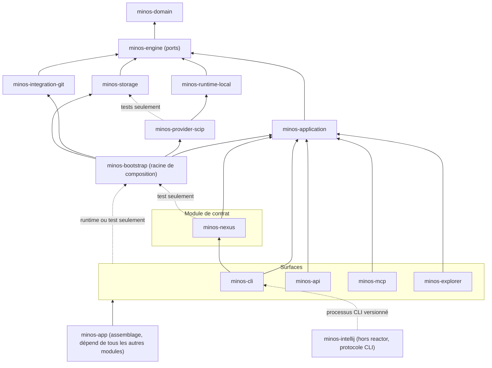
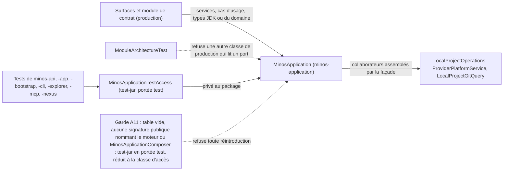

# Capacité `frontieres-de-modules` — dossier durable

Spec de référence : [openspec/specs/frontieres-de-modules/spec.md](../../../../openspec/specs/frontieres-de-modules/spec.md)
· Relevé au commit `87d24b8f` (2026-11-27).

## Objet et périmètre

[Exigence] Les frontières entre les modules du reactor suivent la direction domain → engine → runtime/storage →
adapters → application → surfaces (ARCH-0068), avec `minos-bootstrap` pour racine de composition (ARCH-0042) ;
elles sont tenues par trois mécanismes : le garde Python (le script d'entrée
`scripts/architecture/check-module-boundaries.py`, ses modules de règles et leurs auto-tests, décrits dans
[quality-gates.md](../../../developer/quality-gates.md)), les tests ArchUnit de `minos-app/src/test/java/com/minos/app/architecture/ModuleArchitectureTest.java`
sur le bytecode, et les règles Archgate des ADR. Les dettes encore tolérées sont des listes fermées (cliquets) qui
ne peuvent que se resserrer. Acteurs : le développeur qui ajoute une dépendance ou déplace une classe, la CI.

La vue détaillée des dépendances réelles entre POM est générée :
[module-dependencies.md](../module-dependencies.md) (par `check-module-boundaries.py --write-doc`, ne pas éditer).

## Vues

### Quelles dépendances entre modules sont autorisées ?

Type : flowchart (vue de composants, non UML) · Portée : existant vérifié · Exigences : « Les adaptateurs de
stockage forment un seul module », « `minos-nexus` ne dépend plus de `minos-engine` », « La composition et le
provider SCIP ne nomment pas le backend PostgreSQL », « Le garde de cycles couvre le plugin IntelliJ hors du
reactor », « Un module de contrat reste sous les surfaces », « Aucune surface ne dépend d'une autre surface »

Vue simplifiée de la section `allowedDependencies` de `scripts/architecture/module-boundaries.json`, source unique
que le garde et `ModuleArchitectureTest` lisent sans copie (la règle A17 refuse toute table recopiée) ; les flèches transitives vers le
domaine et le moteur sont omises. Les surfaces n'atteignent la racine de composition qu'en portée `runtime` ou
`test`, le module de contrat en portée `test` seulement. Aucune flèche ne relie deux surfaces : `minos-cli`
dépend du module de contrat `minos-nexus`, qui ne dépend que du domaine et de l'application. Le plugin IntelliJ
n'est pas un module : il n'entre que dans l'analyse des cycles (A8).

Règles du garde, par ce qu'elles refusent : A2 dépendance contraire aux rôles hexagonaux (dont une surface
qui dépend d'une autre surface, et un module de contrat qui dépend d'autre chose que du domaine et de
l'application) ; A3 package partagé
entre deux modules ; A7 liste des modules différente du reactor ; A8 nouveau cycle de packages ; A9 documentation
des dépendances différente des POM ; A10 type non exporté du runtime local nommé ailleurs ; A11 type du moteur
nommé par une surface ou un module de contrat hors liste ; A12 lancement de processus dans les couches internes ; A13 couplage entre
adaptateurs hors liste ; A14 nouvelle racine de packages ; A15 classe publique sans appelant ; A16
`ServiceLoader` sans chargeur explicite ; A17 table de politique recopiée dans `ModuleArchitectureTest` ; A18 index
mémoire ou port d'écriture hors du cœur ; A19 classe d'adaptateur embarquée nommée hors de sa famille, API
d'infrastructure du JDK nommée par un fichier non listé de `minos-application` ; A20 classe de production de
`minos-app` hors liste. Aucune règle ne porte les étiquettes A1 et A4 à A6.

### Que rend la façade `MinosApplication`, et à qui ?

Type : flowchart (vue de composants, non UML) · Portée : existant vérifié · Exigences : « La façade ne rend ni type
du moteur ni racine de composition », « Les tests lisent un port de l'application par un accès de test », « Les
accesseurs de MinosApplication typés moteur sont tenus par un cliquet », « Les opérations locales reçoivent leurs
collaborateurs et seule la façade lit ses ports », « Le test-jar de l'application ne publie que la classe
d'accès », « Les ports sans lecteur sont retirés de la façade »

`MinosApplication` ne déclare aucune méthode ni aucun constructeur public dont le type de retour ou un paramètre
nomme un type de `minos-engine` ou `MinosApplicationComposer`, `Builder` imbriqué excepté
([ARCH-0087](../../adr/ARCH-0087-adaptateurs-embarques-et-facade-reduite.md) § 2). Elle assemble les
collaborateurs des opérations locales et elle est la seule classe de production à lire ses ports. Le `test-jar` de
`minos-application` ne contient, hors `META-INF/`, que la classe d'accès de test ; aucun jar livré ne la contient.

## Traçabilité

| Exigence | Scénarios couverts | Vue | Preuves | Statut |
|---|---|---|---|---|
| Chaque règle de frontière du garde Python est couverte par un cas refusé et un cas accepté | tous | V1 | `scripts/architecture/test_check_module_boundaries.py#test_every_check_function_of_the_script_is_referenced_by_a_test`, `scripts/architecture/test_check_module_boundaries.py#test_a_surface_that_starts_depending_on_an_adapter_is_refused`, `scripts/architecture/test_check_module_boundaries.py#test_removing_a_permitted_dependency_is_accepted` | couverte |
| Une dépendance interne est reconnue par son artefact, non par un nom de groupe écrit en dur | tous | — | `scripts/architecture/test_check_module_boundaries.py#test_an_unresolved_group_is_refused`, `scripts/architecture/test_check_module_boundaries.py#test_a_look_alike_group_is_refused_instead_of_ignored_as_third_party`, `scripts/architecture/test_check_module_boundaries.py#test_the_real_root_group_is_the_one_the_modules_use` | couverte |
| Les règles de mise en page de build valent aussi dans un profil | tous | — | `scripts/architecture/test_check_module_boundaries.py#test_a_custom_source_directory_is_refused_at_the_root_and_in_a_profile`, `scripts/architecture/test_check_module_boundaries.py#test_compiler_includes_and_excludes_are_refused_at_the_root_and_in_a_profile` | couverte |
| Un cycle de packages absent de la table des cycles connus est refusé | une exigence attend des cycles connus, une autre une table vide (E1) | — | `scripts/architecture/test_check_module_boundaries_packages.py#test_a_new_cycle_is_refused_with_a_witness_edge_in_each_direction`, `scripts/architecture/test_check_module_boundaries_packages.py#test_a_known_cycle_that_grows_is_refused` | partielle |
| Le cliquet des cycles de packages ne se desserre pas | tous | — | `scripts/architecture/test_check_module_boundaries_packages.py#test_a_known_cycle_that_was_lifted_but_is_still_listed_is_refused`, `scripts/architecture/test_check_module_boundaries_packages.py#test_a_known_cycle_that_shrinks_is_refused` | couverte |
| Le garde de cycles couvre le plugin IntelliJ hors du reactor | tous (racine synthétique, plugin réel par la configuration) | V1 | `scripts/architecture/test_check_module_boundaries_packages.py#test_a_cycle_in_a_source_root_outside_the_reactor_is_refused`, `scripts/architecture/module_boundary_packages.py#EXTERNAL_SOURCE_ROOTS` | couverte |
| Les listes de dépendances de la documentation d'architecture courante sont confrontées aux POM | tous | — | `scripts/architecture/test_check_module_boundaries_documents.py#test_a_dependency_the_pom_does_not_declare_is_refused_with_the_expected_line`, `scripts/architecture/test_check_module_boundaries_documents.py#test_the_current_document_matches_the_real_poms` | couverte |
| Le code de production ne contient aucun cycle de packages | tous | — | `scripts/architecture/test_check_module_boundaries_packages.py#test_the_real_repository_has_no_package_cycle_and_no_excuse_for_one` | couverte |
| Les packages de `minos-application` sont séparables | recherche « pivot extrait » non vide (historique) | — | `scripts/architecture/test_check_module_boundaries_packages.py#test_the_real_repository_has_no_package_cycle_and_no_excuse_for_one`, `minos-application/src/main/java/com/minos/application/resolution/ProjectResolver.java` | partielle |
| L'incrémental ne dépend plus de l'orchestration en retour | réintroduction protégée seulement par A8 générique | — | `scripts/architecture/test_check_module_boundaries_packages.py#test_the_real_repository_has_no_package_cycle_and_no_excuse_for_one` | partielle |
| Le plugin IntelliJ n'a pas de cycle entre `protocol`, `service` et `ui` | protégé seulement par A8 générique | V1 | `scripts/architecture/test_check_module_boundaries_packages.py#test_a_cycle_in_a_source_root_outside_the_reactor_is_refused` | partielle |
| Le comportement observable est inchangé à l'octet | aucune étape `git diff --exit-code` sur les goldens | — | `minos-app/src/test/java/com/minos/characterization/A2SurfaceCharacterizationTest.java#cliJsonOutputsAreUnchanged`, `minos-app/src/test/java/com/minos/characterization/A2SurfaceCharacterizationTest.java#cliTextOutputsAreUnchanged` | partielle |
| Les gates et la couverture suivent les classes déplacées | un gate cité n'apparaît dans aucun workflow (E6) | — | `scripts/quality/check-jacoco.py:71` | partielle |
| Le module PostgreSQL est rangé en sous-packages sans cycle | tous (par A8 générique) | — | `minos-app/src/test/java/com/minos/packaging/ShadedJarCompositionRootIT.java#shadedJarDeclaresExactlyOneCompositionRootAndNoTestDependency`, `scripts/architecture/test_check_module_boundaries_packages.py#test_the_real_repository_has_no_package_cycle_and_no_excuse_for_one` | couverte |
| Le module CLI est rangé en sous-packages sans cycle | tous (par A8 générique) | — | `minos-app/src/test/java/com/minos/packaging/ShadedJarMcpEntryPointIT.java#shadedJarDeclaresExactlyOneMcpEntryPoint`, `minos-app/src/test/java/com/minos/packaging/ShadedJarMcpEntryPointIT.java#realDiscoveryInsideTheShadedJarFindsTheSingleMcpEntryPoint` | couverte |
| Les types de confinement de l'exécution locale ne sont nommés que par liste fermée | tous | — | `scripts/architecture/test_check_module_boundaries_adapters.py#test_a_single_import_of_a_type_that_is_not_exported_is_refused`, `scripts/architecture/test_check_module_boundaries_adapters.py#test_an_export_entry_no_other_module_names_any_more_is_refused`, `scripts/architecture/test_check_module_boundaries_adapters.py#test_the_real_tree_names_only_exported_types` | couverte |
| Le module d'exécution locale est rangé en sous-packages sans cycle | tous (par A8 générique) | — | `minos-runtime-local/src/test/java/com/minos/runtime/local/sandbox/WindowsExecutionPathIdentityProviderTest.java#registeredRuntimeProviderEstablishesStrongAuthorization` | couverte |
| Les surfaces n'assemblent pas le cycle d'indexation | construction hors des surfaces : aucun garde automatisé | V1 | `scripts/architecture/test_check_module_boundaries.py#test_the_application_layer_may_not_depend_on_an_adapter`, `minos-app/src/test/java/com/minos/app/architecture/ModuleArchitectureTest.java#applicationOnlyKnowsPorts` | partielle |
| Une classe publique de production est référencée par la production ou déclarée | tous | — | `scripts/architecture/test_check_module_boundaries_packages.py#test_public_class_without_caller_is_refused`, `scripts/architecture/test_check_module_boundaries_packages.py#test_class_named_only_by_a_test_is_refused`, `scripts/architecture/test_check_module_boundaries_packages.py#test_repository_list_matches_the_head` | couverte |
| La liste des classes sans appelant est un cliquet justifié | tous | — | `scripts/architecture/test_check_module_boundaries_packages.py#test_stale_entry_is_refused`, `scripts/architecture/test_check_module_boundaries_packages.py#test_entry_without_reason_is_refused` | couverte |
| Les fournisseurs optionnels sont découverts par le chargeur de MINOS | tous | — | `minos-bootstrap/src/test/java/com/minos/bootstrap/StorageBackendSelectionTest.java#emptyContextClassLoaderStillFindsThePostgresqlProvider`, `minos-runtime-local/src/test/java/com/minos/runtime/local/sandbox/WindowsExecutionPathIdentityProviderTest.java#emptyContextClassLoaderStillEstablishesTheAuthorization` | couverte |
| Des fournisseurs en double sont refusés | refus du lancement d'un provider prouvé jusqu'à l'identité indisponible | — | `minos-bootstrap/src/test/java/com/minos/bootstrap/StorageBackendSelectionTest.java#twoProvidersOfTheRequestedIdAreRefusedByName`, `minos-engine/src/test/java/com/minos/orchestration/StableFileSystemIdentityDiscoveryTest.java#twoProvidersMakeTheIdentityUnavailable` | partielle |
| Aucune découverte de service de production n'omet le chargeur | tous | — | `scripts/architecture/test_check_module_boundaries_adapters.py#test_a_one_argument_call_in_production_is_refused_with_file_and_line`, `scripts/architecture/test_check_module_boundaries_adapters.py#test_the_real_tree_passes_a_loader_at_every_site` | couverte |
| Les types du moteur nommés par une surface le sont par liste fermée | tous (exemple de la spec périmé, E5) | — | `scripts/architecture/test_check_module_boundaries_ratchets.py#test_an_imported_type_outside_the_list_is_refused_naming_surface_file_and_type`, `scripts/architecture/test_check_module_boundaries_ratchets.py#test_a_dead_entry_is_refused`, `minos-app/src/test/java/com/minos/app/architecture/ModuleArchitectureTest.java#surfacesUseOnlyListedEngineTypes` | couverte |
| Le lancement de processus hors du runtime local est tenu par liste fermée | tous | — | `scripts/architecture/test_check_module_boundaries_ratchets.py#test_a_process_builder_in_an_unlisted_engine_class_is_refused`, `scripts/architecture/test_check_module_boundaries_ratchets.py#test_the_real_tree_launches_no_process_in_the_inner_layers` | couverte |
| Les types d'un adaptateur nommés par un autre adaptateur le sont par liste fermée | tous | — | `scripts/architecture/test_check_module_boundaries_adapters.py#test_a_postgresql_test_importing_the_local_backend_is_refused`, `scripts/architecture/test_check_module_boundaries_ratchets.py#test_a_listed_couple_without_a_reason_is_refused` | couverte |
| Un module ne crée pas de nouvelle racine de packages | tous | — | `scripts/architecture/test_check_module_boundaries_adapters.py#test_a_new_root_in_the_engine_is_refused_naming_module_and_root`, `scripts/architecture/test_check_module_boundaries_adapters.py#test_the_real_tree_creates_no_new_root` | couverte |
| Les arêtes d'exécution par service figurent dans le document de dépendances | tous | — | `scripts/architecture/test_check_module_boundaries_documents.py#test_the_real_tree_documents_the_cli_to_assembly_edge`, `scripts/architecture/test_check_module_boundaries_documents.py#test_a_document_without_the_edge_is_refused_naming_the_edge` | couverte |
| La classe d'index mémoire n'est nommée que par le cœur | tous | — | `scripts/architecture/test_check_module_boundaries_adapters.py#test_an_imported_memory_index_outside_the_core_is_refused_naming_class_and_type`, `scripts/architecture/test_check_module_boundaries_adapters.py#test_the_real_tree_keeps_the_memory_index_in_the_core` | couverte |
| Les cas d'usage de lecture ne reçoivent pas le port d'écriture | tous | — | `scripts/architecture/test_check_module_boundaries_adapters.py#test_the_write_port_named_by_the_application_is_refused`, `scripts/architecture/test_check_module_boundaries_adapters.py#test_the_write_port_stays_allowed_outside_the_application` | couverte |
| Les familles de l'indexation ne sont plus nommées par les surfaces | décomptes du cliquet périmés (E4) | — | `scripts/architecture/test_check_module_boundaries_ratchets.py#test_a_type_removed_by_the_first_lot_is_refused_again_against_the_real_cli_list`, `scripts/architecture/test_check_module_boundaries_ratchets.py#test_the_real_tree_names_only_listed_engine_types` | partielle |
| L'indexation distante est un cas d'usage qui refuse avant tout effet | tous | — | `minos-application/src/test/java/com/minos/application/remote/RemoteIndexingUseCaseRefusalTest.java#refusesBeforeAnyEffectWhenNoSandboxIsQualifiedForUntrustedCode`, `minos-cli/src/test/java/com/minos/cli/operations/LocalRemoteIndexOperationsRefusalTest.java#productionWiringRefusesBeforeAnyMaterializationOnTheCurrentHost` | couverte |
| L'état de reprise est lu sans écriture par l'application | tous | — | `minos-application/src/test/java/com/minos/application/ProjectInspectionServiceResumableRunTest.java#theResumableRunIsReadWithoutAnyWriteOrLease`, `minos-mcp/src/test/java/com/minos/mcp/MinosMcpReadOnlyHomeTest.java#theResumableRunIsReadFromARealHomeWithoutAnyTrace` | couverte |
| Les choix applicatifs couvrent les énumérations du moteur | tous | — | `minos-application/src/test/java/com/minos/application/indexing/IndexingResumeChoiceTest.java#everyEnginePolicyHasAChoiceOfTheSameNameAndBack`, `minos-application/src/test/java/com/minos/application/remote/RemoteSourceRequestTest.java#everyWorkerNetworkPolicyHasAChoiceOfTheSameNameAndBack` | couverte |
| Le premier lot ne change aucune sortie publique | contrôle des goldens par `git diff` manuel | — | `minos-app/src/test/java/com/minos/characterization/A2SurfaceCharacterizationTest.java#javaApiOutputsAreUnchanged`, `minos-api/src/test/java/com/minos/api/ProviderDtoOrderTest.java#capabilitiesAreKeptSortedWhateverTheirInsertionOrder` | partielle |
| Un accesseur de MinosApplication appelé par une surface compte comme un usage du type rendu | tous (arbres synthétiques ; aucun accesseur réel n'est public, E8 levé pour cette exigence) | — | `scripts/architecture/test_check_module_boundaries_facade.py#test_an_accessor_called_without_naming_the_type_is_refused`, `scripts/architecture/test_check_module_boundaries_facade.py#test_a_method_reference_counts_as_a_use`, `scripts/architecture/test_check_module_boundaries_facade.py#test_replacing_the_import_by_var_keeps_the_count`, `scripts/architecture/test_check_module_boundaries_facade.py#test_a_homonym_with_another_arity_is_ignored` | couverte |
| Les types du moteur utilisés par le bytecode d'une surface le sont par liste fermée | tous | — | `minos-app/src/test/java/com/minos/app/architecture/ModuleArchitectureTest.java#surfacesUseOnlyListedEngineTypes`, `minos-app/src/test/java/com/minos/app/architecture/ModuleArchitectureTest.java#theBytecodeRatchetRefusesANewTypeAChangedCountAndADeadEntry` | couverte |
| Le mécanisme d'ACL du runtime local n'est nommé par aucun autre module | tous | — | `scripts/architecture/test_check_module_boundaries_adapters.py#test_the_acl_package_is_guarded_and_exports_nothing` | couverte |
| Le diagnostic de l'hôte est consommé par un service applicatif | réintroductions couvertes par A11 générique ; un type cité non affirmé (E7) | — | `scripts/architecture/test_check_module_boundaries_ratchets.py#test_the_cli_no_longer_uses_the_host_mechanisms_of_the_engine`, `minos-application/src/test/java/com/minos/application/HostDiagnosticsServiceTest.java#aHostCommandIsFoundOrReportedAbsent` | partielle |
| Le noyau transverse sans E/S est dans le domaine | redéclaration dans le moteur couverte par A3 et A14 génériques ; raison écrite non contrôlée | — | `scripts/architecture/test_check_module_boundaries_ratchets.py#test_no_surface_uses_the_transverse_core_moved_to_the_domain`, `minos-app/src/test/java/com/minos/app/architecture/ModuleArchitectureTest.java#coreModulesStayAtTheBottom` | partielle |
| Le contrôle hébergé est consommé par une façade applicative | scénario d'accesseur périmé (E8) | — | `scripts/architecture/test_check_module_boundaries_ratchets.py#test_no_surface_uses_the_hosted_control_plane_of_the_engine`, `minos-app/src/test/java/com/minos/characterization/A2SurfaceCharacterizationTest.java#teamControlPlaneOutputsAreUnchanged` | partielle |
| L'activité Git est consommée par une requête applicative | scénario d'accesseur périmé (E8) | — | `scripts/architecture/test_check_module_boundaries_ratchets.py#test_the_surfaces_read_git_through_the_application_and_keep_only_the_published_read_models`, `minos-application/src/test/java/com/minos/application/LocalProjectGitQueryTest.java#theInspectionAndTheActivityAreThoseOfThePort` | partielle |
| La requête de symboles de l'API est construite par l'application | tous | — | `scripts/architecture/test_check_module_boundaries_ratchets.py#test_the_surfaces_read_git_through_the_application_and_keep_only_the_published_read_models`, `minos-app/src/test/java/com/minos/characterization/A2SurfaceCharacterizationTest.java#javaApiOutputsAreUnchanged` | couverte |
| Les résultats de requête sont des modèles de lecture publiés | raison écrite des entrées non contrôlée | — | `scripts/architecture/test_check_module_boundaries_ratchets.py#test_an_imported_type_outside_the_list_is_refused_naming_surface_file_and_type` | partielle |
| L'export NEXUS passe par un cas d'usage applicatif | tous | — | `minos-application/src/test/java/com/minos/application/export/KnowledgeExportRefusalTest.java#anUnregisteredProjectRootIsRefusedByItsName`, `scripts/architecture/test_check_module_boundaries_ratchets.py#test_the_nexus_export_no_longer_uses_the_engine` | couverte |
| `minos-nexus` ne dépend plus de `minos-engine` | usage transitif : pas de témoin négatif en bytecode | V1 | `scripts/architecture/test_check_module_boundaries.py#test_the_nexus_contract_module_may_not_depend_on_the_engine_again`, `minos-app/src/test/java/com/minos/app/architecture/ModuleArchitectureTest.java#everyModuleOnlyUsesItsAllowedModules` | partielle |
| Les adaptateurs de stockage forment un seul module | tous | V1 | `scripts/architecture/test_check_module_boundaries_packages.py#test_reactor_module_absent_from_the_governed_list_fails`, `scripts/architecture/test_check_module_boundaries_documents.py#test_the_real_test_reads_the_single_source` | couverte |
| La composition et le provider SCIP ne nomment pas le backend PostgreSQL | tous | V1 | `scripts/architecture/test_check_module_boundaries_adapters.py#test_an_import_of_the_backend_in_the_composition_root_is_refused`, `minos-app/src/test/java/com/minos/app/architecture/ModuleArchitectureTest.java#onlyThePostgresqlBackendUsesPostgresql` | couverte |
| Le mode local ne charge aucune classe PostgreSQL | tous | — | `minos-bootstrap/src/test/java/com/minos/bootstrap/LocalCompositionLoadsNoPostgresqlClassTest.java#theLocalCompositionLoadsNoPostgresqlClass`, `minos-bootstrap/src/test/java/com/minos/bootstrap/LocalCompositionLoadsNoPostgresqlClassTest.java#theCheckNamesAPostgresqlClassLoadedByTheComposition` | couverte |
| Le garde refuse l'ajout de sources par build-helper | tous | — | `scripts/architecture/test_check_module_boundaries.py#test_the_build_helper_plugin_is_refused_at_the_root_and_in_a_profile` | couverte |
| Les backends de stockage ne se nomment pas l'un l'autre | tous | — | `scripts/architecture/test_check_module_boundaries_adapters.py#test_the_local_backend_naming_postgresql_by_qualified_name_is_refused` | couverte |
| Le codec et le mapping de chemins ne dépendent d'aucun backend | dépendance du codec en bytecode : pas de témoin négatif | — | `scripts/architecture/test_check_module_boundaries_adapters.py#test_the_codec_importing_jdbc_is_refused`, `minos-app/src/test/java/com/minos/app/architecture/ModuleArchitectureTest.java#theSharedStoragePackagesUseNoBackend` | partielle |
| Le backend PostgreSQL ne dépend pas du backend local dans le bytecode | pas de témoin négatif | — | `minos-app/src/test/java/com/minos/app/architecture/ModuleArchitectureTest.java#thePostgresqlBackendDoesNotUseTheLocalBackend` | partielle |
| Le provider SCIP ne nomme pas le stockage en production | tous | V1 | `scripts/architecture/test_check_module_boundaries_ratchets.py#test_a_file_store_created_again_by_the_scip_lifecycle_is_refused_without_a_storage_couple`, `scripts/architecture/test_check_module_boundaries.py#test_the_scip_provider_sees_the_storage_module_in_tests_only` | couverte |
| Les sous-packages de com.minos.storage appartiennent à minos-storage | tous | — | `scripts/architecture/test_check_module_boundaries_adapters.py#test_a_package_below_the_storage_root_outside_minos_storage_is_refused`, `scripts/architecture/test_check_module_boundaries_adapters.py#test_the_real_tree_keeps_the_storage_packages_apart` | couverte |
| La part de code concret du moteur est mesurée sans cliquet | tous | — | `scripts/architecture/test_check_module_boundaries_ratchets.py#test_each_file_counts_for_its_first_top_level_declaration_with_all_its_lines`, `scripts/architecture/test_check_module_boundaries_ratchets.py#test_the_real_engine_has_no_unclassified_file` | couverte |
| La correspondance des chemins Docker passe par une façade applicative | tous | — | `minos-application/src/test/java/com/minos/application/ProjectPathMappingServiceTest.java#refusesToReplaceAnotherMappingAndWritesNothing`, `scripts/architecture/test_check_module_boundaries_facade.py#test_the_cli_no_longer_names_the_project_path_port` | couverte |
| Les accesseurs de MinosApplication typés moteur sont tenus par un cliquet | tous (table vide) | V2 | `scripts/architecture/test_check_module_boundaries_facade.py#test_an_accessor_outside_the_list_is_refused_with_its_name_and_type`, `scripts/architecture/test_check_module_boundaries_facade.py#test_an_entry_added_to_the_empty_table_is_refused`, `scripts/architecture/test_check_module_boundaries_facade.py#test_a_surface_reaching_the_composition_root_is_refused`, `scripts/architecture/test_check_module_boundaries_facade.py#test_the_real_list_matches_the_real_application` | couverte |
| Un module de contrat reste sous les surfaces | tous | V1 | `scripts/architecture/test_check_module_boundaries.py#test_a_contract_module_may_not_depend_on_a_surface`, `scripts/architecture/test_check_module_boundaries.py#test_a_contract_module_sees_the_composition_root_in_tests_only`, `scripts/architecture/test_check_module_boundaries_ratchets.py#test_an_engine_type_back_in_nexus_is_refused_against_the_real_list`, `minos-app/src/test/java/com/minos/app/architecture/ModuleArchitectureTest.java#contractModulesSitBelowTheSurfaces` | couverte |
| Aucune surface ne dépend d'une autre surface | tous | V1 | `scripts/architecture/test_check_module_boundaries.py#test_no_surface_depends_on_another_surface_in_any_scope`, `scripts/architecture/test_check_module_boundaries.py#test_a_surface_may_depend_on_a_contract_module`, `minos-app/src/test/java/com/minos/app/architecture/ModuleArchitectureTest.java#noSurfaceUsesAnotherSurface` | couverte |
| Le signal sémantique NEXUS est déclaré non qualifié | « Documentation honnête » : recherche textuelle, sans test | — | `scripts/architecture/test_check_module_boundaries_packages.py#test_the_nexus_semantic_signal_stays_declared_as_not_qualified` | partielle |
| La politique de frontières partagée a une source unique | « Compteur de la vue bytecode » : aucune mutation du fichier exécutée | — | `scripts/architecture/test_check_module_boundaries.py#test_the_real_policy_is_the_source_of_the_guard_tables`, `scripts/architecture/test_check_module_boundaries.py#test_an_edge_removed_from_the_file_fails_the_dependency_policy`, `minos-app/src/test/java/com/minos/app/architecture/ModuleArchitectureTest.java#surfacesUseOnlyListedEngineTypes` | partielle |
| Une source de politique illisible fait échouer les deux lecteurs | tous | — | `scripts/architecture/test_check_module_boundaries.py#test_a_missing_file_is_refused`, `scripts/architecture/test_check_module_boundaries.py#test_an_unknown_key_is_refused`, `scripts/architecture/test_check_module_boundaries.py#test_an_unknown_module_in_an_edge_is_refused`, `minos-app/src/test/java/com/minos/app/architecture/ModuleBoundaryPolicyTest.java#aMissingFileIsRefused`, `minos-app/src/test/java/com/minos/app/architecture/ModuleBoundaryPolicyTest.java#anUnknownKeyIsRefused` | couverte |
| Le test ArchUnit ne redéclare aucune table de politique | tous | — | `scripts/architecture/test_check_module_boundaries_documents.py#test_a_copied_allowed_table_is_refused`, `scripts/architecture/test_check_module_boundaries_documents.py#test_a_test_that_no_longer_reads_the_policy_is_refused`, `scripts/architecture/test_check_module_boundaries_documents.py#test_the_real_test_reads_the_single_source` | couverte |
| La portée d'une dépendance hors compilation est écrite dans la documentation de dépendances | tous | — | `scripts/architecture/test_check_module_boundaries_documents.py#test_the_generated_document_writes_the_scope_outside_compilation`, `scripts/architecture/test_check_module_boundaries_documents.py#test_a_missing_scope_is_refused_naming_the_dependency_and_the_expected_scope`, `scripts/architecture/test_check_module_boundaries_documents.py#test_a_see_also_parenthesis_after_a_compile_dependency_is_not_a_scope`, `scripts/architecture/test_check_module_boundaries_documents.py#test_a_scope_written_for_a_compile_dependency_is_refused` | couverte |
| Les racines de packages citées par la documentation d'un module sont les siennes | tous | — | `scripts/architecture/test_check_module_boundaries_documents.py#test_a_package_root_omitted_from_the_sources_line_is_refused`, `scripts/architecture/test_check_module_boundaries_documents.py#test_a_package_root_of_another_module_is_refused`, `scripts/architecture/test_check_module_boundaries_documents.py#test_a_section_without_a_sources_line_is_refused`, `scripts/architecture/test_check_module_boundaries_documents.py#test_a_sources_line_with_the_source_directory_only_is_accepted` | couverte |
| Les interfaces citées par la documentation d'un module existent et sont attribuées au bon module | tous | — | `scripts/architecture/test_check_module_boundaries_documents.py#test_a_port_attributed_to_the_wrong_module_is_refused_naming_its_real_module`, `scripts/architecture/test_check_module_boundaries_documents.py#test_none_is_refused_for_a_module_that_declares_a_public_interface`, `scripts/architecture/test_check_module_boundaries_documents.py#test_a_type_no_module_declares_is_refused`, `scripts/architecture/test_check_module_boundaries_documents.py#test_the_current_document_matches_the_real_poms` | couverte |
| L'historique d'import est lu et écrit par un port | 3/5 (littéral absent de l'application et détenteur unique du format : recherche textuelle, aucun gate) | — | `minos-cli/src/test/java/com/minos/cli/ImportHistoryFailureTest.java#aSuccessfulHistoryWriteStaysSilent`, `minos-bootstrap/src/test/java/com/minos/bootstrap/application/ImportHistoryInspectionTest.java#theInspectionAfterAnImportShowsItsSnapshotProviderVersionAndDate`, `minos-bootstrap/src/test/java/com/minos/bootstrap/DefaultMinosApplicationComposerTest.java#theImportHistoryStoreIsTheFileStoreOfTheHomeAndAReadingCreatesNothing`, `scripts/architecture/check-module-boundaries.py` (A11, `.github/workflows/pr-ci.yml:162`) | partielle |
| Le format de l'historique d'import reste lisible | tous | — | `minos-storage/src/test/java/com/minos/storage/home/FileIndexImportHistoryStoreTest.java#aHistoryInTheEarlierFormatIsReadWithAnEmptyVersionAsAbsent`, `minos-storage/src/test/java/com/minos/storage/home/FileIndexImportHistoryStoreTest.java#aProjectWithoutHistoryReadsEmptyAndCreatesNothing`, `minos-storage/src/test/java/com/minos/storage/home/FileIndexImportHistoryStoreTest.java#anAsciiHistoryIsWrittenAsPropertiesAndPrivate`, `minos-storage/src/test/java/com/minos/storage/home/FileIndexImportHistoryStoreTest.java#aSecondWriteReplacesTheFirstAndLeavesNoTemporary` | couverte |
| Un historique d'import illisible est refusé sans fuite | tous | — | `minos-storage/src/test/java/com/minos/storage/home/FileIndexImportHistoryStoreTest.java#aHistoryWithoutASnapshotIdIsRefusedByItsLeafName`, `minos-application/src/test/java/com/minos/application/ProjectInspectionServiceRefusalMessageTest.java#theRefusalOfTheHistoryPortIsRelayedWithoutAPath`, `minos-storage/src/test/java/com/minos/storage/home/FileIndexImportHistoryStoreTest.java#aHistoryBeyondTheByteBoundIsRefused`, `minos-cli/src/test/java/com/minos/cli/ImportHistoryFailureTest.java#aFailedHistoryWriteIsJournaledAndTheImportStillSucceeds` | couverte |
| Le fournisseur d'embeddings appris est fourni par la racine de composition | tous | — | `minos-bootstrap/src/test/java/com/minos/bootstrap/semantic/M23SemanticProviderConfigurationTest.java#nativeOpenCanSelectExplicitLoopbackLearnedProvider`, `minos-bootstrap/src/test/java/com/minos/bootstrap/DefaultMinosApplicationComposerTest.java#theLearnedProviderIsOllamaWithItsDefaultsAndAnotherIdentifierIsNotSupplied`, `scripts/architecture/test_check_module_boundaries_adapters.py#test_the_real_tree_matches_both_tables`, `scripts/architecture/test_check_module_boundaries_adapters.py#test_a_qualified_name_of_an_adapter_is_refused`, `minos-application/src/test/java/com/minos/application/LearnedEmbeddingProviderSettingsTest.java#aProviderTheRootDoesNotSupplyIsRefusedWithoutFallback`, `minos-application/src/test/java/com/minos/application/LearnedEmbeddingProviderSettingsTest.java#anInvalidSettingIsRefusedBeforeTheRootIsAsked` | couverte |
| Les fournisseurs du graphe de programme sont fournis par la racine de composition | tous | — | `minos-bootstrap/src/test/java/com/minos/bootstrap/application/ProgramGraphProviderCompositionTest.java#anOpenedApplicationHasTheProductionProvidersInOrder`, `minos-bootstrap/src/test/java/com/minos/bootstrap/application/ProgramGraphProviderCompositionTest.java#theRelationshipProviderAloneIsCompletedWithTheJavaAnalyserAndTheSidecar`, `minos-bootstrap/src/test/java/com/minos/bootstrap/application/ProgramGraphProviderCompositionTest.java#anotherProviderIsCompletedWithTheSidecarOnly`, `scripts/architecture/test_check_module_boundaries_adapters.py#test_the_service_naming_an_adapter_again_is_refused_with_the_file_and_the_class`, `minos-application/src/test/java/com/minos/application/ProgramGraphProviderAssemblyTest.java#anEmptyProductionListIsRefusedBeforeAnyCompletion` | couverte |
| Les API d'infrastructure du JDK nommées par l'application le sont par liste fermée | tous | V1 | `scripts/architecture/test_check_module_boundaries_adapters.py#test_a_new_http_client_of_the_application_is_refused_with_the_file_and_the_api`, `scripts/architecture/test_check_module_boundaries_adapters.py#test_the_real_tree_matches_both_tables`, `scripts/architecture/test_check_module_boundaries_adapters.py#test_a_listed_file_that_no_longer_names_an_api_is_refused_as_stale`, `scripts/architecture/test_check_module_boundaries_adapters.py#test_an_api_mentioned_in_a_comment_or_a_literal_only_is_accepted` | couverte |
| Une classe d'adaptateur embarquée n'est nommée que par sa famille | tous | V1 | `scripts/architecture/test_check_module_boundaries_adapters.py#test_the_service_naming_an_adapter_again_is_refused_with_the_file_and_the_class`, `scripts/architecture/test_check_module_boundaries_adapters.py#test_the_listed_files_and_classes_are_accepted_and_the_family_names_itself`, `scripts/architecture/test_check_module_boundaries_adapters.py#test_the_real_tree_matches_both_tables`, `scripts/architecture/test_check_module_boundaries_adapters.py#test_an_adapter_entry_without_a_class_is_refused_as_stale`, `scripts/architecture/test_check_module_boundaries_adapters.py#test_an_api_user_missing_from_the_adapters_is_refused_with_the_class_and_the_list`, `scripts/architecture/test_check_module_boundaries_adapters.py#test_an_api_user_missing_from_the_adapters_is_refused_even_when_another_source_names_it`, `scripts/architecture/test_check_module_boundaries_adapters.py#test_every_api_user_listed_as_an_adapter_is_accepted_and_an_adapter_may_name_no_api` | couverte |
| Le câblage des fournisseurs par la racine ne change aucune sortie publique | tous (goldens comparés par les tests de caractérisation ; `git diff --exit-code` non rejoué en CI) | — | `minos-app/src/test/java/com/minos/characterization/A2SurfaceCharacterizationTest.java#cliJsonOutputsAreUnchanged`, `minos-app/src/test/java/com/minos/characterization/A2SurfaceCharacterizationTest.java#mcpToolOutputsAreUnchanged`, `minos-app/src/test/java/com/minos/characterization/A2SurfaceCharacterizationTest.java#javaApiOutputsAreUnchanged`, `minos-app/src/test/java/com/minos/characterization/A2CompositionCharacterizationTest.java#assemblerConsultsTheSelectedBackendInAFixedOrderAndCloseIsIdempotent` | couverte |
| Les classes de production de minos-app sont tenues par liste fermée | tous | V1 | `scripts/architecture/test_check_module_boundaries_adapters.py#test_the_real_assembly_matches_its_list`, `scripts/architecture/test_check_module_boundaries_adapters.py#test_a_new_production_class_is_refused_with_its_name_and_the_advice`, `scripts/architecture/test_check_module_boundaries_adapters.py#test_a_stale_entry_is_refused_with_the_request_to_remove_it`, `scripts/architecture/test_check_module_boundaries_adapters.py#test_an_entry_without_a_role_is_refused` | couverte |
| Les cas d'usage reçoivent leurs collaborateurs et non l'application | tous | V1 | `minos-application/src/test/java/com/minos/application/UseCasePackagesDependencyTest.java#noUseCasePackageImportsATypeOfTheFacadePackage`, `scripts/architecture/check-module-boundaries.py` (A8, `.github/workflows/pr-ci.yml:162`), `minos-application/src/test/java/com/minos/application/indexing/ProjectIndexingUseCaseTest.java#aForcedIndexingIsCompleteAndADryRunWritesNoState`, `minos-application/src/test/java/com/minos/application/indexing/ProjectIndexingDependenciesTest.java#aMissingCollaboratorIsRefusedByName` | couverte |
| La façade expose les cas d'usage, construits à la demande | 3/4 (surfaces servies par la façade : recherche de `UseCase.of(` et `UseCase.viaWsl(` sans gate, garantie seulement par la compilation du reactor) | — | `minos-mcp/src/test/java/com/minos/mcp/MinosMcpWriteProtectedHomeTest.java#aSymbolQueryAnswersOnAWriteProtectedHomeAndLeavesItUntouched`, `minos-application/src/test/java/com/minos/application/UseCaseFacadeTest.java#openingAsksNoUseCaseCollaboratorOfTheCompositionRoot`, `minos-application/src/test/java/com/minos/application/UseCaseFacadeTest.java#theLocalIndexingAndTheExportAreBuiltOnceOnFirstRequest`, `minos-application/src/test/java/com/minos/application/UseCaseFacadeTest.java#noWslRouteYieldsEmptyWithoutResolvingAnything`, `minos-application/src/test/java/com/minos/application/UseCaseFacadeTest.java#aFailingMaterializerIsPropagatedAndTheNextRequestTriesAgain` | partielle |
| L'injection des cas d'usage ne change aucune sortie publique | tous (goldens comparés par les tests de caractérisation ; `git diff --exit-code` non rejoué en CI) | — | `minos-app/src/test/java/com/minos/characterization/A2SurfaceCharacterizationTest.java#cliJsonOutputsAreUnchanged`, `minos-app/src/test/java/com/minos/characterization/A2SurfaceCharacterizationTest.java#mcpToolOutputsAreUnchanged`, `minos-app/src/test/java/com/minos/characterization/A2SurfaceCharacterizationTest.java#javaApiOutputsAreUnchanged`, `minos-cli/src/test/java/com/minos/cli/operations/LocalRemoteIndexOperationsRefusalTest.java#productionWiringRefusesBeforeAnyMaterializationOnTheCurrentHost` | couverte |
| La documentation courante ne cite aucune ligne du garde de frontières | tous | — | `docs/developer/quality-gates.md` ; commande `git grep` de la spécification, rejouée à la clôture du changement, aucun gate | partielle |
| La documentation des gates nomme chaque fichier du garde de frontières | tous | — | `docs/developer/quality-gates.md`, `scripts/architecture/test_check_module_boundaries_documents.py#test_quality_gates_names_every_file_of_the_guard`, `scripts/architecture/test_check_module_boundaries_documents.py#test_quality_gates_has_a_bullet_for_every_rule_of_the_guard` | couverte |
| Le point d'entrée du garde exécute chacune de ses règles | tous | — | `scripts/architecture/test_check_module_boundaries.py#test_the_real_run_passes_and_calls_every_rule`, `scripts/architecture/test_check_module_boundaries.py#test_the_error_of_every_rule_turns_main_red`, `scripts/architecture/test_check_module_boundaries.py#test_the_lists_of_exceptions_are_closed`, `scripts/architecture/test_check_module_boundaries.py#test_the_rule_modules_are_found_on_disk` | couverte |
| Le lanceur partagé des gardes d'architecture a son propre auto-test | tous | — | `scripts/architecture/test_gate_runner.py#test_a_report_is_printed_on_stdout_with_code_0`, `scripts/architecture/test_gate_runner.py#test_an_exception_is_reported_on_stderr_with_code_1`, `scripts/architecture/test_gate_runner.py#test_an_interruption_propagates_and_is_never_a_success` | couverte |
| La façade ne rend ni type du moteur ni racine de composition | tous | — | `scripts/architecture/test_check_module_boundaries_facade.py#test_a_public_composition_root_is_refused_and_a_package_private_one_accepted`, `scripts/architecture/test_check_module_boundaries_facade.py#test_an_engine_accessor_reintroduced_with_an_empty_table_is_refused`, `scripts/architecture/test_check_module_boundaries_facade.py#test_an_entry_added_to_the_empty_table_is_refused`, `minos-application/src/test/java/com/minos/application/MinosApplicationTestAccessTest.java#theFacadeKeepsEveryRelayedPortPackagePrivate`, `scripts/architecture/test_check_module_boundaries_facade.py#test_a_public_signature_taking_an_engine_type_is_refused`, `scripts/architecture/test_check_module_boundaries_facade.py#test_a_package_private_signature_or_a_non_engine_parameter_is_accepted`, `scripts/architecture/test_check_module_boundaries_facade.py#test_the_builder_keeps_its_engine_parameters`, `scripts/architecture/test_check_module_boundaries_facade.py#test_the_real_application_takes_no_engine_type` | couverte |
| Les tests lisent un port de l'application par un accès de test | tous | — | `scripts/architecture/test_check_module_boundaries.py#test_the_test_jar_in_test_scope_is_accepted`, `scripts/architecture/test_check_module_boundaries.py#test_the_test_jar_in_another_scope_is_refused_with_module_type_and_scope`, `scripts/architecture/test_check_module_boundaries.py#test_the_real_poms_declare_the_test_jar_in_test_scope`, `minos-application/src/test/java/com/minos/application/MinosApplicationTestAccessTest.java#everyRelayReturnsTheInstanceTheApplicationWasBuiltWith`, `minos-app/src/test/java/com/minos/packaging/ApplicationTestAccessPackagingIT.java#neitherTheApplicationJarNorTheShadedJarCarriesTheTestAccess`, `minos-application/src/test/java/com/minos/application/UseCaseFacadeTest.java` | couverte |
| Le retrait des accesseurs de la façade ne change aucune sortie publique | tous | — | `minos-app/src/test/resources/characterization/` inchangé (`git diff --exit-code` à l'implémentation, PR #816) ; `minos-app/src/test/java/com/minos/packaging/ApplicationTestAccessPackagingIT.java#theTestJarOfTheApplicationCarriesTheTestAccessAndNoService` | partielle |
| La documentation courante de la façade décrit son état en vigueur | tous | — | `docs/developer/public-surfaces.md`, `docs/architecture/adr/ARCH-0042-racine-de-composition.md`, `docs/architecture/adr/README.md` ; commandes `git grep` des scénarios, aucun gate | partielle |
| La table de rupture de la façade ne promet aucun remplaçant absent | tous | — | `docs/user/java-api.md` ; commande du scénario, aucun gate | partielle |
| Le test-jar de l'application ne publie que la classe d'accès | tous | V2 | `scripts/architecture/test_check_module_boundaries.py#test_a_widened_completed_or_missing_include_is_refused_with_the_value_found`, `scripts/architecture/test_check_module_boundaries.py#test_excludes_are_refused`, `scripts/architecture/test_check_module_boundaries.py#test_a_second_or_a_missing_test_jar_execution_is_refused`, `scripts/architecture/test_check_module_boundaries.py#test_the_real_pom_publishes_the_access_class_only`, `minos-app/src/test/java/com/minos/packaging/ApplicationTestAccessPackagingIT.java#theTestJarOfTheApplicationCarriesNothingButTheTestAccessOutsideMetaInf` | couverte |
| Les opérations locales reçoivent leurs collaborateurs et seule la façade lit ses ports | tous | V2 | `minos-app/src/test/java/com/minos/app/architecture/ModuleArchitectureTest.java#onlyTheFacadeReadsItsPorts`, `minos-application/src/test/java/com/minos/application/LocalProjectOperationsRetentionTest.java#aMissingCollaboratorIsNamedBeforeTheRegistryIsRead`, `minos-application/src/test/java/com/minos/application/LocalOperationsAssemblyTest.java#theProviderPlatformReadsTheCatalogAtEachCall`, `minos-application/src/test/java/com/minos/application/LocalOperationsAssemblyTest.java#theGitQueryOfAnApplicationAsksItsGitPort` | couverte |
| Les points d'entrée publics des opérations locales sont conservés | signatures relevées par `javap -public`, aucun gate | — | `minos-application/src/test/java/com/minos/application/LocalOperationsAssemblyTest.java#theSymbolQueryOfAnApplicationIsBuiltOverItsQueryService`, `minos-application/src/test/java/com/minos/application/LocalOperationsAssemblyTest.java#theGitQueryOfAnApplicationAsksItsGitPort` | partielle |
| Les ports sans lecteur sont retirés de la façade | absence tenue par la compilation ; aucun test ne refuse une réintroduction privée au package | V2 | `minos-application/src/main/java/com/minos/application/MinosApplication.java` | partielle |
| Le dossier de la capacité nomme chaque règle du garde | tous | V1 | `scripts/architecture/test_check_module_boundaries_documents.py#test_the_dossier_lists_exactly_the_rules_of_the_guard`, `scripts/architecture/test_check_module_boundaries_documents.py#test_a_label_removed_from_the_documentation_is_seen`, `scripts/architecture/test_check_module_boundaries_documents.py#test_a_new_rule_module_or_label_is_seen` | couverte |

Le garde et ses auto-tests tournent dans le job `invariants` de `pr-ci.yml` ; les tests ArchUnit dans les jobs
`Verify` (Linux et Windows).

## Écarts

| Id | Écart | Preuve | Suite proposée |
|---|---|---|---|
| E1 | La spec se contredit : une exigence attend des cycles connus dans la table et à l'affichage, une autre une table vide ; le code suit la seconde | `openspec/specs/frontieres-de-modules/spec.md:58`, `openspec/specs/frontieres-de-modules/spec.md:114`, `scripts/architecture/module_boundary_packages.py` (`KNOWN_PACKAGE_CYCLES`) | [Proposition] Mettre la première exigence à l'état final (table vide) par un changement |
| E2 | Compte de modules faux dans le scénario du stockage réuni | `pom.xml`, `scripts/architecture/module-boundaries.json` (section `modules`) | Clos : le scénario n'écrit aucun nombre, les modules se lisent dans la liste de la politique (changement `aligner-la-prose-d-architecture-sur-le-code`) |
| E3 | Une exigence comptait les découvertes de service de production | `scripts/architecture/test_check_module_boundaries_adapters.py` (`test_the_real_tree_passes_a_loader_at_every_site`) | Clos : l'exigence « Aucune découverte de service de production n'omet le chargeur » ne compte plus les sites (changement `actualiser-le-dossier-des-frontieres-de-modules`) |
| E4 | Le scénario « Décomptes du cliquet » attend des décomptes figés que le cliquet a dépassés, dans un format d'affichage différent de celui du garde : il échouerait tel qu'écrit | `openspec/specs/frontieres-de-modules/spec.md:524`, `scripts/architecture/module-boundaries.json` (section `engineTypesNamedBySurface`) | [Proposition] Décrire le cliquet sans compte figé (il ne fait que baisser) |
| E5 | L'exemple de type du moteur « déjà listé » pour la CLI (`io.PrivateLocalStorage`) est sorti de la liste ; le test s'appuie sur un autre type | `openspec/specs/frontieres-de-modules/spec.md:361` | [Proposition] Mettre l'exemple à jour |
| E6 | Un gate cité par une exigence (`check-polyglot-provider-consistency.py`) n'apparaît dans aucun workflow | `scripts/quality/check-polyglot-provider-consistency.py` | [Question] Gate orphelin à câbler ou à retirer ? |
| E7 | Le test du diagnostic de l'hôte n'affirme pas l'un des trois types que la spec cite (`runtime.HostCommandLocator`) | `scripts/architecture/test_check_module_boundaries.py` (`test_the_cli_no_longer_uses_the_host_mechanisms_of_the_engine`) | [Proposition] Compléter le test |
| E8 | Des scénarios appellent, sur une copie du dépôt, des accesseurs absents de `MinosApplication` : c'est la compilation qui échoue, pas la règle A11 | `openspec/specs/frontieres-de-modules/spec.md:708` (contrôle hébergé), `openspec/specs/frontieres-de-modules/spec.md:731` (activité Git) ; `minos-application/src/main/java/com/minos/application/MinosApplication.java` ne déclare aucun des accesseurs appelés | Levé pour « Un accesseur de MinosApplication appelé par une surface compte comme un usage du type rendu » (scénarios sur arbre de test, changement `retirer-la-racine-de-composition-de-la-facade`) ; reste pour les exigences du contrôle hébergé et de l'activité Git : [Proposition] Reformuler leurs scénarios |
| E9 | La spec exige une raison écrite pour chaque entrée de la liste A11 | `scripts/architecture/module-boundaries.json` (section `engineTypesNamedBySurface`), `scripts/architecture/module_boundary_policy.py` (lecture stricte) | Clos : chaque entrée A11 porte une `reason` non vide, contrôlée à la lecture de la politique (AUD-ARC-04) |

## Questions ouvertes

Aucune.
