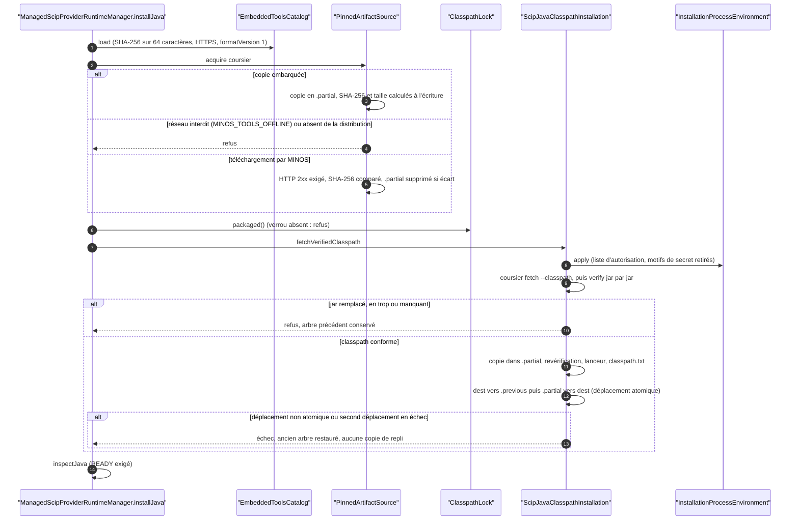
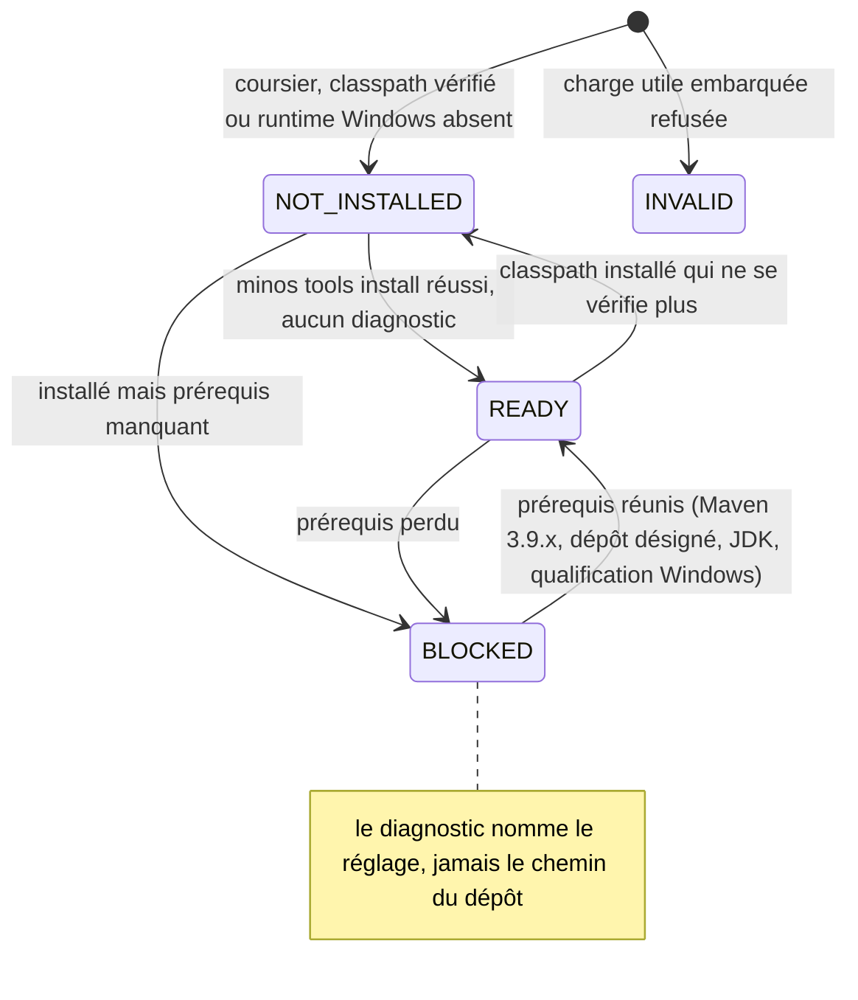

# Capacité `installation-des-providers` — dossier durable

Spec de référence : [openspec/specs/installation-des-providers/spec.md](../../../../openspec/specs/installation-des-providers/spec.md)
· Relevé au commit `64d131e4` (2026-11-04).

## Objet et périmètre

[Exigence] MINOS installe lui-même les outils de provider SCIP (scip-java et son classpath, Coursier, toolchains)
depuis un catalogue qui épingle versions et empreintes SHA-256 (ADR 0065), vérifie chaque artefact avant usage,
ne transmet jamais l'environnement complet ni un secret aux commandes d'installation, publie l'installation par
déplacement atomique, et ne déclare scip-java prêt que si son exécution est qualifiée (bac à sable Windows, Maven
hors ligne sous Linux). Acteurs : l'utilisateur (`minos tools install`, `minos doctor`), la CI. Hors périmètre :
l'exécution d'indexation elle-même (capacité `confinement-code-non-fiable`).

## Vues

### Comment un outil est-il installé, vérifié puis publié ?

Type : sequenceDiagram (UML, séquence) · Portée : existant vérifié · Exigences : « Le classpath de scip-java est
vérifié jar par jar avant tout usage », « L'installation n'exécute pas scip-java pour en lire la version »,
« Une commande d'installation ou de sondage ne reçoit pas l'environnement complet », « L'installation d'un outil
échoue fermée quand le déplacement atomique manque », « L'installation range une copie vérifiée du classpath de
scip-java »

`ManagedScipProviderRuntimeManager.installJava`
(`minos-provider-scip/src/main/java/com/minos/adapter/scip/runtime/install/ManagedScipProviderRuntimeManager.java:341-359`)
enchaîne l'acquisition vérifiée de Coursier, la lecture du verrou du classpath, la résolution par `fetch` seule et
la vérification jar par jar, puis la publication atomique (`DurableAtomicFile.moveDirectory`, sans repli par
copie). L'environnement de chaque commande est construit par `InstallationProcessEnvironment`, dont le motif de
refus est unique (`ProviderProcessEnvironment.isDeniedName`). L'entrée Coursier du catalogue suit la plateforme
(`windows-x64` ou `linux-x64`). Sous Linux, `CoursierLauncherInstallation` acquiert l'archive `gz` par
`PinnedArtifactSource` (borne `MAX_COURSIER_ARCHIVE_BYTES`, empreinte vérifiée sur l'archive), la décompresse avec
une borne de taille dans un fichier partiel créé privé, ne donne le droit d'exécution qu'au propriétaire, puis
publie `cs` par déplacement atomique sous `MINOS_HOME/tools/coursier/linux-x64-<commit court>/` et inscrit son
origine au registre des outils. Tout échec supprime l'archive et le partiel, et le diagnostic nomme Coursier sans
chemin. Un `cs` du `PATH` reste accepté quand aucun Coursier géré n'est installé.

### Quand scip-java est-il déclaré prêt ?

Type : stateDiagram-v2 (UML, machine à états) · Portée : existant vérifié · Exigences : « scip-java sous Windows
n'est pas déclaré prêt sans exécution qualifiée sous le bac à sable », « Sous Linux, scip-java n'est prêt que s'il
peut construire hors ligne », « Le plan d'indexation de scip-java n'exécute que le classpath revérifié »

États de `ProviderRuntimeStatus.State` (`minos-engine/src/main/java/com/minos/runtime/ProviderRuntimeStatus.java:46-63`),
calculés à chaque inspection. Un état autre que `READY` empêche de remettre un exécuteur pour l'indexation.

## Traçabilité

| Exigence | Scénarios couverts | Vue | Preuves | Statut |
|---|---|---|---|---|
| Une commande d'installation ou de sondage ne reçoit pas l'environnement complet | tous (sonde de toolchain simulée, E6) | V1 | `minos-provider-scip/src/test/java/com/minos/adapter/scip/runtime/install/InstallationEnvironmentIsolationTest.java#noInstallationOrProbeCommandReceivesAMinosOrCiSecret`, `minos-runtime-local/src/test/java/com/minos/runtime/local/process/InstallationProcessEnvironmentTest.java#controlPlaneAndCiSecretsAreNeverInherited` | couverte |
| Un motif de secret l'emporte sur toute liste d'autorisation | tous | V1 | `minos-runtime-local/src/test/java/com/minos/runtime/local/process/InstallationProcessEnvironmentTest.java#aSecretPatternWinsOverTheDeclaredValues`, `minos-runtime-local/src/test/java/com/minos/runtime/local/process/InstallationProcessEnvironmentTest.java#theDenyPatternMatchesSecretsAndSparesTheCacheDirectory` | couverte |
| Une variable déclarée par un plan d'indexation n'échappe pas au motif de secret | tous | — | `minos-runtime-local/src/test/java/com/minos/runtime/local/process/ProviderProcessEnvironmentDeclaredSecretsTest.java#aDeclaredVariableNamedLikeASecretIsNotForwardedBySanitize`, `minos-runtime-local/src/test/java/com/minos/runtime/local/process/ProviderProcessEnvironmentDeclaredSecretsTest.java#theInstallationEnvironmentRefusesTheSameDeclaredNames` | couverte |
| Le classpath de scip-java est vérifié jar par jar avant tout usage | verrou absent non testé | V1 | `minos-provider-scip/src/test/java/com/minos/adapter/scip/runtime/install/ClasspathLockTest.java#aReplacedJarFailsAndNamesOnlyTheFile`, `minos-provider-scip/src/test/java/com/minos/adapter/scip/runtime/install/ClasspathLockTest.java#anExtraJarFails`, `minos-provider-scip/src/test/java/com/minos/adapter/scip/runtime/install/ClasspathLockTest.java#aMissingJarFails` | partielle |
| L'installation n'exécute pas scip-java pour en lire la version | tous | V1 | `minos-provider-scip/src/test/java/com/minos/adapter/scip/runtime/install/ClasspathLockTest.java#theInstallationFetchesTheClasspathAndNeverLaunchesScipJava`, `minos-provider-scip/src/test/java/com/minos/adapter/scip/runtime/install/ManagedScipProviderRuntimeManagerTest.java#fetchesPinnedScipJavaWithoutLaunchingIt` | couverte |
| Le verrou est tenu par le catalogue et contrôlé en CI | tous | — | `scripts/quality/test_check_tools_manifest.py#test_a_lock_that_does_not_match_the_catalogue_version_is_refused`, `scripts/quality/test_check_tools_manifest.py#test_a_coursier_fetch_component_without_a_lock_file_is_refused` | couverte |
| Les tests du provider SCIP ne dépendent pas du JAVA_HOME de l'hôte | un test lit le `JAVA_HOME` de l'hôte et se saute sans lui (E1) | — | `minos-provider-scip/src/test/java/com/minos/adapter/scip/runtime/install/ScipJavaProcessPlanFactoryToolchainTest.java` | partielle |
| Sans JDK de projet, le plan scip-java est refusé avant toute préparation | tous | V2 | `minos-provider-scip/src/test/java/com/minos/adapter/scip/runtime/install/ScipJavaProcessPlanFactoryToolchainTest.java#anUnsetJavaHomeIsRefusedBeforeAnythingIsStaged`, `minos-provider-scip/src/test/java/com/minos/adapter/scip/runtime/install/ScipJavaProcessPlanFactoryToolchainTest.java#aJavaHomeWithoutJavacIsRefusedBeforeAnythingIsStaged` | couverte |
| Un test du provider propre à Windows est compté comme sauté ailleurs | rapport Linux non lu automatiquement ; classe citée par la spec différente (E2) | — | `minos-provider-scip/src/test/java/com/minos/adapter/scip/runtime/install/ScipJavaProcessPlanFactoryToolchainTest.java#onWindowsAKotlinProjectGivesItsLanguageToTheRunner` | partielle |
| Le helper d'identité de chemin Windows n'hérite pas de l'environnement de MINOS | tous (capture réelle sous Windows) | — | `minos-runtime-local/src/test/java/com/minos/runtime/local/sandbox/WindowsExecutionPathIdentityHelperEnvironmentTest.java#noSecretOfTheJvmEnvironmentReachesTheHelper`, `minos-runtime-local/src/test/java/com/minos/runtime/local/sandbox/WindowsExecutionPathIdentityHelperEnvironmentTest.java#theHelperDoesNotInheritTheModulePathNorTheToolchainVariablesOfTheJvm` | couverte |
| scip-java sous Windows n'utilise que le PowerShell du répertoire système | tous (Windows) | — | `minos-provider-scip/src/test/java/com/minos/adapter/scip/runtime/plan/ScipJavaPowerShellTest.java#lePlanUtiliseLePowerShellDuRepertoireSystemeQuelQueSoitLePath`, `minos-provider-scip/src/test/java/com/minos/adapter/scip/runtime/install/ScipJavaProcessPlanFactoryToolchainTest.java#onWindowsAPowerShellOnPathIsNeverTheOneThePlanRuns` | couverte |
| scip-java sous Windows n'est pas déclaré prêt sans exécution qualifiée sous le bac à sable | 3/3 ; le diagnostic et le refus de l'exécuteur nomment `--via-wsl`, sans le runtime Docker | V2 | `minos-provider-scip/src/test/java/com/minos/adapter/scip/runtime/install/ManagedScipProviderRuntimeManagerToolchainTest.java#onWindowsAnInstalledScipJavaIsBlockedUntilItsSandboxedExecutionIsQualified`, `ManagedScipProviderRuntimeManagerToolchainTest.java#onLinuxScipJavaIsNotBlockedByTheWindowsSandboxQualification`, `minos-provider-scip/src/test/java/com/minos/adapter/scip/runtime/install/ManagedScipProviderRuntimeManagerRuntimeTest.java#noExecutorIsHandedOutForARuntimeThatIsNotReady` | couverte |
| Sous Linux, l'installation de scip-java installe Coursier depuis le catalogue | 3/3 ; source épinglée simulée en test, téléchargement réel exercé par `minos tools install scip-java` dans une distribution WSL2 (dossier `indexation-java-via-wsl`, qualification) | V1 | `minos-provider-scip/src/test/java/com/minos/adapter/scip/runtime/install/ManagedScipProviderRuntimeManagerCoursierLinuxTest.java#theLauncherIsInstalledFromThePinnedSourceAsAnOwnerOnlyExecutable`, `ManagedScipProviderRuntimeManagerCoursierLinuxTest.java#aSourceThatServesOtherBytesIsRefusedAndLeavesNoCoursierFile`, `ManagedScipProviderRuntimeManagerCoursierLinuxTest.java#withTheNetworkRefusedTheDiagnosticNamesCoursierAndIsActionable` | couverte |
| L'installation d'un outil échoue fermée quand le déplacement atomique manque | tous | V1 | `minos-provider-scip/src/test/java/com/minos/adapter/scip/runtime/install/ManagedToolInstallationFilesTest.java#aMoveRefusedAsNotAtomicFailsTheInstallationWithoutCopyingAnything`, `minos-provider-scip/src/test/java/com/minos/adapter/scip/runtime/install/ManagedToolInstallationFilesTest.java#aSwapWhoseSecondMoveFailsRestoresThePreviousTree` | couverte |
| scip-java lance Maven hors ligne sur le dépôt désigné | indexation réelle hors ligne non trouvée | — | `minos-provider-scip/src/test/java/com/minos/adapter/scip/runtime/plan/ScipJavaMavenOfflineTest.java#theRunGetsTheFixedOfflineLineTheRepositoryAsOnlyRootAndTheHostSettingsMasked` | partielle |
| Une désignation de dépôt qui expose un dossier sensible est refusée avant préparation | tous sous Linux (dossiers système énumérés en partie) | — | `minos-provider-scip/src/test/java/com/minos/adapter/scip/runtime/plan/ScipJavaMavenOfflineTest.java#theHomeDirectoryItsAncestorsMinosHomeAndSystemDirectoriesAreRefused`, `minos-provider-scip/src/test/java/com/minos/adapter/scip/runtime/plan/ScipJavaMavenOfflineTest.java#theRealDirectoryOfAHomeReachedThroughALinkIsRefused` | couverte |
| Une désignation qui n'a pas la forme d'un dépôt Maven est refusée | tous sous Linux | — | `minos-provider-scip/src/test/java/com/minos/adapter/scip/runtime/plan/ScipJavaMavenOfflineTest.java#aDesignationThatIsNotShapedAsAMavenRepositoryIsRefused`, `minos-provider-scip/src/test/java/com/minos/adapter/scip/runtime/plan/ScipJavaMavenOfflineTest.java#aDesignationThatOverlapsTheRunOrTheProjectIsRefused` | couverte |
| Les réglages Maven et le dépôt de tête sont fixés par MINOS pour chaque run | tous sous Linux | — | `minos-provider-scip/src/test/java/com/minos/adapter/scip/runtime/plan/ScipJavaMavenOfflineTest.java#theConstantSettingsDeclareNoServerMirrorProxyProfileLocalRepositoryOrOfflineFlag`, `minos-provider-scip/src/test/java/com/minos/adapter/scip/runtime/plan/ScipJavaMavenOfflineTest.java#anExistingHeadRepositoryIsRefused` | couverte |
| Le dépôt désigné n'apparaît dans aucune sortie publique ni journal par son chemin | diagnostic testé ; journaux et sortie de `minos doctor` non (E3) | V2 | `minos-provider-scip/src/test/java/com/minos/adapter/scip/runtime/install/ManagedScipProviderRuntimeManagerOfflineMavenTest.java#aRefusedDesignationIsReportedByItsSettingAndStateWithoutItsPath` | partielle |
| Les réglages globaux du Maven de l'hôte sont masqués et seul Maven 3.9.x est accepté | masquage vérifié dans le plan, pas sous bac à sable réel | — | `minos-provider-scip/src/test/java/com/minos/adapter/scip/runtime/plan/ScipJavaMavenOfflineTest.java#maven4AndMaven38AreRefusedNamingTheQualifiedRangeWithoutRunningMaven` | partielle |
| Sous Linux, scip-java n'est prêt que s'il peut construire hors ligne | tous sous Linux | V2 | `minos-provider-scip/src/test/java/com/minos/adapter/scip/runtime/install/ManagedScipProviderRuntimeManagerOfflineMavenTest.java#aMavenOutsideTheQualifiedRangeIsAMachinePrerequisiteAndIsNeverRun`, `minos-provider-scip/src/test/java/com/minos/adapter/scip/runtime/install/ManagedScipProviderRuntimeManagerOfflineMavenTest.java#withoutADesignatedRepositoryScipJavaIsNotReadyAndTheDiagnosticNamesTheSetting` | couverte |
| L'installation range une copie vérifiée du classpath de scip-java | tous | V1 | `minos-provider-scip/src/test/java/com/minos/adapter/scip/runtime/install/ScipJavaClasspathInstallationTest.java#theVerifiedJarsAreCopiedBesideARelativeListingAndTheirLauncher`, `minos-provider-scip/src/test/java/com/minos/adapter/scip/runtime/install/ScipJavaClasspathInstallationTest.java#aJarThatDoesNotMatchTheLockIsNeverKeptAndThePreviousTreeSurvives` | couverte |
| Le plan d'indexation de scip-java n'exécute que le classpath revérifié | tous (Linux et Windows répartis) | V2 | `minos-provider-scip/src/test/java/com/minos/adapter/scip/runtime/install/ScipJavaProcessPlanFactoryToolchainTest.java#onLinuxAJarThatNoLongerMatchesTheLockIsRefusedBeforeAnythingIsStaged`, `minos-provider-scip/src/test/java/com/minos/adapter/scip/runtime/install/ScipJavaProcessPlanFactoryToolchainTest.java#onWindowsAMissingClasspathIsRefusedRatherThanResolvedByTheRunner` | couverte |

Beaucoup de tests de cette capacité ne tournent que sous un système (`@EnabledOnOs`) : chaque garantie n'est prouvée
que par le job `Verify` du système concerné.

## Écarts

| Id | Écart | Preuve | Suite proposée |
|---|---|---|---|
| E1 | L'exigence veut qu'un test qui dépend du `JAVA_HOME` de l'hôte échoue sur tout système ; un test lit ce `JAVA_HOME` et se saute en silence quand il manque | `minos-provider-scip/src/test/java/com/minos/adapter/scip/runtime/plan/ScipJavaProcessPlanFactoryTargetRootTest.java:40` | [Proposition] Fournir au test un JDK de projet qu'il pose lui-même, sans `assumeTrue` |
| E2 | La spec situe le test Windows de propagation Kotlin dans la classe du gestionnaire de runtime ; il vit dans la classe de la fabrique du plan | `minos-provider-scip/src/test/java/com/minos/adapter/scip/runtime/install/ScipJavaProcessPlanFactoryToolchainTest.java:308` | [Proposition] Corriger la référence du scénario |
| E3 | L'exigence couvre les journaux WARNING ; aucun journal n'existe dans les classes concernées, donc rien à observer ni à tester | `minos-provider-scip/src/main/java/com/minos/adapter/scip/runtime/plan/ScipJavaMavenOffline.java` | [Question] Retirer la mention des journaux ou en prévoir ? |
| E4 | « Verrou absent… sans lancer Coursier » : sous Windows, Coursier peut être acquis avant la lecture du verrou (il n'est lancé qu'après) ; aucun test ne le prouve | `minos-provider-scip/src/main/java/com/minos/adapter/scip/runtime/install/ManagedScipProviderRuntimeManager.java:344-351` | [Proposition] Test du verrou absent |
| E5 | Les dossiers système refusés ne sont testés que pour `/` et `/etc` | `minos-provider-scip/src/test/java/com/minos/adapter/scip/runtime/plan/ScipJavaMavenOfflineTest.java:117` | [Proposition] Énumérer les autres dossiers système dans le test |
| E6 | Le scénario « Sonde de toolchain » nomme `dotnet --version` et `go version` ; le test passe un programme Java par la même méthode | `minos-provider-scip/src/test/java/com/minos/adapter/scip/runtime/install/InstallationEnvironmentIsolationTest.java` | Aucun : le chemin de code est le même ; à préciser dans le scénario |

## Questions ouvertes

Aucune.
