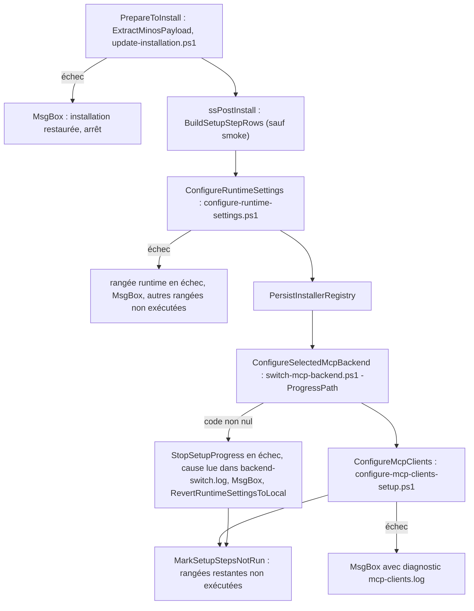
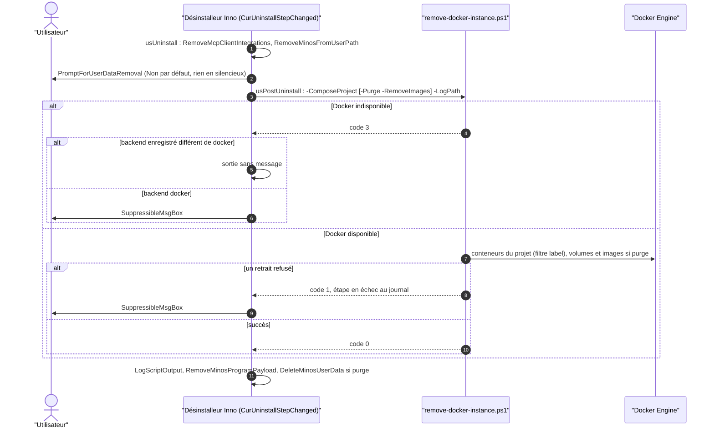

# Capacité `installeur-windows` — dossier durable

Spec de référence : [openspec/specs/installeur-windows/spec.md](../../../../openspec/specs/installeur-windows/spec.md)
· Relevé au commit `3b516b1e` (2026-11-03).

## Objet et périmètre

[Exigence] L'installeur Windows (Inno Setup, gabarit `packaging/windows/minos-installer.iss.template`) affiche
une progression honnête de chaque étape de configuration, sans secret ni texte libre, et le désinstalleur retire
l'instance Docker, l'intégration Codex et le menu Démarrer sans perdre de données hors purge, en journalisant et
en annonçant tout échec. Acteurs : l'utilisateur qui installe ou désinstalle ; les scripts PowerShell de
configuration. Hors périmètre : le contenu de la page Docker, que le changement actif
`exposer-seulement-les-projets-inscrits-a-docker` modifie (aucune exigence de cette capacité n'est touchée).

## Vues

### Que se passe-t-il après la copie des fichiers, et où l'installation s'arrête-t-elle en cas d'échec ?

Type : flowchart (organigramme de décision, non UML) · Portée : existant vérifié · Exigences : « L'état final
d'une étape découle du code de sortie », « Une rangée de progression par étape de configuration sélectionnée »

Le déroulé est celui de `CurStepChanged(ssPostInstall)` dans le gabarit. Pendant `switch-mcp-backend.ps1`, un
minuteur (`SetTimer`, 250 ms) relit le fichier de progression écrit par les scripts selon le protocole fermé ;
l'état final de chaque rangée découle du code de sortie (`FinishSetupStepGroup`). Le script de bascule écrit
`BEGIN`, `COMMIT` ou `ROLLBACK` dans `backend-switch.log` : en cas d'échec, l'ancien backend est conservé ou
restauré.

### Comment le désinstalleur retire-t-il l'instance Docker sans perdre de données ?

Type : sequenceDiagram (UML, séquence) · Portée : existant vérifié · Exigences : « La désinstallation retire le
projet Compose de l'instance Docker », « Sans purge, aucune donnée Docker n'est supprimée », « Un échec de
retrait Docker est journalisé et annoncé », « La purge retire les images MINOS inutilisées »

Le désinstalleur appelle `docker/scripts/remove-docker-instance.ps1`
(`packaging/windows/minos-installer.iss.template:1613-1626`) avec Windows PowerShell 5.1, recopie son journal dans
celui de la désinstallation, puis n'annonce l'échec que hors code 0. Le code 3 (Docker absent) reste silencieux
quand le poste n'a jamais utilisé le backend Docker (`packaging/windows/minos-installer.iss.template:1632`) : voir
l'écart E2.

## Traçabilité

| Exigence | Scénarios couverts | Vue | Preuves | Statut |
|---|---|---|---|---|
| La désinstallation retire le projet Compose de l'instance Docker | 1/2 (le « compose down » testé est celui d'un script que le désinstalleur n'appelle pas) | V2 | `scripts/install/verify-docker-instance-removal.ps1`, `minos-app/src/test/java/com/minos/packaging/UninstallCleanupContractTest.java#removalScriptAndCodexCleanupPassTheirVerifiersUnderWindowsPowerShell`, `minos-app/src/test/java/com/minos/packaging/UninstallCleanupContractTest.java#uninstallerRemovesTheComposeProjectBeforeTheProgramFilesAndTheData` | partielle |
| Sans purge, aucune donnée Docker n'est supprimée | 1/1 | V2 | `scripts/install/verify-docker-instance-removal.ps1:228`, `minos-app/src/test/java/com/minos/packaging/UninstallCleanupContractTest.java#removalScriptAndCodexCleanupPassTheirVerifiersUnderWindowsPowerShell` | couverte |
| Un échec de retrait Docker est journalisé et annoncé | 3/3 ; l'annonce n'est vérifiée que sur le texte du gabarit | V2 | `scripts/install/verify-docker-instance-removal.ps1:239`, `minos-app/src/test/java/com/minos/packaging/UninstallCleanupContractTest.java`, `scripts/install/verify-installer-template.ps1` | partielle |
| La désinstallation retire le bloc Codex borné par les marqueurs MINOS | 2/2 | — | `scripts/install/verify-codex-mcp-integration.ps1:155`, `minos-app/src/test/java/com/minos/packaging/UninstallCleanupContractTest.java#removalScriptAndCodexCleanupPassTheirVerifiersUnderWindowsPowerShell` | couverte |
| La purge retire les images MINOS inutilisées | 2/2 | V2 | `scripts/install/verify-docker-instance-removal.ps1:255`, `minos-app/src/test/java/com/minos/packaging/UninstallCleanupContractTest.java` | couverte |
| Le dossier vide du menu Démarrer est retiré | 1/1 (contrôle du texte du gabarit, pas du retrait réel) | — | `minos-app/src/test/java/com/minos/packaging/UninstallCleanupContractTest.java#uninstallerRemovesTheComposeProjectBeforeTheProgramFilesAndTheData` | couverte |
| Une rangée de progression par étape de configuration sélectionnée | 2/3 (« Installeur construit » : manuel uniquement) | V1 | `minos-app/src/test/java/com/minos/packaging/InstallerSetupProgressContractTest.java#stepLabelNamesTheStepAndLeavesTheStateToTheBar`, `minos-app/src/test/java/com/minos/packaging/InstallerSetupProgressContractTest.java#rowsAreCreatedOnlyForSelectedStepsAndNeverInSmokeMode` | partielle |
| Les scripts signalent leurs étapes par un protocole fermé | 3/3 | — | `scripts/install/test_setup_progress.py#test_emitter_writes_only_the_closed_vocabulary`, `scripts/install/test_setup_progress.py#test_emitter_without_progress_path_writes_nothing`, `minos-app/src/test/java/com/minos/packaging/InstallerSetupProgressContractTest.java#scriptsEmitOnlyStepsTheInstallerDisplays` | couverte |
| La progression est lue sans rediriger la sortie des scripts | 1/1 (absence d'affichage du reste du fichier non assertée) | V1 | `minos-app/src/test/java/com/minos/packaging/InstallerSetupProgressContractTest.java#progressIsReadByATimerWithoutRedirectingTheScripts` | couverte |
| L'état final d'une étape découle du code de sortie | 1/1 (contrôle du texte du gabarit) | V1 | `minos-app/src/test/java/com/minos/packaging/InstallerSetupProgressContractTest.java#finalStateFollowsTheExitCode` | couverte |
| Un pourcentage n'est affiché que s'il est fourni par l'outil | 1/1 ; « seul Ollama émet un pourcentage » et barre indéterminée non assertés | — | `scripts/install/test_setup_progress.py#test_ollama_percent_is_read_only_when_printed` | partielle |
| La progression ne contient aucun secret et laisse le mode smoke inchangé | 2/2 (le test cité par le scénario ne contrôle que l'ASCII, voir E3) | — | `minos-app/src/test/java/com/minos/packaging/InstallerSetupProgressContractTest.java#scriptsEmitOnlyStepsTheInstallerDisplays`, `minos-app/src/test/java/com/minos/packaging/InstallerSetupProgressContractTest.java#rowsAreCreatedOnlyForSelectedStepsAndNeverInSmokeMode` | couverte |

Exécution : les tests Java tournent dans les jobs `Verify` de `pr-ci.yml` ; ceux qui lancent les vérificateurs
PowerShell portent `@EnabledOnOs(WINDOWS)` et ne s'exécutent que sur le job Windows. `test_setup_progress.py`
tourne dans le job `invariants` et sur Windows. `verify-installer-template.ps1` ne tourne que par la construction
de la distribution et par `windows-in-place-upgrade.yml` (filtré par chemins), pas sur chaque PR.

## Écarts

| Id | Écart | Preuve | Suite proposée |
|---|---|---|---|
| E1 | Le scénario « Ordre dans le désinstalleur » attend un `compose down` avec profils ; le test lit `mcp-lifecycle.ps1`, alors que le désinstalleur appelle `remove-docker-instance.ps1`, qui retire par filtre de label sans `compose down` | `minos-app/src/test/java/com/minos/packaging/UninstallCleanupContractTest.java:64`, `docker/scripts/remove-docker-instance.ps1:123` | [Proposition] Aligner le scénario sur le script réellement appelé, par un changement |
| E2 | Un code 3 (Docker absent) n'est pas annoncé quand le backend enregistré n'est pas Docker ; la spec demande d'annoncer tout échec hors mode silencieux | `packaging/windows/minos-installer.iss.template:1632` | [Question] Comportement voulu (commentaire du gabarit) : l'ajouter à la spec par un changement ? |
| E3 | Le scénario « Fonctions d'émission sans texte libre » cite `M29InstallerBackendLifecycleContractTest`, qui ne contrôle que l'ASCII ; la signature est vérifiée par un autre test | `minos-app/src/test/java/com/minos/packaging/M29InstallerBackendLifecycleContractTest.java` | [Proposition] Corriger la référence du scénario |
| E4 | La rangée `runtime` est pilotée par l'installeur, sans émetteur du protocole ; la spec ne le dit pas | `minos-app/src/test/java/com/minos/packaging/InstallerSetupProgressContractTest.java:188` | Aucun : cohérent avec la spec, à préciser au prochain changement |

## Questions ouvertes

- Le scénario « Installeur construit » n'est prouvé que manuellement : faut-il une trace automatisée (capture du
  journal d'installation en mode silencieux) ?
