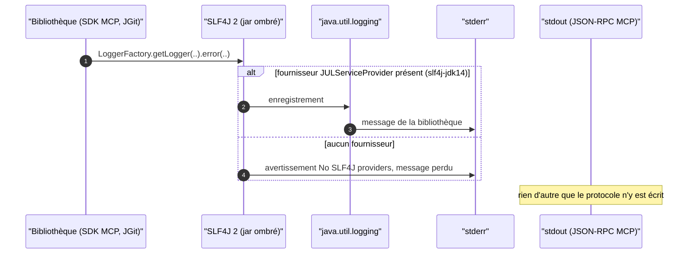
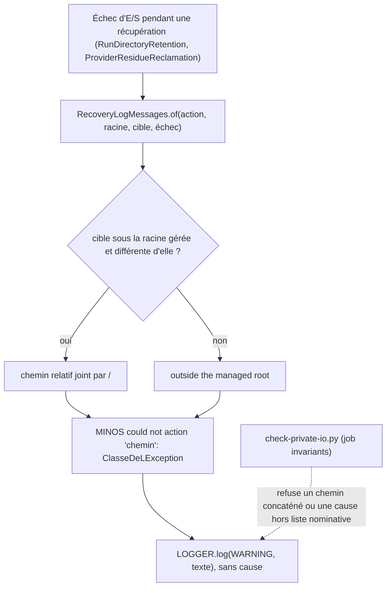

# Capacité `journalisation` — dossier durable

Spec de référence : [openspec/specs/journalisation/spec.md](../../../../openspec/specs/journalisation/spec.md)
· Relevé au commit `3b516b1e` (2026-11-03).

## Objet et périmètre

[Exigence] Les journaux de MINOS restent observables (les erreurs des bibliothèques atteignent stderr) sans
fuite (aucun chemin absolu ni cause d'échec de fichier dans un WARNING), et stdout reste réservé au protocole
MCP (ARCH-0017). Acteurs : l'opérateur qui lit stderr, un client MCP qui lit stdout. Hors périmètre : les
journaux serveur du plan de contrôle hébergé, au-delà de leur entrée dans la liste nominative.

## Vues

### Où va une erreur émise par une bibliothèque dans le jar ombré ?

Type : sequenceDiagram (UML, séquence) · Portée : existant vérifié · Exigences : « Les erreurs des bibliothèques
atteignent stderr dans le livrable »

Le livrable embarque un seul fournisseur SLF4J, `slf4j-jdk14` (`minos-app/pom.xml:29`), qui renvoie vers
`java.util.logging`, donc vers stderr. La branche « aucun fournisseur » est celle que le test d'intégration
interdit : elle rendrait les erreurs des bibliothèques muettes.

### Comment un échec de récupération de fichiers est-il journalisé sans fuite ?

Type : flowchart (organigramme de décision, non UML) · Portée : existant vérifié · Exigences : « Un message de
récupération de fichiers ne contient ni chemin absolu ni cause », « Un journal ne concatène jamais un chemin »,
« La cause d'un journal n'est transmise que par une liste nominative »

Le texte est composé par `RecoveryLogMessages`
(`minos-runtime-local/src/main/java/com/minos/runtime/local/workspace/RecoveryLogMessages.java:21-43`) : chemin
relatif à la racine gérée, nom simple de la classe de l'exception, jamais le message de l'exception. Le gate
`scripts/architecture/check-private-io.py` refuse statiquement un chemin concaténé dans un appel de journal et
toute cause transmise hors de la liste `scripts/architecture/private-io-allowlist.json`.

## Traçabilité

| Exigence | Scénarios couverts | Vue | Preuves | Statut |
|---|---|---|---|---|
| Les erreurs des bibliothèques atteignent stderr dans le livrable | 2/3 (stdout propre prouvé seulement sur l'image Docker de requête) | V1 | `minos-app/src/test/java/com/minos/packaging/ShadedJarLoggingIT.java#theShadedJarHasExactlyTheJulSlf4jProvider`, `minos-app/src/test/java/com/minos/packaging/ShadedJarLoggingIT.java#aLibraryErrorReachesStderrAndNeverStdout`, `scripts/ci/qualify-docker-release.sh:378` | partielle |
| Un message de récupération de fichiers ne contient ni chemin absolu ni cause | 2/2 hors clause « aucune cause » (non assertée) | V2 | `minos-runtime-local/src/test/java/com/minos/runtime/local/workspace/RecoveryLoggingTest.java#aRunThatCannotBeQuarantinedIsReportedByRelativeNameAndClass`, `minos-runtime-local/src/test/java/com/minos/runtime/local/workspace/RecoveryLoggingTest.java#anUnreadableResidueDirectoryIsReportedByRelativeNameAndClass`, `minos-runtime-local/src/test/java/com/minos/runtime/local/workspace/RecoveryLogMessagesTest.java#theMessageNamesTheRelativePathAndTheExceptionClassOnly` | partielle |
| Un journal ne concatène jamais un chemin | 2/2 | V2 | `scripts/architecture/test_check_private_io.py#test_a_path_concatenated_into_a_log_message_fails_and_has_no_exception`, `scripts/architecture/test_check_private_io.py#test_a_relative_path_or_a_class_name_in_a_log_message_passes` | couverte |
| La cause d'un journal n'est transmise que par une liste nominative | 3/3 (le 3ᵉ par l'exécution du gate sur le dépôt) | V2 | `scripts/architecture/test_check_private_io.py#test_a_cause_or_get_message_in_a_log_call_needs_a_nominative_entry`, `scripts/architecture/test_check_private_io.py#test_a_log_call_without_a_cause_passes_and_a_stale_entry_fails`, `scripts/architecture/check-private-io.py` | couverte |

## Écarts

| Id | Écart | Preuve | Suite proposée |
|---|---|---|---|
| E1 | Les scénarios de récupération exigent « aucun enregistrement n'a de cause » ; l'outil de capture des tests ne lit que le message, jamais la cause | `minos-engine/src/test/java/com/minos/testsupport/LogCapture.java:31` | [Proposition] Faire exposer la cause par `LogCapture` et l'asserter vide |
| E3 | Le scénario « Le protocole MCP reste propre » vise le jar ombré ; la seule vérification ligne à ligne de stdout passe par l'image Docker de requête | `scripts/ci/qualify-docker-release.sh:378` | [Proposition] Test sur le jar ombré nu |
| E4 | Le marqueur du scénario (`marqueur-d-essai`) diffère de celui du test (`erreur-de-bibliotheque-visible`) | `minos-app/src/test/java/com/minos/packaging/ShadedJarLoggingIT.java:26` | Aucun : écart cosmétique |

## Questions ouvertes

Aucune.
