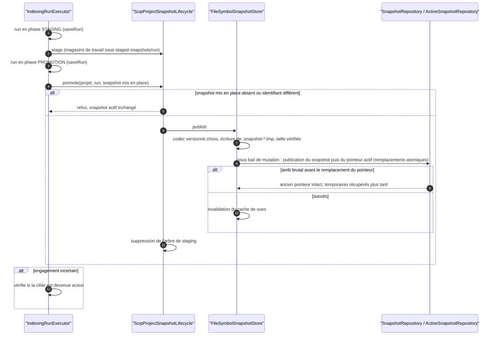
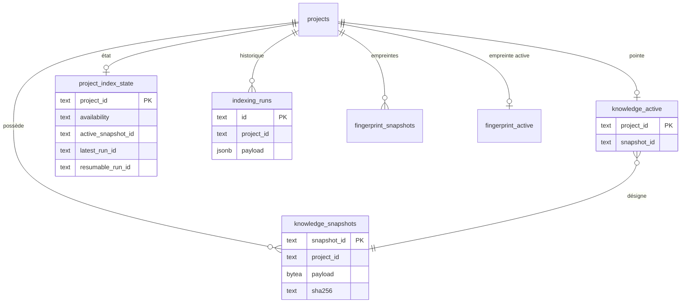
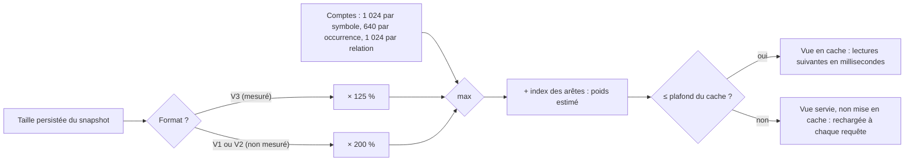
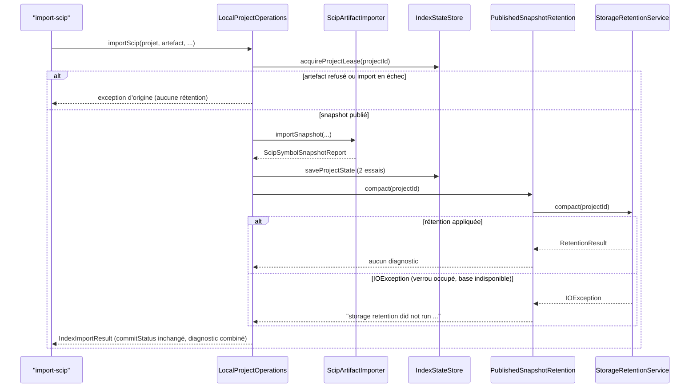

# Capacité `persistance-snapshots` — dossier durable

Spec de référence : [openspec/specs/persistance-snapshots/spec.md](../../../../openspec/specs/persistance-snapshots/spec.md)
· Relevé au commit `64d131e4` (2026-11-04).

## Objet et périmètre

[Exigence] Les snapshots de connaissance et l'état d'indexation sont persistés de façon atomique et vérifiée, dans
le backend local (fichiers) comme dans le backend PostgreSQL : un arrêt brutal laisse l'actif précédent intact, un
snapshot altéré n'est ni publié ni mis en cache, les deux backends partagent le même codec versionné, les
migrations sont rejouables, et les lectures de statut ne chargent pas le snapshot. Acteurs : l'indexation (qui
publie), les requêtes (qui lisent la vue active), l'opérateur (migrations, rétention). Hors périmètre : la
production des faits par les providers.

[Existant vérifié] Les deux backends sont des packages du module `minos-storage` (`com.minos.storage.local`,
`com.minos.storage.postgresql`, `com.minos.storage.codec`) ; les dossiers `minos-storage-local` et
`minos-storage-postgresql` ne sont pas des modules du reactor.

## Vues

### Comment un snapshot est-il publié sans jamais laisser un actif incohérent ?

Type : sequenceDiagram (UML, séquence) · Portée : existant vérifié · Exigences : « Un arrêt brutal pendant une
publication laisse le snapshot actif précédent intact », « Un snapshot altéré n'est ni publié ni mis en cache »,
« La mise en place SCIP passe par des magasins de travail injectés », « Les deux backends lisent et écrivent les
snapshots par le même codec »

La publication locale (`minos-storage/src/main/java/com/minos/storage/local/store/FileSymbolSnapshotStore.java:310-339`)
écrit le snapshot dans un temporaire, le nomme d'après son empreinte, puis remplace atomiquement le snapshot et le
pointeur `active.pointer` sous le bail de mutation du projet. En PostgreSQL, la même publication insère dans
`knowledge_snapshots` puis met à jour `knowledge_active` sous un verrou consultatif. La reprise d'un run
interrompu suit BE-0039 (`docs/architecture/adr/BE-0039-reprise-indexation-apres-interruption.md`).

### Comment l'état persisté est-il structuré dans le backend PostgreSQL ?

Type : erDiagram (entité-relation, non UML) · Portée : existant vérifié · Exigences : « Une base PostgreSQL
peuplée migre jusqu'à la version courante sans perte », « L'état d'indexation conserve l'offre de reprise quel que
soit le backend »

Tables créées par `PostgresSchemaMigrator` (version de schéma courante 5 ; `resumable_run_id` ajoutée en v5). Le
backend local porte les mêmes informations en fichiers sous `MINOS_HOME` : `symbol-snapshots/<projet>/`
(`active.pointer`, snapshots versionnés), `index-state/projects/` et `index-state/runs/`.

### Comment le poids estimé d'une vue décide-t-il de son admission au cache ?

Type : flowchart · Portée : existant vérifié · Exigences : « Un snapshot de la taille de ce dépôt est admis au cache de vues »,
« Le poids estimé d'une vue ne sous-évalue pas le tas qu'elle retient »

Les trois valeurs (plafond de persistance 400 Mio, amplifications, plafond du cache 512 Mio) viennent de `SnapshotLimits`
(`minos-storage/src/main/java/com/minos/storage/codec/SnapshotLimits.java`), et `requireCacheCoversPersistable` impose que le plafond du
cache couvre le plafond de persistance multiplié par l'amplification de V3. La décision est dans
`docs/architecture/adr/DATA-0078-port-de-connaissance-et-persistance-des-snapshots-plafonds-de-taille.md` (points 12 à 14).

### Quand l'import applique-t-il la rétention, et que rend-il si elle ne tourne pas ?

Type : sequenceDiagram (UML, séquence) · Portée : existant vérifié · Exigences : « Un import manuel applique la même
rétention que l'indexation », « Un verrou de rétention occupé ne fait pas échouer un import publié »

L'import compacte sous le bail du projet, après l'enregistrement de l'état : le store fichier protège alors le snapshot
importé par le pointeur actif et par l'état, et un état resté en attente protège encore celui qu'il désigne.
`PublishedSnapshotRetention` (`minos-application/src/main/java/com/minos/application/PublishedSnapshotRetention.java`)
sert aussi aux deux chemins de succès de l'indexation : une `IOException` y devient la même ligne de diagnostic, sans
cause ni chemin, et le statut de validation n'en dépend pas. Sur PostgreSQL, la rétention réutilise la session du bail
de cycle de vie et ne regarde que les pointeurs actifs, jamais les runs : un snapshot importé sans run est compacté.

## Traçabilité

| Exigence | Scénarios couverts | Vue | Preuves | Statut |
|---|---|---|---|---|
| Un arrêt brutal pendant une publication laisse le snapshot actif précédent intact | arrêt entre les deux renommages : probabiliste, pas déterministe | V1 | `minos-storage/src/test/java/com/minos/storage/local/store/SnapshotPublicationCrashTest.java#aPublicationKilledAtAnyPointLeavesAValidActiveSnapshot` | partielle |
| Un pointeur actif illisible fait échouer l'ouverture de façon explicite | tous, mais le message ne nomme pas le fichier (E2) | V1 | `minos-storage/src/test/java/com/minos/storage/local/store/ActivePointerCorruptionTest.java#aPointerCutInTheMiddleIsRefused`, `minos-storage/src/test/java/com/minos/storage/local/store/ActivePointerCorruptionTest.java#aPointerOfAnUnknownVersionIsRefused` | partielle |
| Une base PostgreSQL peuplée migre jusqu'à la version courante sans perte | message nommant l'étape non vérifié (E3) ; Docker requis | V2 | `minos-storage/src/test/java/com/minos/storage/postgresql/support/PostgresSchemaUpgradeFromV1Test.java#aPopulatedV1DatabaseMigratesToTheCurrentVersionWithItsData`, `minos-storage/src/test/java/com/minos/storage/postgresql/support/PostgresSchemaUpgradeFromV1Test.java#aFailingStepRollsBackTheWholeMigration` | partielle |
| Les pointeurs temporaires orphelins sont récupérés sans toucher une écriture en cours | tous | V1 | `minos-storage/src/test/java/com/minos/storage/local/store/SnapshotRetentionOrphanTest.java#deletesOnlyPreparedSnapshotAndPointerTemporariesOlderThanTheMaxAge`, `minos-storage/src/test/java/com/minos/storage/local/store/SnapshotRetentionOrphanTest.java#policyApplicationSweepsOrphanPreparedSnapshotsUnderTheSameLease` | couverte |
| La validation réseau des connexions du pool PostgreSQL est bornée | tous | — | `minos-storage/src/test/java/com/minos/storage/postgresql/support/PostgresConnectionFactoryValidationTest.java#anImmediateBorrowAndReturnPaysNoValidationRoundTrip`, `minos-storage/src/test/java/com/minos/storage/postgresql/support/PostgresConnectionFactoryValidationTest.java#aConnectionFoundInvalidAfterTheThresholdIsClosedAndReplaced` | couverte |
| Une connexion rendue dans un état incertain n'est pas réutilisée | message de l'erreur rejouée non vérifié | — | `minos-storage/src/test/java/com/minos/storage/postgresql/support/PostgresConnectionFactoryValidationTest.java#aConnectionReturnedAfterAnyFailureOfItsCallIsClosedAndNeverReused`, `minos-storage/src/test/java/com/minos/storage/postgresql/support/PostgresConnectionFactoryValidationTest.java#aWriteThatAlreadyRanIsNeverReplayed` | partielle |
| Une recherche de symbole par identifiant utilise l'index de la vue | tous | — | `minos-application/src/test/java/com/minos/application/dynamic/RuntimeIntelligenceServiceTest.java#symbolReportReadsTheActiveQueryViewAndNeverTheRawSnapshot`, `minos-application/src/test/java/com/minos/impact/ReadViewSubstitutionTest.java#theRuntimeReportOfASymbolReadsTheSubstituteReader` | couverte |
| Le poids d'une vue en cache compte ses index dérivés | cache du graphe de programme : poids sans mesure du tas | — | `minos-storage/src/test/java/com/minos/storage/local/store/QueryViewWeightTest.java#estimatedWeightIsNotBelowTheHeapRetainedByTheView`, `minos-engine/src/test/java/com/minos/store/SymbolEdgeIndexTest.java#weightIsChargedPerRelationshipAndSaturates` | partielle |
| Un snapshot de la taille de ce dépôt est admis au cache de vues | snapshot de plus de 64 Mio persistés non reproduit : les tests abaissent les plafonds (V3 admis en un chargement, V1 et V2 amplifiés à 200 %, vue plus lourde que le plafond rechargée) ; mesure réelle sur un snapshot de 339,5 Mio dans `docs/developer/indexing-and-storage.md` | V3 | `minos-storage/src/test/java/com/minos/storage/local/store/FileSymbolSnapshotStoreViewAdmissionTest.java`, `minos-storage/src/test/java/com/minos/storage/postgresql/snapshot/PostgresCodeKnowledgeSnapshotStoreViewAdmissionTest.java` (Docker requis), `minos-storage/src/test/java/com/minos/storage/local/store/FileSymbolSnapshotStoreCacheTest.java` | partielle |
| Le poids estimé d'une vue ne sous-évalue pas le tas qu'elle retient | l'amplification de V3 (125 %) ne couvre pas seule le tas des corpus riches en relations (0,84 à 0,88 du tas retenu) : la somme des comptes porte la garantie ; V1 et V2 gardent 200 % ; corpus de plus de 300 Mio non rejoué dans le test | V3 | `minos-storage/src/test/java/com/minos/storage/local/store/QueryViewWeightTest.java#estimatedWeightIsNotBelowTheHeapRetainedByTheView`, `minos-storage/src/test/java/com/minos/storage/codec/SnapshotLimitsTest.java` | partielle |
| Un snapshot altéré n'est ni publié ni mis en cache | tous | V1 | `minos-storage/src/test/java/com/minos/storage/local/store/FileSymbolSnapshotStoreIntegrityTest.java`, `minos-storage/src/test/java/com/minos/storage/codec/SnapshotVerifiedReadTest.java#truncatedContentIsAChecksumMismatchNotADecodingError` | couverte |
| Un snapshot décodé partage une instance par chaîne distincte | tous | — | `minos-storage/src/test/java/com/minos/storage/codec/SnapshotDecodeStringSharingTest.java#utf8DecodingSharesEqualStrings`, `minos-storage/src/test/java/com/minos/storage/codec/SnapshotDecodeStringSharingTest.java#sharingIsLocalToOneDecodingPass` | couverte |
| Une seconde publication identique ne change pas l'état persisté | « duplication détectée » : mutation manuelle ; Docker requis | V2 | `minos-storage/src/test/java/com/minos/storage/postgresql/snapshot/PostgresCodeKnowledgeSnapshotStoreTest.java#isIdempotentForSameContent` | partielle |
| Une migration rejouée laisse le schéma à la version courante | tous (Docker requis) | V2 | `minos-storage/src/test/java/com/minos/storage/postgresql/support/PostgresSchemaMigratorTest.java#isIdempotentWhenCalledRepeatedly`, `minos-storage/src/test/java/com/minos/storage/postgresql/support/PostgresSchemaMigratorTest.java#rejectsSchemaVersionNewerThanRuntime` | couverte |
| L'attente d'un verrou de mutation est prouvée par un signal observé | « verrou retiré » : mutation manuelle ; Docker requis | — | `minos-storage/src/test/java/com/minos/storage/postgresql/project/PostgresRetentionMutationLockTest.java#retentionWaitsForTheSharedProjectMutationBoundary`, `minos-storage/src/test/java/com/minos/storage/postgresql/PostgresAdvisoryLockWaiterTest.java#observesASessionWaitingForTheProjectLock` | partielle |
| Une panne du stockage de l'état d'index a un type unique | tous | — | `minos-storage/src/test/java/com/minos/storage/local/orchestration/FileIndexStateStoreErrorContractTest.java#anUnreadableProjectStateIsAStoreFailureWithoutTheRoot`, `minos-storage/src/test/java/com/minos/storage/postgresql/project/PostgresIndexStateStoreTest.java#aStorageFailureIsReportedWithTheOperationAndItsCause` | couverte |
| Un défaut de programmation n'est pas requalifié en panne d'E/S | tous | — | `minos-bootstrap/src/test/java/com/minos/bootstrap/application/ProjectIndexStateReconcilerErrorContractTest.java#aNullPointerExceptionOfTheStoreIsNotRequalifiedAsAnIoFailure` | couverte |
| Les messages du port d'état d'index ne contiennent aucun chemin absolu | tous | — | `minos-storage/src/test/java/com/minos/storage/local/orchestration/FileIndexStateStoreErrorContractTest.java#aMissingPropertyIsNamedWithoutAnyPath` | couverte |
| Les requêtes du snapshot actif sont servies par un port de lecture neutre | tous | — | `minos-application/src/test/java/com/minos/impact/ReadViewSubstitutionTest.java#queriesThroughANonMemoryReaderAnswerAsTheMemoryIndex`, `minos-application/src/test/java/com/minos/impact/ReadViewSubstitutionTest.java#withoutAnActiveSnapshotTheReadsFailAsBefore` | couverte |
| Les résultats des requêtes sont inchangés | tous (volet PostgreSQL avec Docker) | — | `minos-app/src/test/java/com/minos/characterization/A2SurfaceCharacterizationTest.java`, `minos-application/src/test/java/com/minos/impact/ImpactReferenceReportsTest.java` | couverte |
| L'ancien contrat de vue reste disponible sans seconde construction d'index | tous | — | `minos-storage/src/test/java/com/minos/storage/local/store/FileSymbolSnapshotStoreReadViewTest.java#theReadViewAndTheLegacyViewShareOneBuildAndOneIncomingIndex`, `minos-engine/src/test/java/com/minos/store/PublishedStoreContractTest.java` | couverte |
| Une implémentation existante du port de snapshot reste valide | tous | — | `minos-engine/src/test/java/com/minos/store/SnapshotReadViewTest.java#aStoreWrittenForTheLegacyContractServesTheReadViewByDerivation` | couverte |
| La vue neutre garde la cohérence pendant une promotion concurrente | tous | — | `minos-storage/src/test/java/com/minos/storage/local/store/FileSymbolSnapshotStoreReadViewTest.java#aPromotionDuringTheBuildServesTheNewSnapshotAndCachesNothingOfTheOldOne` | couverte |
| Le rang de correspondance d'un symbole est calculé une fois par candidat | tous | — | `minos-engine/src/test/java/com/minos/store/SymbolMatchRankTest.java#textSearchComputesTheRankOncePerCandidate`, `minos-engine/src/test/java/com/minos/store/SymbolMatchRankTest.java#absentCriteriaIsRefusedBeforeAnyRank` | couverte |
| Le calcul unique du rang ne change ni le contenu ni l'ordre des résultats | tous | — | `minos-engine/src/test/java/com/minos/store/SymbolMatchRankTest.java#textSearchKeepsTheCapturedContentAndOrder` | couverte |
| L'état d'indexation conserve l'offre de reprise quel que soit le backend | tous (PostgreSQL avec Docker) | V2 | `minos-storage/src/test/java/com/minos/storage/local/orchestration/FileIndexStateStoreContractTest.java`, `minos-storage/src/test/java/com/minos/storage/postgresql/project/PostgresIndexStateStoreContractTest.java`, `minos-storage/src/test/java/com/minos/storage/postgresql/support/PostgresSchemaUpgradeFromV4Test.java#aPopulatedV4DatabaseGainsTheResumeColumnAndKeepsItsStates` | couverte |
| La rétention protège le run offert à la reprise | tous | — | `minos-storage/src/test/java/com/minos/storage/local/orchestration/IndexRunRetentionServiceTest.java#compactionProtectsTheResumableRunLikeTheLatestRun`, `minos-storage/src/test/java/com/minos/storage/postgresql/project/PostgresStorageRetentionServiceTest.java#compactionProtectsTheRunOfferedForResumeLikeTheLatestRun` | couverte |
| Les deux backends lisent et écrivent les snapshots par le même codec | tous | V1 | `minos-storage/src/test/java/com/minos/storage/local/store/SnapshotFormatCompatibilityTest.java#v2StoresWrittenByTheBaseStillOpenUntouchedWithEveryTrapString`, `minos-storage/src/test/java/com/minos/storage/codec/KnowledgeSnapshotCodecsTest.java#aPayloadDeclaringAnUnknownVersionIsRefused`, `scripts/architecture/check-module-boundaries.py` | couverte |
| Le pointeur actif garde son format à l'octet près | tous | V1 | `minos-storage/src/test/java/com/minos/storage/local/store/ActiveSnapshotPointerBytesTest.java#everyHistoricalPointerIsRewrittenByteForByte`, `minos-storage/src/test/java/com/minos/storage/local/store/ActiveSnapshotPointerBytesTest.java#aPointerFollowedByAnExtraByteIsRefused` | couverte |
| La mise en place SCIP passe par des magasins de travail injectés | tous | V1 | `minos-provider-scip/src/test/java/com/minos/adapter/scip/runtime/ScipProjectSnapshotLifecycleTest.java#opensEveryWorkingStoreThroughThePortUnderTheStagingRunRoot`, `minos-provider-scip/src/test/java/com/minos/adapter/scip/runtime/ScipProjectSnapshotLifecycleTest.java#promotionWithoutAStagedSnapshotFailsAndLeavesTheActiveStoreUnchanged` | couverte |
| Une lecture de statut ou une réconciliation ne charge pas le snapshot actif | tous | — | `minos-application/src/test/java/com/minos/application/ActiveSnapshotReadCostTest.java#aStatusViewDoesNotLoadTheActiveSnapshot`, `minos-application/src/test/java/com/minos/application/ActiveSnapshotReadCostTest.java#aStateThatReferencesAMissingSnapshotFailsClosedWithoutWriting` | couverte |
| L'ancien contrat de réconciliation reste disponible et cohérent | tous | — | `minos-application/src/test/java/com/minos/application/ActiveSnapshotReadCostTest.java#theDeprecatedStatusReadLoadsTheSnapshotOnce`, `minos-application/src/test/java/com/minos/application/ActiveSnapshotReadCostTest.java#theDeprecatedRepairLoadsTheSnapshotOnce` | couverte |
| Un snapshot de plus de 256 Mio est persisté jusqu'au plafond de persistance | tous, avec des plafonds abaissés en test (un snapshot réel de plus de 256 Mio n'est pas rejoué ; mesure réelle de 339,5 Mio dans `docs/developer/indexing-and-storage.md`) ; PostgreSQL avec Docker | V3 | `minos-storage/src/test/java/com/minos/storage/local/store/SnapshotPersistenceCeilingTest.java#aSnapshotAboveTheFormerCeilingIsPublishedUnderTheCurrentOneAndReadBack`, `minos-storage/src/test/java/com/minos/storage/codec/SnapshotReadCeilingTest.java#aSnapshotPublishedUnderARaisedCeilingIsReadUnderIt` | partielle |
| Un snapshot au-delà du plafond de persistance est refusé sans rien écrire | tous | V3 | `minos-storage/src/test/java/com/minos/storage/local/store/PersistedSnapshotLimitTest.java#oversizedSnapshotLeavesNoFileAndKeepsTheActiveSnapshot`, `minos-storage/src/test/java/com/minos/storage/local/store/PersistedSnapshotLimitTest.java#theProductionCeilingIsFourHundredMebibytesAndTheRefusalNamesIt` | couverte |
| Le plafond du cache de vues couvre tout snapshot persistable | tous (volet PostgreSQL avec Docker) | V3 | `minos-storage/src/test/java/com/minos/storage/codec/SnapshotLimitsTest.java#theProductionCacheCeilingCoversTheLargestPersistableSnapshot`, `minos-storage/src/test/java/com/minos/storage/codec/SnapshotLimitsTest.java#aCacheCeilingBelowThePersistableViewWeightIsRefusedNamingTheThreeValues`, `minos-storage/src/test/java/com/minos/storage/local/store/FileSymbolSnapshotStoreLimitsTest.java`, `minos-storage/src/test/java/com/minos/storage/postgresql/snapshot/PostgresCodeKnowledgeSnapshotStoreLimitsTest.java` | couverte |
| Un import manuel applique la même rétention que l'indexation | tous ; mesure réelle sur un projet de 340 Mio non refaite | V4 | `minos-cli/src/test/java/com/minos/cli/ImportScipRetentionTest.java#fourDistinctImportsKeepTheActiveSnapshotAndTwoHistoricalOnes`, `minos-application/src/test/java/com/minos/application/LocalProjectOperationsRetentionTest.java#aPublishedImportCompactsTheProjectOnceAfterItsStateIsSaved`, `minos-application/src/test/java/com/minos/application/LocalProjectOperationsRetentionTest.java#aRefusedArtifactAppliesNoRetention` | couverte |
| Un verrou de rétention occupé ne fait pas échouer un import publié | tous | V4 | `minos-application/src/test/java/com/minos/application/LocalProjectOperationsRetentionTest.java#aBusyRetentionLeavesTheImportCommittedWithADiagnosticWithoutItsCause`, `minos-application/src/test/java/com/minos/application/LocalProjectOperationsRetentionTest.java#aBusyRetentionAfterAPendingStateKeepsBothDiagnosticsInOrder`, `minos-application/src/test/java/com/minos/application/PublishedSnapshotRetentionTest.java#anInputOutputFailureIsAFixedDiagnosticWithoutItsCause` | couverte |
| La rétention après un import s'applique au store PostgreSQL | tous (Docker requis) ; l'import complet n'est pas rejoué sur PostgreSQL, seule la rétention | V2 | `minos-storage/src/test/java/com/minos/storage/postgresql/project/PostgresStorageRetentionServiceTest.java#compactsSnapshotsImportedWithoutAnyRun` | partielle |
| Les contrôles d'identité du snapshot actif ne le chargent pas | tous | — | `minos-application/src/test/java/com/minos/application/ActiveSnapshotReadCostTest.java#aHostedBindingToTheActiveSnapshotIsAcceptedWithoutLoadingIt`, `minos-application/src/test/java/com/minos/application/indexing/PromotedSnapshotIdentityTest.java` | couverte |

Les tests PostgreSQL se sautent sans Docker, sauf avec `-Dminos.postgresql.tests.required=true`
(`minos-storage/src/test/java/com/minos/storage/postgresql/PostgresTestSupport.java`).

## Écarts

| Id | Écart | Preuve | Suite proposée |
|---|---|---|---|
| E1 | La spec et certains scénarios parlent des modules `minos-storage-local` et `minos-storage-postgresql` ; ce ne sont pas des modules du reactor, les backends sont des packages de `minos-storage` | `pom.xml` (liste des modules) | [Proposition] Corriger les références par un changement |
| E2 | La spec demande un message qui nomme le fichier du pointeur ; les messages sont génériques et le test les fige ainsi | `minos-storage/src/main/java/com/minos/storage/local/store/ActiveSnapshotRepository.java:95`, `minos-storage/src/test/java/com/minos/storage/local/store/ActivePointerCorruptionTest.java:28` | [Proposition] Nommer `active.pointer` (nom de fichier, pas chemin) |
| E3 | La spec demande qu'un échec de migration nomme l'étape ; le message est générique, le test ne vérifie que la cause | `minos-storage/src/main/java/com/minos/storage/postgresql/support/PostgresSchemaMigrator.java:67` | [Proposition] Nommer la version de l'étape en échec |
| E5 | Le test de migration écrit en dur la liste des versions 1 à 5 ; le scénario « base plus récente » cite 6, le test 999 | `minos-storage/src/test/java/com/minos/storage/postgresql/support/PostgresSchemaUpgradeFromV1Test.java:33` | [Proposition] Dériver la liste de la version courante |
| E6 | Un échec de suppression de l'arbre de staging après promotion est ignoré ; rien ne prouve sa récupération ultérieure | `minos-provider-scip/src/main/java/com/minos/adapter/scip/runtime/ScipProjectSnapshotLifecycle.java:152` | [Question] Récupération par la rétention, à vérifier |

## Questions ouvertes

Aucune.
