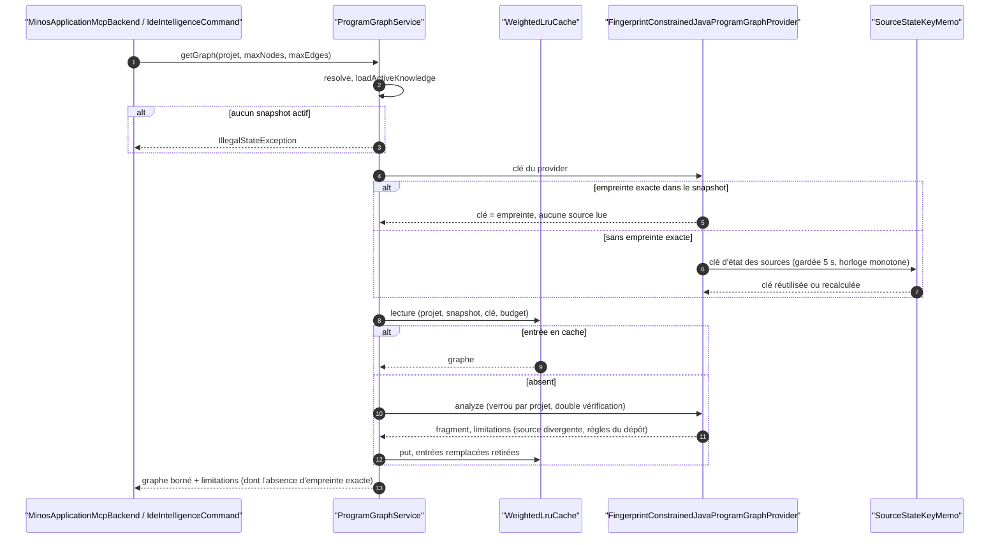
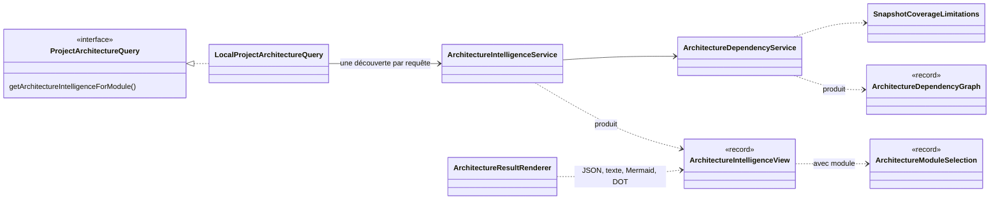

# Capacité `program-graph-et-architecture` — dossier durable

Spec de référence : [openspec/specs/program-graph-et-architecture/spec.md](../../../../openspec/specs/program-graph-et-architecture/spec.md)
· Relevé au commit `3b516b1e` (2026-11-03).

## Objet et périmètre

[Exigence] Les vues d'architecture, les requêtes de relations et le graphe de programme déclarent ce qu'ils ne
couvrent pas (références par occurrence non agrégées, absence de relations d'appel, graphe construit sans
empreinte exacte, règles de sécurité fournies par le dépôt analysé), refusent explicitement un filtre par module
inapplicable, servent le graphe depuis un cache borné dans le temps et échappent leurs sorties Mermaid. Acteurs :
l'utilisateur de la CLI (`architecture`, `ide program-graph`, `impact-v2`, `security-paths`), un agent par MCP
(`minos_architecture`, `minos_architecture_graph`, `minos_program_graph`, `minos_security_paths`), l'API Java.
Hors périmètre : la précision des providers de graphe eux-mêmes.

## Vues

### Comment un graphe de programme est-il servi, depuis le cache ou reconstruit ?

Type : sequenceDiagram (UML, séquence) · Portée : existant vérifié · Exigences : « Un graphe de programme servi
par le cache ne relit pas les sources dans le délai », « Une source modifiée est prise en compte au plus tard
après le délai », « Un graphe construit sans empreinte exacte est déclaré », « Les règles de sécurité fournies par
le dépôt analysé sont déclarées »

`ProgramGraphService.entry`
(`minos-application/src/main/java/com/minos/program/analysis/ProgramGraphService.java:147-199`) sert le graphe
depuis un cache pondéré dont la clé contient l'état des sources. Sans empreinte exacte, cet état est recalculé au
plus toutes les cinq secondes (`SOURCE_STATE_REUSE_SECONDS`, `ProgramGraphService.java:47`) : une source modifiée
est vue au plus tard après ce délai, et le graphe porte la limitation qui le dit. Avec une empreinte exacte, une
source divergente produit un fragment dégradé qui le déclare (écart E2).

### Quels types portent une vue d'architecture ?

Type : classDiagram (UML, classes) · Portée : existant vérifié · Exigences : « L'architecture déclare les
références par occurrence non agrégées », « Une requête de graphe d'architecture avec module découvre le dépôt une
seule fois », « Les libellés Mermaid du graphe d'architecture échappent les chevrons »

`LocalProjectArchitectureQuery.getArchitectureIntelligenceForModule`
(`minos-application/src/main/java/com/minos/architecture/LocalProjectArchitectureQuery.java:67-71`) charge le
snapshot et découvre le dépôt une seule fois par requête. `ArchitectureDependencyService` pose la limitation des
références par occurrence ; `ArchitectureResultRenderer` la rend comme dernière clé JSON, comme ligne de texte ou
comme commentaire Mermaid ou DOT, en interdisant qu'un nom issu de la vue ouvre une directive Mermaid (`%%{`).

## Traçabilité

| Exigence | Scénarios couverts | Vue | Preuves | Statut |
|---|---|---|---|---|
| L'architecture déclare les références par occurrence non agrégées | 4/4 hors sortie MCP (aucun test MCP de `limitations`) | V2 | `minos-application/src/test/java/com/minos/architecture/ArchitectureDependencyServiceTest.java#declaresOccurrenceReferencesAsNotAggregated`, `minos-application/src/test/java/com/minos/output/ArchitectureResultRendererLimitationsTest.java#jsonCarriesTheLimitationsAsTheLastKey`, `minos-application/src/test/java/com/minos/output/ArchitectureResultRendererLimitationsTest.java#mermaidAndDotGetACommentAndKeepTheSameNodesAndEdges` | partielle |
| Le message de preuve d'architecture énonce sa couverture | 1/1 | V2 | `minos-application/src/test/java/com/minos/architecture/ArchitectureDependencyServiceTest.java#proofMessageNamesPersistedDependenciesAsTheOnlyAggregatedSource` | couverte |
| Les requêtes d'appelants et d'appelés déclarent l'absence de relations d'appel | 4/4 | — | `minos-engine/src/test/java/com/minos/query/SnapshotCoverageLimitationsTest.java#callRelationsAreOnlyThoseOfKindCalls`, `minos-bootstrap/src/test/java/com/minos/bootstrap/application/ProjectQueryServiceRelationshipLimitationsTest.java#callersAndCalleesDeclareTheAbsenceOfCallRelationsOnASnapshotWithoutAny`, `minos-mcp/src/test/java/com/minos/mcp/MinosMcpRelationshipLimitationsTest.java#callersCalleesAndDependentsDeclareTheirLimitationWhereImplementationsStayUnchanged` | couverte |
| Les requêtes de dépendances déclarent les références par occurrence non projetées | 2/2 | — | `minos-bootstrap/src/test/java/com/minos/bootstrap/application/ProjectQueryServiceRelationshipLimitationsTest.java#dependenciesDeclareThatOccurrenceReferencesAreNotProjected`, `minos-cli/src/test/java/com/minos/cli/command/RelationshipCommandTest.java#declaresTheLimitationsOfTheKindAskedForAndNothingForImplementations` | couverte |
| Le filtre par module refuse explicitement un snapshot sans module | 3/3 | — | `minos-app/src/test/java/com/minos/app/query/SymbolQueryServiceTest.java#aModuleFilterOnASnapshotWithoutAnyModuleIsRefusedExplicitly`, `minos-app/src/test/java/com/minos/app/query/SymbolQueryServiceTest.java#anUnknownModuleOnASnapshotThatRecordsModulesIsAnEmptyAnswerNotARefusal`, `minos-mcp/src/test/java/com/minos/mcp/MinosMcpModuleFilterRefusalTest.java#aModuleFilterOnASnapshotWithoutModulesIsAnActionableErrorAndTheUnfilteredSearchStillAnswers` | couverte |
| L'indexation autonome renseigne le module de chaque symbole local | 2/4 (bout en bout sur deux modules et symbole externe non trouvés ; parité OS simulée par les séparateurs) | — | `minos-provider-scip/src/test/java/com/minos/adapter/scip/runtime/ScipProjectSnapshotLifecycleTest.java#stagingFillsTheModuleOfEachSymbolFromItsFileInAMultiModuleScope`, `minos-engine/src/test/java/com/minos/discovery/ModuleAssignmentRuleTest.java#backslashAndSlashSeparatorsDesignateTheSameFileAndTheSameIdentifier`, `minos-application/src/test/java/com/minos/architecture/ArchitectureModuleResolverParityTest.java#theArchitectureResolverAndTheAttributionRuleReturnTheSameIdentifierForEveryFile` | partielle |
| Une requête de graphe d'architecture avec module découvre le dépôt une seule fois | 4/4 (sortie comparée à l'ancien enchaînement, pas à un golden versionné) | V2 | `minos-mcp/src/test/java/com/minos/mcp/MinosMcpArchitectureGraphSingleDiscoveryTest.java#aMermaidGraphWithAModuleDiscoversOnceAndLoadsTheSnapshotOnce`, `minos-cli/src/test/java/com/minos/cli/command/ArchitectureCommandSingleDiscoveryTest.java#aDotGraphWithAModuleDiscoversOnceAndLoadsTheSnapshotOnce`, `minos-cli/src/test/java/com/minos/cli/command/ArchitectureCommandSingleDiscoveryTest.java#anUnknownModuleKeepsItsPublicErrorAfterASingleDiscovery` | couverte |
| Un graphe de programme servi par le cache ne relit pas les sources dans le délai | 3/3 | V1 | `minos-application/src/test/java/com/minos/program/analysis/ProgramGraphSourceStateReuseTest.java#secondCallWithExactFingerprintReadsNoSource`, `minos-application/src/test/java/com/minos/program/analysis/ProgramGraphSourceStateReuseTest.java#secondCallWithoutExactFingerprintReadsNoSourceInsideTheDelay`, `minos-application/src/test/java/com/minos/program/analysis/SourceStateKeyMemoTest.java#clockThatWentBackwardsIsNotTrusted` | couverte |
| Une source modifiée est prise en compte au plus tard après le délai | 2/2 | V1 | `minos-application/src/test/java/com/minos/program/analysis/ProgramGraphSourceStateReuseTest.java#changedSourceIsServedFromCacheInsideTheDelayAndRebuiltAfterIt`, `minos-application/src/test/java/com/minos/program/analysis/ProgramGraphSourceStateReuseTest.java#modifiedSourceWithExactFingerprintIsStillRefusedByAFreshService` | couverte |
| Un graphe construit sans empreinte exacte est déclaré | 3/3 | V1 | `minos-app/src/test/java/com/minos/app/application/ProgramGraphSourceStateLimitationSurfaceTest.java#everySurfaceRelaysTheSameIdentifierWithoutExactFingerprint`, `minos-application/src/test/java/com/minos/program/analysis/ProgramGraphSourceStateLimitationTest.java#snapshotWithoutJavaSourceDeclaresNothing` | couverte |
| Les libellés Mermaid du graphe d'architecture échappent les chevrons | 3/3 | V2 | `minos-application/src/test/java/com/minos/output/ArchitectureResultRendererMermaidEscapingTest.java#aHostileModuleNameReachesTheOutputWithoutAnyChevron`, `minos-application/src/test/java/com/minos/output/ArchitectureResultRendererMermaidEscapingTest.java#anAmpersandIsEscapedOnceAndTheChevronBesideIt` | couverte |
| Une ligne de commentaire Mermaid ne porte pas de directive issue de la vue | 2/2 (nom de projet seulement ; identifiant de snapshot hostile non testé) | V2 | `minos-application/src/test/java/com/minos/output/ArchitectureResultRendererMermaidEscapingTest.java#aProjectNameCannotOpenAMermaidDirective` | couverte |
| Les règles de sécurité fournies par le dépôt analysé sont déclarées | 3/4 (aucun test de surface MCP ou CLI pour la limitation) | V1 | `minos-application/src/test/java/com/minos/program/analysis/ProgramGraphSecurityRulesProvenanceTest.java#aRepositoryThatSuppliesItsRulesIsDeclaredByTheThreeAnalyses`, `minos-application/src/test/java/com/minos/program/analysis/ProgramGraphSecurityRulesProvenanceTest.java#aHostileRepositoryThatOmitsItsSourcesGetsNoPathButTheDeclaration` | partielle |
| Un chemin assaini reste rapporté et marqué | 2/2 (au niveau du service, pas de l'outil MCP) | — | `minos-application/src/test/java/com/minos/program/analysis/ProgramGraphSecurityRulesProvenanceTest.java#aSanitizerOnThePathMarksItAndNeverRemovesIt`, `minos-bootstrap/src/test/java/com/minos/bootstrap/program/analysis/ProgramGraphAnalysisTest.java#impactV2AddsProgramFlowBeyondM8AndSecurityReportsSanitizedObservedPath` | couverte |

## Écarts

| Id | Écart | Preuve | Suite proposée |
|---|---|---|---|
| E1 | La sortie MCP de `minos_architecture` porte bien `limitations`, mais aucun test MCP ne le vérifie | `minos-mcp/src/main/java/com/minos/mcp/MinosApplicationMcpBackend.java:189` | [Proposition] Test de surface MCP |
| E2 | « L'analyse Java est refusée » avec une empreinte exacte et une source divergente : le code ne lève pas d'erreur, il rend un fragment dégradé qui porte la limitation | `minos-application/src/main/java/com/minos/program/analysis/FingerprintConstrainedJavaProgramGraphProvider.java:95` | [Question] « Refus » au sens de la spec = déclaration par limitation ? À préciser |
| E3 | Les exigences qui citent des goldens (« sortie identique à l'octet », « goldens inchangés ») sont prouvées par comparaison à un rendu recalculé, pas par des fichiers versionnés | `minos-cli/src/test/java/com/minos/cli/command/ArchitectureCommandSingleDiscoveryTest.java` | [Proposition] Reformuler les scénarios ou ajouter les goldens |
| E4 | Un filtre par module sur un projet vide rend une liste vide sans refus, comportement non spécifié | `minos-app/src/test/java/com/minos/app/query/SymbolQueryServiceTest.java` | [Proposition] Scénario à ajouter par un changement |

## Questions ouvertes

Aucune.
