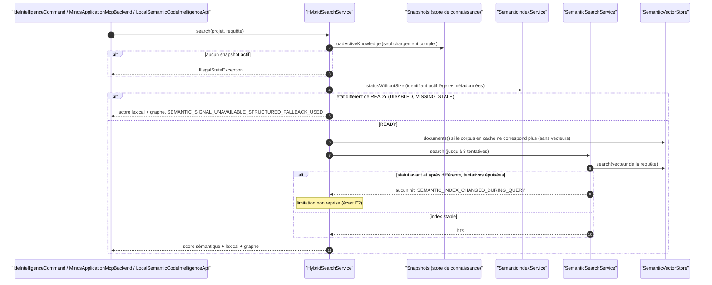
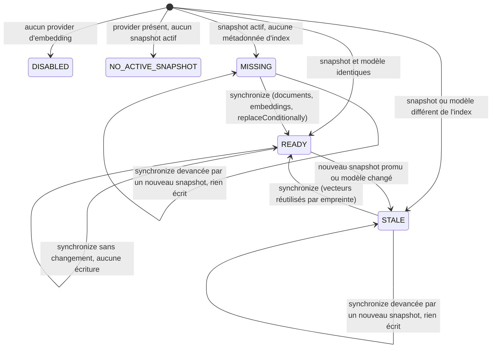

# Capacité `recherche-semantique` — dossier durable

Spec de référence : [openspec/specs/recherche-semantique/spec.md](../../../../openspec/specs/recherche-semantique/spec.md)
· Relevé au commit `3b516b1e` (2026-11-03).

## Objet et périmètre

[Exigence] La recherche sémantique et hybride répond à coût borné (un seul chargement du snapshot actif, aucun
vecteur chargé à la requête), détecte un index remplacé pendant la requête, synchronise l'index par différentiel
sans écriture inutile, et n'utilise le service géré `minos-ollama` que depuis le runtime Docker. Acteurs :
l'utilisateur de la CLI (`semantic-search`, `hybrid-search`), un agent par MCP, l'API Java. Hors périmètre : la
qualité des embeddings du modèle.

## Vues

### Comment une recherche hybride combine-t-elle les signaux et quand se replie-t-elle ?

Type : sequenceDiagram (UML, séquence) · Portée : existant vérifié · Exigences : « Une requête hybride lit le
snapshot actif au plus une fois », « Une requête hybride ne charge aucun vecteur et ne calcule aucune taille
d'index », « Un index modifié pendant une requête reste détecté »

`HybridSearchService.search`
(`minos-application/src/main/java/com/minos/application/semantic/HybridSearchService.java:53-97`) charge le
snapshot actif une fois, lit l'état de l'index sans calculer sa taille, réutilise le corpus en cache tant que
l'identité de l'index ne change pas, puis pondère : avec index, 0,50 sémantique, 0,35 lexical, 0,15 graphe ; sans
index, 0,70 lexical, 0,30 graphe avec une limitation déclarée. `SemanticSearchService` relit le statut avant et
après la recherche et rejoue au plus trois fois
(`minos-application/src/main/java/com/minos/application/semantic/SemanticSearchService.java:21`).

### Quels états l'index sémantique traverse-t-il ?

Type : stateDiagram-v2 (UML, machine à états) · Portée : existant vérifié · Exigences : « Une synchronisation
sans changement n'écrit rien », « Le différentiel est équivalent à un remplacement complet »

Les états sont ceux de `SemanticIndexService.State`
(`minos-application/src/main/java/com/minos/application/semantic/SemanticIndexService.java:266`), calculés à
chaque lecture (ils ne sont pas persistés). Une synchronisation écrit par `replaceConditionally` : si un nouveau
snapshot est promu entre-temps, elle est refusée et l'index précédent reste en place. L'indexation déclenche la
synchronisation après promotion, sans la rendre fatale.

## Traçabilité

| Exigence | Scénarios couverts | Vue | Preuves | Statut |
|---|---|---|---|---|
| Une requête hybride lit le snapshot actif au plus une fois | 2/2 | V1 | `minos-application/src/test/java/com/minos/application/semantic/HybridQueryCostTest.java#aHybridSearchLoadsTheActiveSnapshotAtMostOnce`, `minos-storage/src/test/java/com/minos/storage/local/store/ActiveSnapshotIdTest.java#theIdentifierIsReadWithoutOpeningTheSnapshotFile` | couverte |
| Une requête hybride ne charge aucun vecteur et ne calcule aucune taille d'index | 3/3 | V1 | `minos-application/src/test/java/com/minos/application/semantic/HybridQueryCostTest.java#aHybridSearchLoadsNoVectorAndComputesNoIndexSize`, `minos-application/src/test/java/com/minos/application/semantic/HybridQueryCostTest.java#aSecondHybridSearchOverTheSameIndexReadsNoDocument`, `minos-application/src/test/java/com/minos/application/semantic/HybridQueryCostTest.java#theIndexStatusStillReportsItsSize` | couverte |
| Un index modifié pendant une requête reste détecté | 2/2 sur le résultat final (nombre de tentatives non compté) | V1 | `minos-application/src/test/java/com/minos/application/semantic/HybridQueryCostTest.java#hitsOfAnotherIndexAreNeverReturned`, `minos-application/src/test/java/com/minos/application/semantic/SemanticQueryPathStatesTest.java#aReplacedIndexIsReadAgainAndItsDocumentsReplaceTheCachedOnes` | partielle |
| La construction des documents sémantiques ouvre chaque fichier source une fois | 4/4 | — | `minos-application/src/test/java/com/minos/application/semantic/SemanticDocumentFactorySourceReadsTest.java#aFileWithTwentySymbolsIsReadOnce`, `minos-application/src/test/java/com/minos/application/semantic/SemanticDocumentFactorySourceReadsTest.java#theDocumentsAreThoseOfTheReadingPerSymbol`, `minos-application/src/test/java/com/minos/application/semantic/SemanticDocumentFactorySourceReadsTest.java#theSymbolsOfAFileMissingFromTheDiskFallBackToTheirOwnText` | couverte |
| Aucun contenu de source n'est conservé après la construction | 1/1 par reconstruction (pas par une demande d'extrait) | — | `minos-application/src/test/java/com/minos/application/semantic/SemanticDocumentFactorySourceReadsTest.java#aFileChangedAfterABuildIsReadAgainByTheNextOne` | partielle |
| Une synchronisation sans changement n'écrit rien | 2/2 au niveau du service (pas par `minos index`) ; « version de documents » absente du code (E1) | V2 | `minos-application/src/test/java/com/minos/application/semantic/SemanticSynchronizeCostTest.java#anUnchangedReadyIndexIsNeitherRebuiltNorRewritten`, `minos-application/src/test/java/com/minos/application/semantic/SemanticSynchronizeCostTest.java#anotherModelTakesTheFullPath` | partielle |
| L'écriture PostgreSQL est proportionnelle aux documents modifiés | 3/3 (Docker requis ; sauté sans Docker) | V2 | `minos-storage/src/test/java/com/minos/storage/postgresql/semantic/PostgresSemanticDifferentialSyncTest.java#oneChangedDocumentOutOfNIsTheOnlyVectorSent`, `minos-storage/src/test/java/com/minos/storage/postgresql/semantic/PostgresSemanticDifferentialSyncTest.java#aMovedDocumentLeavesTheRowsOfAFullReplacement`, `minos-domain/src/test/java/com/minos/semantic/SemanticVectorReuseTest.java#aDocumentWithoutAVectorMustBeMarkedAsReusingItsStoredVector` | couverte |
| Le différentiel est équivalent à un remplacement complet | 2/2 (Docker requis) | V2 | `minos-storage/src/test/java/com/minos/storage/postgresql/semantic/PostgresSemanticDifferentialSyncTest.java#anEntirelyReusedTargetLeavesTheRowsOfAFullReplacement`, `minos-storage/src/test/java/com/minos/storage/postgresql/semantic/PostgresSemanticDifferentialSyncTest.java#aFailureAfterTheRemovalOfDocumentsLeavesThePreviousIndex` | couverte |
| Le service géré minos-ollama n'est joint que depuis le runtime Docker | 3/3 | — | `minos-application/src/test/java/com/minos/application/semantic/OllamaEmbeddingProviderRuntimeLocationTest.java#theManagedServiceFromTheDockerLocationIsAcceptedAndNotDeclaredUnusable`, `minos-application/src/test/java/com/minos/application/semantic/OllamaEmbeddingProviderRuntimeLocationTest.java#theManagedServiceFromTheDefaultNativeLocationFailsAtUseBeforeAnyNameResolution`, `minos-bootstrap/src/test/java/com/minos/bootstrap/semantic/M23SemanticProviderConfigurationTest.java#openRefusesAnUnknownRuntimeLocationByName` | couverte |
| Un MINOS_HOME configuré pour Docker reste ouvrable par un lanceur natif | 2/2 | — | `minos-bootstrap/src/test/java/com/minos/bootstrap/semantic/M23SemanticProviderConfigurationTest.java#nativeOpenOfADockerConfiguredHomeSucceedsAndReportsTheProviderUnusable` | couverte |
| Le corps d'une réponse d'erreur Ollama est borné et assaini | 2/2 | — | `minos-application/src/test/java/com/minos/application/semantic/OllamaEmbeddingProviderErrorBodyTest.java#aLargeErrorBodyIsBoundedInTheMessage`, `minos-application/src/test/java/com/minos/application/semantic/OllamaEmbeddingProviderErrorBodyTest.java#anErrorBodyNamingAnAbsolutePathIsOmittedButTheStatusRemains` | couverte |

Les tests PostgreSQL se sautent sans Docker (`minos-storage/src/test/java/com/minos/storage/postgresql/PostgresTestSupport.java`) :
leur preuve dépend du job qui dispose de Docker.

## Écarts

| Id | Écart | Preuve | Suite proposée |
|---|---|---|---|
| E1 | L'exigence « Une synchronisation sans changement n'écrit rien » cite la « version de documents » parmi les conditions ; le code ne compare que le snapshot et le modèle : un changement du format des documents pour un même snapshot et un même modèle ne reconstruit pas l'index | `minos-application/src/main/java/com/minos/application/semantic/SemanticIndexService.java:207-210` | [Question] Défaut à corriger (ajouter une version de documents aux métadonnées) ou exigence à préciser ? Décision métier |
| E2 | La recherche hybride ignore les limitations de la recherche sémantique : un index changé pendant la requête donne des scores sémantiques nuls tout en restant annoncé `semanticAvailable=true`, contraire au principe capability-honest | `minos-application/src/main/java/com/minos/application/semantic/HybridSearchService.java:166-174` | [Proposition] Défaut à corriger par un changement (reprendre la limitation dans la réponse hybride), avec test rouge |
| E3 | Aucun test ne compte les tentatives (trois au plus) | `minos-application/src/main/java/com/minos/application/semantic/SemanticSearchService.java:21` | [Proposition] Test complémentaire |
| E4 | Un index supprimé entre la lecture du statut et celle des métadonnées donne une `NoSuchElementException`, pas une limitation | `minos-application/src/main/java/com/minos/application/semantic/HybridSearchService.java:63` | [Question] Cas non spécifié ; à trancher avec E2 |
| E5 | Un modèle injoignable au moment de la requête propage une `IOException`, sans repli lexical ; la spec ne fixe rien | `minos-application/src/main/java/com/minos/application/semantic/SemanticSearchService.java:94` | [Question] Décision métier : erreur ou repli déclaré ? |

## Questions ouvertes

- Les tests du différentiel PostgreSQL ne prouvent quelque chose que sur un job où Docker est disponible :
  lequel l'exécute sans saut ?
