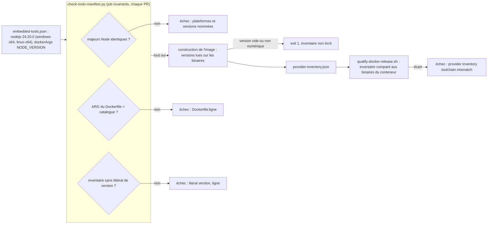

# Capacité `socle-d-execution` — dossier durable

Spec de référence : [openspec/specs/socle-d-execution/spec.md](../../../../openspec/specs/socle-d-execution/spec.md)
· Relevé au commit `3b516b1e` (2026-11-03).

## Objet et périmètre

[Exigence] Les runtimes embarqués ou exigés par MINOS (JDK de la baseline, Node livré, toolchains de l'image)
sont des versions maintenues, énoncées une seule fois et contrôlées partout où elles sont écrites ; l'inventaire
de provenance de l'image reflète les binaires réellement installés. Acteurs : le mainteneur qui monte une
version, la CI qui la contrôle. Références : `docs/developer/TOOLCHAIN_POLICY.md`. Hors périmètre : la
qualification fonctionnelle des providers (la CI n'en exécute aucun).

## Vues

### Comment une version de Node ou de toolchain est-elle contrôlée, du catalogue à l'image qualifiée ?

Type : flowchart (organigramme de décision, non UML) · Portée : existant vérifié · Exigences : « Le runtime Node
livré est maintenu et de même majeur sur chaque plateforme », « L'inventaire de provenance de l'image reflète
les binaires installés »

Le catalogue `minos-provider-scip/src/main/resources/com/minos/adapter/scip/runtime/embedded-tools.json` est la
source. Le gate `scripts/quality/check-tools-manifest.py` (fonctions `check_node_runtime`, `check_dockerfile`,
`check_provider_inventory`) s'exécute à chaque PR ; la lecture des versions sur les binaires et l'arrêt sur une
version illisible ont lieu à la construction de l'image (`docker/Dockerfile.mcp.release:283-298`) ; la
comparaison finale n'a lieu que dans la qualification de release (`.github/workflows/docker-release-validation.yml`).
La baseline Java suit un contrôle parallèle (`scripts/quality/check-toolchain-baseline.py`, référence
`maven.compiler.release` de `pom.xml`), non dessiné ici.

## Traçabilité

| Exigence | Scénarios couverts | Vue | Preuves | Statut |
|---|---|---|---|---|
| Le runtime Node livré est maintenu et de même majeur sur chaque plateforme | 1/3 (`NODE_VERSION` contrôlé par la règle générique d'ARG ; providers Node non exécutés) | V1 | `scripts/quality/test_check_tools_manifest.py#test_node_majors_that_differ_between_platforms_are_refused`, `scripts/quality/test_check_tools_manifest.py#test_the_shipped_catalogue_with_an_older_node_major_on_linux_is_refused`, `scripts/quality/test_check_tools_manifest.py#test_a_dockerfile_version_that_differs_from_the_catalogue_is_refused` | partielle |
| L'inventaire de provenance de l'image reflète les binaires installés | 2/3 (version illisible : logique du Dockerfile, aucun test exécuté) | V1 | `scripts/quality/test_check_tools_manifest.py#test_a_literal_version_in_the_provider_inventory_is_refused_with_its_line`, `scripts/quality/test_check_tools_manifest.py#test_an_inventory_version_that_comes_from_no_variable_is_refused`, `scripts/ci/qualify-docker-release.sh:236` | partielle |
| Le produit se construit et s'exécute sur un JDK LTS maintenu | 1/3 (refus d'un autre JDK et runtime embarqué non exécutés) | — | `scripts/quality/test_check_toolchain_baseline.py#test_an_enforcer_left_on_the_previous_java_is_refused`, `scripts/quality/test_check_toolchain_baseline.py#test_an_image_left_on_the_previous_java_is_refused`, `.github/workflows/pr-ci.yml` (jobs `Verify` Linux et Windows) | partielle |
| La version de Java est énoncée une seule fois et contrôlée partout | 4/4 | — | `scripts/quality/test_check_toolchain_baseline.py#test_a_workflow_left_on_the_previous_java_is_refused`, `scripts/quality/test_check_toolchain_baseline.py#test_the_plugin_steps_in_java_21_are_accepted_by_a_closed_list`, `scripts/quality/test_check_toolchain_baseline.py#test_java_21_outside_the_closed_list_is_refused`, `scripts/quality/test_check_toolchain_baseline.py#test_an_agents_file_or_an_openspec_config_with_another_java_is_refused` | couverte |
| La politique de toolchain nomme la fin de support de chaque baseline | 2/2 hors registre des risques (non contrôlé) | — | `scripts/quality/test_check_toolchain_baseline.py#test_a_policy_without_an_end_of_support_date_is_refused`, `scripts/quality/test_check_toolchain_baseline.py#test_a_support_line_about_another_java_is_refused` | partielle |

## Écarts

| Id | Écart | Preuve | Suite proposée |
|---|---|---|---|
| E1 | Le scénario « Providers Node qualifiés dans l'image » attend que la qualification indexe des fixtures TypeScript et Python avec scip-typescript et scip-python ; elle importe un artefact SCIP versionné sans exécuter de provider, et il n'existe pas de fixture Python | `scripts/ci/qualify-docker-release.sh:303` | [Question] Décision métier : exiger une exécution réelle des providers Node (aujourd'hui impossible en CI) ou réécrire le scénario par un changement en déclarant la limite |
| E2 | Le scénario « Politique sans date de fin de support » exige que le gate nomme la section ; il nomme seulement le fichier | `scripts/quality/test_check_toolchain_baseline.py:231` | [Proposition] Aligner le message ou le scénario |
| E3 | « Ligne LTS maintenue » : le gate ne compare que les majeurs | `scripts/quality/check-tools-manifest.py:142` | [Question] Comment prouver qu'une ligne est maintenue (date de fin de support au catalogue ?) |
| E4 | Le registre des risques pour une baseline proche de sa fin de support n'est contrôlé par aucun gate | `scripts/quality/check-toolchain-baseline.py` | [Proposition] Contrôle à ajouter ou exigence à préciser |

## Questions ouvertes

- Le refus d'un JDK hors baseline par Maven Enforcer n'est prouvé que par sa configuration (`pom.xml`) : faut-il
  une exécution de `validate` sous un autre JDK en CI ?
