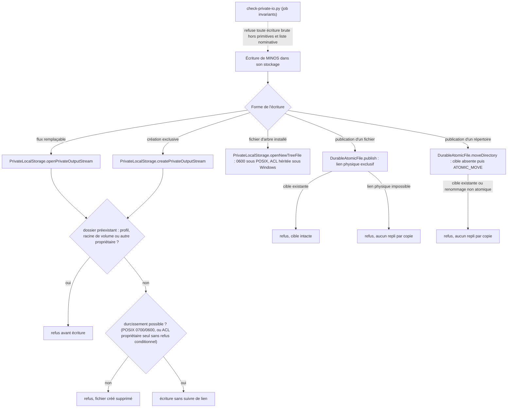
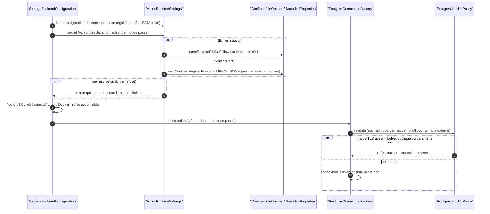

# Capacité `stockage-prive-et-secrets` — dossier durable

Spec de référence : [openspec/specs/stockage-prive-et-secrets/spec.md](../../../../openspec/specs/stockage-prive-et-secrets/spec.md)
· Relevé au commit `64d131e4` (2026-11-04).

## Objet et périmètre

[Exigence] MINOS ne crée, n'écrit, ne lit et ne verrouille ses fichiers que par des primitives confinées
(`PrivateLocalStorage`, `DurableAtomicFile`, `ConfinedFileOpener`, `BoundedFileLease`, `BoundedProperties`) qui ne
suivent pas de lien, donnent des droits privés et publient sans écraser une cible ; un gate refuse toute écriture
brute nouvelle. Les secrets (mot de passe PostgreSQL, fichiers écrits par l'installation) n'existent jamais avec
une ACL héritée, et une connexion PostgreSQL externe exige un TLS vérifié reconnu à l'identique par le pilote.
Acteurs : MINOS et ses scripts d'installation ; l'attaquant considéré a un accès local non privilégié (liens
plantés, dossiers partagés). Hors périmètre : le contenu des fichiers.

## Vues

### Quelle primitive sert quelle écriture, et quand l'écriture est-elle refusée ?

Type : flowchart (organigramme de décision, non UML) · Portée : existant vérifié · Exigences : « Une publication
n'écrase jamais une cible existante », « Une publication fail-closed quand l'absence d'écrasement n'est pas
garantie », « Une écriture en flux dans le stockage privé ne suit jamais un lien », « Un dossier privé préexistant
n'est durci que s'il appartient à l'utilisateur », « Un refus conditionnel n'est jamais retiré par le
durcissement », « Une écriture brute nouvelle hors des primitives est refusée par le gate »

Les primitives vivent dans `minos-engine/src/main/java/com/minos/io/`. Sous Windows, le durcissement passe par un
port d'ACL découvert par `ServiceLoader` (implémentation `WindowsIcaclsAccessControl` dans `minos-runtime-local`) :
zéro ou deux implémentations font échouer l'opération. Une publication de fichier crée un lien physique exclusif ;
une publication de répertoire contrôle l'absence de la cible puis renomme atomiquement, ce qui laisse une course
connue entre deux écrivains (écart E4).

### Comment un mot de passe PostgreSQL est-il lu et la connexion autorisée ?

Type : sequenceDiagram (UML, séquence) · Portée : existant vérifié · Exigences : « Une connexion PostgreSQL externe
exige un mode TLS reconnu à l'identique par le pilote », « Un BOM UTF-8 initial n'altère ni une propriété ni un
secret », « Une configuration d'exécution présente mais non régulière est refusée », « Un PostgreSQL géré sans URL
est refusé hors Docker de façon actionnable »

La politique d'URL (`minos-storage/src/main/java/com/minos/storage/postgresql/support/PostgresJdbcUrlPolicy.java`)
lit la clé et la valeur de `sslmode` comme le pilote les lit, accepte le bouclage IPv4 et IPv6 sans TLS et exige
`verify-full` pour tout autre hôte. Le script d'installation applique le même contrôle à l'URL saisie.

## Traçabilité

| Exigence | Scénarios couverts | Vue | Preuves | Statut |
|---|---|---|---|---|
| Une connexion PostgreSQL externe exige un mode TLS reconnu à l'identique par le pilote | tous (absence de connexion déduite de l'ordre) | V2 | `minos-storage/src/test/java/com/minos/storage/postgresql/support/PostgresJdbcUrlPolicyTest.java#anExternalHostWithoutAModeOrWithAWeakerOne`, `minos-storage/src/test/java/com/minos/storage/postgresql/support/PostgresJdbcUrlPolicyTest.java#aDuplicateSslModeIsRefusedWhateverItsCase` | couverte |
| Tout URL accepté par la politique a le même mode TLS pour le pilote | assertion de l'installateur non testée par une exécution | V2 | `minos-storage/src/test/java/com/minos/storage/postgresql/support/PostgresJdbcUrlPolicyDriverParityTest.java` | partielle |
| L'IPv6 de bouclage est reconnu comme bouclage | tous | V2 | `minos-storage/src/test/java/com/minos/storage/postgresql/support/PostgresJdbcUrlPolicyTest.java#anotherIpv6AddressStillRequiresVerifyFull`, `minos-engine/src/test/java/com/minos/storage/StorageBackendConfigurationTest.java` | couverte |
| Un BOM UTF-8 initial n'altère ni une propriété ni un secret | tous | V2 | `minos-engine/src/test/java/com/minos/io/BoundedPropertiesTest.java`, `minos-engine/src/test/java/com/minos/storage/AbsoluteSecretFileTest.java` | couverte |
| Une publication n'écrase jamais une cible existante | tous | V1 | `minos-engine/src/test/java/com/minos/io/DurableAtomicFileTest.java#replaceStillReplacesAnExistingTarget` | couverte |
| Une publication fail-closed quand l'absence d'écrasement n'est pas garantie | tous | V1 | `minos-engine/src/test/java/com/minos/io/DurableAtomicFileTest.java#publishFailsClosedWhenTheFilesystemCannotLinkAndNeverOverwrites`, `minos-engine/src/test/java/com/minos/io/IoRefusalMessageTest.java` | couverte |
| Un secret écrit par un script d'installation n'existe jamais avec une ACL héritée | tous (Windows) | — | `scripts/install/test_secret_file_acl.py#test_the_secret_is_written_into_a_file_that_is_already_restricted`, `scripts/install/test_secret_file_acl.py#test_a_restriction_that_fails_leaves_no_file` | couverte |
| Un fichier de secret existant est revérifié | tous (Windows) | — | `scripts/install/test_secret_file_acl.py#test_an_existing_file_of_inherited_acl_is_restricted_before_it_is_kept`, `scripts/install/test_secret_file_acl.py#test_an_existing_file_that_cannot_be_restricted_is_refused_and_left_unchanged` | couverte |
| Le message d'une primitive d'E/S privée ne contient pas de chemin absolu | tous | — | `minos-engine/src/test/java/com/minos/io/IoRefusalMessageTest.java#propertiesLoadOnADirectoryDoesNotNameTheAbsolutePath`, `minos-storage/src/test/java/com/minos/storage/local/incremental/FileProjectFingerprintSnapshotStoreSymlinkTest.java#rejectedSymlinkedProjectDirectoryDoesNotNameTheAbsolutePath` | couverte |
| Une configuration d'exécution présente mais non régulière est refusée | tous | V2 | `minos-engine/src/test/java/com/minos/storage/MinosRuntimeSettingsConfigurationFileTest.java` | couverte |
| Une écriture brute nouvelle hors des primitives est refusée par le gate | tous | V1 | `scripts/architecture/test_check_private_io.py#test_each_forbidden_call_fails_on_its_own`, `scripts/architecture/test_check_private_io.py#test_a_process_output_redirected_to_a_file_is_caught` | couverte |
| La liste de tolérance des écritures brutes ne fait que se resserrer | liste illisible : refusée par le code, sans auto-test | V1 | `scripts/architecture/test_check_private_io.py#test_a_stale_maximum_fails`, `scripts/architecture/test_check_private_io.py#test_a_blank_or_missing_justification_is_refused` | partielle |
| L'ouverture confinée ne dépend d'aucun état statique modifiable | tous | — | `minos-engine/src/test/java/com/minos/io/ConfinedFileOpenerStructureTest.java#hasNoStaticFieldThatCanBeReassigned`, `minos-engine/src/test/java/com/minos/io/ConfinedFileOpenerTest.java#refusesAFileReplacedByASymlinkBetweenValidationAndOpen` | couverte |
| Un refus conditionnel n'est jamais retiré par le durcissement | tous (Windows) | V1 | `minos-engine/src/test/java/com/minos/io/PrivateLocalStorageWindowsAclTest.java#anExplicitConditionalDenyIsRefusedAndStillThereAfterwards`, `minos-runtime-local/src/test/java/com/minos/runtime/local/acl/WindowsPrivateStorageEndToEndTest.java` | couverte |
| Un octroi d'ACL du bac à sable est additif, borné et fail-closed | tous | — | `minos-runtime-local/src/test/java/com/minos/runtime/local/sandbox/WindowsAclGrantsTest.java` | couverte |
| Une écriture en flux dans le stockage privé ne suit jamais un lien | tous | V1 | `minos-engine/src/test/java/com/minos/io/PrivateLocalStorageWritesTest.java#writePrivateFileNeverWritesThroughALink`, `minos-engine/src/test/java/com/minos/io/PrivateLocalStorageStreamsTest.java#anExistingFileIsRefusedAndItsContentIsIntact` | couverte |
| La lecture par canal et la publication de répertoire échouent fermées | tous (classes de test autres que celles citées par la spec, E2) | V1 | `minos-engine/src/test/java/com/minos/io/ConfinedFileOpenerChannelTest.java#aLinkLeafIsRefusedWithoutBeingFollowed`, `minos-engine/src/test/java/com/minos/io/DurableAtomicFileMoveDirectoryTest.java#aFilesystemWithoutAtomicRenameFailsClosedAndNothingIsCopied` | couverte |
| Le magasin PostgreSQL n'écrit pas ses fichiers de travail par un appel brut | prouvé seulement avec Docker | — | `minos-storage/src/test/java/com/minos/storage/postgresql/snapshot/PostgresSnapshotScratchFileLinkTest.java` | partielle |
| Une entrée de cache de dépôt distant est publiée par un déplacement atomique de répertoire | tous | V1 | `minos-integration-git/src/test/java/com/minos/integration/git/JGitRemoteRepositoryMaterializerPublicationTest.java` | couverte |
| L'artefact d'un provider est lu sans suivre de lien et l'index figé est écrit par une primitive privée | tous | — | `minos-provider-scip/src/test/java/com/minos/adapter/scip/ingestion/ScipArtifactOpeningTest.java#anIndexReplacedByALinkBetweenTheCheckAndTheOpenIsRefused` | couverte |
| Le stockage local écrit ses fichiers par les primitives d'E/S privées | aucun test d'écriture par lien substitué dans `minos-storage` | V1 | `minos-storage/src/test/java/com/minos/storage/local/store/FileSymbolSnapshotStoreSymlinkTest.java`, `minos-engine/src/test/java/com/minos/io/PrivateLocalStorageWritesTest.java` | partielle |
| Une sauvegarde de migration et une session publiée ne sont jamais écrasées | tous | — | `minos-storage/src/test/java/com/minos/storage/local/registry/LegacyRegistryBackupTest.java#aBackupWhichAlreadyExistsIsNeitherModifiedNorReplaced`, `minos-storage/src/test/java/com/minos/storage/local/store/FileRuntimeObservationStoreTest.java#aNameTakenMeanwhileByAnotherContentIsRefused` | couverte |
| L'historique d'indexation et les empreintes de sources ne suivent pas de lien | lien substitué au temporaire de l'historique non testé | — | `minos-application/src/test/java/com/minos/program/analysis/SourceFingerprintLeafNoFollowTest.java`, `minos-application/src/test/java/com/minos/application/LocalProjectOperationsHistoryTest.java` | partielle |
| La configuration du backend MCP est écrite par une primitive privée | lien substitué au temporaire non testé | — | `minos-app/src/test/java/com/minos/app/McpBackendConfigurationStoreSaveTest.java` | partielle |
| Le mécanisme d'ACL Windows est un port découvert, fail-closed | découverte dans le JAR distribué non testée | V1 | `minos-engine/src/test/java/com/minos/io/PlatformAccessControlDiscoveryTest.java` | partielle |
| Le lanceur d'icacls accepte les chemins longs | tous | — | `minos-runtime-local/src/test/java/com/minos/runtime/local/acl/WindowsIcaclsTest.java#aRelativeTargetIsRefusedBeforeAnyProcess` | couverte |
| La doublure de test du port reste alignée sur le mécanisme réel | tous | — | `minos-runtime-local/src/test/java/com/minos/runtime/local/acl/WindowsIcaclsParityTest.java`, `minos-bootstrap/src/test/java/com/minos/bootstrap/PlatformAccessControlRegistrationTest.java` | couverte |
| Un dossier privé préexistant n'est durci que s'il appartient à l'utilisateur | tous | V1 | `minos-engine/src/test/java/com/minos/io/PrivateLocalStorageSharedLocationTest.java`, `minos-engine/src/test/java/com/minos/io/PrivateLocalStorageWindowsAclTest.java` | couverte |
| Le MINOS_HOME natif d'une installation PostgreSQL gérée par Docker est en stockage local | tous (Windows) | — | `scripts/install/test_runtime_settings_storage.py` | couverte |
| Un PostgreSQL géré sans URL est refusé hors Docker de façon actionnable | tous | V2 | `minos-engine/src/test/java/com/minos/storage/StorageBackendConfigurationTest.java` | couverte |
| Un fichier d'arbre d'installation hérite de l'accès de son dossier privé | tous | — | `minos-provider-scip/src/test/java/com/minos/adapter/scip/runtime/install/ManagedToolInstallationFilesTest.java`, `minos-engine/src/test/java/com/minos/io/PrivateLocalStorageStreamsTest.java#aNewFileInheritsTheFolderAclAndItsDaclIsNotRewritten` | couverte |
| Une lecture du registre des projets n'écrit rien | tous | — | `minos-storage/src/test/java/com/minos/storage/local/registry/InterProcessLocalProjectRegistryWriteProtectedStorageTest.java` | couverte |
| Une lecture du registre reste exclue par un écrivain | échéance du bail de lecture non testée | — | `minos-engine/src/test/java/com/minos/io/BoundedFileLeaseSharedProcessTest.java#twoReadersOfTwoProcessesDoNotExcludeEachOther` | partielle |
| Un fichier de verrou non conforme est refusé à la lecture, jamais réparé | tous | — | `minos-engine/src/test/java/com/minos/io/BoundedFileLeaseSharedTest.java#aReaderDoesNotCreateAnAbsentLockFile`, `minos-storage/src/test/java/com/minos/storage/local/registry/InterProcessLocalProjectRegistrySymlinkTest.java#rejectsSymlinkedRegistryLock` | couverte |
| Une lecture ne migre pas une entrée de registre héritée | tous | — | `minos-storage/src/test/java/com/minos/storage/local/registry/InterProcessLocalProjectRegistryWriteProtectedStorageTest.java` | couverte |
| La lecture des observations runtime n'écrit rien | tous (exclusion par un import concurrent non testée) | — | `minos-storage/src/test/java/com/minos/storage/local/store/FileRuntimeObservationStoreTest.java#readsAnswerOnAWriteProtectedStoreAndLeaveItUntouched` | couverte |
| Un paquet d'artefact et une mise de côté de répertoire sont atomiques sans repli | refus de déplacement atomique d'un paquet non testé | V1 | `minos-engine/src/test/java/com/minos/io/DurableAtomicFileMoveDirectoryTest.java`, `minos-runtime-local/src/test/java/com/minos/runtime/local/distributed/DistributedArtifactBundlePublicationTest.java#theBundleIsTheOnlyEntryLeftInTheFolderOfTheCaller` | partielle |
| Le gate des messages reconnaît un chemin nommé par le suffixe Home | tous | — | `scripts/architecture/test_check_private_io.py#test_a_home_a_derived_path_or_a_diagnostic_in_an_optional_fails`, `scripts/architecture/test_check_private_io.py#test_a_home_site_takes_a_justified_entry_and_a_stale_entry_is_refused`, `scripts/architecture/test_check_private_io.py#test_the_two_real_project_jdk_messages_reverted_to_the_java_home_value_are_caught` | couverte |
| Le gate des messages reconnaît un chemin dérivé par un appel chaîné | tous | — | `scripts/architecture/test_check_private_io.py#test_a_home_a_derived_path_or_a_diagnostic_in_an_optional_fails`, `scripts/architecture/test_check_private_io.py#test_a_home_named_by_its_role_or_a_path_not_rendered_passes` | couverte |
| Le gate des messages lit un diagnostic préparé dans un Optional | tous | — | `scripts/architecture/test_check_private_io.py#test_a_home_a_derived_path_or_a_diagnostic_in_an_optional_fails`, `scripts/architecture/test_check_private_io.py#test_the_inventory_lists_a_diagnostic_in_an_optional_as_public` | couverte |

Beaucoup de preuves dépendent du système (`@EnabledOnOs`) ou de la capacité du compte à créer un lien symbolique ;
celles du magasin PostgreSQL exigent Docker.

## Écarts

| Id | Écart | Preuve | Suite proposée |
|---|---|---|---|
| E1 | Un scénario donne une commande `-pl minos-storage-local`, module absent du reactor ; le test vit dans `minos-storage` | `openspec/specs/stockage-prive-et-secrets/spec.md:567` | [Proposition] Corriger la commande par un changement |
| E2 | Deux scénarios citent `ConfinedFileOpenerTest` et `DurableAtomicFileTest` ; les preuves sont dans `ConfinedFileOpenerChannelTest` et `DurableAtomicFileMoveDirectoryTest` | `minos-engine/src/test/java/com/minos/io/ConfinedFileOpenerChannelTest.java:73` | [Proposition] Corriger les références |
| E3 | La spec demande le « même motif » de refus à l'installation et à l'exécution ; les messages diffèrent sans se contredire, et aucun test ne les compare | `scripts/install/configure-runtime-settings.ps1:235`, `minos-storage/src/main/java/com/minos/storage/postgresql/support/PostgresJdbcUrlPolicy.java:63` | [Proposition] Test de parité des messages |
| E4 | Deux exigences demandent un renommage de répertoire « vers un nom inexistant » sans remplacer d'entrée ; la primitive contrôle puis renomme, et le reconnaît : deux écrivains en course peuvent remplacer un répertoire vide sous POSIX | `minos-engine/src/main/java/com/minos/io/DurableAtomicFile.java:148-152` | [Question] Limite à déclarer dans l'exigence (noms créés par le seul appelant) ou à corriger ? |
| E5 | La publication d'un paquet d'artefact remplace une cible existante (atomique, mais pas « sans écrasement » comme les autres publications) | `minos-runtime-local/src/main/java/com/minos/runtime/local/distributed/DistributedArtifactBundleStore.java:146` | [Question] Comportement voulu à écrire dans l'exigence ? |
| E6 | `PrivateLocalStorage` est présenté comme une primitive, mais le gate ne le compte pas parmi ses primitives : il porte des entrées nominatives dans la liste de tolérance | `scripts/architecture/check-private-io.py:70` | [Proposition] Préciser le statut dans la spec |

## Questions ouvertes

Aucune.
