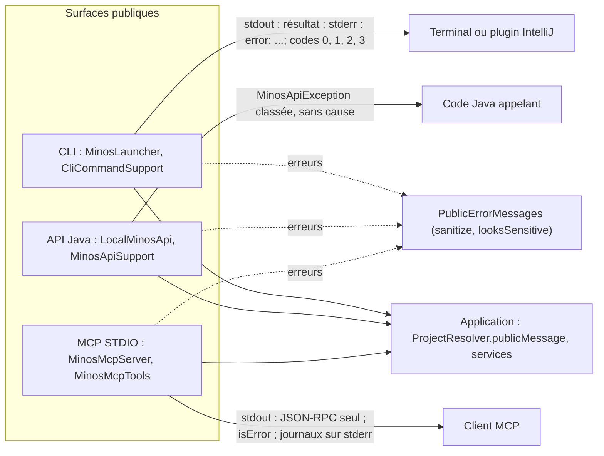
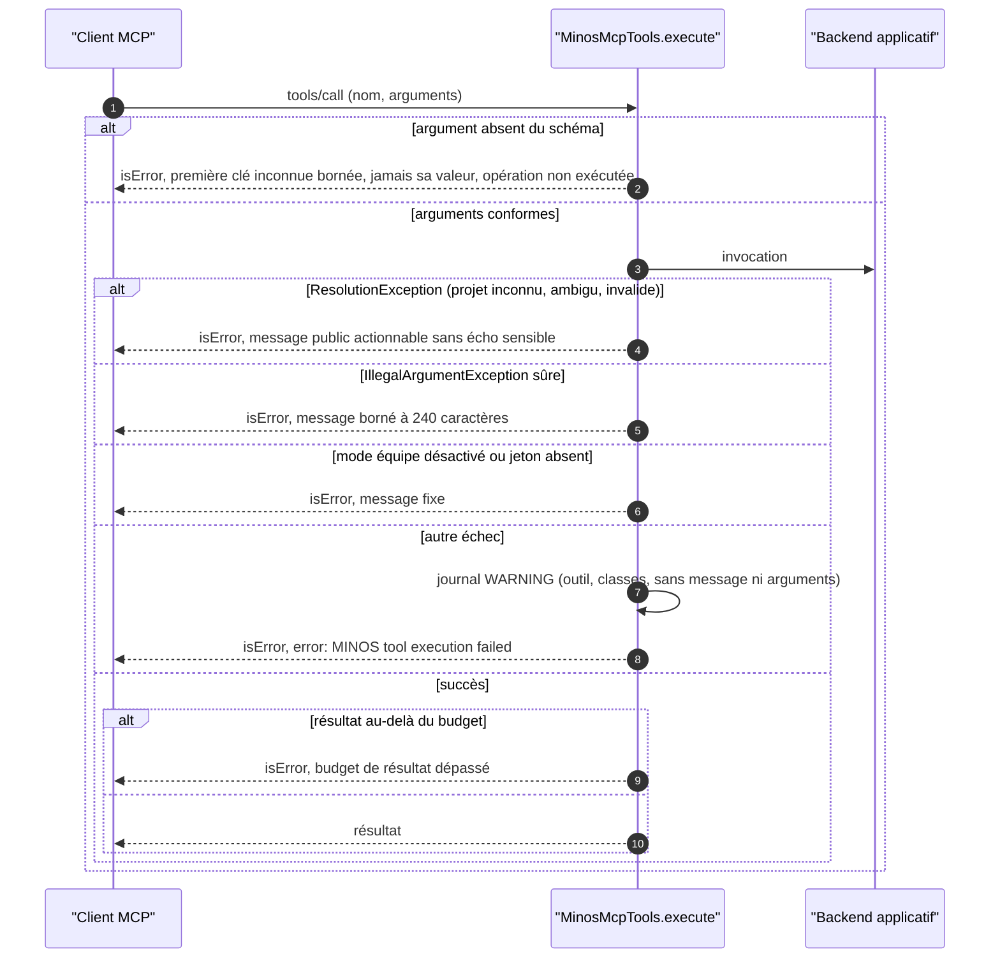

# Capacité `surfaces-publiques` — dossier durable

Spec de référence : [openspec/specs/surfaces-publiques/spec.md](../../../../openspec/specs/surfaces-publiques/spec.md)
· Relevé au commit `64d131e4` (2026-11-03).

## Objet et périmètre

[Exigence] Les trois surfaces publiques (CLI, API Java, MCP STDIO en lecture seule, ARCH-0017) rendent des
erreurs actionnables pour l'usage et opaques pour l'interne, sans chemin absolu, secret ni valeur d'argument ; le
statut MCP n'a aucun effet de bord et ne présente jamais un état non inspecté comme inspecté ; un argument hors du
schéma publié est refusé. Acteurs : l'utilisateur d'un terminal, un code Java appelant, un client MCP (agent IA,
plugin IntelliJ via la CLI). Hors périmètre : le contenu fonctionnel de chaque requête.

## Vues

### Par où passent une requête et ses erreurs, d'une surface à l'autre ?

Type : flowchart (vue de composants, non UML) · Portée : existant vérifié · Exigences : « Les échecs internes
restent opaques et sans fuite », « Tout échec d'ouverture de l'API Java est une erreur publique classée et
redactée », « Une référence de projet inconnue, ambiguë ou invalide reçoit une erreur actionnable sans fuite »

La règle de message d'une référence de projet est unique : `ProjectResolver.publicMessage()`
(`minos-application/src/main/java/com/minos/application/resolution/ProjectResolver.java:49-56`). Toute autre
erreur publique passe par `PublicErrorMessages`
(`minos-domain/src/main/java/com/minos/diagnostics/PublicErrorMessages.java`). Codes de sortie de la CLI : 0
succès, 1 erreur d'exécution, 2 erreur d'usage, 3 résultat partiel
(`minos-cli/src/main/java/com/minos/cli/support/CliExitCodes.java:9-13`). L'API classe chaque échec (requête
invalide, indisponibilité, E/S, accès refusé, échec d'exécution) sans attacher de cause.

### Comment un outil MCP traite-t-il ses arguments et ses échecs ?

Type : sequenceDiagram (UML, séquence) · Portée : existant vérifié · Exigences : « Un argument MCP absent du
schéma publié est refusé », « Le refus d'un argument inconnu n'expose aucune valeur d'argument », « Un échec
d'outil MCP est diagnostiquable par l'opérateur sans exposer son message », « Les échecs d'usage et de
configuration connus du MCP sont diagnostiquables »

`MinosMcpTools.execute` (`minos-mcp/src/main/java/com/minos/mcp/MinosMcpTools.java:172-203`) refuse d'abord tout
argument hors schéma (la validation du SDK est désactivée parce qu'elle recopierait la clé sans borne), puis
classe l'échec. Le serveur lit au plus 1 Mio par message entrant et n'écrit sur stdout que le protocole.

## Traçabilité

| Exigence | Scénarios couverts | Vue | Preuves | Statut |
|---|---|---|---|---|
| Une référence de projet inconnue, ambiguë ou invalide reçoit une erreur actionnable sans fuite | nom sensible prouvé de bout en bout sur le MCP seul ; ambigu, vide, trop long au niveau du résolveur | V1, V2 | `minos-mcp/src/test/java/com/minos/mcp/MinosMcpProjectReferenceErrorTest.java#aReferenceShapedLikeAPathOrASecretGetsAnActionableErrorThatDoesNotEchoIt`, `minos-cli/src/test/java/com/minos/cli/ProjectReferenceErrorTest.java#aPathShapedReferenceIsReportedAsUnknownWithTheWayToFixIt`, `minos-api/src/test/java/com/minos/api/ProjectReferenceErrorApiTest.java#aPathShapedReferenceIsAnInvalidRequestWithAnActionableMessageAndNoCause`, `minos-bootstrap/src/test/java/com/minos/bootstrap/application/ProjectResolverTest.java#publicMessageOfAnAmbiguousNameIsRedactedOnlyWhenTheNameIsSensitive` | partielle |
| Les échecs d'usage et de configuration connus du MCP sont diagnostiquables | tous | V2 | `minos-mcp/src/test/java/com/minos/mcp/MinosMcpProjectReferenceErrorTest.java#aNameNotFoundBesideAnUnreadableRegistryEntryCountsThemAndSaysExistenceCannotBeEstablished`, `minos-mcp/src/test/java/com/minos/mcp/MinosMcpTypedErrorsTest.java#aTeamToolSaysThatATeamTokenIsRequiredWithoutEchoingAnyToken` | couverte |
| Les échecs internes restent opaques et sans fuite | tous | V1, V2 | `minos-mcp/src/test/java/com/minos/mcp/MinosMcpErrorRedactionTest.java#internalBackendFailureNeverReturnsOperationalDetails`, `minos-mcp/src/test/java/com/minos/mcp/MinosMcpErrorRedactionTest.java#anUnexpectedFailureIsTheGenericErrorWithoutItsMessage` | couverte |
| Un échec d'outil MCP est diagnostiquable par l'opérateur sans exposer son message | tous | V2 | `minos-mcp/src/test/java/com/minos/mcp/MinosMcpFailureLoggingTest.java#anOpaqueFailureLogsTheToolAndBothClassesButNeitherTheMessageNorTheArguments`, `minos-mcp/src/test/java/com/minos/mcp/MinosMcpFailureLoggingTest.java#aFailureWithoutACauseNamesItselfAsItsRoot` | couverte |
| Le statut MCP n'a aucun effet de bord | inspection réelle par les commandes explicites non prouvée | — | `minos-mcp/src/test/java/com/minos/mcp/MinosMcpReadOnlyHomeTest.java#statusAndStructureNeverInspectTheProviderRuntimesNorChangeTheHome` | partielle |
| L'état d'exécution des runtimes n'est jamais présenté comme inspecté par le statut MCP | tous par tests unitaires (le golden masque la valeur, E2) | — | `minos-mcp/src/test/java/com/minos/mcp/MinosMcpReadOnlyHomeTest.java#theProfilesDeclareTheRuntimeStateAsNotInspectedAndNeverSimulateAState`, `minos-mcp/src/test/java/com/minos/mcp/ProviderProfilesKeyOrderTest.java#everyProfileKeepsItsDeclaredKeyOrderAndSortedCapabilities` | couverte |
| Le statut d'index ne dépend pas de la découverte du dépôt | commandes de structure prouvées pour la vue de structure seulement | — | `minos-bootstrap/src/test/java/com/minos/bootstrap/application/ProjectStatusWithoutDiscoveryTest.java#theStatusNeverCallsTheDiscoveryWhereTheStructureViewDoes`, `minos-mcp/src/test/java/com/minos/mcp/MinosMcpIndexStatusWithoutDiscoveryTest.java#indexStatusAnswersWithoutDiscoveringTheRepositoryEvenWhenDiscoveryWouldFail` | partielle |
| Une combinaison de bornes acceptée par le schéma publié n'est pas refusée par les défauts | tous | — | `minos-mcp/src/test/java/com/minos/mcp/MinosMcpHybridContextBoundsTest.java#theDefaultPerDocumentCapIsBoundedByMaxTokens`, `minos-cli/src/test/java/com/minos/cli/command/IdeIntelligenceCommandTest.java` | couverte |
| Tout échec d'ouverture de l'API Java est une erreur publique classée et redactée | « aucune ressource conservée » non prouvé (E3) | V1 | `minos-api/src/test/java/com/minos/api/OpenFailureTranslationTest.java#theOpeningFailuresAreClassifiedLikeEveryOtherCall`, `minos-api/src/test/java/com/minos/api/OpenFailureTranslationTest.java#aSensitiveOpeningMessageIsRedactedAndNoCauseIsAttached` | partielle |
| Une erreur d'exécution d'une opération IDE n'est pas rapportée comme un échec de démarrage | tous | V1 | `minos-cli/src/test/java/com/minos/cli/command/IdeIntelligenceCommandTest.java#anIoFailureOfAServiceIsAnExecutionErrorNotABootstrapFailure`, `minos-cli/src/test/java/com/minos/cli/LazyWiringGuardTest.java#anOpenFailureIsStillReportedAsABootstrapFailureByEveryCommandThatNeedsTheApplication` | couverte |
| Un chemin absolu masqué par une séquence de contrôle ou accolé à un mot est détecté | tous | V1 | `minos-domain/src/test/java/com/minos/diagnostics/PublicErrorMessagesTest.java#anAbsolutePathBehindAnAnsiSequenceIsRejected`, `minos-domain/src/test/java/com/minos/diagnostics/PublicErrorMessagesTest.java#aWindowsDriveGluedToAWordIsRejected` | couverte |
| Un chemin relatif n'est pas pris pour un chemin absolu | tous | V1 | `minos-domain/src/test/java/com/minos/diagnostics/PublicErrorMessagesTest.java#aRelativeMultiSegmentPathIsPublishedUnchanged`, `minos-domain/src/test/java/com/minos/diagnostics/PublicErrorMessagesTest.java#aDomainNameIsNotMistakenForAnAbsolutePath` | couverte |
| Un argument MCP absent du schéma publié est refusé | tous, en STDIO réel et sur tout le catalogue | V2 | `minos-app/src/test/java/com/minos/app/mcp/MinosMcpServerIntegrationTest.java#unknownArgumentIsRefusedOverStdioWithoutEchoingCallerValues`, `minos-mcp/src/test/java/com/minos/mcp/MinosMcpUnknownArgumentTest.java#everyToolRefusesAnUnknownKeyWithoutRunningItsOperation` | couverte |
| Le refus d'un argument inconnu n'expose aucune valeur d'argument | tous | V2 | `minos-mcp/src/test/java/com/minos/mcp/MinosMcpUnknownArgumentTest.java#theRefusalNamesTheFirstUnknownKeyInNaturalOrderAndNeverItsValue`, `minos-mcp/src/test/java/com/minos/mcp/MinosMcpUnknownArgumentTest.java#anAbsolutePathShapedKeyYieldsTheGenericErrorWithoutTheKey` | couverte |
| Le MCP n'expose pas la racine absolue d'un projet | tous (plugin par un JSON simulé) | V1 | `minos-mcp/src/test/java/com/minos/mcp/MinosMcpProjectRootExposureTest.java#projectStructureRendersTheRootDirectoryNameNotTheAbsolutePath`, `minos-app/src/test/resources/characterization/mcp.golden` | couverte |
| Un run d'indexation en échec donne une erreur actionnable sans chemin absolu | code de sortie 1 non vérifié par une exécution de la CLI | — | `minos-cli/src/test/java/com/minos/cli/operations/IndexRunFailureMessageTest.java` | partielle |
| Un échec de provider nomme ses traces sans chemin absolu | dépendance non accordable simulée par un fichier absent | — | `minos-runtime-local/src/test/java/com/minos/runtime/local/process/ProcessIndexerExecutorArtifactPreservationTest.java#hostileProviderFailureWithNonEmptyDirectoryStillRestoresPreexistingArtifact`, `minos-runtime-local/src/test/java/com/minos/runtime/local/sandbox/WindowsSandboxAclAndProbeRefusalTest.java#aRefusedDependencyIsNamedByItsFileNameWithoutItsDirectory` | partielle |
| Tout outil MCP répond sur un répertoire de données qu'il ne peut pas écrire | tous | — | `minos-mcp/src/test/java/com/minos/mcp/MinosMcpWriteProtectedHomeTest.java#noToolFailsInternallyOnAWriteProtectedHome`, `minos-mcp/src/test/java/com/minos/mcp/MinosMcpWriteProtectedHomeTest.java#theRuntimeSessionsAreListedOnAWriteProtectedHome` | couverte |

## Écarts

| Id | Écart | Preuve | Suite proposée |
|---|---|---|---|
| E1 | L'exigence demande un message qui nomme la cause et l'action corrective ; une référence vide donne « project identifier must not be blank », sans action corrective (le scénario n'exige qu'« identifiant invalide ») | `minos-application/src/main/java/com/minos/application/resolution/ProjectResolver.java:137` | [Proposition] Ajouter l'action corrective au message |
| E2 | Le golden de caractérisation masque `runtimeState` et `runtimeDiagnostics` en `<host>` alors que leur valeur est désormais fixe (`NOT_INSPECTED`) : il ne prouve plus rien sur ce point | `minos-app/src/test/java/com/minos/characterization/CharacterizationNormalizer.java:179` | [Proposition] Ne plus masquer ces champs pour le MCP, avec justification de la mise à jour du golden |
| E3 | Aucun test ne prouve qu'un échec d'ouverture de l'API ne garde aucune ressource ; la fermeture est déléguée à l'ouverture de l'application | `minos-api/src/main/java/com/minos/api/MinosApiSupport.java:97-112` | [Proposition] Test de l'échec d'ouverture avec contrôle des ressources |
| E4 | Une quatrième classe d'erreur (`EXECUTION_FAILURE`) existe et est testée, absente de l'énumération de l'exigence | `minos-api/src/main/java/com/minos/api/MinosApiSupport.java:110` | [Proposition] Compléter l'exigence par un changement |
| E5 | Limite figée par les tests : un chemin POSIX accolé à un mot (`v1.2/home/u`) n'est pas détecté ; l'exigence ne vise que la forme Windows | `minos-domain/src/test/java/com/minos/diagnostics/PublicErrorMessagesTest.java:170` | [Question] Limite à déclarer dans la spec ? |

## Questions ouvertes

Aucune.
