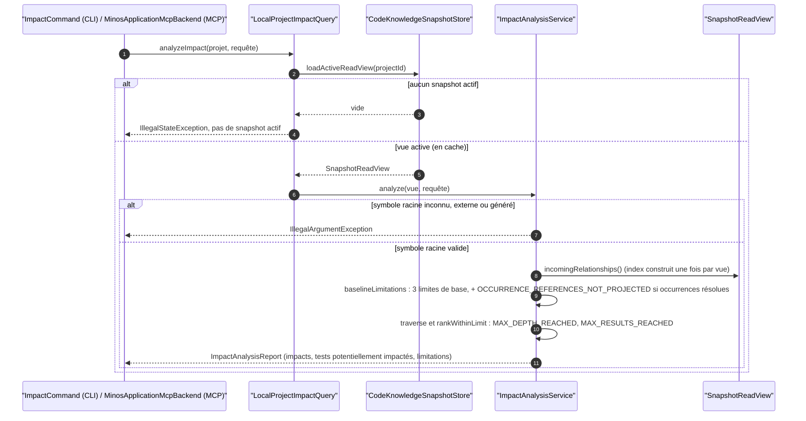
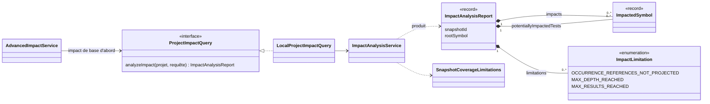

# Capacité `tests-lies-et-impact` — dossier durable

Spec de référence : [openspec/specs/tests-lies-et-impact/spec.md](../../../../openspec/specs/tests-lies-et-impact/spec.md)
· Relevé au commit `3b516b1e` (2026-11-03).

## Objet et périmètre

[Exigence] L'analyse d'impact (base et avancée) et la dérivation des tests liés rendent un résultat borné,
reproductible et honnête : une réponse vide ou courte n'est jamais présentée comme preuve d'absence de chemin
quand des références ne sont pas projetées. Acteurs : l'utilisateur de la CLI (`impact`, `related-tests`), un
agent par MCP (`minos_impact`, `minos_impact_v2`, `minos_related_tests`), l'API Java. Hors périmètre : la
qualité des index SCIP produits par les providers.

## Vues

### Comment une requête d'impact est-elle servie et quelles limites déclare-t-elle ?

Type : sequenceDiagram (UML, séquence) · Portée : existant vérifié · Exigences : « L'analyse d'impact déclare les
références par occurrence non projetées », « Les index d'impact sont construits une fois par vue ou par graphe
en cache »

`LocalProjectImpactQuery.analyzeImpact`
(`minos-application/src/main/java/com/minos/impact/LocalProjectImpactQuery.java:40-46`) charge la vue active en
cache, qui porte l'index des arêtes entrantes construit une fois pour elle. `ImpactAnalysisService` pose les
limitations de base et ajoute `OCCURRENCE_REFERENCES_NOT_PROJECTED` dès que le snapshot contient une occurrence
de référence résolue (`minos-engine/src/main/java/com/minos/query/SnapshotCoverageLimitations.java:35-40`). L'ordre
des limitations rendues suit l'ordre de déclaration de l'énumération
(`minos-application/src/main/java/com/minos/impact/ImpactLimitation.java:8`). L'impact avancé
(`AdvancedImpactService`, MCP `minos_impact_v2`) appelle d'abord cette analyse de base puis ajoute seulement les
symboles absents de la base, par l'adjacence du graphe de programme en cache.

### Que contient un rapport d'impact ?

Type : classDiagram (UML, classes) · Portée : existant vérifié · Exigences : « Les sorties d'impact restent
additives et reproductibles », « L'impact avancé conserve la limite de l'impact de base »

Le record `ImpactAnalysisReport` (`minos-application/src/main/java/com/minos/impact/ImpactAnalysisReport.java:16`)
porte la liste des impacts, celle des tests potentiellement impactés (arêtes `RELATED_TEST` heuristiques
traversées) et les limitations. L'énumération est abrégée aux trois valeurs utiles ici ; elle en compte neuf.

## Traçabilité

| Exigence | Scénarios couverts | Vue | Preuves | Statut |
|---|---|---|---|---|
| L'analyse d'impact déclare les références par occurrence non projetées | 3/4 (parité Windows/Linux de l'ordre non testée) | V1 | `minos-application/src/test/java/com/minos/impact/ImpactAnalysisServiceTest.java#declaresOccurrenceReferencesNotProjectedEvenWhenNoImpactIsFound`, `minos-application/src/test/java/com/minos/impact/ImpactAnalysisServiceTest.java#doesNotDeclareOccurrenceReferencesWithoutResolvedReferenceOccurrences`, `minos-app/src/test/java/com/minos/app/impact/ImpactAnalysisRealFixtureTest.java#replaysVersionedTypeScriptMultiModuleImpactGraph`, `minos-app/src/test/resources/characterization/cli-json.golden` | couverte |
| L'impact avancé conserve la limite de l'impact de base | 1/1 | V1, V2 | `minos-bootstrap/src/test/java/com/minos/bootstrap/program/analysis/ProgramGraphAnalysisTest.java#impactV2KeepsTheBaselineOccurrenceReferenceLimitation` | couverte |
| Les sorties d'impact restent additives et reproductibles | 1/1 sur l'hôte qui exécute les goldens (comparaison inter-OS non prouvée) | V2 | `minos-app/src/test/java/com/minos/characterization/A2SurfaceCharacterizationTest.java#cliJsonOutputsAreUnchanged`, `minos-app/src/test/java/com/minos/characterization/A2SurfaceCharacterizationTest.java#mcpEveryToolOutputIsUnchanged` | partielle |
| Les fichiers de test des conventions polyglottes sont classés comme tests | 4/4 | — | `minos-engine/src/test/java/com/minos/query/RelatedTestHeuristicsTest.java#theProjectTestConventionsAreTestPaths`, `minos-engine/src/test/java/com/minos/query/RelatedTestHeuristicsTest.java#aDirectoryThatMerelyContainsTheWordTestIsNotATestPath` | couverte |
| Un symbole de test polyglotte n'est pas un impact de production ordinaire | 1/2 (relation obtenue par occurrence, pas par nommage seul) | — | `minos-engine/src/test/java/com/minos/query/RelatedTestDerivationServiceTest.java#recognisesAGoTestFileByItsSuffixConvention`, `minos-engine/src/test/java/com/minos/query/RelatedTestDerivationServiceTest.java#doesNotTreatAGoFileThatMerelyEndsWithTheWordTestAsATest` | partielle |
| Les index d'impact sont construits une fois par vue ou par graphe en cache | 4/4 | V1 | `minos-application/src/test/java/com/minos/impact/ImpactIndexReuseTest.java#twoAnalysesOnTheSameViewBuildTheIncomingIndexOnce`, `minos-application/src/test/java/com/minos/impact/ImpactIndexReuseTest.java#simultaneousFirstAnalysesAllRenderTheExpectedReport`, `minos-application/src/test/java/com/minos/program/analysis/AdvancedImpactAdjacencyReuseTest.java#twoAdvancedImpactsOnTheSameCachedGraphBuildTheAdjacencyOnce` | couverte |
| Les preuves d'une relation de test lié sont bornées et l'omission est déclarée | 3/3 | — | `minos-engine/src/test/java/com/minos/query/RelatedTestDerivationServiceTest.java#keepsFirstLocationsUpToTheCapAndDeclaresTheOmittedCount`, `minos-engine/src/test/java/com/minos/query/RelatedTestDerivationServiceTest.java#capChangesNeitherPairsNorConfidencesNorOrder`, `minos-engine/src/test/java/com/minos/query/RelatedTestDerivationServiceTest.java#keepsTheSameLocationsWhateverTheOccurrenceOrder` | couverte |
| Sous le plafond, les sorties de tests liés sont inchangées | 3/3 (format de snapshot vérifié en lecture seulement) | — | `minos-engine/src/test/java/com/minos/query/RelatedTestDerivationServiceTest.java#keepsExactlyCapLocationsWithoutSummary`, `minos-storage/src/test/java/com/minos/storage/codec/SnapshotCodecV3Test.java#readsBackEveryEvidenceOfARelatedTestBeyondTheDerivationCap` | couverte |

Aucun gate `scripts/**/check-*.py` ne garde cette capacité.

## Écarts

| Id | Écart | Preuve | Suite proposée |
|---|---|---|---|
| E1 | Le scénario parle d'une occurrence « visant ce symbole » ; le code déclare la limitation dès qu'une occurrence résolue existe dans le snapshot (conforme au texte de l'exigence, plus large que le scénario) | `minos-engine/src/main/java/com/minos/query/SnapshotCoverageLimitations.java:35` | [Question] Préciser le scénario ou l'exigence |
| E2 | Le scénario Go demande une relation « par convention de nommage » ; le test l'obtient par une occurrence de référence | `minos-engine/src/test/java/com/minos/query/RelatedTestDerivationServiceTest.java:161` | [Proposition] Test complémentaire sans occurrence |
| E4 | Une requête de tests liés ne déclare jamais `OCCURRENCE_REFERENCES_NOT_PROJECTED` : un résultat vide n'annonce aucune limite, en tension avec le Purpose de la spec | `minos-engine/src/main/java/com/minos/query/SnapshotCoverageLimitations.java:52` | [Question] Décision métier : faut-il une limite déclarée pour les tests liés ? |

## Questions ouvertes

- La reproductibilité « identique sous Windows et sous Linux » repose sur l'exécution des goldens par les deux
  jobs `Verify` ; aucun test ne compare les deux sorties entre elles.
