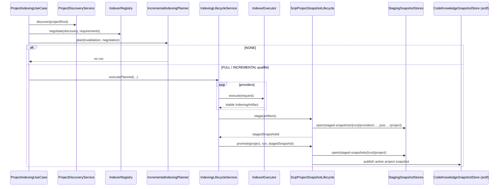
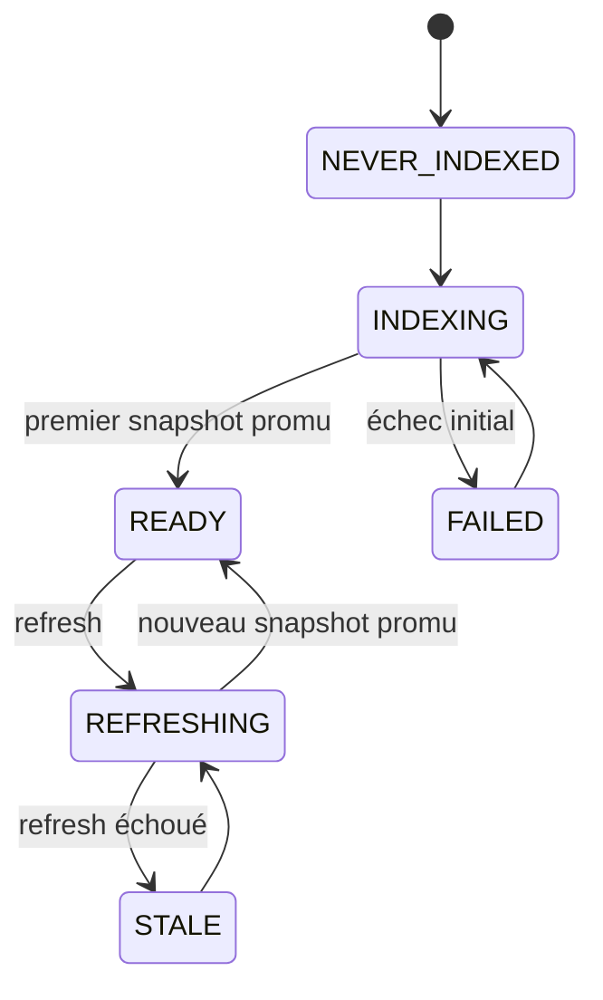

# Indexation, lifecycle et stockage

M14 relie désormais le lifecycle interne historique à une exécution réelle de providers.

## Parcours autonome



Le chemin manuel M9 reste disponible séparément via `import-scip`.

## Discovery et négociation

`ProjectDiscoveryService` détecte langages, build systems et modules.

`IndexerRegistry` reste fournisseur-indépendant et choisit un provider uniquement si :

- le langage est supporté ;
- le build est compatible avec la qualification ;
- les capacités demandées sont présentes ;
- le niveau de qualification est admissible ;
- la priorité déterministe le place devant les autres candidats compatibles.

Un override CLI `--provider` réduit le catalogue considéré ; il ne contourne pas les contraintes de qualification.

## Runtime providers M14

Le runtime est séparé de l'orchestration :

```text
IndexerRegistry        = sait quel provider choisir
ProviderRuntimeManager = sait si son runtime est disponible/installable
IndexerExecutor        = sait exécuter un provider choisi
```

`ProcessIndexerExecutor` ne connaît aucun type SCIP. Il reçoit un `IndexerProcessPlan` construit par l'adapter provider.

Responsabilités génériques :

- working directory explicite ;
- arguments sans shell implicite ;
- adaptation `.cmd/.bat` Windows via `cmd.exe` lorsque nécessaire ;
- environnement contrôlé ;
- timeout ;
- stdout/stderr capturés ;
- destruction du process tree en cas de timeout ;
- préservation d'un artefact préexistant dans le projet ;
- copie du nouvel artefact sous `<MINOS_HOME>/runs/<runId>/<provider>/` ;
- métadonnées d'exécution et masquage minimal des arguments sensibles.

### Racines de lecture et fichiers masqués du plan

Un `IndexerProcessPlan` peut déclarer des **racines de lecture** (`readOnlyRoots`, répertoires que le provider lit sans jamais les écrire) et des **fichiers masqués** (`maskedFiles`, présentés vides). Le constructeur à cinq composantes n'en déclare aucun ; `withCommand` et `withEnvironment` les conservent, et chaque transformateur de plan passe par eux. `ProcessIndexerExecutor` refuse un plan dont un transformateur a perdu ces déclarations.

- `LinuxBubblewrapWorkerSandboxBackend` revérifie chaque racine juste avant de construire sa commande (chemin absolu, répertoire existant, aucun lien, composants appartenant à l'utilisateur ou à root et non inscriptibles par d'autres comptes, aucun chevauchement avec l'espace de travail, l'artefact, le run ou `MINOS_HOME`), la monte par `--ro-bind` vers elle-même après les montages inscriptibles, puis lie `/dev/null` sur chaque fichier masqué existant. Le réseau reste celui de la politique du plan.
- `WindowsAppContainerWorkerSandboxBackend`, `WindowsJobObjectProcessOwnership` et la propriété cgroup Linux sans bac à sable OS refusent un plan qui en déclare, avant tout fichier de plan, octroi ou processus.

Seul scip-java en déclare aujourd'hui (ADR SEC-0076) ; un autre usage (Gradle, NuGet) demande sa propre décision.

## Providers SCIP gérés

### TypeScript

Le runtime géré installe `@sourcegraph/scip-typescript` sous `MINOS_HOME/tools` sans modifier le PATH global.

MINOS exige `node`/`npm` mais ne lance jamais automatiquement l'installation des dépendances métier du projet.

### Java

Le runtime géré utilise Coursier pour lancer la version de `scip-java` verrouillée par M14.

Le projet doit fournir son JDK via `JAVA_HOME` et appartenir au périmètre de build qualifié. M14 ne transforme pas le runtime Java embarqué de MINOS en JDK du projet.

Hors Windows, le build Maven est hors ligne (ADR SEC-0076) : `ScipJavaMavenOffline` valide la désignation `minos.scip.java.maven-repository` (lue par `minos-bootstrap` dans les réglages de MINOS) et le Maven 3.9.x du `PATH`, écrit dans le run un `settings.xml` constant par `PrivateLocalStorage` et un dépôt de tête vide, puis le plan passe à scip-java, après `--`, `--batch-mode --offline -s … -gs … -Dmaven.repo.local=… -Dmaven.repo.local.tail=… clean verify -DskipTests`. Le dépôt désigné est la seule racine de lecture du plan ; `conf/settings.xml` et `conf/toolchains.xml` du Maven résolu sont masqués. Tout refus survient avant la copie du projet.

## Lifecycle d'un projet



- `NEVER_INDEXED` : aucune connaissance active ;
- `INDEXING` : premier run en cours ;
- `REFRESHING` : refresh avec ancien snapshot encore actif ;
- `READY` : snapshot actif valide ;
- `STALE` : refresh échoué, ancien snapshot conservé ;
- `FAILED` : aucun snapshot utilisable après échec initial.

`FileIndexStateStore` rend ces états et les runs persistants entre processus CLI.

## États d'un run

```text
Status: RUNNING | SUCCEEDED | FAILED
Phase : PROVIDER_EXECUTION | STAGING | PROMOTION | COMPLETED
```

Un run `SUCCEEDED` est `COMPLETED` et possède un `activeSnapshotAfter`.

## Staging M14

Le chemin d'import direct historique :

```text
SCIP -> normalize -> active store
```

n'est plus utilisé par le parcours autonome.

Le parcours M14 est :

```text
artifact provider A ─┐
artifact provider B ─┼→ normalisation temporaire
                     ↓
            faits providers normalisés
                     ↓
            assemblage snapshot projet
                     ↓
                 staging
                     ↓
             promotion atomique
                     ↓
               active store
```

`ScipProjectSnapshotLifecycle` normalise chaque artefact dans un magasin de travail, puis publie le snapshot fusionné dans le magasin de mise en place ; la promotion le relit et le publie dans le magasin actif. Le cycle ne crée aucun magasin : il reçoit le magasin actif du backend choisi et ouvre ses magasins de travail par le port `StagingSnapshotStores` du moteur, sous `staged-snapshots/<run>` seulement. `minos-bootstrap` y passe `FileSymbolSnapshotStore::new` pour les deux backends : le travail de mise en place reste sur fichiers sous `MINOS_HOME`, et une promotion reprise par un autre processus relit le même arbre. Les collisions d'identifiants sont rejetées explicitement ; aucune fusion implicite contradictoire n'est effectuée.

## Promotion atomique

La règle ADR-0006 reste inchangée : **aucun nouveau snapshot n'est annoncé actif tant que tous les providers, le staging et la promotion n'ont pas réussi**.

En cas d'échec de refresh, l'ancien snapshot reste actif et l'état devient `STALE`.

## Fingerprints et indexation incrémentale

Le planner M7 reste source de vérité :

```text
NONE
FULL
INCREMENTAL
```

`INCREMENTAL` n'est permis que si tous les providers sélectionnés déclarent explicitement la capacité qualifiée.

Pour les runtimes M14 initiaux, cette capacité n'est pas revendiquée. Le comportement conservateur est donc :

```text
aucun changement -> NONE
changement       -> FULL
```

Le fingerprint n'est promu qu'après succès du run et si le workspace n'a pas changé pendant l'indexation.

## CLI

Parcours normal :

```text
minos index <project>
minos index <project> --dry-run
minos index <project> --force-full
```

Parcours de diagnostic/compatibilité :

```text
minos import-scip <project> --file <index.scip> --provider <id>
```

`index --scip` reste temporairement accepté avec warning de dépréciation.

## Stockage M14

Selon les fonctionnalités utilisées :

```text
<MINOS_HOME>/
├── registry/
├── symbol-snapshots/
├── fingerprint-snapshots/
├── index-state/
├── staged-snapshots/
├── runs/
└── tools/
```

Le code de requête dépend uniquement du snapshot MINOS actif, jamais du fichier SCIP brut.

## Mesurer un gros snapshot

Deux `main` et un test des sources de `minos-storage`, hors `verify` (leur nom ne correspond à aucun motif Surefire), mesurent ce qu'un snapshot de plusieurs centaines de Mio coûte à lire et à mettre en cache. Un snapshot au-dessus du plafond de persistance (400 Mio, `SnapshotLimits`) ne se publie ni ne se lit : le mesurer demande un build dont le plafond (`SnapshotBinaryCodecSupport.MAX_PERSISTED_SNAPSHOT_BYTES`) est relevé localement, jamais commité.

| Outil | Rôle |
|---|---|
| `LargeSnapshotMeasurement` (`com.minos.storage.local.store`) | taille persistée, tas retenu par la vue avec l'index des arêtes, pic de tas au chargement, lectures successives et état du cache ; mode `synthetic <racine> <fichiers>` ou `existing <MINOS_HOME>/symbol-snapshots <projectId>` |
| `LargePostgresSnapshotMeasurement` (`com.minos.storage.postgresql.snapshot`) | publication d'un snapshot du magasin fichier dans le store PostgreSQL géré (Docker, image pgvector épinglée déjà tirée), puis lectures successives ; lancé par `-Dtest=LargePostgresSnapshotMeasurement -Dminos.largeSnapshot.store=… -Dminos.largeSnapshot.project=…` |
| `SnapshotReadCeilingTest` (`com.minos.storage.codec`) | exécuté par `verify` : le plafond borne aussi la lecture, sans chemin dans le message |

Le classpath du `main` sur poste Windows ajoute `minos-storage/src/test/platform-access-control` (fournisseur de contrôle d'accès des tests du module).

Mesures du 2026-11-07, `develop` `2e3da18b`, JDK 21.0.12.1, Windows, plafond relevé à 1 Gio dans un build jetable. Snapshot réel : `morpheus-engine` (1 488 fichiers Java, 60 472 symboles, 488 477 occurrences) ; snapshot synthétique : `QueryViewWeightFixtures`, 3 300 fichiers.

| Mesure | `morpheus-engine` (réel) | Synthétique (3 300 fichiers) |
|---|---|---|
| Taille persistée | 356 038 984 octets (339,5 Mio) | 330 621 486 octets (315,3 Mio) |
| Tas retenu par la vue, index des arêtes compris | 374 738 864 octets, soit 1,05 fois le fichier | 484 663 400 octets, soit 1,47 fois le fichier |
| Somme des comptes du poids estimé (1 024 par symbole et par relation, 640 par occurrence) | 363,4 Mio, soit 1,02 fois le tas retenu | 669 Mio, soit 1,45 fois |
| Lecture à froid, magasin fichier | 3,5 s | 4,2 s |
| Lectures suivantes | 3,0 à 3,2 s : la vue est refusée par le cache (poids estimé au-dessus de 512 Mio), 5 chargements complets pour 5 lectures | 3,3 à 3,9 s, même refus |
| Plus petit tas qui charge une vue | 512 Mo | non mesuré |
| Deux vues chargées en même temps | `OutOfMemoryError` sous 512 et 640 Mo, passe sous 768 Mo | non mesuré |
| Publication PostgreSQL (356 Mo), deux essais | 10,4 à 12,1 s | non mesuré |
| Lecture PostgreSQL | 9,5 à 13,7 s à chaque lecture (aucune mise en cache) | non mesuré |

Lecture : sur un corpus réel le tas retenu est proche de 1,05 à 1,14 fois le fichier (1,14 sur le code de production de MINOS, ADR 0047) ; le corpus synthétique, riche en relations, atteint 1,47. Le poids estimé est le plus grand de la somme des comptes et du produit d'une amplification par la taille du fichier : sur le corpus réel mesuré, la somme des comptes suffit déjà à ne pas sous-évaluer.

Mesures du 2026-11-07 avec un build non modifié de `develop` `bc2995a8` (persistance 400 Mio, cache 512 Mio), même JDK, poste de 48 Go (tas par défaut de la JVM : 12 Gio), import du SCIP de `morpheus-engine` (51,9 Mo) dans un `MINOS_HOME` temporaire :

| Mesure | Résultat |
|---|---|
| `import-scip` sous `-Xmx512m` | refusé avant décodage, rien d'écrit : `SCIP index exceeds safe decode heap budget`, estimation de 196 274 198 octets pour un budget de 178 956 970 (le tiers du tas) |
| `import-scip` sous `-Xmx576m`, `640m`, `768m`, `1g` et le tas par défaut | publié en 10,1 à 11,3 s |
| Occupation du tas avant une collection, tas par défaut | 1 432 à 1 451 Mio ; la JVM laisse croître un grand tas, ce chiffre n'est pas un minimum |
| Sonde MCP à trois appels `minos_find_symbols`, tas par défaut puis `-Xmx768m` | premier appel en 4 156 et 4 206 ms (chargement de la vue), deux suivants en 54 à 62 ms (vue en cache) |
| Ré-import du même SCIP, trois fois | un seul snapshot, adressé par son contenu : 339,5 Mio sur disque |
| Import de quatre variantes distinctes par `import-scip` | cinq snapshots conservés, 1 697,7 Mio : le build `bc2995a8` ne compacte qu'à l'indexation |
| `QueryViewWeightTest` avec `-Dminos.queryViewWeight.print=true` (150 fichiers, 14,8 à 15,0 Mo persistés) | tas retenu de 1,43 (ascii, latin1) à 1,48 (cjk) fois le fichier ; poids estimé de 1,53 à 1,57 fois le tas retenu ; amplification V3 seule de 0,84 à 0,88 |

Un import publié applique la même rétention que l'indexation : `PublishedSnapshotRetention` (`minos-application`) sert à `LocalProjectOperations.importScipLocked` et aux deux chemins de succès de `ProjectIndexingUseCase`. Quatre imports distincts laissent l'actif et deux historiques (`minos-cli/src/test/java/com/minos/cli/ImportScipRetentionTest.java`) ; un verrou occupé laisse l'import réussi avec un diagnostic sans cause ni chemin.

## Cohérence concurrente

`IndexingLifecycleService` sérialise les runs par projet dans une instance : un projet déjà `INDEXING` ou `REFRESHING` ne peut pas démarrer un second run concurrent.

Le store persistant rend l'état observable entre processus. Une protection inter-processus stricte par verrou OS n'est pas ajoutée par M14 ; l'exploitation normale doit éviter deux commandes d'indexation concurrentes sur le même projet.

## Ajouter un provider

1. déclarer un `IndexerDescriptor` et ses capacités réellement prouvées ;
2. adapter/normaliser son format sans faire fuiter ses types dans `orchestration` ;
3. fournir un diagnostic/runtime géré ou externe ;
4. construire son `IndexerProcessPlan` ;
5. qualifier FULL et INCREMENTAL séparément ;
6. produire une fixture et un replay réel ;
7. conserver staging et promotion projet atomique.
