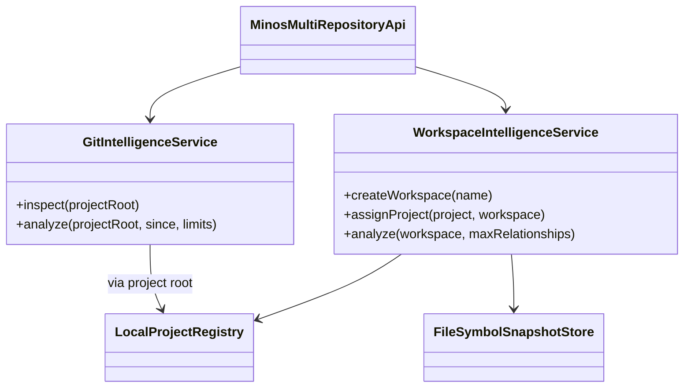
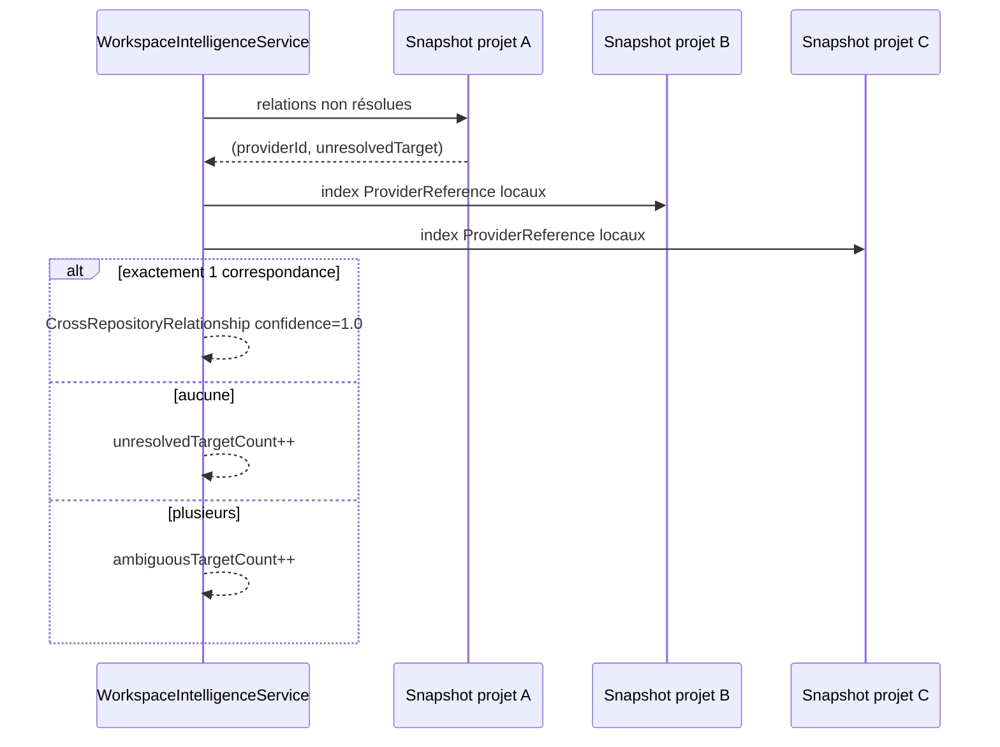

# Multi-dépôts et intelligence Git

M12 ajoute deux capacités distinctes :

1. des workspaces regroupant plusieurs projets MINOS ;
2. des faits Git locaux lus en Java pur avec JGit.

Ces capacités restent séparées des métriques d’architecture : une zone très modifiée n’est pas automatiquement un module important.

## Vue UML



## Workspaces

Un workspace associe plusieurs projets enregistrés. Il ne fusionne pas leurs snapshots : chaque projet conserve son propre snapshot actif.

L’analyse workspace construit une **vue dérivée** des relations inter-dépôts.

## Résolution cross-repository

La résolution est volontairement stricte.

Pour une relation non résolue du projet A, MINOS utilise :

```text
relationship.origin.providerId
relationship.unresolvedTarget
```

et cherche dans les symboles locaux des autres projets du même workspace une référence :

```text
symbol.providerReference.providerId
symbol.providerReference.externalId
```

La promotion n’a lieu que si la correspondance est exacte et unique.



### Ce qui n’est pas utilisé comme preuve

MINOS ne résout pas automatiquement une relation cross-repository avec :

- le simple `name` ;
- le `qualifiedName` seul ;
- une ressemblance de chemin ;
- la fréquence Git ;
- une heuristique de proximité.

`resolutionBasis` vaut `EXACT_PROVIDER_REFERENCE` pour les relations promues.

## GitIntelligenceService

M12 utilise Eclipse JGit ; le cœur n’a pas besoin d’exécuter `git.exe` pour analyser le dépôt.

Informations de repository :

```text
repositoryId
workTree
originRemote (remote réseau sans identifiants ; null et ORIGIN_REMOTE_NOT_DISCLOSED pour un remote local ou illisible)
branch
headCommit
detachedHead
shallow
clean
limitations
```

### Dépôt trouvé : remontée, propriétaire, filtres

Un dépôt Git analysé n'est pas de confiance (cf. `.claude/rules/securite.md`, point 5).

- **Remontée.** Depuis la racine du projet, JGit remonte jusqu'au premier `.git` (monorepo, worktree, sous-module). `GIT_DIR`, `GIT_WORK_TREE` et `GIT_CEILING_DIRECTORIES` restent ignorés. Si la racine du dépôt n'est pas celle du projet, la limitation `REPOSITORY_ABOVE_PROJECT_ROOT` le dit.
- **Propriétaire.** Le propriétaire du répertoire Git trouvé (chemin résolu, et répertoire commun d'un worktree lié) doit être celui que le système attribue aux fichiers créés par le processus MINOS (comparé à un fichier-sonde créé dans le répertoire privé de MINOS (`minos.home`, `MINOS_HOME`, sinon `~/.minos`), jamais dans le dépôt ni dans le répertoire temporaire partagé, et non à `user.name`). Sinon l'appel échoue avant toute lecture de l'index, avec un message actionnable ; un propriétaire illisible échoue aussi (fail-closed), par un message distinct. Limite : sous Windows, un dépôt créé par un compte élevé puis analysé par un processus non élevé (ou l'inverse) est refusé, comme le fait git (« dubious ownership »). Aucun contournement n'est proposé.
- **Filtres.** Aucune commande déclarée par le dépôt ne s'exécute : les pilotes `filter.*` de sa configuration (celle du répertoire commun pour un worktree lié, fichiers inclus compris) sont redirigés en mémoire vers un filtre intégré transparent ; `.git/config` n'est jamais modifié. Les filtres de la configuration de l'utilisateur et du système restent appliqués. Un dépôt qui déclare lui-même un filtre (`git lfs install --local`) porte `REPOSITORY_FILTERS_NOT_APPLIED` : `clean` est alors calculé sur le contenu brut et peut être `false` à tort.

## Historique borné

Bornes de la **requête publique** (`ActivityQuery`) — elles décrivent la forme du résultat demandé :

```text
max commits  10000
max files    10000
zone depth   8
```

Un historique dépassant les bornes est signalé comme tronqué plutôt que présenté comme exhaustif.

### Frontière de ressources de l'analyse

`maxFiles` borne ce qui est **retourné**, pas ce que produire la réponse **coûte**. Les deux sont distincts et le rester est délibéré : détourner `maxFiles` en budget de travail changerait le sens d'un paramètre publié. `GitIntelligenceService.ActivityBudget` borne donc explicitement le travail pendant la marche d'historique :

```text
maxDiffEntriesPerCommit   2000
maxTrackedFiles          20000
maxTrackedZones           5000
maxRetainedChangedPaths  50000
```

La taille du diff d'un commit est **mesurée avant matérialisation** : un `TreeWalk` compte et s'arrête une entrée au-delà du budget (linéaire en `min(taille, budget)`, mémoire constante). Un commit dans le budget passe ensuite par `DiffFormatter.scan`, ce qui conserve la détection de renommage — et donc les chemins restitués — à l'identique pour tout commit normal ; un commit au-delà du budget retombe sur les chemins bornés de cette marche.

Toute limite atteinte est restituée dans `limitations` plutôt que de façonner silencieusement la réponse :

```text
DIFF_SCAN_TRUNCATED
PATHS_TRUNCATED
FILE_TRACKING_TRUNCATED
ZONE_TRACKING_TRUNCATED
```

La troncature reste déterministe (ordre d'arbre, puis tri), et les valeurs par défaut sont très au-dessus de tout commit d'ingénierie réaliste : un dépôt normal est analysé exactement comme avant.

## Activité par fichier

La vue fichier expose notamment :

```text
path
commitCount
uniqueAuthorCount
lastChangedAt
lastCommitId
```

Ce sont des faits d’activité observée, pas un score de criticité.

## Activité par zone

Une zone correspond à un préfixe de répertoire borné par `zoneDepth`. Les fichiers à la racine utilisent une zone dédiée.

La vue permet d’identifier où se concentre l’activité récente sans conclure automatiquement que cette zone est architecturalement centrale.

## Commits et merges

Le service analyse les chemins modifiés par commit. Les merges sont comparés au premier parent ; le commit racine est comparé à un arbre vide.

## Remote

Le remote public est sanitisé avant exposition : informations d’authentification et éléments sensibles de l’URL ne doivent pas être renvoyés dans les DTOs.

## Limitations explicites

Exemples Git :

```text
NO_ORIGIN_REMOTE
DETACHED_HEAD
SHALLOW_HISTORY
UNBORN_HEAD
HISTORY_TRUNCATED
HISTORY_SCAN_LIMIT
FILES_TRUNCATED
REPOSITORY_ABOVE_PROJECT_ROOT
REPOSITORY_FILTERS_NOT_APPLIED
```

Exemples workspace :

```text
PROJECT_WITHOUT_ACTIVE_SNAPSHOT
AMBIGUOUS_PROVIDER_IDENTITY
UNRESOLVED_CROSS_REPOSITORY_TARGETS
RELATIONSHIPS_TRUNCATED
```

## API publique

`MinosMultiRepositoryApi` expose ces vues sans JGit dans ses signatures. Aucun type `org.eclipse.jgit` ne doit traverser le contrat public.
