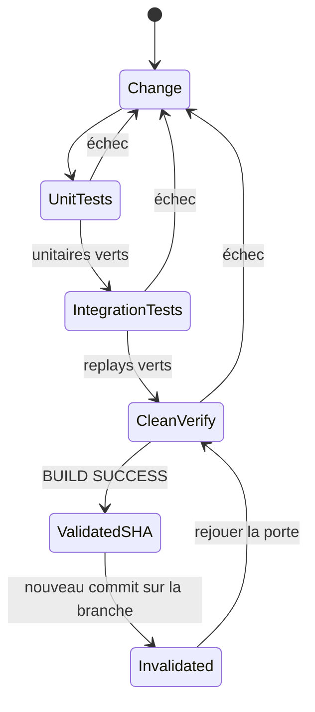

# Tests, validation et contribution

MINOS utilise une discipline de validation stricte : un résultat local n’est une preuve que pour le **SHA exact** testé.

## Porte locale

Commande de référence :

```powershell
.\mvnw.cmd clean verify
```

Avant la commande :

```powershell
git status
git rev-parse HEAD
java -version
.\mvnw.cmd -version
```

Le build doit tourner réellement sous Java 25.

## Pipeline Maven

Le build utilise notamment :

```text
maven-enforcer-plugin
maven-compiler-plugin
maven-surefire-plugin
maven-failsafe-plugin
maven-jar-plugin
maven-dependency-plugin
maven-shade-plugin
```

`verify` exécute aussi les tests d’intégration Failsafe lorsqu’ils correspondent aux conventions configurées.

## Types de tests

### Tests unitaires de domaine

Ils verrouillent les invariants : symboles, relations, critères, normalisation, scoring et bornes.

### Tests de stores

Ils vérifient la persistance, l’historique et la promotion des snapshots.

Un test d'idempotence relit l'état après le second appel (nombre de lignes, contenu rechargé par une instance neuve du store, `schema_version`) : un test qui se contente de survivre à deux appels reste vert quand une ligne est dupliquée en silence.

### Tests de concurrence : prouver une attente

Un test qui affirme « le concurrent attend le verrou » ne s'appuie jamais sur un délai fixe (`Thread.sleep` puis assertion négative) : sur un runner chargé, un verrou retiré laisse ce test vert parce que le concurrent n'a pas encore tourné. Il observe un **signal positif** d'attente, avec une échéance qui fait échouer le test (jamais un passage par défaut), puis affirme l'absence d'effet. Trois moyens, selon le verrou :

| Verrou | Signal | Aide |
|---|---|---|
| Verrou de la JVM (`ReentrantLock`, bail en mémoire) et verrou de fichier pris par `BoundedFileLease` (même JVM ou autre JVM : l'attente y est une pause bornée entre deux `tryLock`) | le fil du concurrent est `WAITING` ou `TIMED_WAITING` avec un cadre de la classe qui porte l'attente | `com.minos.testsupport.ParkedThreads.awaitParkedIn` (test-jar de `minos-engine`) |
| Verrou consultatif PostgreSQL | `pg_locks` montre la demande **non accordée** sur la clé du projet, dans la base courante | `PostgresTestSupport.awaitAdvisoryLockWaiter` |
| Verrou bloquant dans un appel natif, sans fil observable | loquet posé juste avant l'appel bloquant, puis attente bornée d'un signal positif « acquis », attendu absent (preuve indirecte, à compléter par la preuve de non-vacuité) | trois lignes de `CountDownLatch` dans le test |

Le concurrent pose d'abord un loquet « démarré » et publie son `Thread` : avant ce loquet, un fil de pool attend dans la file de l'exécuteur, ce qui ne prouve rien.

**Preuve de non-vacuité.** Un test de verrou nouveau ou réécrit est vu rouge une fois : le verrou est neutralisé **localement, sans commit** (acquisition remplacée par un passage direct), le test doit échouer, la sortie rouge est consignée dans le changement OpenSpec, puis la production est restaurée (`git status -- '*/src/main/*'` vide avant de commiter). Un test qui reste vert sans verrou n'est pas terminé.

**Rejeu.** Un test de concurrence nouveau ou réécrit est rejoué 50 fois avant d'être déclaré stable : `@RepeatedTest(50)` temporaire (retiré avant commit) ou boucle sur `./mvnw -B -ntp -pl <module> -am test "-Dtest=Classe#methode"`. Un seul échec renvoie à la réécriture. Le décompte, et la plateforme qui n'a tourné qu'en CI, sont consignés.

### Tests de frontières

Exemples :

```text
NamespaceConventionTest
ProviderBoundaryTest
MinosApiContractTest
MinosMultiRepositoryApiContractTest
```

Ils empêchent notamment une fuite de types fournisseur ou de packages internes vers les contrats publics.

### Variables d'environnement des tests

Un test ne lit jamais l'environnement de l'hôte pour décider de son résultat. Un test de processus fils pose lui-même l'environnement de ce processus (modèle : `ChildJvm` de `minos-provider-scip`, qui vide l'environnement puis pose `PATH` et `JAVA_HOME`). Une moitié de test propre à un système s'écrit dans un test `@EnabledOnOs`, compté comme sauté ailleurs, jamais derrière un `if`. `minos-provider-scip` retire `JAVA_HOME` du JVM de ses tests (`excludedEnvironmentVariables` de surefire) : un test qui lirait le `JAVA_HOME` de l'hôte y échoue partout, CI comprise (AUD-TST-18).

### Fixtures réelles

Le dépôt contient des fixtures qui servent à mesurer le comportement sur de vrais artefacts SCIP et de vrais graphes.

Les tests `*RealFixtureTest` doivent produire des mesures reproductibles, pas seulement des mocks.

### Qualification du confinement (bubblewrap, cgroup v2, AppContainer)

Les tests de `minos-runtime-local` qui qualifient le confinement des providers dépendent d'un mécanisme du système d'exploitation :

| Système | Prérequis | Classes concernées |
|---|---|---|
| Linux | bubblewrap + prlimit, racine cgroup v2 déléguée (`MINOS_SANDBOX_CGROUP_ROOT`, voir `scripts/ci/delegate-linux-cgroup.sh`), capacité de propriété de processus forte | `LinuxBubblewrapWorkerSandboxBackendTest`, `LinuxBubblewrapWorkerSandboxIsolationTest`, `LinuxCgroupJobContainmentTest`, `LinuxCgroupJobOwnershipIsolationTest`, `LinuxStrongProcessOwnershipContainmentTest` |
| Windows | AppContainer + Job Object | `WindowsAppContainerWorkerSandboxBackendTest`, `WindowsJobObjectContainmentTest`, `WindowsStrongProcessOwnershipContainmentTest`, `WindowsAppContainerRecoveryOwnershipTest`, `WindowsNonElevatedIndexingTest` |

- Un test propre à une plateforme est restreint par `@EnabledOnOs` : il est **compté comme sauté** sur l'autre système (jamais un `return` anticipé qui le fait passer à vide).
- Sur un poste, un mécanisme absent saute le test avec la raison de la découverte (comportement par défaut).
- Avec `-Dminos.sandbox.tests.required=true`, un mécanisme absent **fait échouer** le test, avec les diagnostics de la découverte. `pr-ci.yml` passe cette propriété sur les deux commandes Maven (Ubuntu et Windows) ; `check-current-docs.py` garde sa présence. C'est le même contrat que `minos.postgresql.tests.required`. Sous PowerShell, citer l'argument (`"-Dminos.sandbox.tests.required=true"`) : un nom pointé non cité est découpé.
- La décision est centralisée dans `SandboxTestSupport` (`requireBackend`, `requireDelegatedCgroupRoot`, `requireStrongCapability`). Ne pas écrire de `assumeTrue` direct pour exprimer la disponibilité d'un confinement.
- Sauts d'hypothèse conservés, sans rapport avec la disponibilité du confinement : `/dev/shm` absent, `python3` absent, compte détenant `WRITE_DAC` sur `%SystemRoot%`, verrou étranger ouvrable en écriture, et l'exemption volontaire de `WindowsNonElevatedIndexingTest` sur un runner de CI (élevé par conception).
- Si une image de runner dérive (AppArmor, délégation cgroup) et que la CI devient rouge, c'est le signal voulu : qualifier la nouvelle image ; ne retirer l'argument de l'étape concernée que par décision explicite, avec un commentaire daté.

### Replays d’intégration

Exemples :

```text
StableCliIntegrationTest
MinosMcpServerIntegrationTest
LocalMinosApiIntegrationTest
LocalMinosMultiRepositoryApiIntegrationTest
NexusExportIntegrationTest
```

Ils prouvent qu’une chaîne complète de composants fonctionne ensemble.

## UML du cycle de changement



## Exact-head validation

À documenter dans une PR :

```text
HEAD exact
version Java
nombre de sources main/test
nombre de tests
failures/errors/skipped
BUILD SUCCESS/FAILURE
replay significatif
```

Un commit ajouté après le `BUILD SUCCESS` invalide cette preuve et impose une nouvelle validation.

## Ajouter une fonctionnalité

Ordre recommandé :

1. identifier le package propriétaire de la responsabilité ;
2. écrire/adapter le modèle et ses invariants ;
3. ajouter le service interne ;
4. ajouter les tests unitaires ;
5. ajouter une fixture/replay si le comportement dépend d’un provider ou d’un vrai projet ;
6. exposer ensuite en CLI/API/MCP si nécessaire ;
7. documenter les limitations ;
8. lancer `clean verify`.

## Ajouter un DTO public

Vérifier :

- uniquement des types JDK ou DTOs du contrat public ;
- collections copiées en immuable ;
- bornes validées dans le constructeur lorsque nécessaire ;
- aucune dépendance `adapter.*`, `store.*`, `domain.*`, `org.eclipse.jgit` ou protocole dans la signature publique ;
- test de contrat mis à jour.

## Ajouter une relation dérivée

Une relation non factuelle doit :

```text
nature != FACTUAL
confidence != null
0 <= confidence <= 1
evidence non vide
```

Le test doit vérifier à la fois le résultat et l’explication.

## Ajouter un provider externe

Ne pas importer la bibliothèque du provider dans le domaine. Placer l’intégration dans un adapter et normaliser immédiatement vers les modèles MINOS.

Ajouter au minimum :

- tests de mapping ;
- données invalides ;
- cas unresolved/external ;
- fixture réelle si possible ;
- limites et version du provider.

## Tests MCP

Ne pas écrire de logs applicatifs sur stdout lors d’un test serveur STDIO. Le protocole utilise ce canal.

Le replay MCP doit au minimum prouver : initialisation, catalogue des tools, appel réel, erreur bornée/schema et fermeture propre.

## Tests M13 NEXUS

Le côté MINOS doit prouver :

- version du contrat ;
- projet/snapshot ;
- résolution sûre des chemins ;
- symboles/relations réels ;
- limitations explicites ;
- JSON stdout déterministe.

Le replay inter-dépôt complet appartient à la qualification conjointe MINOS/NEXUS et doit conserver les versions Java propres aux deux moteurs.

## Git et PR

Avant commit :

```powershell
git status
git diff
git diff --check
```

Ne pas mélanger une refactorisation sans rapport avec un jalon fonctionnel. Préférer des commits atomiques dont le message explique la décision.

## Audit de code à la demande

SpotBugs (analyse statique) et PIT (tests de mutation) sont disponibles dans les profils Maven `audit-spotbugs` et `audit-mutation`. Ils ne font pas partie de `clean verify` ni de la CI de PR. Voir [Audit de code : SpotBugs et PIT](quality/code-audit.md).

## Documentation

Toute évolution de surface utilisateur doit mettre à jour :

- `docs/user/` ;
- les guides développeur impactés ;
- le document de jalon/ADR lorsqu’une décision d’architecture évolue.

Les diagrammes Mermaid doivent rester suffisamment abstraits pour survivre aux refactorings mineurs, tout en utilisant les vrais noms des composants structurants.
