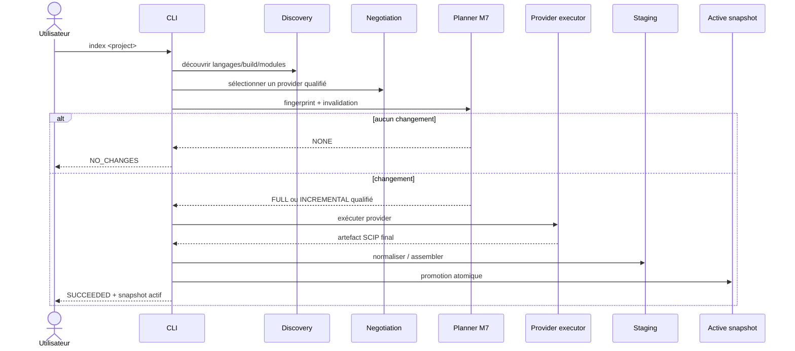

# Indexation autonome

M14 fait de `minos index <project>` le parcours normal d'alimentation de MINOS.

## Flux



## Diagnostic avant exécution

```powershell
minos index my-project --dry-run --format json
```

Le dry-run ne lance aucun provider. Il calcule néanmoins la découverte, la négociation, l'état runtime et la portée d'indexation.

## Choix du provider

MINOS utilise le `IndexerRegistry` existant :

- langage détecté ;
- build system compatible ;
- capacités déclarées ;
- niveau de qualification ;
- priorité déterministe.

Override explicite :

```powershell
minos index my-project --provider scip-java
```

Un override incompatible avec le projet est rejeté ; il ne force pas MINOS à inventer une capacité.

## Portée NONE/FULL/INCREMENTAL

Le planner M7 reste source de vérité.

Pour les providers actuellement gérés par M14 :

- `scip-java` : `INCREMENTAL_INDEXING` non qualifié ;
- `scip-typescript` : `INCREMENTAL_INDEXING` non qualifié.

Donc le comportement conservateur initial est :

```text
projet inchangé                         -> NONE
source/test modifié                     -> FULL
build/ignore/fichier non qualifié changé -> FULL
```

`--force-full` impose un run FULL même si le fingerprint est inchangé :

```powershell
minos index my-project --force-full
```

## Provider Java

Le runtime géré utilise une version verrouillée de `scip-java` et Coursier.

Préconditions du projet :

```text
pom.xml
JAVA_HOME -> JDK avec javac
build Maven exploitable
```

L'indexeur est lancé depuis la racine du projet. Le `index.scip` éventuellement déjà présent est préservé et restauré après le run ; MINOS travaille sur une copie conservée dans son répertoire de run.

## Taille d'un projet indexable

MINOS garde pour chaque projet un snapshot de sa connaissance : fichiers, symboles, occurrences, relations. Il persiste un snapshot jusqu'à **400 Mio**. Mesuré sur un projet Java réel (`morpheus-engine`, 1 488 fichiers Java dont 769 de tests, environ 197 000 lignes), le snapshot fait 339,5 Mio, soit de l'ordre de 0,23 Mio par fichier Java, tests compris ; la taille varie avec le contenu, donc ce rapport est un ordre de grandeur, pas une garantie.

Au-delà du plafond, l'indexation s'arrête sans rien écrire et l'index précédent reste actif. Le message commence par `knowledge snapshot is too large to persist:` et ne donne que deux tailles en octets, la taille encodée et le plafond. MINOS n'offre pas d'option pour exclure des fichiers de l'index : réduire la taille demande d'indexer un projet plus petit.

Un snapshot s'interroge en mémoire : la vue d'un snapshot retient environ 1,05 à 1,5 fois la taille de son fichier (1,05 mesuré sur `morpheus-engine`). Le serveur MCP garde cette vue en cache tant qu'elle tient dans son plafond ; sinon il la recharge à chaque requête, ce qui prend de 3 à 4 s avec le stockage fichier et de 10 à 14 s avec PostgreSQL pour un snapshot de 340 Mio. Sous Docker, le tas de la JVM suit le plafond mémoire du conteneur : voir [docker-runtime.md](docker-runtime.md).

Cette taille n'est pas qualifiée sous Linux : les mesures viennent de Windows.

## Provider TypeScript

Le runtime géré installe `scip-typescript` localement dans `MINOS_HOME/tools`.

Préconditions :

```text
node
npm
tsconfig.json ou package.json compatible
dépendances du projet déjà installées
```

MINOS ne prépare jamais silencieusement `node_modules`.

## Répertoires de run

Chaque provider exécuté produit des diagnostics sous :

```text
<MINOS_HOME>/runs/<runId>/<provider>/
├── provider.stdout.log
├── provider.stderr.log
├── process.txt
├── index.scip
└── failed-index.scip       # uniquement lorsqu'un artefact partiel existe
```

`process.txt` conserve la commande effective, le working directory, le timeout et les dates. Les arguments manifestement sensibles (`token`, `password`, `secret`) sont masqués dans le rendu de commande.

## Staging et promotion

Un artefact provider ne devient jamais directement le snapshot actif.

```text
provider artifact
   ↓
temporary provider normalization
   ↓
provider facts
   ↓
project assembly
   ↓
staged project snapshot
   ↓
atomic promotion
   ↓
active snapshot
```

Si plusieurs providers sont sélectionnés, les collisions d'identifiants sont rejetées plutôt que fusionnées silencieusement.

## Échec de refresh

Le lifecycle historique reste appliqué :

```text
READY -> REFRESHING -> READY    succès
READY -> REFRESHING -> STALE    échec
```

En `STALE`, l'ancien snapshot actif reste lisible.

## Workspace modifié pendant le run

MINOS capture un fingerprint avant et après l'exécution.

Si le projet a changé pendant l'indexation :

- le snapshot produit peut avoir été promu par le lifecycle ;
- le fingerprint baseline n'est **pas** promu ;
- le run signale explicitement le diagnostic ;
- le prochain `index` retombera conservativement sur une nouvelle indexation.

## Import manuel

L'import d'un artefact externe reste disponible :

```powershell
minos import-scip my-project --file .\index.scip --provider custom
```

Ce chemin est destiné aux diagnostics, fixtures et providers qui ne disposent pas encore d'un executor MINOS.

L'import décode l'artefact en mémoire. Il refuse, sans rien écrire, un artefact dont le décodage estimé dépasse le tiers du tas de la JVM ; le message commence par `SCIP index exceeds safe decode heap budget`. Mesuré, le SCIP de 52 Mo d'un projet Java de 1 488 fichiers est refusé sous un tas de 512 Mo et importé dès 576 Mo.

Un import qui publie son snapshot applique ensuite la même rétention que `minos index` : le projet garde le snapshot actif et les deux snapshots historiques les plus récents, les plus anciens sont supprimés. Pour un projet de cette taille (340 Mio par snapshot), l'espace occupé reste ainsi de l'ordre de 1 Gio quel que soit le nombre d'imports. Ré-importer un artefact identique ne crée pas de snapshot supplémentaire. Un import refusé ou en échec ne supprime rien.

Si la rétention ne peut pas s'exécuter (son verrou est pris par une autre opération sur le même projet), l'import reste réussi et le champ `diagnostic` de la sortie l'indique : `storage retention did not run (its lock was busy or unavailable); it runs after the next indexing`. Le prochain import ou la prochaine indexation l'applique.
