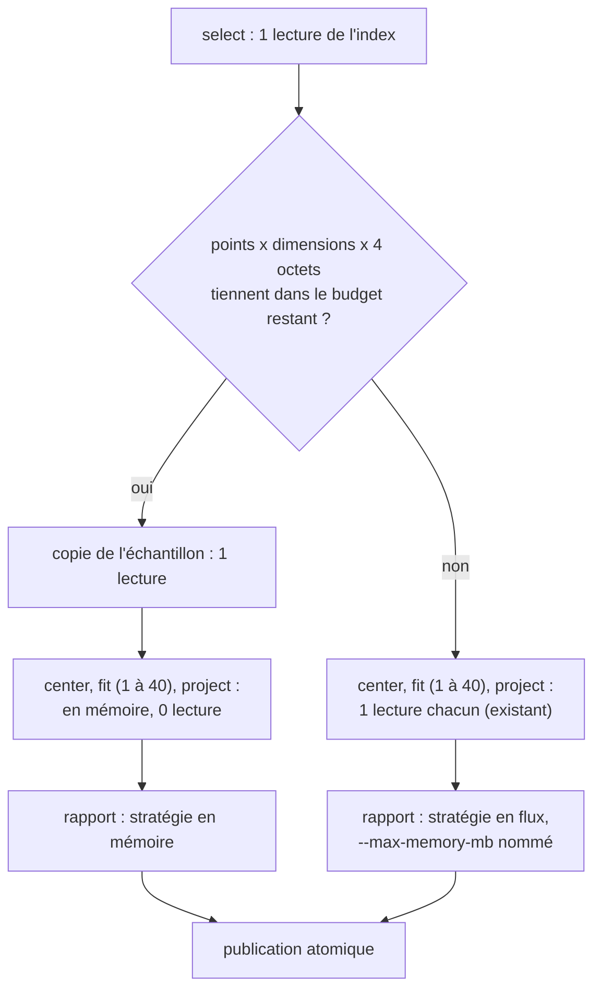

# Design

## Contexte

Motivation : voir `proposal.md` (Why). Le calcul d'une projection vit dans `minos-application` (`ProjectionPreparation`, `PrincipalAxes`, `SemanticProjectionService`) et lit les vecteurs par le port `SemanticVectorStore.vectorPage` ; la commande `minos semantic projection prepare` (`minos-cli`) en rend le rapport. Le parcours en flux est un choix écrit du code : « The index is never held » (`ProjectionPreparation.java:23-28`), la mémoire tenue croît avec le nombre de points, pas avec l'index.

Prérequis non livré au HEAD : le banc de AUD-PERF-13 (sprint 1).

## État vérifié au HEAD

HEAD `89be3fb4`. Lecture du code seulement ; aucune préparation n'a été exécutée.

| Fait | Preuve |
|---|---|
| `run()` : sélection, puis `walkSample("center")`, boucle `walkSample("fit")` jusqu'à `MAX_ITERATIONS` ou convergence, puis `walkSample("project")` | `minos-application/src/main/java/com/minos/application/semantic/ProjectionPreparation.java:65-90` |
| La sélection est elle-même un `walk` complet | même fichier `:97-115` |
| `walkSample` lit chaque vecteur de l'index et écarte ceux hors échantillon (`if (position == null) return;`) | même fichier `:135-145` |
| `walk` lit tout l'index par pages et compare les métadonnées de chaque page à celles du départ | même fichier `:148-162` |
| `MAX_ITERATIONS = 40` ; tolérance `1e-9` | `SemanticProjectionService.java:24` ; `PrincipalAxes.java:19` |
| Un vecteur est retrouvé par sa clé stable, pas par son rang : l'ordre des pages est celui du store (collation en base) | `ProjectionPreparation.java:130-134` |
| `PrincipalAxes` exige le même ordre des vecteurs à chaque passe pour un résultat reproductible | `PrincipalAxes.java:11-14` |
| Budget : page de vecteurs (`2 × dimensions × 8 + 160` octets par vecteur, quart du budget au plus), six tableaux de `PrincipalAxes`, candidats, table des positions | `ProjectionPreparation.java:52-57`, `:108-120` ; `PrincipalAxes.java:52-54` |
| Dépassement du budget : refus `MEMORY_BUDGET_EXCEEDED`, message qui nomme `--max-points` et `--max-memory-mb` | `ProjectionPreparation.java:227-235` |
| Défauts : 100 000 points, 1 000 000 au plus, 256 Mio | `SemanticProjectionService.java:25-28` |
| Le rapport porte `passes` (égal à `outcome.passes()`, le nombre de parcours de l'index), `durationMillis`, `peakWorkingBytes` ; le `+ 1` de la phase de publication ne concerne que la progression ; la CLI rend `passes` | `SemanticProjectionService.java:85`, `:89`, `:224-226` ; `minos-cli/src/main/java/com/minos/cli/command/SemanticProjectionCommand.java:109` |
| `WorkingMemory.reserve` ajoute à `held` et à `peak` **avant** de refuser : une réservation refusée laisse un pic au-dessus du budget | `ProjectionPreparation.java:227-235` |
| La synchronisation ne construit pas d'index au-delà de 250 000 documents ni de 192 Mio de vecteurs comptés à 8 octets par dimension (32 768 documents à 768 dimensions, 98 304 à 256), quel que soit le stockage | `minos-application/src/main/java/com/minos/application/semantic/SemanticIndexBudget.java:15-19`, `:59-75` ; `SemanticIndexService.java:137-138` ; `SemanticDocumentFactory.java:73` |
| Un test encode le comportement en flux : `report.passes() >= 3`, `vectorPages >= 3 * passes`, phases `select`, `fit` et `project` attendues, sur 2 500 documents à 32 dimensions et un budget de 64 Mio | `minos-application/src/test/java/com/minos/application/semantic/SemanticProjectionServiceTest.java:90-107` ; `ProjectionFixture.java:41`, `:103-106` |
| La page développeur décrit « chaque étape est un parcours de l'index » | `docs/developer/semantic-explorer.md:108-116` |
| Le store local rend des `double` qui sont exactement les `float` du fichier ; le store PostgreSQL analyse le texte de `embedding` en `double` | `minos-storage/src/main/java/com/minos/storage/local/store/FileSemanticVectorStore.java:646-654` ; `minos-storage/src/main/java/com/minos/storage/postgresql/semantic/PostgresSemanticReadQueries.java:328-342` |
| Le repère de durée publié est provisoire et synthétique (25 000 documents, 256 dimensions, `local-hash`, Windows) | `docs/user/semantic-explorer.md:134-138` |
| Tests existants | `minos-application/src/test/java/com/minos/application/semantic/SemanticProjectionServiceTest.java`, `ProjectionFixture.java` |

**Non mesuré** : le nombre réel de passes sur un index réel (l'audit l'écrit : « borne théorique, nombre réel de passes non relevé »), la durée à 768 dimensions, la part des lectures dans la durée totale.

## Écarts

| Écart | Source A | Source B | Suite proposée |
|---|---|---|---|
| L'audit confronte « 100 000 × 768 × 4 octets = 293 Mio » au budget de 256 Mio ; un tel index n'est pas constructible : la synchronisation borne les vecteurs à 192 Mio comptés à 8 octets par dimension, donc tout échantillon en `float` pèse au plus 96 Mio | `findings.json` AUD-PERF-02, action | `SemanticIndexBudget.java:15-19`, `:59-75` | Le chemin en mémoire est le cas courant au budget par défaut ; le repli (D2) ne sert que sous un `--max-memory-mb` abaissé |
| Les replis proposés (« sous-échantillonner », « projection aléatoire », « itération par blocs ») changent les coordonnées publiées, donc la méthode liée à l'identité de la projection | `findings.json` AUD-PERF-02, action | exploration-semantique › Une projection est publiée atomiquement et liée à l'identité de son index | Hors périmètre ; le repli retenu ne change pas le résultat |
| L'audit parle de « 43 lectures » ; le compte exact au HEAD est 1 + 1 + (1 à 40) + 1, soit 4 à 43, et `passes` le rend déjà | `findings.json` AUD-PERF-02, titre | `ProjectionPreparation.java:73-81`, `:149` | La mesure « avant » relève `passes` réel |
| Critère de sortie du sprint : « les passes d'ajustement ne relisent que l'échantillon » ; en repli, elles relisent l'index | `sprints.md`, sprint 4 | D2 | Le critère est tenu au budget par défaut pour tout index constructible ; il ne l'est pas sous un budget abaissé par l'utilisateur, et le rapport le dit |
| Le test `aPreparationReadsTheVectorsByBoundedPagesAndNeverLoadsTheWholeIndex` casse dès que la préparation itère en mémoire (2 parcours au lieu de 3 au moins) | `SemanticProjectionServiceTest.java:90-107` | exigence « … ne relit pas l'index à chaque itération … » | Le test est scindé : lecture par pages bornées sans chargement complet (deux stratégies), et compte des parcours par stratégie (tâche 2.2) |
| « Mesurer sur un index réel à 768 dimensions » : 32 768 documents au plus | `findings.json` AUD-PERF-02, action | `SemanticIndexBudget.java:59-75` | Jeux de mesure bornés à ce que la synchronisation construit |
| Stocker l'échantillon en `float` arrondit, sous PostgreSQL, des valeurs que le HEAD traite en `double` analysé du texte | action de l'audit | `PostgresSemanticReadQueries.java:337` | D4 |
| Les 40 itérations sont toutes faites sur chaque jeu mesuré : la tolérance de `PrincipalAxes` (1e-9) n'est jamais atteinte, donc `passes` vaut 43 en flux, et le gain de la copie est de 41 lectures sur 43 | relevés « avant » (`passes` = 43 pour 25 000, 32 768 et 98 304 documents) | `PrincipalAxes.TOLERANCE` | Constat, hors périmètre (le changement ne touche pas la convergence) ; l'itération reste bornée à 40 |
| La mémoire de travail rapportée est multipliée par 2,9 à 4,5 en stratégie en mémoire (25-54 Mo → 102-155 Mo sur les jeux mesurés) : le gain se paie en tas, dans le budget de 256 Mio | `peakWorkingBytes` des relevés | D2, D3 | Annoncé dans la doc utilisateur ; le compte de cette mémoire dans le budget des vues reste AUD-PERF-04 |
| Ajouter deux composants au `record` public `PreparationReport` est additif à la lecture mais change son constructeur canonique (rupture source pour qui le construit) ; aucun constructeur hors du dépôt n'a été trouvé | `SemanticProjectionService.java` (`PreparationReport`) | revue d'architecture | Consigné ; ne pas reprendre ce motif pour une API publique stable |
| `PassReporter` de la commande regroupait ses lignes par numéro de passe : les étapes en mémoire, qui partagent la passe 2, auraient écrasé la phase `copy` | `SemanticProjectionCommand.java` (`PassReporter.advanced`) | Contrats d'interface (« le numéro de passe annoncé reste le nombre de parcours ») | Une ligne par phase d'une même passe ; test CLI (`pass 2 (copy)`) |
| Le banc comptait chaque événement de progression comme une page lue ; les étapes en mémoire en annoncent sans lecture | `SemanticExplorerBenchmark.java` (progression) | tâche 3.2 | Les événements sans vecteur lu ne sont plus comptés ; deux mesures ajoutées (`iterations`, `inMemory`) et le test de fumée mis à jour (67 lignes) |

## Exigences couvertes

- exploration-semantique › La préparation ne relit pas l'index à chaque itération quand l'échantillon tient en mémoire — « Traitements et interactions », D1.
- exploration-semantique › Un échantillon plus lourd que le budget garde le parcours en flux et l'annonce — D2, « Contrats d'interface ».
- exploration-semantique › Les deux stratégies de préparation rendent les mêmes coordonnées — « Modèle de domaine et invariants », D4.

## Objectifs et non-objectifs

Objectif : rendre le nombre de lectures de l'index indépendant du nombre d'itérations quand la mémoire le permet, sans changer le résultat. Non-objectifs : changer la méthode, accélérer la convergence, relever un défaut.

## Responsabilités et frontières des composants

Tout le calcul reste dans `minos-application` ; le port `SemanticVectorStore` (`minos-domain`) n'est pas modifié ; `minos-cli` ajoute un champ au rendu. Aucune dépendance nouvelle : direction ARCH-0068 inchangée.

## Modèle de domaine et invariants

- L'échantillon en mémoire est une matrice plate `float[points × dimensions]`, remplie dans **l'ordre d'arrivée** des vecteurs du parcours de copie, avec la position d'échantillon de chaque ligne [Proposition].
- Invariant d'ordre : les itérations en mémoire visitent les lignes dans cet ordre d'arrivée, qui est l'ordre dans lequel le parcours en flux présente les mêmes vecteurs à chaque passe. Les sommes de `PrincipalAxes` sont donc faites dans le même ordre par les deux stratégies.
- Invariant de valeur : les deux stratégies calculent sur la même valeur de chaque composante (D4).
- Invariant de budget : la place de la matrice est **demandée sans effet** avant d'être réservée (`WorkingMemory` gagne une question « ces octets tiennent-ils ? » qui ne modifie ni `held` ni `peak`) ; au HEAD, `reserve` compte avant de refuser, et un essai de réservation fausserait le pic rapporté. Une réponse négative déclenche le repli, pas un dépassement.

## Traitements et interactions

Voir le diagramme. Après la sélection, le nombre de points est connu : si `points × dimensions × 4` octets tiennent dans ce qui reste du budget, un parcours copie l'échantillon (et vérifie, comme `walkSample`, que chaque point est vu une fois) ; centrage, ajustement et projection parcourent ensuite la matrice. Sinon, le déroulé actuel s'applique sans changement.

## États et transitions

Non applicable : la préparation reste une exécution unique sans état intermédiaire publié.

## Contrats d'interface

CLI `minos semantic projection prepare`, rapport JSON : deux champs **additifs** — la stratégie suivie (deux valeurs : en mémoire, en flux) et le nombre d'itérations d'ajustement (1 à 40), noms exacts fixés à l'implémentation, stables ensuite ; en flux pour cause de budget, une limitation qui nomme `--max-memory-mb`. `passes` garde son sens, le nombre de parcours de l'index : 2 en mémoire (sélection, copie), 4 à 43 en flux ; le nombre d'itérations, que `passes` laissait déduire en flux, a désormais son propre champ. Progression (`Progress.advanced`) : les phases gardent leurs noms (`select`, `center`, `fit`, `project`, `publish`) dans les deux stratégies, plus une phase de copie en mémoire ; le numéro de passe annoncé reste le nombre de parcours de l'index faits. API Java : `PreparationReport` gagne les deux composants correspondants. Les options, codes de sortie et refus existants ne changent pas. Compatibilité : additive ; le plugin IntelliJ ne lit pas ce rapport (à confirmer par recherche à l'implémentation).

## Persistance et intégrité

Non applicable : le format de la projection publiée et son identité (méthode, paramètres, graine, sélection) ne changent pas.

## Transactions, concurrence et idempotence

Inchangé : le verrou de préparation par projet et la publication atomique sont ceux du HEAD. Le parcours de copie compare les métadonnées de chaque page comme tout `walk` ; une fois la copie faite, un index remplacé n'affecte plus le calcul, et le contrôle d'identité à la publication reste celui du HEAD.

## Sécurité et isolation

Fail-closed : jamais de dépassement du budget ; un index modifié pendant la sélection ou la copie refuse la préparation sans rien publier. Aucun chemin ni secret dans le nouveau champ.

## Erreurs et reprise

Refus existants conservés (`MEMORY_BUDGET_EXCEEDED`, `INDEX_CHANGED_DURING_PREPARATION`, `NO_DOCUMENT_OF_THE_SELECTED_KINDS`). Le repli n'est pas une erreur.

## Observabilité

Stratégie, `passes`, `durationMillis` et `peakWorkingBytes` dans le rapport ; la progression (`Progress.advanced`) annonce les phases en mémoire sans lecture.

## Performance et mesure

Aucun objectif chiffré : aucune source. Stratégie :

1. **Avant** (sur `main`) : banc de AUD-PERF-13, stockage local et PostgreSQL, index construits par la synchronisation — 25 000 documents à 768 dimensions (ou 32 768, la plus grande taille constructible) et 98 304 à 256 — durée, `passes`, `peakWorkingBytes`.
2. **Après** : même banc, deux fois : budget par défaut (chemin en mémoire attendu) et budget abaissé qui force le flux.

Tailles des jeux. La synchronisation ne construit pas d'index au-delà de `SemanticIndexBudget.DEFAULT` (`SemanticIndexBudget.java:15-19`, `:59-75`) : un index réel se mesure à ces tailles au plus, et le critère de sortie « gain mesuré sur un index réel » n'est tenable qu'à elles. « 100 000 documents à 768 dimensions » n'existe que comme index synthétique écrit directement dans le store par le harnais ; mesuré, il est dit synthétique.
3. Consignation dans la PR et, par le propriétaire, dans `docs/project/audits/2026-11-15/SUIVI.md`. Le repère de durée de `docs/user/semantic-explorer.md` n'est remplacé que par une mesure.

## Compatibilité, migration et retour arrière

Aucune migration. Une projection publiée au HEAD reste lisible et garde son état. Retour arrière : revenir au code précédent, sans donnée à convertir.

## Diagrammes

### Combien de fois l'index est-il lu selon que l'échantillon tient ou non dans le budget ?

Type : flowchart · Portée : cible proposée · Exigences : exploration-semantique › La préparation ne relit pas l'index à chaque itération quand l'échantillon tient en mémoire ; › Un échantillon plus lourd que le budget garde le parcours en flux et l'annonce

La branche de gauche lit l'index deux fois ; celle de droite garde les 4 à 43 lectures du HEAD. Les deux aboutissent à la même projection.

## Décisions

### D1 — Échantillon en `float`, rempli dans l'ordre du parcours [Proposition]

Choix : matrice `float` plate (96 Mio au plus pour un index constructible). Alternative écartée : `double` (192 Mio au plus, qui ne tiendraient plus au budget par défaut avec la page de copie). Alternative écartée : fusionner sélection et copie en un seul parcours en gardant le vecteur de chaque candidat retenu — une seule lecture, mais un ordre de sommation propre à cette voie, donc sans égalité garantie avec le flux sous PostgreSQL.

### D2 — Repli : le parcours en flux existant, annoncé [Proposition]

Choix : aucun changement de méthode en repli. Alternatives écartées : sous-échantillonner d'office, projection aléatoire, itération par blocs (elles changent les coordonnées ; voir Écarts). Portée : au budget par défaut, aucun index constructible ne déclenche le repli (échantillon ≤ 96 Mio, page de copie ≤ 64 Mio, sélection et table des positions en sus : à prouver par le test du pire cas, tâche 2.1) ; il ne sert que quand l'utilisateur abaisse `--max-memory-mb`.

### D3 — Défauts inchangés [Décision de périmètre]

Le budget par défaut (256 Mio) contient l'échantillon de tout index constructible : aucun relèvement n'est nécessaire, aucune décision n'est attendue. Le compte de cette mémoire dans le budget des vues reste AUD-PERF-04 (sprint 5).

### D4 — Une seule valeur par composante pour les deux stratégies [Proposition, à confirmer]

Pour que les stratégies soient égales au bit près, le chemin en flux calcule lui aussi sur la valeur arrondie en `float`. Stockage local : aucun effet (les valeurs sont déjà des `float`). PostgreSQL : les coordonnées peuvent différer au dernier chiffre de celles préparées au HEAD. Recommandation : accepter, sans changer `METHOD_VERSION` (la méthode et ses paramètres sont les mêmes ; la préparation PostgreSQL est « non qualifiée »). Si le propriétaire veut une identité stricte avec le HEAD sous PostgreSQL, l'alternative est de n'exiger l'égalité des stratégies qu'à une tolérance, ce qui modifie le scénario « Égalité des projections ».

## Qualification des capacités

`exploration-semantique`, carte 2D : inchangée — **partielle** en stockage local (mesures synthétiques), **non qualifiée** sous PostgreSQL. Windows et Linux : même code ; l'égalité des coordonnées entre plateformes est celle du HEAD (`StrictMath` pour la rotation), non revérifiée ici.

## Risques et compromis

- [Risque] le pire cas constructible ne tient pas au budget par défaut une fois comptées la page de copie et la sélection → test du pire cas par le calcul des réservations (tâche 2.1) ; s'il échoue, réduire la page de copie avant de conclure au repli.
- [Risque] pic de tas réel supérieur au compte (matrice plus page de copie) → la page de copie reste réservée pendant la copie ; `peakWorkingBytes` mesuré par le banc.
- [Risque] inégalité au dernier bit entre stratégies par un ordre de sommation différent → invariant d'ordre, test d'égalité stricte.
- [Risque] le nombre réel de passes est faible et le gain marginal → mesuré « avant » ; rien n'est annoncé.

## Vérification

- `SemanticProjectionServiceTest` étendu avec un store qui compte ses parcours complets (via `ProjectionFixture`) : deux parcours en mémoire, égalité stricte des deux stratégies, repli annoncé, refus de budget, index remplacé pendant la copie, question de capacité sans effet sur le pic. Le test existant `aPreparationReadsTheVectorsByBoundedPagesAndNeverLoadsTheWholeIndex` (`:90-107`) est scindé et adapté.
- Commande : `./mvnw -B -ntp -pl minos-application -am test "-Dtest=SemanticProjection*Test" "-Dsurefire.failIfNoSpecifiedTests=false"` ; rendu CLI : `./mvnw -B -ntp -pl minos-cli -am test`.
- Gates : `python .claude/scripts/run_gates.py --fast`, `check-module-boundaries.py`, `check-comment-language.py` ; goldens de caractérisation inchangés (`git diff --exit-code` sur `minos-app/src/test/resources/characterization/`).
- Non vérifiable localement sans le banc : durée et pic réels (manuel).

## Documentation durable à mettre à jour

`docs/architecture/diagrams/capacites/exploration-semantique.md` ; `docs/user/semantic-explorer.md` (stratégies, option de budget ; repère de durée seulement mesuré) ; `docs/developer/semantic-explorer.md:108-116` (étapes de la préparation) ; `docs/project/audits/2026-11-15/SUIVI.md` (propriétaire).

## Traçabilité

| Exigence (capacité › titre) | Scénario | Conception ou diagramme | Tâche | Test ou preuve |
|---|---|---|---|---|
| exploration-semantique › La préparation ne relit pas l'index à chaque itération quand l'échantillon tient en mémoire | Échantillon dans le budget | diagramme, D1 | 2.1, 2.3 | `SemanticProjectionServiceTest#aSampleThatFitsTheBudgetIsIteratedInMemoryAfterTwoWalksOfTheIndex`, `ProjectionPreparationTest#theLargestIndexTheProductBuildsIsIteratedInMemoryUnderTheDefaultBudget` |
| idem | Index remplacé pendant la copie | Transactions | 2.1, 2.3 | `SemanticProjectionServiceTest#anIndexReplacedWhileTheSampleIsCopiedRefusesThePreparationAndKeepsThePublishedProjection` |
| exploration-semantique › Un échantillon plus lourd que le budget garde le parcours en flux et l'annonce | Repli annoncé | D2, Contrats | 3.1, 3.2 | `SemanticProjectionServiceTest#aSampleThatDoesNotFitTheBudgetKeepsTheStreamAndSaysWhichStrategyRan`, `SemanticProjectionCommandLineTest#aStreamedPreparationNamesTheOptionThatLiftsItsLimit` |
| idem | Budget insuffisant même en flux | Erreurs, invariant de budget | 2.1, 3.1 | `SemanticProjectionServiceTest#aBudgetBelowTheSmallestWorkableOneIsRefusedAndPublishesNothing`, `ProjectionPreparationTest#askingWhetherBytesFitChangesNeitherTheMemoryHeldNorThePeak` |
| exploration-semantique › Les deux stratégies de préparation rendent les mêmes coordonnées | Égalité des projections | Invariants, D4 | 2.1, 2.3 | `SemanticProjectionServiceTest#theTwoStrategiesPublishTheSamePointsCoordinatesAndVariance` |
| (mesure du sprint) | — | Performance et mesure | 1.2, 4.1 | relevés `avant3-*`, `apres-pg25000.tsv` et `apres3-*` du dossier de notes de la session ; une exécution, poste bruité, jeux synthétiques ; référence sur la machine de référence : manuelle |

## Questions ouvertes

- D4 (arrondi sous PostgreSQL, version de la méthode) : décision du propriétaire, recommandation ci-dessus.
- Seuil d'acceptation du gain, à fixer sur la mesure « avant ».
