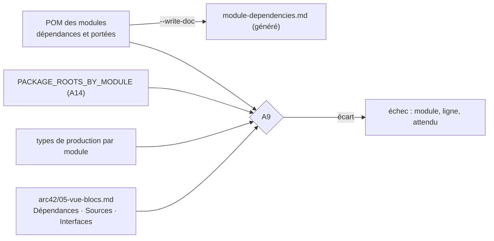

# Design

Changement documentaire et d'outillage : le modèle est réduit ; les sections sans objet le disent sur une ligne.

## Contexte

Motivation : voir `proposal.md` (Why). Sont touchés : la vue des blocs de l'arc42, le document de dépendances généré, la règle A9 du garde et son auto-test, le dossier de la capacité `frontieres-de-modules`. Aucun code Java.

## État vérifié au HEAD

Commit relu : `89be3fb4` (`main`).

| Fait | Preuve |
|---|---|
| A9 lit, par section `### minos-…`, la seule puce « Dépendances » et compare l'ensemble des jetons `minos-…` aux dépendances du POM, toutes portées | `scripts/architecture/check-module-boundaries.py:1586-1649` |
| Le garde connaît la portée de chaque dépendance (`minos_dependencies` rend module → portée ; la plus forte l'emporte en cas de double déclaration) | `scripts/architecture/check-module-boundaries.py:189-205`, `:208` |
| Le document généré est produit depuis un graphe sans portée | `scripts/architecture/check-module-boundaries.py:1741-1794`, `:1836` |
| Table des racines de packages par module (A14) | `scripts/architecture/check-module-boundaries.py:676-696` |
| Le garde sait lister les types de production d'un module | `scripts/architecture/check-module-boundaries.py:699-705` |
| `minos-domain` : « Interfaces : aucune (modèle passif) » ; sa ligne « Sources » cite `domain`, `program`, `semantic` et omet `diagnostics` | `docs/architecture/arc42/05-vue-blocs.md:49`, `:51` ; table A14 `:679` |
| `minos-domain` déclare trois interfaces publiques, dont `SemanticVectorStore` et `SemanticProjectionStore` | `minos-domain/src/main/java/com/minos/semantic/SemanticVectorStore.java:17`, `SemanticProjectionStore.java:10` |
| `minos-engine` : la ligne « Sources » cite `store`, `orchestration`, `query`, `discovery`, `incremental`, `hosted`, `dynamic` ; manquent `git`, `io`, `registry`, `remote`, `runtime`, `source`, `storage` | `docs/architecture/arc42/05-vue-blocs.md:58` ; `ls minos-engine/src/main/java/com/minos/` |
| `minos-storage` : `SemanticVectorStore` rangé parmi les interfaces « définies dans `minos-engine` » | `docs/architecture/arc42/05-vue-blocs.md:70` |
| `minos-explorer` : ligne « Dépendances » sans portée ; le POM déclare `minos-engine` en test (jar et test-jar) et `minos-bootstrap` en runtime | `docs/architecture/arc42/05-vue-blocs.md:121` ; `minos-explorer/pom.xml:33-53` |
| Document généré : ligne de `minos-explorer` sans portée | `docs/architecture/diagrams/module-dependencies.md:99` |
| `minos-app` : « route MCP » seulement, dans le diagramme et dans la section ; la route de l'explorateur existe | `docs/architecture/arc42/05-vue-blocs.md:17`, `:131` ; `minos-app/src/main/java/com/minos/app/ExplorerLaunchRouteProvider.java` ; `docs/architecture/diagrams/module-dependencies.md` (arête `minos-cli` → `minos-app`, service `ExplorerLaunchRoute`) |
| Une portée est déjà écrite en prose libre pour un module | `docs/architecture/arc42/05-vue-blocs.md:79` (« `minos-storage` (tests seulement : … ) ») |
| Spec : « 14 modules » aux lignes 58, 114 et 137, « 13 modules » à la ligne 822 | `openspec/specs/frontieres-de-modules/spec.md` |
| Reactor : 14 modules ; `MODULES` : 14 | `pom.xml:24-37` ; `scripts/architecture/check-module-boundaries.py:19-34` |
| Dossier de capacité, écart E2 : « le reactor et le garde en comptent 13 » | `docs/architecture/diagrams/capacites/frontieres-de-modules.md:149` |

Non mesuré : le garde n'a pas été exécuté pendant la spécification.

## Écarts

| Écart | Source A | Source B | Suite proposée |
|---|---|---|---|
| L'audit cite `minos-explorer/pom.xml:35-48` ; les deux déclarations de `minos-engine` sont aux lignes 40-53 | `findings.json` (AUD-ARC-07) | `minos-explorer/pom.xml` | Sans effet |
| L'audit dit que les sources du moteur omettent 7 racines sur 14 : confirmé ; il ne relève pas que `minos-domain` omet aussi `diagnostics` | `findings.json` (AUD-ARC-07) | `05-vue-blocs.md:51` | Corrigé par la même règle |
| « Écrire le nombre de modules une seule fois dans la spec » : une spec de référence ne s'édite que par archivage ; les trois « 14 » sont vrais au HEAD, seul le « 13 » est faux | `findings.json` (AUD-ARC-07) | `.claude/rules/openspec.md` | D4 : une seule exigence modifiée ; le fait chiffré vit dans la liste `MODULES` |
| Le dossier de capacité inverse le constat (il tient 13 pour vrai) | `frontieres-de-modules.md:149` | `pom.xml:24-37` | Corriger E2 dans le dossier |
| La portée test de `minos-nexus` → `minos-bootstrap` et celle de `minos-provider-scip` → `minos-storage` sont dans le même cas que l'explorateur, non citées par l'audit | `minos-nexus/pom.xml:27-33` ; `05-vue-blocs.md:79`, `:99` | `findings.json` | Couvertes par la règle générale |
| Des lignes « Interfaces » citent entre accents graves des noms qui ne sont pas des types du reactor (`ServiceLoader`, `com.minos.io`) ou des types d'un autre module sans le nommer (`IndexingRuntimePorts` dans `minos-runtime-local`) | `05-vue-blocs.md:56`, `:63` | règle proposée | La prose est reformulée dans la même tâche que la règle |
| La route de l'explorateur dans `minos-app` n'a pas de forme contrôlable simple | `05-vue-blocs.md:131` | — | Corrigée en prose, déclarée non gardée (risque) |

## Exigences couvertes

- `frontieres-de-modules` › La portée d'une dépendance hors compilation est écrite dans la documentation de dépendances : D2.
- `frontieres-de-modules` › Les racines de packages citées par la documentation d'un module sont les siennes : D1, D3.
- `frontieres-de-modules` › Les interfaces citées par la documentation d'un module existent et sont attribuées au bon module : D1, D3.
- `frontieres-de-modules` › Les adaptateurs de stockage forment un seul module (modifiée) : D4.

## Objectifs et non-objectifs

Objectif : ce que l'arc42 affirme sur les ports, les racines et les portées échoue au garde quand le code le contredit. Non-objectif : garder toute la prose ; les « Types clés » et « Responsabilité » restent libres.

## Responsabilités et frontières des composants

Non applicable : aucun module de production touché ; direction des dépendances (ARCH-0068) sans objet.

## Modèle de domaine et invariants

Non applicable.

## Traitements et interactions

Non applicable.

## États et transitions

Non applicable.

## Contrats d'interface

Forme attendue des lignes de la vue des blocs (contrat lu par A9) :

- `- **Dépendances** : `minos-application`, `minos-bootstrap` (runtime), `minos-domain`, `minos-engine` (test)` — seule une parenthèse qui suit immédiatement le jeton et commence par le mot `test` ou `runtime` vaut portée ; un texte libre peut suivre ce mot dans la parenthèse. Toute autre parenthèse est de la prose : c'est le cas de « (voir [`module-dependencies.md`]…) » après la dernière dépendance de `minos-nexus` (`05-vue-blocs.md:99`) et de `minos-bootstrap` (`:127`), et de « (tests seulement : … ) » pour `minos-provider-scip` (`:79`), à réécrire en « (test : … ) ».
- `- **Sources** : …` — les racines sont les jetons `com/minos/<racine>/` de la ligne, premier segment seulement.
- `- **Interfaces** : …` — les types sont les jetons entre accents graves formés d'un nom simple en casse chameau. Les modules d'attribution sont les jetons `minos-…` qui suivent une tournure « défini dans », « définie dans », « définis dans » ou « définies dans », jusqu'à la fin de la phrase. Un module nommé ailleurs dans la ligne ne compte pas : la ligne de `minos-storage` (`05-vue-blocs.md:70`) nomme `minos-engine` par cette tournure et `minos-application` dans une phrase négative. Limite assumée : la tournure est la seule forme reconnue ; une autre formulation échoue et se réécrit.

Document généré : la table « Dépendances MINOS directes » écrit `` `minos-engine` (test) `` ; les arêtes du diagramme Mermaid portent le libellé de portée quand elle n'est pas `compile` [Proposition].

## Persistance et intégrité

Non applicable.

## Transactions, concurrence et idempotence

`--write-doc` reste idempotent : deux exécutions successives ne produisent aucune différence.

## Sécurité et isolation

Fail-closed : une section sans ligne « Sources » échoue ; une ligne « Interfaces » illisible échoue ; un document absent échoue déjà.

## Erreurs et reprise

Chaque échec nomme le module, la ligne en cause et la ligne attendue quand elle est calculable (dépendances, racines).

## Observabilité

La ligne de résumé A9 annonce le nombre de sections dont dépendances, portées, sources et interfaces sont conformes.

## Performance et mesure

Non applicable.

## Compatibilité, migration et retour arrière

Aucune règle Archgate ne lit le document généré : celles d'ARCH-0068 lisent le script et `pom.xml` (`ARCH-0068-…rules.ts:7-8`). Les autres lecteurs éventuels (hooks, skills) sont relevés en tâche 1.1. Retour arrière : revert ; le document se régénère.

## Diagrammes

### Que vérifie A9 après l'extension, et depuis quelles sources ?

Type : flowchart · Portée : cible · Exigences : les trois exigences ajoutées

A9 ne lit aucune source nouvelle : les trois entrées existent déjà dans le garde pour d'autres règles.

## Décisions

### D1 — Étendre A9 plutôt que retirer les listes

Statut : [Proposition], recommandation pour le propriétaire. Les lignes « Sources » et « Interfaces » sont ce qu'un lecteur cherche d'abord ; les retirer appauvrit la vue, les garder sans contrôle reproduit le constat. Alternative : retirer les deux lignes de l'arc42 et renvoyer au document généré (moins de règle, moins d'information). Le contrôle des « Interfaces » est volontairement modeste : existence et attribution, pas exhaustivité.

### D2 — La portée s'écrit dans le document généré et dans l'arc42

Statut : [Décision] de conception. L'exigence existante « toutes portées » reste vraie : l'ensemble des modules cités ne change pas, une annotation s'ajoute. Une dépendance déclarée deux fois (jar et test-jar) garde sa portée la plus forte, comme aujourd'hui.

### D3 — Les règles s'appuient sur les tables existantes

Statut : [Décision] de conception. « Sources » se compare à `PACKAGE_ROOTS_BY_MODULE` ; « Interfaces » aux types de production par module. Aucune table nouvelle. Si `donner-une-source-unique-aux-tables-du-garde-de-frontieres` est fusionné avant, rien ne change ici : la table A14 reste dans le script.

### D4 — Le nombre de modules n'est plus affirmé par le scénario faux

Statut : [Décision] de conception. Le scénario « Reactor fusionné » renvoie à la règle A7 (liste `MODULES` égale au reactor) au lieu d'un nombre. Les trois exigences qui écrivent « 14 » sont vraies au HEAD et ne sont pas modifiées : les réécrire toucherait trois titres de plus, que d'autres changements peuvent modifier. Le dossier de capacité note que le nombre se lit dans `MODULES`.

Le bloc modifié est écrit pour rester vrai avant et après `donner-une-source-unique-aux-tables-du-garde-de-frontieres` : il garde les noms `ALLOWED_DEPENDENCIES` et `ModuleArchitectureTest.ALLOWED`, qui subsistent comme attribut et champ chargés, et son scénario parle de « la politique de dépendances lue par le garde et par `ModuleArchitectureTest` » au lieu des « tables A2 et A17 », A17 cessant d'être une table. Ce changement est le seul à modifier cette exigence.

## Qualification des capacités

`frontieres-de-modules` : qualifiée pour les quatre exigences ; contrôle statique identique sous Windows et Linux.

## Risques et compromis

- [Risque] Le sprint 7 et AUD-ARC-08 changent la vue des blocs et les tables → ce changement est le dernier du sprint ; la prose est écrite sur le `main` du moment.
- [Risque] La route de l'explorateur dans `minos-app` et les « Types clés » restent de la prose non gardée → dit dans `docs/developer/quality-gates.md`.
- [Risque] D'autres lecteurs du document généré (hooks, skills) dépendent de sa forme → relevé en 1.1.

## Vérification

- `python scripts/architecture/test_check_module_boundaries.py` (cas refusé et accepté par règle), `python scripts/architecture/check-module-boundaries.py`, puis `--write-doc` et de nouveau sans option (code 0, `git diff` vide au second passage).
- `python scripts/docs/check-current-docs.py`, `python scripts/docs/product-facts.py --check`, `python scripts/docs/check-capability-dossiers.py`, `archgate check`, `python .claude/scripts/run_gates.py`.

## Documentation durable à mettre à jour

`docs/architecture/arc42/05-vue-blocs.md` ; `docs/architecture/diagrams/module-dependencies.md` (par `--write-doc` seulement) ; `docs/developer/quality-gates.md` (A9) ; `docs/architecture/diagrams/capacites/frontieres-de-modules.md` (exigences, écart E2).

## Traçabilité

| Exigence (capacité › titre) | Scénario | Conception ou diagramme | Tâche | Test ou preuve |
|---|---|---|---|---|
| frontieres-de-modules › La portée d'une dépendance hors compilation est écrite dans la documentation de dépendances | Document généré | D2 | 1.2, 1.3 | `scripts/architecture/test_check_module_boundaries.py#test_the_generated_document_writes_the_scope_outside_compilation` ; `--write-doc` exécuté deux fois, le second sans différence ; garde au code 0 |
| idem | Portée absente de l'arc42 | D2 | 1.2 | `scripts/architecture/test_check_module_boundaries.py#test_a_missing_scope_is_refused_naming_the_dependency_and_the_expected_scope` ; rouge du dépôt sur `minos-explorer` |
| idem | Portée écrite à tort | D2 | 1.2 | `scripts/architecture/test_check_module_boundaries.py#test_a_scope_written_for_a_compile_dependency_is_refused`, `test_a_wrong_scope_is_refused` |
| idem | Parenthèse qui n'est pas une portée | D2 | 1.2 | `scripts/architecture/test_check_module_boundaries.py#test_a_see_also_parenthesis_after_a_compile_dependency_is_not_a_scope` ; ligne réelle de `minos-bootstrap` acceptée |
| frontieres-de-modules › Les racines de packages citées par la documentation d'un module sont les siennes | Racine omise ; Racine d'un autre module ; Section sans ligne Sources ; Répertoire de sources seul | D1, D3 | 2.1, 2.2 | `scripts/architecture/test_check_module_boundaries.py#test_a_package_root_omitted_from_the_sources_line_is_refused`, `test_a_package_root_of_another_module_is_refused`, `test_a_section_without_a_sources_line_is_refused`, `test_a_sources_line_with_the_source_directory_only_is_accepted` |
| frontieres-de-modules › Les interfaces citées par la documentation d'un module existent et sont attribuées au bon module | Port attribué au mauvais module ; Aucune interface déclarée à tort ; Type disparu | D1, D3 | 2.1, 2.2 | `scripts/architecture/test_check_module_boundaries.py#test_a_port_attributed_to_the_wrong_module_is_refused_naming_its_real_module`, `test_a_module_named_outside_the_defined_in_clause_does_not_count`, `test_none_is_refused_for_a_module_that_declares_a_public_interface`, `test_a_type_no_module_declares_is_refused` |
| idem | Documentation corrigée | diagramme | 2.3 | garde au code 0 après correction ; `scripts/architecture/test_check_module_boundaries.py#test_the_current_document_matches_the_real_poms` |
| frontieres-de-modules › Les adaptateurs de stockage forment un seul module | Reactor fusionné | D4 | 3.1 | cas A7 de l'auto-test rejoués (304 cas verts) |
| idem | Ancien module réintroduit | — | 3.1 | cas A7 existants rejoués |

## Questions ouvertes

- D1 : étendre A9 (recommandé) ou retirer les listes de l'arc42.
