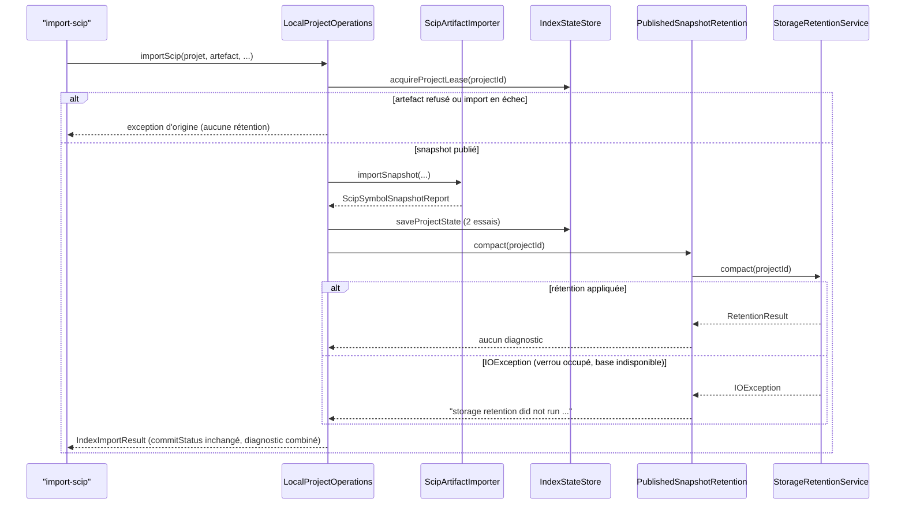

# Design

## Contexte

[Existant vérifié] La rétention des snapshots est un port neutre du backend, `StorageRetentionService` (`minos-engine`), réalisé par `LocalStorageRetentionService` et `PostgresStorageRetentionService` (`minos-storage`), et exposé par `MinosApplication.retentionService()`. Un seul appelant de production l'invoque : `ProjectIndexingUseCase` (`minos-application`, package `com.minos.application.indexing`). L'import SCIP explicite passe par `LocalProjectOperations` (package `com.minos.application`), qui n'appelle pas ce port. Motivation et mesure : `proposal.md`, Why.

Modules : `minos-application` (code), `minos-storage` et `minos-cli` (tests seulement). Surfaces : la CLI (`import-scip`, `index --scip`) et l'API Java (`ProjectOperations.importScip`) rendent le résultat ; aucun champ ne change. Plateformes : le code ne contient aucune branche propre à un système.

## État vérifié au HEAD

Relevé sur `develop` `bc2995a8`.

| Fait | Preuve |
|---|---|
| L'indexation compacte sur ses deux chemins de succès (run réussi, projet inchangé) par `compactAfterSuccess` | `minos-application/src/main/java/com/minos/application/indexing/ProjectIndexingUseCase.java:308`, `:327` |
| Et sur ses deux chemins d'échec (run échoué, empreinte non publiée) par `compactAfterFailure`, qui attache l'erreur de rétention à l'échec | `ProjectIndexingUseCase.java:366`, `:376`, `:382-388` |
| `compactAfterSuccess` capte `IOException` seulement et rend un diagnostic fixe, sans cause | `ProjectIndexingUseCase.java:457-464` |
| L'indexation compacte sous le bail de cycle de vie du projet | `ProjectIndexingUseCase.java:271-281` (`execute`), `:308` |
| L'import publie, enregistre l'état (deux essais), écrit l'historique, sans compacter, sous le même bail | `minos-application/src/main/java/com/minos/application/LocalProjectOperations.java:99-106`, `:118-157`, `:159-189` |
| Le résultat d'import porte un `diagnostic` facultatif ; la CLI le rend en texte (`diagnostic:`) et en JSON (clé `diagnostic`, présente même nulle) | `minos-application/src/main/java/com/minos/application/ProjectOperations.java:103-124` ; `minos-cli/src/main/java/com/minos/cli/command/ImportScipCommand.java:44-52`, `:81-84` ; `minos-cli/src/main/java/com/minos/cli/support/CliCommandSupport.java:45-60` |
| `LocalProjectOperations` est la seule implémentation de production de `ProjectOperations` | recherche `implements ProjectOperations` dans `minos-*/src/main` |
| Store fichier : verrou de rétention borné (10 s) par projet ; le snapshot actif du store et celui de l'état du projet sont protégés | `minos-storage/src/main/java/com/minos/storage/local/LocalStorageRetentionService.java:35`, `:83-107` |
| PostgreSQL : rétention transactionnelle ; le verrou de mutation est déjà détenu quand le bail de cycle de vie l'est sur le même fil, la rétention réutilise alors sa session | `minos-storage/src/main/java/com/minos/storage/postgresql/project/PostgresStorageRetentionService.java:23-37` ; `minos-storage/src/main/java/com/minos/storage/postgresql/support/PostgresProjectMutationLock.java:24-31` ; `minos-storage/src/main/java/com/minos/storage/postgresql/project/ProjectMutationIndexStateStore.java:39-80` |
| PostgreSQL : la suppression des snapshots ne dépend d'aucun run (seuls `knowledge_active` et `project_index_state.active_snapshot_id` protègent) | `PostgresStorageRetentionService.java:40-69` |
| Le test PostgreSQL existant publie six snapshots avec runs et fingerprints, jamais un snapshot sans run | `minos-storage/src/test/java/com/minos/storage/postgresql/project/PostgresStorageRetentionServiceTest.java:29-74` |
| Le gate `check-post-mne.py` exige dans `ProjectIndexingUseCase.java` la chaîne `retentionService.compact(projectId)`, la signature de `compactAfterFailure` et au moins quatre sites `compactAfterFailure(` / `compactAfterSuccess(prepared.project().id())` | `scripts/remediation/check-post-mne.py:276-285` |
| `com.minos.application.indexing` dépend de `com.minos.application` ; l'inverse n'existe pas | imports de `ProjectIndexingUseCase.java` (`MinosApplication`) ; aucun `import com.minos.application.indexing` dans `minos-application/src/main/java/com/minos/application/*.java` |
| Aucun test de `minos-application` n'exerce `importScip` (seulement `requireRegularArtifact` et `writeHistory`) | `minos-application/src/test/java/com/minos/application/LocalProjectOperationsArtifactRefusalTest.java`, `LocalProjectOperationsHistoryTest.java` |

**Non mesuré** : le gain disque d'un réimport après correctif sur `morpheus-engine` (attendu : trois snapshots, environ 1 Gio) ; le comportement PostgreSQL sous un import réel (seul le service de rétention est exercé par Testcontainers).

## Écarts

| Écart | Source A | Source B | Suite proposée |
|---|---|---|---|
| L'import ne compacte pas, l'indexation compacte | `ProjectIndexingUseCase.java:308` | `LocalProjectOperations.java:118-157` | Ce changement (D1) |
| La page utilisateur et DATA-0078 décrivent l'absence de rétention après import | PR #673 (`docs/user/autonomous-indexing.md`, « Import manuel » ; DATA-0078, « Écarts constatés ») | ce changement | Retirer l'écart et réécrire la phrase (tâche 3.1), après la fusion de la PR #673 |

## Exigences couvertes

- `persistance-snapshots › Un import manuel applique la même rétention que l'indexation` : D1, D3, « Traitements et interactions ».
- `persistance-snapshots › Un verrou de rétention occupé ne fait pas échouer un import publié` : D2.
- `persistance-snapshots › La rétention après un import s'applique au store PostgreSQL` : « Persistance et intégrité ».

## Objectifs et non-objectifs

- **Objectif** : une seule règle « rétention après publication » partagée par l'import et l'indexation, avec le même diagnostic.
- **Non-objectifs** : changer la politique, la rendre réglable, compacter après un import en échec, réécrire les chemins d'échec de l'indexation.

## Responsabilités et frontières des composants

[Proposition] Une classe publique `PublishedSnapshotRetention`, dans `com.minos.application` (module `minos-application`), porte la règle : appliquer `StorageRetentionService.compact(projectId)` et rendre, sur `IOException`, le diagnostic fixe. `LocalProjectOperations` (même package) et `ProjectIndexingUseCase` (`com.minos.application.indexing`, qui dépend déjà de `com.minos.application`) l'utilisent.

Direction des dépendances (ADR 0068) : aucune dépendance Maven ajoutée ; `minos-application` ne nomme que le port `StorageRetentionService` de `minos-engine`, jamais une classe de `minos-storage`. Le câblage du service concret reste dans `minos-bootstrap` (ADR 0042). Aucun nouvel arc de package : `com.minos.application.indexing → com.minos.application` existe, l'arc inverse n'est pas créé (règle A8).

`compactAfterSuccess` reste une méthode de `ProjectIndexingUseCase`, qui délègue : le gate `check-post-mne.py` compte ses appels et `compactAfterFailure` garde la chaîne `retentionService.compact(projectId)`.

## Modèle de domaine et invariants

- I1 : après un import publié, la rétention du projet a été tentée exactement une fois, après l'enregistrement de l'état du projet (réussi ou en attente).
- I2 : une erreur d'entrée-sortie de la rétention ne change ni le statut de validation ni le snapshot actif ; elle ajoute au diagnostic une ligne qui ne contient ni cause ni chemin.
- I3 : un import refusé ou en échec n'appelle pas la rétention.

## Traitements et interactions

Déroulé cible de `LocalProjectOperations.importScip`, sous le bail de cycle de vie du projet : contrôle de l'artefact → publication par `ScipArtifactImporter` → enregistrement de l'état (`saveCommittedState`, deux essais) → rétention (`PublishedSnapshotRetention.compact`) → historique CLI → résultat. La rétention passe après l'état pour que le store fichier protège le snapshot importé par les deux pointeurs (actif du store et état du projet) ; si l'état n'a pas pu être enregistré, l'état désigne encore l'ancien snapshot, qui est alors protégé lui aussi. Voir le diagramme de séquence.

## États et transitions

Non applicable : aucun cycle de vie nouveau ; le statut de validation (`IndexImportCommitStatus`) n'est pas modifié par la rétention.

## Contrats d'interface

- **CLI** `minos import-scip <projet> --file <scip> --provider <id> [--provider-version] [--module] [--snapshot] [--format text|json]` et `minos index --scip` (déprécié) : options, code de sortie (0 pour un import publié) et champs inchangés. Le champ `diagnostic`, existant, peut porter la ligne « storage retention did not run (its lock was busy or unavailable); it runs after the next indexing », seule ou après la ligne d'une validation en attente, séparée par `; `. Avec `COMMITTED`, la CLI n'écrit aucun avertissement sur stderr (`ImportScipCommand.java:46-51`) : la ligne apparaît dans la sortie.
- **API Java** `ProjectOperations.importScip` : signature et record `IndexImportResult` inchangés ; `diagnostic` déjà nullable.
- **MCP** : lecture seule, aucun outil d'import. **IntelliJ** : client CLI, aucun champ changé.
- Compatibilité : additive. Idempotence : un réimport du même artefact garde un seul snapshot (adressé par son contenu) ; la rétention ne supprime alors rien.

## Persistance et intégrité

Aucun format ni schéma modifié. Les suppressions sont celles des services de rétention existants : store fichier sous verrou de rétention puis bail de mutation du projet ; PostgreSQL en une transaction (`PostgresStorageRetentionService.java:26-34`). Sur PostgreSQL, un snapshot importé n'a pas de run : la requête de suppression (`:40-69`) ne regarde que les pointeurs actifs, ce que prouve le test ajouté (tâche 2.1).

## Transactions, concurrence et idempotence

La rétention s'exécute sous le bail de cycle de vie détenu par l'import (`LocalProjectOperations.java:103`), comme pour l'indexation : l'ordre des verrous documenté par `LocalStorageRetentionService` (bail de cycle de vie, puis verrou de rétention, puis bail de mutation) est respecté. Sur PostgreSQL, le bail de cycle de vie lie sa session au fil ; `PostgresProjectMutationLock.acquire` la reconnaît et ne reprend pas le verrou (`PostgresProjectMutationLock.java:27`), sans attente ni interblocage. Un verrou de rétention occupé (autre processus) expire après 10 s et donne le diagnostic de D2.

## Sécurité et isolation

Fail-closed non concerné : la rétention est une maintenance après une publication réussie, pas un contrôle. Le diagnostic est une chaîne constante : aucune cause, aucun chemin (règle 7 de `.claude/rules/securite.md`). Une erreur non vérifiée (`RuntimeException`) de la rétention n'est pas captée, comme dans l'indexation : elle remonte comme une erreur interne, rendue opaque par la CLI.

## Erreurs et reprise

- `IOException` de la rétention : import réussi, diagnostic (D2). La rétention suivante (import ou indexation) rattrape.
- Import refusé ou en échec : l'exception d'origine, sans rétention (D3).
- Échec de l'historique CLI : inchangé (journalisé, sans effet sur le résultat).

## Observabilité

Le diagnostic du résultat (CLI texte et JSON, API Java) dit qu'une rétention n'a pas tourné. Aucun journal ajouté : l'indexation n'en écrit pas dans ce cas non plus. Le nombre de snapshots supprimés (`RetentionResult`) n'est pas exposé, comme pour l'indexation.

## Performance et mesure

La rétention liste les snapshots du projet et supprime au plus quelques fichiers ; son coût n'a pas été mesuré séparément [Question non bloquante]. Mesure de vérification proposée (manuelle, tâche 3.2) : quatre imports distincts de `morpheus-engine` sous Windows, espace occupé relevé avant et après.

## Compatibilité, migration et retour arrière

Aucune migration. Une installation qui a accumulé des snapshots par import est compactée au premier import suivant. Retour arrière : un binaire antérieur cesse de compacter à l'import, sans rien casser ; les snapshots déjà supprimés ne reviennent pas (ils étaient historiques).

## Diagrammes

### Quand l'import applique-t-il la rétention, et que rend-il si elle ne tourne pas ?

Type : sequenceDiagram · Portée : cible · Exigences : `persistance-snapshots › Un import manuel applique la même rétention que l'indexation`, `persistance-snapshots › Un verrou de rétention occupé ne fait pas échouer un import publié`

La rétention vient après l'enregistrement de l'état et avant l'historique CLI, sous le bail du projet. Une `IOException` devient une ligne de diagnostic constante ; le statut de validation n'en dépend pas. Ce diagramme est reporté dans le dossier de capacité (tâche 1.4).

## Décisions

### D1 — Une classe partagée dans `com.minos.application`

[Proposition] `PublishedSnapshotRetention` porte l'appel au port et le diagnostic ; l'import et l'indexation l'utilisent. Alternatives écartées : copier `compactAfterSuccess` dans `LocalProjectOperations` (deux textes de diagnostic à tenir égaux) ; faire passer l'import par `ProjectIndexingUseCase` (crée l'arc `com.minos.application → com.minos.application.indexing`, donc un cycle de packages interdit par A8) ; placer la règle dans `minos-engine` (le diagnostic est un message de cas d'usage). Compromis : une classe de plus, publique parce qu'utilisée depuis un sous-package.

### D2 — Même diagnostic que l'indexation

[Proposition] Le texte existant est réutilisé à l'identique ; il reste vrai après ce changement (l'indexation suivante compacte). Alternative écartée : « it runs after the next indexing or import », qui changerait une sortie émise par l'indexation vers toutes les surfaces et le test `ProjectIndexingUseCaseTest#aBusyRetentionAfterASuccessIsADiagnosticNotAFailure`, sans information utile de plus. Le diagnostic se combine à celui de la validation par `; `, l'ordre étant validation puis rétention.

### D3 — Pas de rétention après un import en échec

[Proposition] L'indexation compacte après un échec pour libérer le snapshot préparé et le run non réussi. Un import en échec ne prépare rien que la rétention libérerait (l'importeur publie de façon atomique ; un temporaire laissé par un arrêt relève de la récupération des orphelins). Compacter ajouterait une seconde erreur possible à attacher à l'échec, sans gain.

### ADR

Aucun ADR nouveau : le changement applique une politique existante à un second appelant, sans option structurante. DATA-0078 est corrigé dans ses « Écarts constatés » (tâche 3.1).

## Qualification des capacités

- Rétention après import, store fichier : **qualifiée** après les tâches 1.x (test de bout en bout sur le vrai store local, tâche 1.3).
- Rétention après import, PostgreSQL : **qualifiée au niveau du service** (Testcontainers, tâche 2.1) ; l'import complet sur PostgreSQL n'est pas rejoué en test, la règle applicative étant indépendante du backend et prouvée par la tâche 1.1.
- Windows et Linux : même code ; les tests de `minos-application`, `minos-cli` et `minos-storage` passent sur les deux runners de la CI (les tests Testcontainers suivent la règle existante de leur module).

## Risques et compromis

- [Risque] La rétention supprime un snapshot qu'un utilisateur comptait garder après des imports successifs → c'est la politique déjà appliquée par l'indexation, documentée dans la page utilisateur (tâche 3.1).
- [Risque] Une `RuntimeException` de la rétention fait échouer un import déjà publié → même comportement que l'indexation ; hors périmètre.
- [Risque] Le gate littéral `check-post-mne.py` casse si `compactAfterSuccess` disparaît → la méthode est gardée et délègue (tâche 1.2).

## Vérification

- `minos-application` : `PublishedSnapshotRetentionTest` (appliquée, `IOException` avec chemin, `RuntimeException`), `LocalProjectOperationsRetentionTest` (appel unique après l'état, verrou occupé, validation en attente plus verrou occupé, artefact refusé), `ProjectIndexingUseCaseTest` (inchangé, doit rester vert).
- `minos-cli` : `ImportScipRetentionTest`, quatre imports d'identifiants distincts sur le backend local réel, trois snapshots restants.
- `minos-app` : le golden `retention.golden` de `A2SurfaceCharacterizationTest#retentionEffectIsUnchanged` importe quatre snapshots puis compacte ; il change par construction (trois snapshots avant la compaction explicite, qui ne supprime plus rien). Changement voulu, consigné en tâche 1.5 ; le scénario « Sorties inchangées » de `frontieres-de-modules › Le contrôle hébergé est consommé par une façade applicative`, qui compare les goldens à leur référence versionnée reste satisfaite.
- `minos-storage` : `PostgresStorageRetentionServiceTest#compactsSnapshotsImportedWithoutAnyRun` (Testcontainers ; exécuté par la CI, pas forcément sur le poste).
- Commandes : `./mvnw -B -ntp -pl minos-application -am test`, `./mvnw -B -ntp -pl minos-cli -am test`, test ciblé de `minos-storage` ; `python .claude/scripts/run_gates.py --fast` ; `python scripts/remediation/check-post-mne.py` ; `python scripts/docs/check-capability-dossiers.py` ; `openspec validate --all --strict`. Jamais deux builds Maven en même temps.
- Non vérifiable localement : le test PostgreSQL si Docker est absent du poste (CI) ; la mesure réelle sur `morpheus-engine` est manuelle (tâche 3.2).

## Documentation durable à mettre à jour

- `docs/architecture/diagrams/capacites/persistance-snapshots.md` : vue « rétention après publication » (tâche 1.4) ; lignes de traçabilité des trois exigences à l'archivage.
- `docs/user/autonomous-indexing.md`, section « Import manuel » : l'import compacte comme l'indexation (tâche 3.1).
- DATA-0078, « Écarts constatés » : retirer l'écart sur `import-scip` (tâche 3.1).
- `docs/developer/indexing-and-storage.md` : la ligne de mesure « `import-scip` n'applique pas la rétention » est un relevé daté ; la compléter par la mesure de la tâche 3.2 si elle est faite, sans réécrire le relevé.

## Traçabilité

| Exigence (capacité › titre) | Scénario | Conception ou diagramme | Tâche | Test ou preuve |
|---|---|---|---|---|
| persistance-snapshots › Un import manuel applique la même rétention que l'indexation | Quatre imports distincts sur le store fichier | D1, séquence | 1.3 | `minos-cli/src/test/java/com/minos/cli/ImportScipRetentionTest.java#fourDistinctImportsKeepTheActiveSnapshotAndTwoHistoricalOnes` (rouge sans correctif : quatre snapshots) |
| persistance-snapshots › Un import manuel applique la même rétention que l'indexation | Rétention après la publication | D1, séquence | 1.1, 1.2 | `minos-application/src/test/java/com/minos/application/LocalProjectOperationsRetentionTest.java#aPublishedImportCompactsTheProjectOnceAfterItsStateIsSaved` |
| persistance-snapshots › Un import manuel applique la même rétention que l'indexation | Import refusé | D3 | 1.1, 1.2 | `minos-application/src/test/java/com/minos/application/LocalProjectOperationsRetentionTest.java#aRefusedArtifactAppliesNoRetention`, `#aFailedPublicationAppliesNoRetention` |
| persistance-snapshots › Un verrou de rétention occupé ne fait pas échouer un import publié | Verrou occupé après un import | D2, séquence | 1.1, 1.2 | `minos-application/src/test/java/com/minos/application/LocalProjectOperationsRetentionTest.java#aBusyRetentionLeavesTheImportCommittedWithADiagnosticWithoutItsCause`, `minos-application/src/test/java/com/minos/application/PublishedSnapshotRetentionTest.java#anInputOutputFailureIsAFixedDiagnosticWithoutItsCause` |
| persistance-snapshots › Un verrou de rétention occupé ne fait pas échouer un import publié | Verrou occupé et validation en attente | D2 | 1.1, 1.2 | `minos-application/src/test/java/com/minos/application/LocalProjectOperationsRetentionTest.java#aBusyRetentionAfterAPendingStateKeepsBothDiagnosticsInOrder` |
| persistance-snapshots › La rétention après un import s'applique au store PostgreSQL | Snapshots importés sans run | Persistance et intégrité | 2.1 | `minos-storage/src/test/java/com/minos/storage/postgresql/project/PostgresStorageRetentionServiceTest.java#compactsSnapshotsImportedWithoutAnyRun` (Docker requis) |

## Questions ouvertes

- Coût de la rétention sur un projet de 340 Mio : non mesuré, sans effet sur l'approche (mesure manuelle de la tâche 3.2).
