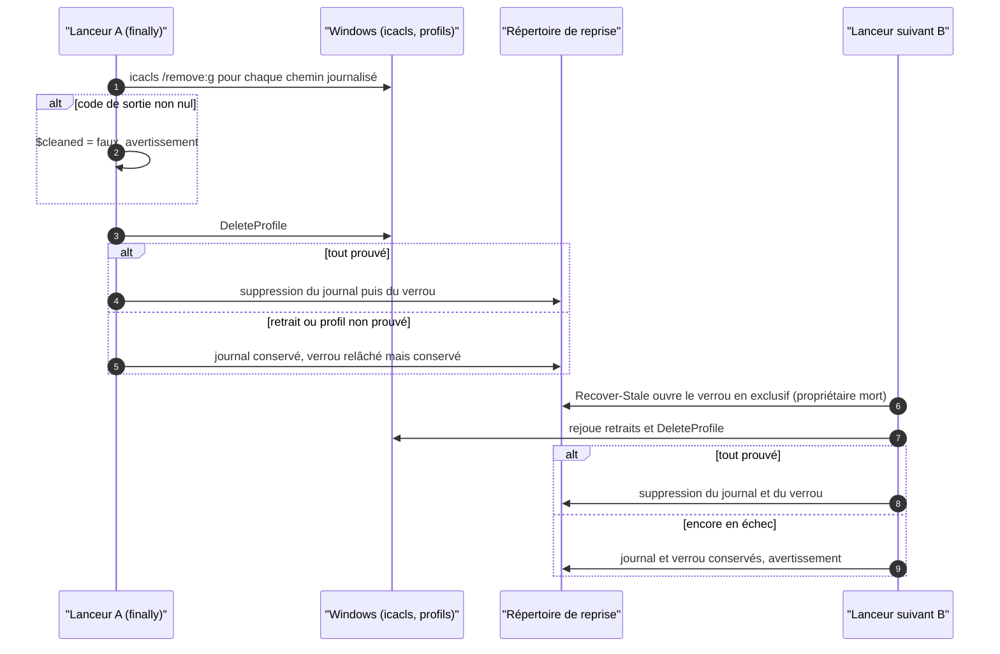
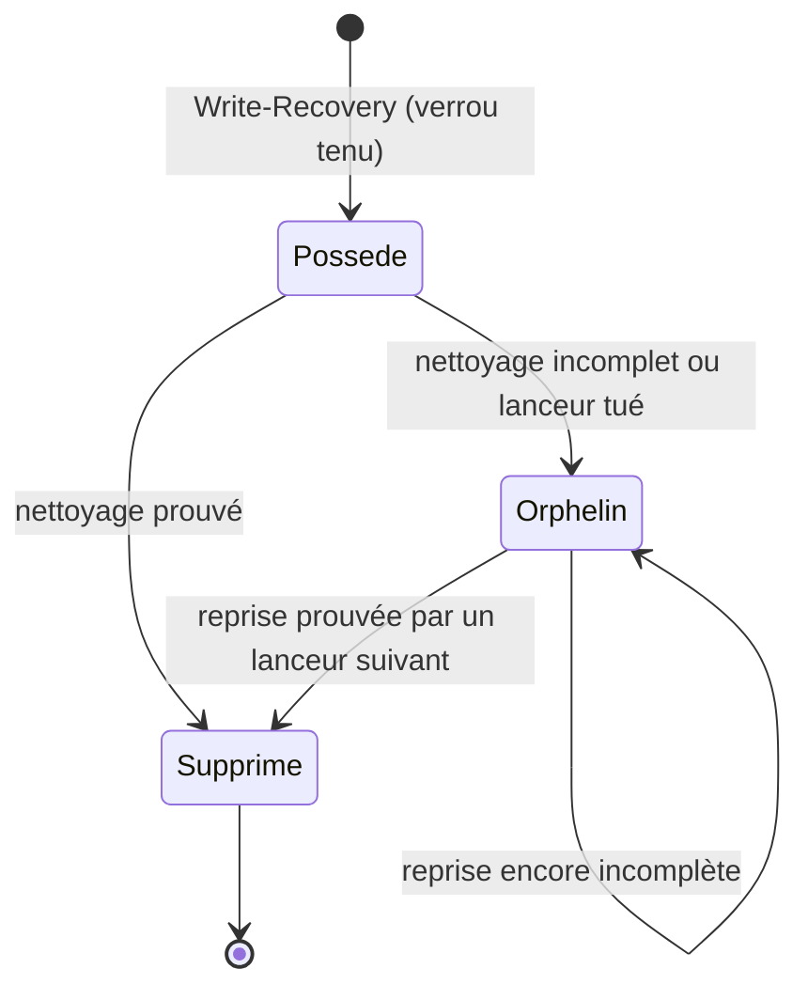

# Design

## Contexte

Le lanceur AppContainer Windows est un script PowerShell assemblé à partir du gabarit
`windows-appcontainer-sandbox-v4.ps1.template` et de fragments (`windows-fragments/*.ps1frag`) par
`WindowsContainmentScript`. Il journalise chaque droit accordé au SID du conteneur avant de l'appliquer, tient un
verrou exclusif de propriété pendant toute la vie du sandbox, et nettoie dans son bloc `finally`. Le balayage
`Recover-Stale` de chaque lanceur reprend les journaux dont le verrou prouve la mort du propriétaire. Seul
`minos-runtime-local` change ; aucune surface publique n'est touchée. Motivation : `proposal.md` (Why).

## État vérifié au HEAD

Commit `64d131e4`.

| Fait | Preuve |
|---|---|
| [Existant vérifié] Les fonctions d'octroi testent `$LASTEXITCODE` après chaque appel à `icacls` | `minos-runtime-local/src/main/resources/com/minos/runtime/local/windows-appcontainer-sandbox-v4.ps1.template` |
| [Existant vérifié] Le nettoyage de fin de run est porté par le bloc `finally` du lanceur, la reprise par `Recover-Stale` et la libération du verrou par `Close-OwnershipLock` | même gabarit ; `minos-runtime-local/src/main/resources/com/minos/runtime/local/windows-fragments/appcontainer-recovery-ownership.ps1frag` |
| [Existant vérifié] Un journal sans fichier de verrou n'est jamais repris (« no provable owner ») | même fragment ; test `aJournalWithoutAnOwnerLockIsLeftInPlaceAndReported` |
| [Existant vérifié] Le préambule fixe `$ErrorActionPreference = 'Stop'` | `minos-runtime-local/src/main/resources/com/minos/runtime/local/windows-fragments/script-preamble.ps1frag:6` |
| [Existant vérifié] `WindowsContainmentScriptTest` compare le script assemblé à une copie qualifiée (golden) en retirant une à une les remédiations approuvées ; le fragment de reprise est épinglé par son SHA-256 | `minos-runtime-local/src/test/java/com/minos/runtime/local/sandbox/WindowsContainmentScriptTest.java:37-38`, `:122-141` |
| [Existant vérifié] `icacls /remove:g` d'un SID absent rend 0 ; sous un refus `OWNER RIGHTS (S-1-3-4):(WDAC)` il rend 5 et le dossier reste supprimable ; `DeleteAppContainerProfile` d'un profil absent rend `S_OK` | sonde PowerShell 5.1 du 2026-11-04 (Windows 10 19045) |

Non mesuré : un échec réel de `DeleteAppContainerProfile` (aucune façon reproductible de le provoquer sur un poste) ;
le comportement sous Windows Server 2022 est attendu de la CI `Verify (windows-2022)`.

## Écarts

| Écart | Source A | Source B | Suite proposée |
|---|---|---|---|
| Le cas d'un retrait en échec n'est ni spécifié ni testé | exigence « confinement-code-non-fiable › Les autorisations accordées à un conteneur sont retirées même après un arrêt brutal » | gabarit et fragment de reprise | Spécifié, rendu explicite et testé par ce changement (D1 à D3) |

## Exigences couvertes

- confinement-code-non-fiable › Les autorisations accordées à un conteneur sont retirées même après un arrêt
  brutal : Décisions D1 à D4, Traitements et interactions.

## Objectifs et non-objectifs

Objectif : aucun droit accordé à un conteneur ne perd son journal tant que son retrait n'est pas prouvé.
Non-objectifs : borner le nombre de rejeux d'un retrait durablement impossible (il est rejoué et signalé à chaque
lancement) ; retirer les autorisations orphelines antérieures à ce changement (exigence de recensement distincte).

## Responsabilités et frontières des composants

Non applicable : seuls le gabarit et le fragment PowerShell de `minos-runtime-local` changent ; aucune dépendance
entre modules n'est ajoutée (ARCH-0068).

## Modèle de domaine et invariants

[Décision] Invariant : un journal de reprise existe tant qu'un droit qu'il nomme n'a pas été retiré avec succès ou
que le profil n'a pas été supprimé avec succès ; un fichier de verrou n'existe jamais sans son journal, sauf un
verrou orphelin que le balayage supprime.

## Traitements et interactions

Voir le diagramme « Que fait un lanceur quand un retrait échoue ? ». Fin de run : chaque retrait est tenté ; un
échec (exception de `Remove-AppContainerPath` ou de `DeleteProfile`) passe `$cleaned` à faux et produit un
avertissement ; le journal n'est supprimé que si `$cleaned` est vrai, sinon il est réécrit avec les seuls chemins en
échec ; `Close-OwnershipLock` relâche le verrou et ne supprime son fichier que si le journal a disparu. Reprise : même règle, le `finally` existant de
`Recover-Stale` garde déjà le verrou quand le journal reste.

## États et transitions

Voir le diagramme « Quels états traverse un journal de reprise ? ».

## Contrats d'interface

Le contrat est le script assemblé, épinglé par `WindowsContainmentScriptTest` (dérive approuvée
`removeApprovedFailClosedGrantRemoval`, SHA-256 du fragment). Le code de sortie du lanceur reste celui du provider
(D4). Avertissements ajoutés sur stderr : `MINOS AppContainer cleanup is incomplete; recovery journal <nom> is kept
for the next launcher` et `MINOS AppContainer recovery of journal <nom> is incomplete; the journal is kept for the
next launcher`.

## Persistance et intégrité

Format du journal inchangé (`profile`, `sid`, `paths`) ; répertoire de reprise inchangé
(`appcontainer-recovery-v2`). Seule change la durée de vie du journal et de son verrou après un échec.

## Transactions, concurrence et idempotence

[Existant vérifié] Quand le retrait est possible, le rejeu est idempotent : retirer une entrée absente et supprimer
un profil absent réussissent (sonde ci-dessus). Sans droit de modifier la liste d'accès, retirer même une entrée
absente échoue : le chemin reste journalisé, ce qui est le comportement fail-closed voulu (rien n'est prouvé). Un journal conservé n'est repris qu'après preuve de mort de son propriétaire : son verrou est
relâché à la sortie du lanceur, et un lanceur suivant l'ouvre en exclusif.

## Sécurité et isolation

Fail-closed : un retrait non prouvé reste nommé par un journal. Le message d'erreur de `Remove-AppContainerPath` et
les avertissements ajoutés ne citent aucun chemin : seul le nom de fichier du journal et le code de sortie
d'`icacls` apparaissent. La sortie d'erreur propre d'`icacls` reste celle des fonctions d'octroi existantes.

## Erreurs et reprise

Un retrait durablement impossible laisse le journal en place ; chaque lanceur suivant le rejoue et le signale par
nom. Le diagnostic des autorisations orphelines (exigence de recensement) reste le moyen de les voir.

## Observabilité

Avertissements sur stderr, repris dans le journal du lanceur, nommant le journal conservé.

## Performance et mesure

Non applicable : un test `Test-Path` et une variable booléenne de plus par run.

## Compatibilité, migration et retour arrière

Additif. Un journal laissé par un lanceur antérieur est repris à l'identique. Retour arrière : les journaux
conservés entre-temps restent repris normalement.

## Diagrammes

### Que fait un lanceur quand un retrait échoue ?

Type : sequenceDiagram · Portée : cible · Exigences : confinement-code-non-fiable › Les autorisations accordées à
un conteneur sont retirées même après un arrêt brutal

Le journal ne disparaît qu'après un nettoyage entier prouvé, par A ou par un lanceur suivant.

### Quels états traverse un journal de reprise ?

Type : stateDiagram-v2 · Portée : cible · Exigences : confinement-code-non-fiable › Les autorisations accordées à
un conteneur sont retirées même après un arrêt brutal

Un journal « Orphelin » a toujours son fichier de verrou relâché : c'est ce qui permet la preuve de mort.

## Décisions

### D1 — Un retrait se prouve par le code de sortie d'`icacls`

[Décision] `Remove-AppContainerPath` lève une erreur quand `$LASTEXITCODE` est non nul, comme les fonctions
d'octroi. Alternative écartée : relire l'ACL après coup ; plus coûteux et sans gain, `icacls` rend un code fiable
(sonde).

### D2 — Le journal n'est supprimé qu'après un nettoyage entier prouvé

[Décision] Fin de run et reprise suivent la même règle : tous les retraits et `DeleteProfile` sont tentés, puis le
journal n'est supprimé que si aucun n'a échoué ; sinon il est réécrit (`Write-Recovery`, publication atomique) avec
les seuls chemins dont le retrait a échoué, et la suppression du profil est toujours rejouée. Une réécriture en échec
laisse l'ancien journal, qui nomme un sur-ensemble des chemins : rien n'est perdu. Alternative écartée : conserver le
journal entier, qui ferait réécrire à chaque lancement les ACL de chemins déjà nettoyés (le JDK notamment).

### D3 — Le verrou relâché reste à côté du journal conservé

[Décision] `Close-OwnershipLock` ne supprime le fichier de verrou que si le journal a disparu. Sans ce fichier, le
balayage refuserait le journal (« no provable owner ») et ne le rejouerait jamais.

### D4 — Le code de sortie du lanceur reste celui du provider

[Décision] Le nettoyage incomplet est rattrapé par le lanceur suivant et signalé ; il ne remet pas en cause un
index produit dans le confinement. Alternative écartée : faire échouer l'indexation, ce qui transformerait un
défaut d'hôte persistant en panne de chaque indexation sans améliorer le confinement.

Aucune décision structurante : aucun ADR à écrire.

## Qualification des capacités

- confinement-code-non-fiable › Les autorisations accordées à un conteneur sont retirées même après un arrêt
  brutal : qualifiée sous Windows par les tests de la Vérification. Linux : sans objet (aucune ACL d'hôte accordée).

## Risques et compromis

- [Risque] Un retrait durablement impossible fait rejouer et signaler le même journal à chaque lancement, et
  chaque run qui échoue ainsi ajoute un journal → avertissement nommé ; le journal ne nomme que les chemins en
  échec ; le diagnostic des autorisations orphelines reste le moyen de les traiter.
- [Risque] Hors de ce changement : un chemin accordé qui n'existe plus (renommé pendant le run) est compté comme
  retiré ; l'entrée restante vise le SID d'un conteneur supprimé et n'ouvre aucun accès.
- [Risque] Le refus `OWNER RIGHTS:(WDAC)` des tests dépend du modèle de sécurité de Windows → sondé sur
  Windows 10 ; la CI Windows Server 2022 rejoue les mêmes tests.

## Vérification

- `WindowsAppContainerRecoveryOwnershipTest#aGrantThatCannotBeRemovedAtTheEndOfARunKeepsItsJournalForTheNextLauncher`
  et `#aRecoveryWhoseGrantRemovalFailsKeepsTheJournalForTheNextLauncher` (Windows, `@EnabledOnOs`,
  `SandboxTestSupport`) : rouges d'abord, verts après la correction.
- `WindowsContainmentScriptTest` : SHA-256 du fragment et dérive approuvée du gabarit.
- Gates : `python .claude/scripts/run_gates.py --fast` (dont `scripts/remediation/check-post228-hardening.py`, qui
  cite le gabarit), `openspec validate --all --strict`, `python scripts/docs/check-capability-dossiers.py`.
- Non vérifiable localement : un échec réel de `DeleteAppContainerProfile` ; il suit le même chemin de code que le
  retrait en échec (`$cleaned` à faux).

## Documentation durable à mettre à jour

Dossier `docs/architecture/diagrams/capacites/confinement-code-non-fiable.md` : vue V2 (retrait en échec), ligne de
traçabilité de l'exigence.

## Traçabilité

| Exigence (capacité › titre) | Scénario | Conception ou diagramme | Tâche | Test ou preuve |
|---|---|---|---|---|
| confinement-code-non-fiable › Les autorisations accordées à un conteneur sont retirées même après un arrêt brutal | Lanceur tué après l'octroi | inchangé | — | `WindowsAppContainerRecoveryOwnershipTest#aSandboxWhoseOwnerWasKilledIsRecoveredByTheNextLauncher` |
| idem | Run vivant | inchangé | — | `WindowsAppContainerRecoveryOwnershipTest#aLiveSandboxIsNotAlteredWhenAnotherLauncherStartsAndRunsToCompletion` |
| idem | Propriété non prouvable | inchangé | — | `WindowsAppContainerRecoveryOwnershipTest#aJournalWithoutAnOwnerLockIsLeftInPlaceAndReported` |
| idem | Retrait en échec à la fin du run | D1, D2, D3, D4 ; séquence | 1.1, 1.2 | `WindowsAppContainerRecoveryOwnershipTest#aGrantThatCannotBeRemovedAtTheEndOfARunKeepsItsJournalForTheNextLauncher` |
| idem | Retrait en échec pendant la reprise | D1, D2 ; séquence, états | 1.1, 1.2 | `WindowsAppContainerRecoveryOwnershipTest#aRecoveryWhoseGrantRemovalFailsKeepsTheJournalForTheNextLauncher` |

## Questions ouvertes

Aucune.
