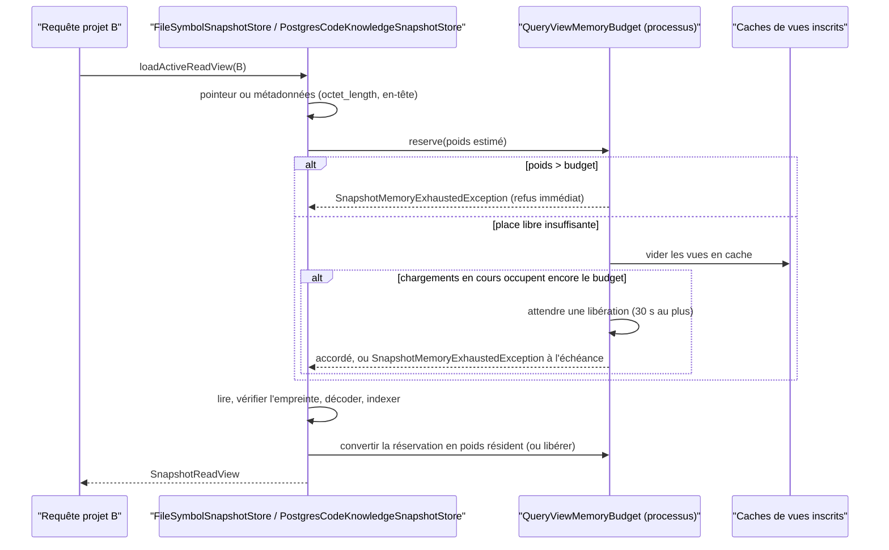
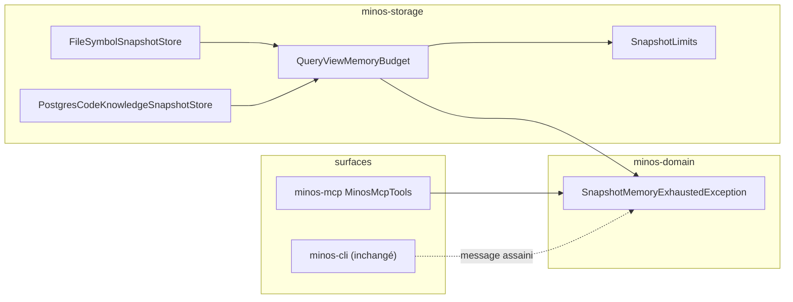

# Design

## Contexte

Motivation : `proposal.md` (Why, constat AUD-PERF-15). Le changement touche le chemin de lecture d'une vue active dans
les deux stores de `minos-storage` (`FileSymbolSnapshotStore`, `PostgresCodeKnowledgeSnapshotStore`), la source unique
des plafonds (`SnapshotLimits`), les images et compose du plan de requête Docker, et l'ADR DATA-0078. Surfaces : le
message d'un refus devient lisible sur la CLI (déjà rendu) et sur le MCP (aujourd'hui opaque). Windows et Linux
exécutent le même code ; les images Docker sont Linux.

## État vérifié au HEAD

HEAD relu : `develop` `3cadc4ca` (branche `perf/borner-les-gros-snapshots-au-tas`, worktree `chg-A`). Chaque preuve de
la spécification du propriétaire est revérifiée ; aucune n'a bougé. Le constat AUD-PERF-15 n'existe pas encore dans
`docs/project/audits/2026-10-10/ETAT-2026-10-13.md` **commité** au HEAD : sa section « Nouveau constat : AUD-PERF-15 »
n'est présente que dans une modification non commitée de l'arbre principal (lue, non modifiée).

| Fait | Preuve |
|---|---|
| [Existant vérifié] Plafond du cache constant de 512 Mio, sans lecture de `Runtime.maxMemory()` | `minos-storage/src/main/java/com/minos/storage/codec/SnapshotLimits.java:32`, `:40-44` |
| [Existant vérifié] Vue V3 maximale : 400 Mio × 125 % = 500 Mio ; invariant `requireCacheCoversPersistable` | `SnapshotLimits.java:93-111` ; DATA-0078 point 14 (l. 49) |
| [Existant vérifié] Le store fichier sérialise un **même** projet par verrou rayé (64 rayures), rien ne borne deux projets | `minos-storage/src/main/java/com/minos/storage/local/store/FileSymbolSnapshotStore.java:47`, `:230-250` |
| [Existant vérifié] Le store fichier connaît format, comptes et taille **avant** décodage (pointeur actif, `Files.size`) | `FileSymbolSnapshotStore.java:221-227`, `:383-393` ; décodage en `:308-320` |
| [Existant vérifié] Le poids n'est calculé qu'**après** la construction de la vue | `FileSymbolSnapshotStore.java:241`, `:279` ; `minos-storage/src/main/java/com/minos/storage/postgresql/snapshot/PostgresCodeKnowledgeSnapshotStore.java:175-186` |
| [Existant vérifié] PostgreSQL : métadonnées sans charge utile, puis `SELECT s.snapshot_id,s.payload,s.sha256` qui rapatrie la ligne entière | `PostgresCodeKnowledgeSnapshotStore.java:364-382`, `:384-400` |
| [Existant vérifié] `copyBounded` borne la copie **après** que le pilote a matérialisé la ligne (`getBinaryStream`) | `PostgresCodeKnowledgeSnapshotStore.java:403-415`, `:466-480` |
| [Existant vérifié] Le format PostgreSQL n'est connu qu'après copie (`codec.formatVersion(row.payload())`) | `PostgresCodeKnowledgeSnapshotStore.java:453` |
| [Existant vérifié] Colonne `payload bytea` en stockage par défaut (`EXTENDED`, compressible) | `minos-storage/src/main/java/com/minos/storage/postgresql/support/PostgresSchemaMigrator.java:83` |
| [Existant vérifié] Message de lecture existant au-delà du plafond, sans chemin | `minos-storage/src/main/java/com/minos/storage/codec/SnapshotBinaryCodecSupport.java:425-431` |
| [Existant vérifié] Les stores sont instanciés sans réglage : `new FileSymbolSnapshotStore(knowledgeRoot)`, `new PostgresCodeKnowledgeSnapshotStore(connections, home)`, et une fabrique `FileSymbolSnapshotStore::new` (magasins de travail SCIP) | `minos-storage/src/main/java/com/minos/storage/local/LocalStorageBackend.java:49` ; `minos-storage/src/main/java/com/minos/storage/postgresql/PostgresStorageBackend.java:41` ; `minos-bootstrap/src/main/java/com/minos/bootstrap/DefaultMinosApplicationComposer.java:126-127` |
| [Existant vérifié] Convention des réglages : propriété système puis variable `MINOS_*` ; un fait de processus ne lit pas le fichier de configuration | `minos-engine/src/main/java/com/minos/storage/MinosRuntimeSettings.java:94-99`, `:101-110` |
| [Existant vérifié] CLI : message d'exception assaini puis rendu, code 1 | `minos-cli/src/main/java/com/minos/cli/support/CliCommandSupport.java:166-174` ; `minos-cli/src/main/java/com/minos/cli/support/CliExitCodes.java:10` |
| [Existant vérifié] MCP : toute `IOException` non reconnue devient `error: MINOS tool execution failed` | `minos-mcp/src/main/java/com/minos/mcp/MinosMcpTools.java:51`, `:186-201` |
| [Existant vérifié] Une surface qui nomme un nouveau type de `minos-engine` fait échouer le cliquet A11 ; un type de `minos-domain` est permis | `scripts/architecture/check-module-boundaries.py:556-584`, `:77-79` ; modèle : `minos-domain/src/main/java/com/minos/domain/registry/UnreadableRegistryException.java:15` |
| [Existant vérifié] Images de requête sans option de tas ; MCP lancé par `docker exec ... java -cp ...` | `docker/Dockerfile.mcp:45` ; `docker/Dockerfile.mcp.release:37`, `:67` ; `docker/scripts/mcp-lifecycle.ps1:973` ; `docker/scripts/prod-mcp.ps1:365` ; `minos-app/src/main/java/com/minos/app/DockerMcpTransport.java:79` |
| [Existant vérifié] `mem_limit` du rôle requêtes : 3 Gio ; `minos-mcp` sans `JAVA_TOOL_OPTIONS` ; admin et tâches en ont un | `docker/compose-mcp.prod.yaml:11-15`, `:28-45`, `:84`, `:256` ; `docker/compose-mcp.connected.yaml:11-15`, `:118`, `:263` |
| [Existant vérifié] Chaque client MCP lance sa propre JVM dans `minos-mcp` (~90 Mio au repos) | `docs/user/docker-runtime.md:366-380` (« Limites de ressources ») |
| [Existant vérifié] Gates littéraux sur les stores : `limits.amplifiedBytes(...)`, `estimateWeight(metadata, payloadBytes, decoded.formatVersion())`, `limits.maxQueryCacheWeightBytes()` | `scripts/remediation/check-mne.py:86-92` ; `scripts/remediation/check-mnd.py:100-101` |
| [Existant vérifié] Test de contrat qui affirme la chaîne `JAVA_TOOL_OPTIONS` des services admin et sonde | `minos-app/src/test/java/com/minos/packaging/M29DockerAdministrationContractTest.java:56`, `:90` |
| [Existant vérifié] Outils de mesure : pic et tas retenu (fichier), lecture PostgreSQL à froid | `minos-storage/src/test/java/com/minos/storage/local/store/LargeSnapshotMeasurement.java:69-90`, `:116` ; `minos-storage/src/test/java/com/minos/storage/postgresql/snapshot/LargePostgresSnapshotMeasurement.java` |
| [Existant vérifié] Lancement d'une JVM fille de test (`java.home`, `java.class.path`) | `minos-storage/src/test/java/com/minos/storage/local/store/SnapshotPublicationCrashTest.java:70-77` |
| [Existant vérifié] `PostgresTestSupport` démarre aujourd'hui Testcontainers ; les sous-classes n'utilisent que `connections` | `minos-storage/src/test/java/com/minos/storage/postgresql/PostgresTestSupport.java:38-66`, `:98-110` |
| [Existant vérifié] Risque reconnu, non suivi | DATA-0078 l. 102-103 (chargements simultanés, tas de 768 Mio), l. 106 (pic au décodage et Linux non mesurés) |

Non mesuré ici (aucun build lancé, consigne) : le pic de tas au décodage au-delà de 512 Mo, le transitoire du pilote
PostgreSQL pendant le rapatriement, `Runtime.maxMemory()` effectif sous `MaxRAMPercentage=35` dans le conteneur.

## Écarts

| Écart | Source A | Source B | Suite proposée |
|---|---|---|---|
| Le constat AUD-PERF-15 n'est pas au HEAD | Spécification du propriétaire (« lire ETAT, section AUD-PERF-15 ») | `ETAT-2026-10-13.md` commité au HEAD `3cadc4ca` (aucune occurrence) | Le constat est cité depuis l'arbre principal ; son commit relève du propriétaire (fichiers interdits à ce change) |
| DATA-0078 point 14 dit « le plafond du cache est de 512 Mio » ; la cible le rend effectif `min(512 Mio, budget)` | DATA-0078 l. 49 | `proposal.md`, What Changes | Amendement de l'ADR en tâche 5.1 |
| Le scénario « Relecture d'un snapshot de plus de 256 Mio » promet la lecture sans condition de tas | `openspec/specs/persistance-snapshots/spec.md:539-542` | Cible : refus à l'admission sous un petit tas | MODIFIED dans le delta (condition de budget) |
| L'audit propose d'« inscrire le risque au registre » ; le registre est un fichier partagé interdit | ETAT (arbre principal), « Action » | Consigne du change | Texte proposé ci-dessous, inscription par le propriétaire |

## Exigences couvertes

| Exigence | Section du design |
|---|---|
| persistance-snapshots › Un chargement de vue non mise en cache réserve son poids avant décodage | D1, D3, Traitements, Concurrence |
| persistance-snapshots › Une vue plus lourde que le budget de mémoire des vues est refusée à l'admission | D1, D7, Erreurs |
| persistance-snapshots › Le plafond effectif du cache de vues dérive du tas maximal | D2, Modèle |
| persistance-snapshots › Le budget de mémoire des vues est réglable et une valeur invalide est refusée | D2, Contrats |
| persistance-snapshots › PostgreSQL lit la taille d'un snapshot avant de rapatrier sa charge utile | D5, Persistance |
| persistance-snapshots › Un refus de mémoire est rendu par la CLI et le MCP avec son message | D7, Contrats |
| persistance-snapshots › Le plafond du cache de vues couvre tout snapshot persistable (MODIFIED) | D2, Modèle (invariant) |
| persistance-snapshots › Un snapshot de plus de 256 Mio est persisté jusqu'au plafond de persistance (MODIFIED) | D2, Compatibilité |
| persistance-snapshots › Un snapshot de la taille de ce dépôt est admis au cache de vues (MODIFIED) | D2 |
| distribution-docker › Le plan de requête Docker fixe le tas de sa JVM en proportion de sa limite mémoire | D6 |

## Objectifs et non-objectifs

- Objectif : aucun chemin de chargement de vue d'**une JVM** n'alloue au-delà du budget sans réservation préalable ;
  l'échec est une `IOException` explicite.
- Non-objectif : borner la somme de plusieurs JVM d'un même conteneur ; mesurer exactement le tas (le poids reste une
  estimation majorante prouvée par `QueryViewWeightTest`) ; changer le format persisté ou le schéma PostgreSQL.

## Responsabilités et frontières des composants

- **`minos-storage`** (adaptateur) porte tout le mécanisme : `QueryViewMemoryBudget` [Proposition] dans
  `com.minos.storage.codec`, à côté de `SnapshotLimits` qui reste la source unique des valeurs. Les deux stores y
  réservent avant décodage. Direction respectée (ADR 0068) : `minos-storage` ne dépend que de `minos-domain` et
  `minos-engine` ; aucun package nouveau, aucune classe de `minos-engine` modifiée.
- **`minos-domain`** (hors colonne) : type `SnapshotMemoryExhaustedException extends IOException` [Proposition] dans
  `com.minos.diagnostics`, seul moyen pour `minos-mcp` de le reconnaître sans nommer un type de `minos-engine` (A11)
  ni de l'adaptateur (A2).
- **`minos-mcp`** (hors colonne) : une clause `catch` qui rend le message assaini, comme `UnreadableRegistryException`.
- **`minos-cli`** : aucun changement ; il rend déjà le message assaini.
- **Docker** : options de tas des images et du service `minos-mcp` ; aucun script de lancement modifié (l'option passe
  par l'environnement hérité par `docker exec`).

## Modèle de domaine et invariants

- `budget = floor(maxMemory × p / 100)`, `p` ∈ [10, 80], 50 par défaut (D2).
- `plafondEffectif = min(SnapshotLimits.maxQueryCacheWeightBytes(), budget)` ; c'est lui que reçoit
  `WeightedLruCache` et que rapportent `cacheStats()` / `queryCacheStats()`.
- Invariant de processus : `Σ réservations en cours + Σ poids en cache (tous stores inscrits) ≤ budget`.
- Réservation d'une vue : fichier = `estimateQueryViewWeight(descriptor)` ; PostgreSQL =
  `max(estimateWeight(metadata, octet_length, versionEnTête), amplificationRapatriement × octet_length)` (D5).
- `requireCacheCoversPersistable` reste vérifié sur le plafond **configuré** (512 Mio ≥ 500 Mio), jamais sur le plafond
  effectif (MODIFIED « Le plafond du cache de vues couvre tout snapshot persistable »).

## Traitements et interactions

1. Le store lit le pointeur ou les métadonnées (aucune charge utile) et calcule la réservation.
2. Réservation > budget : refus immédiat (D7). Sinon, sous le verrou du budget : si la place libre ne suffit pas, le
   budget demande aux stores inscrits de vider leurs vues en cache ; s'il manque encore de la place (chargements en
   cours), il attend un signal de libération jusqu'à l'échéance (D3), puis refuse.
3. Réservation accordée : lecture, décodage, construction de la vue. À la mise en cache, la réservation est
   **convertie** en poids résident ; si la vue n'est pas mise en cache (pointeur déplacé, vue au-dessus du plafond
   effectif), la réservation est libérée à la sortie du chargement. Toute exception libère la réservation
   (`try`-with-resources).

## États et transitions

Non applicable : la réservation a trois états triviaux (en attente, accordée, libérée/convertie) décrits par le
diagramme de séquence ci-dessous ; aucun état persistant.

## Contrats d'interface

- **Réglage** : propriété système `minos.storage.viewHeapPercent`, puis variable `MINOS_VIEW_HEAP_PERCENT` ; entier de
  10 à 80 ; défaut 50 ; le fichier de configuration de `MINOS_HOME` n'est pas lu (le tas est un fait du processus,
  même raison que `runtimeLocation`, `MinosRuntimeSettings.java:101-110`). Lu une fois par processus, au premier
  chargement de vue ; une valeur invalide fait échouer chaque chargement par une `IOException`
  (`MINOS_VIEW_HEAP_PERCENT must be an integer from 10 to 80`), jamais un repli.
- **Erreur de refus** (anglais, convention du module) :
  `insufficient memory to load this snapshot: its view needs an estimated <w> bytes and the view memory budget is <b>
  bytes (<p> percent of the <h>-byte maximum heap); raise the maximum heap (-Xmx or -XX:MaxRAMPercentage) or
  MINOS_VIEW_HEAP_PERCENT`. Erreur d'attente :
  `insufficient memory to load this snapshot now: <w> bytes could not be reserved within <s> seconds while other
  snapshot views use the <b>-byte budget; retry later, raise the maximum heap or MINOS_VIEW_HEAP_PERCENT`. Ni chemin,
  ni barre oblique : `PublicErrorMessages.looksSensitive` doit rendre `false` (testé).
- **CLI** : `error: <message>` sur stderr, code 1 (`CliExitCodes.EXECUTION_ERROR`) ; additif.
- **MCP** : résultat `isError=true`, texte `error: <message>` ; aujourd'hui `error: MINOS tool execution failed` ;
  additif (un message plus précis, même forme d'erreur).
- **API Java** : `SnapshotMemoryExhaustedException` est une `IOException` ; signatures inchangées.

## Persistance et intégrité

- Aucun format ni schéma changé. Requête des métadonnées PostgreSQL étendue à `octet_length(s.payload)` et
  `substring(s.payload from 1 for 8)` (magic et version). [Proposition] `octet_length` d'une valeur TOAST lit sa
  taille brute sans la décompresser et `substring` d'un préfixe ne décompresse que ce préfixe : à confirmer par le
  test 4.1 (temps et absence de rapatriement), pas par une affirmation.
- Une taille hors `[1, maxPersistedBytes]` est refusée avec le message existant `snapshot payload exceeds persisted
  byte limit: <taille>/<plafond>` avant la requête de charge utile ; l'empreinte reste vérifiée après copie, comme
  aujourd'hui.

## Transactions, concurrence et idempotence

- Le budget est un singleton de processus (`QueryViewMemoryBudget.shared()`), injecté par constructeur
  package-private dans les tests. Verrou propre + `Condition` signalée à chaque libération ; ordre des verrous :
  budget puis `cacheLock` d'un store, jamais l'inverse (un store relâche `cacheLock` avant toute réservation ou
  libération).
- Le verrou rayé par projet est conservé : il évite deux chargements du même projet ; le budget borne les projets
  différents. Une réservation se prend **sous** le verrou de projet ; l'attente bornée garantit qu'un verrou de projet
  n'est jamais tenu indéfiniment.
- La relecture d'un pointeur déplacé (boucles de reprise existantes) libère la réservation avant de recommencer.

## Sécurité et isolation

Fail-closed : un budget non résoluble ou dépassé refuse, ne dégrade pas. Les messages ne portent que des tailles et le
nom du réglage. Aucune E/S privée nouvelle ; aucun processus externe ; le refus PostgreSQL précède toute création de
fichier temporaire (`check-private-io.py` inchangé). Aucun secret ni variable d'environnement sensible lu
(`MINOS_VIEW_HEAP_PERCENT` n'entre pas dans un environnement de processus fils).

## Erreurs et reprise

Refus et expiration laissent le store, son cache et le pointeur actif intacts ; une nouvelle requête peut réussir dès
qu'un chargement concurrent se termine. Pas de nouveau code de sortie. Le journal stderr MCP garde sa trace opaque
pour les autres erreurs.

## Observabilité

`cacheStats()` / `queryCacheStats()` rapportent le plafond effectif (champ existant `maximumWeightBytes`). Le budget
expose (package-private, tests et mesure) budget, réservé, résident, attentes et refus ; `LargeSnapshotMeasurement`
les imprime. Aucun journal WARNING avec chemin.

## Performance et mesure

- **Fraction `p` = 50 %** [Proposition], d'après les mesures du 2026-11-07 (DATA-0078, Context) : une vue de 363,4 Mio
  estimés se charge sous 512 Mo de tas (rapport poids / tas = 0,74, seule dans la JVM) ; deux, soit 727 Mio, échouent
  sous 640 Mo (1,19). La fraction doit rester sous 0,74 avec une marge pour le transitoire de décodage (non mesuré
  au-delà de 512 Mo) et le reste du serveur (autres caches, MCP) : 0,5 laisse un tiers de marge sous le point de
  réussite mesuré. Mesure de confirmation : tâche 2.1 (`LargeSnapshotMeasurement` en `-Xmx1100m` puis `-Xmx768m`,
  Windows et Linux sous WSL), seuil de validation : pic mesuré ≤ tas × 0,9 pour une vue admise.
- **Attente bornée = 30 s** [Proposition] : un chargement concurrent dure 3 à 4 s (fichier) et 9,5 à 13,7 s
  (PostgreSQL) pour un snapshot de 356 Mo (DATA-0078) ; 30 s couvre plus de deux chargements PostgreSQL de cette
  taille, sous le délai habituel d'un client MCP.
- **Amplification du rapatriement PostgreSQL = 300 %** [Proposition] jusqu'à mesure : en texte, la ligne `bytea` arrive
  en hexadécimal (2 n octets) puis est décodée (n octets). Mesure en tâche 4.1 (`LargePostgresSnapshotMeasurement`,
  pic de tas pendant `readRow`) ; la valeur mesurée remplace 300 % dans `SnapshotLimits`.

## Compatibilité, migration et retour arrière

Aucune migration. Une JVM au grand tas garde exactement le comportement actuel (plafond 512 Mio, chargements qui
tiennent). Sous un petit tas, des lectures qui finissaient en `OutOfMemoryError` deviennent des refus explicites ;
celles qui réussissaient par chance à deux deviennent séquentielles. Retour arrière : `MINOS_VIEW_HEAP_PERCENT=80`
rapproche du comportement actuel ; revenir sur le commit supprime le mécanisme sans laisser d'état.

## Diagrammes

### Comment un second chargement est-il admis, mis en attente ou refusé ?

Type : sequenceDiagram · Portée : cible · Exigences : persistance-snapshots › Un chargement de vue non mise en cache
réserve son poids avant décodage ; › Une vue plus lourde que le budget de mémoire des vues est refusée à l'admission



Le refus précède toute lecture de charge utile ; l'éviction ne vide que des vues en cache ; seule l'occupation par des
chargements en cours provoque une attente, bornée.

### Où vit le mécanisme et qui dépend de quoi ?

Type : vue de composants (flowchart) · Portée : cible · Exigences : persistance-snapshots › Un refus de mémoire est
rendu par la CLI et le MCP avec son message



Le type public vit dans le domaine pour que `minos-mcp` le reconnaisse sans dépendre de l'adaptateur (A2) ni nommer un
type de `minos-engine` (cliquet A11).

## Décisions

### D1 — Admission au poids dans `minos-storage`, avant toute lecture

[Proposition] Le budget vit dans `minos-storage` (`com.minos.storage.codec`, avec `SnapshotLimits`). Alternatives
écartées : un sémaphore de nombre de chargements (ignore la taille ; un petit snapshot bloquerait un autre) ; un
mécanisme dans `minos-engine` (`WeightedLruCache` générique, sans connaissance des formats) ; une borne dans
`minos-application` (ne voit pas le poids avant décodage).

### D2 — Budget = 50 % du tas, plafond effectif du cache = min(512 Mio, budget), budget commun cache + chargements

[Proposition] Une seule enveloppe pour les vues en cache et les chargements : deux enveloppes séparées
(cache ≤ 512 Mio, chargements ≤ budget) autoriseraient 512 Mio + budget, soit le double. Réglage
`minos.storage.viewHeapPercent` / `MINOS_VIEW_HEAP_PERCENT`, en pourcentage entier comme les amplifications de
`SnapshotLimits`. Plage 10-80 : sous 10 %, aucune vue de dépôt réel ne tient ; au-delà de 80 %, plus de marge pour le
transitoire de décodage.

### D3 — Attente bornée de 30 s, éviction totale des vues en cache sous pression

[Décision] Sous pression, le budget vide les vues en cache des stores inscrits (`removeIf` existant) plutôt que de
les évincer une à une : `WeightedLruCache` (`minos-engine`) n'offre pas d'éviction jusqu'à un poids, et l'ajouter
sortirait de la colonne. Une vue vidée encore utilisée par une requête en cours reste en mémoire jusqu'à la fin de
cette requête (risque ci-dessous).

### D4 — Valeur d'attente fixe

[Décision] Constante de `SnapshotLimits` (30 s), substituable en test par le constructeur du budget ; pas de
réglage public tant qu'aucune mesure ne le demande (décision du propriétaire 3).

### D5 — PostgreSQL : `octet_length` et en-tête avant la charge utile ; transitoire compté

[Proposition] Lecture de la taille et des 8 octets d'en-tête dans la requête des métadonnées ; refus au-delà du
plafond sans requête de charge utile ; réservation = max(poids de la vue, 300 % de la charge utile). Écarté : un
rapatriement par tranches `substring` (le stockage `EXTENDED` décompresserait la valeur à chaque tranche ; passer en
`EXTERNAL` est une migration de schéma, hors lot).

### D6 — `-XX:MaxRAMPercentage=35` pour le plan de requête

[Décision] Par `ENV JAVA_TOOL_OPTIONS="-XX:MaxRAMPercentage=35"` dans `docker/Dockerfile.mcp` et l'étape `query` de
`docker/Dockerfile.mcp.release`, et `JAVA_TOOL_OPTIONS: "-XX:MaxRAMPercentage=${MINOS_MCP_HEAP_PERCENT:-35}"` dans le
service `minos-mcp` des deux compose (l'environnement du service s'applique aux `docker exec`, aucun script de
lancement à modifier). Avec 3 Gio : tas ≈ 1 075 Mio, budget ≈ 537 Mio, plafond effectif 512 Mio : la vue V3 maximale
(500 Mio) est admise, un second gros chargement attend. 35 % plutôt que 50 % : chaque client MCP est une JVM du même
conteneur ; à 35 %, deux JVM chargeant chacune une vue maximale tiennent encore sous 3 Gio, à 50 % une seule.
Admin et tâches inchangés (providers JVM fils sous 2 Gio et 512 Mio). La note « Picked up JAVA_TOOL_OPTIONS » va sur
stderr, jamais sur stdout réservé au protocole.

### D7 — Erreur publique typée dans le domaine

[Décision] `SnapshotMemoryExhaustedException` (`minos-domain`, `com.minos.diagnostics`) étend `IOException` ; le
MCP la rend comme `UnreadableRegistryException`. Écarté : une simple `IOException` (le MCP la rendrait opaque) ; un
type dans `minos-engine` (cliquet A11).

### ADR

[Décision] Nouvel ADR consolidé **DATA-0081** (tâche 5.1) : il reprend DATA-0078 en entier avec le bornage (points 13
et 14), les mesures et la fraction retenue ; le risque des chargements simultanés en est retiré, celui des JVM
multiples d'un conteneur y reste. DATA-0078 passe `Superseded` (en-tête et statut seulement, `.claude/rules/adr.md`).
Les index `docs/architecture/adr/README.md` et `docs/architecture/arc42/09-decisions.md` sont des fichiers partagés :
le propriétaire y reporte les lignes données par la tâche 5.1.

## Qualification des capacités

- Admission au poids, refus, plafond effectif : **qualifiée** à l'issue des tâches 1 à 3 (tests en JVM et JVM fille
  `-Xmx` réduit, Windows et Linux par la CI).
- Refus PostgreSQL avant rapatriement : **qualifiée** par les tests sur `PostgresTestSupport` (CI Linux et Windows) ;
  l'amplification de rapatriement est **partielle** (valeur prudente) tant que la tâche 4.1 n'a pas mesuré.
- Tas Docker : **qualifiée** par le test de contrat ; le tas effectif dans le conteneur est vérifié par une tâche
  **manuelle** (Docker local).
- Bornage entre JVM d'un conteneur : **non supporté** (hors périmètre, risque résiduel décrit par DATA-0081).

## Risques et compromis

- [Risque] Une vue vidée du cache mais tenue par une requête en cours n'est pas libérée → le budget compte la place
  comme libre ; atténuation : marge de 50 % du tas, requêtes courtes ; documenté dans DATA-0078.
- [Risque] Plusieurs JVM MCP d'un conteneur → OOM-kill du conteneur, pas `OutOfMemoryError` ; atténuation : 35 %,
  décrit par DATA-0081 (aucun risque ajouté au registre, décision du propriétaire 6).
- [Risque] 300 % de rapatriement refuse sous Docker connecté les snapshots PostgreSQL au-delà d'environ 179 Mio
  (537 Mio / 3) jusqu'à mesure → aujourd'hui ces lectures risquent l'OOM ; la mesure 4.1 fixe la valeur.
- [Risque] La JVM fille du test dépend du ramasse-miettes → le probe fixe `-XX:+UseSerialGC -Xmx256m
  -XX:+ExitOnOutOfMemoryError` pour un résultat déterministe sur les deux OS.

## Vérification

- Tests nouveaux (`minos-storage`) : `QueryViewMemoryBudgetTest` (réservation, attente, expiration, éviction, réglage,
  messages non sensibles) ; `FileSymbolSnapshotStoreViewBudgetTest` ; `PostgresCodeKnowledgeSnapshotStoreViewBudgetTest`
  (sous-classe de `PostgresTestSupport`, aucune référence directe à Testcontainers, compatible avec le remplacement
  par propriétés système du change C) ; `QueryViewAdmissionChildJvmTest` + probe `QueryViewAdmissionProbe` (JVM fille
  `-Xmx256m`, deux projets) ; tests existants `SnapshotLimitsTest`, `FileSymbolSnapshotStoreViewAdmissionTest`,
  `PostgresCodeKnowledgeSnapshotStoreViewAdmissionTest`, `QueryViewWeightTest` adaptés au plafond effectif.
- Hors colonne : `M29DockerQueryImageContractTest` (`minos-app`) ; test MCP du rendu ; test CLI du code 1.
- Commandes : `./mvnw -B -ntp -pl minos-storage -am test` ; `python .claude/scripts/run_gates.py --fast` ;
  `check-mne.py`, `check-mnd.py`, `check-compose-limits.py`, `check-module-boundaries.py`,
  `check-comment-language.py`, `check-private-io.py` ; JaCoCo / SonarCloud : nouveau code de `minos-storage` ≥ 80 %.
- Non vérifiable localement par la consigne de ce change : aucun build lancé ; la mesure PostgreSQL et le tas Docker
  exigent Docker (tâches manuelles).

## Documentation durable à mettre à jour

`docs/developer/indexing-and-storage.md` (« Mesurer un gros snapshot » : budget, réglage) ; `docs/user/docker-runtime.md`
(« Limites de ressources » : `MINOS_MCP_HEAP_PERCENT`, tas par JVM) ; DATA-0081. À l'archivage (décision du
propriétaire 7) : `docs/architecture/diagrams/capacites/persistance-snapshots.md` (séquence d'admission, traçabilité
des six exigences ajoutées) et `docs/architecture/diagrams/capacites/distribution-docker.md` (exigence du tas).

## Texte proposé pour les fichiers partagés

**`docs/project/audits/2026-10-10/SUIVI.md`** (ligne de tableau, même forme que AUD-PERF-13, l. 299) :

```text
| AUD-PERF-15 | Gros snapshots : cache fixe de 512 Mio et chargements simultanés non bornés | **En cours** (change OpenSpec `borner-les-gros-snapshots-au-tas`) | Admission au poids avant décodage sur un budget de 50 % du tas, plafond effectif du cache `min(512 Mio, budget)`, taille PostgreSQL lue par `octet_length` avant rapatriement, `MaxRAMPercentage=35` pour le plan de requête Docker ; DATA-0081 remplace DATA-0078. Reste hors lot : bornage entre JVM d'un même conteneur. |
```

**`docs/architecture/risks/register.md`** : aucun texte (décision du propriétaire 6 : le bornage supprime le risque
d'une JVM ; le résiduel des JVM multiples est décrit par DATA-0081). Texte initialement proposé, abandonné :

```text
| R-<n> | Épuisement du tas MCP par de gros snapshots : cache fixe de 512 Mio, chargements de vues simultanés non bornés, ligne PostgreSQL rapatriée avant la borne (AUD-PERF-15) | 3 | 3 | 9 | Ouvert → change `borner-les-gros-snapshots-au-tas` | Admission au poids sur un budget dérivé du tas, attente bornée puis erreur explicite ; `octet_length` avant rapatriement ; tas explicite du plan de requête. Résiduel : plusieurs JVM MCP d'un conteneur ne partagent pas le budget. |
```

`docs/developer/supply-chain.md` : aucun texte (aucune dépendance ni image nouvelle).

## Fichiers hors colonne requis

Colonne étendue par le propriétaire (décision 1) :

- `minos-domain/src/main/java/com/minos/diagnostics/SnapshotMemoryExhaustedException.java` (nouveau) et son test.
- `minos-mcp/src/main/java/com/minos/mcp/MinosMcpTools.java` (clause `catch`) et un test de `minos-mcp`.
- Un test de `minos-cli` (refus rendu sur stderr, code 1).
- `minos-app/src/test/java/com/minos/packaging/M29DockerQueryImageContractTest.java` (valeur `MaxRAMPercentage`
  identique et budget suffisant) ; `M29DockerAdministrationContractTest.java` relu, inchangé (admin non touché).
- `scripts/remediation/check-mne.py`, `scripts/remediation/check-mnd.py` : seulement si une chaîne affirmée change
  (l'implémentation garde `estimateWeight(metadata, payloadBytes, decoded.formatVersion())`,
  `limits.amplifiedBytes(...)` et `limits.maxQueryCacheWeightBytes()` ou met le gate à jour dans la même tâche).
- `scripts/quality/check-compose-limits.py` : rejoué ; modifié seulement s'il refuse l'ajout d'environnement.
- `docs/user/docker-runtime.md`, `docs/developer/indexing-and-storage.md` ; dossiers de capacité à l'archivage.

## Traçabilité

| Exigence (capacité › titre) | Scénario | Conception ou diagramme | Tâche | Test ou preuve |
|---|---|---|---|---|
| persistance-snapshots › Un chargement de vue non mise en cache réserve son poids avant décodage | Second chargement qui attend la fin du premier | D1, D3, séquence | 1.1, 2.2, 4.2 | `QueryViewMemoryBudgetTest.aWaitingReservationIsGrantedWhenAnotherOneIsReleased`, `FileSymbolSnapshotStoreViewBudgetTest.aSecondLoadWaitsForTheFirstThenSucceedsWithinTheBudget`, `PostgresCodeKnowledgeSnapshotStoreViewBudgetTest.aSecondProjectWaitsForTheFirstFetchThenLoads` |
| idem | Attente bornée expirée | D3, séquence | 1.1, 2.2 | `QueryViewMemoryBudgetTest.anExpiredWaitIsRefusedWithAPublicMessageAndLeavesTheOtherReservation`, `FileSymbolSnapshotStoreViewBudgetTest.anExpiredWaitRefusesTheSecondLoadBeforeItDecodesAnything` |
| idem | Deux chargements simultanés dans une JVM au tas réduit | D1, Risques | 2.3 | `QueryViewAdmissionChildJvmTest` (sans admission : code 3 ; avec : code 0) |
| persistance-snapshots › Une vue plus lourde que le budget de mémoire des vues est refusée à l'admission | Vue plus lourde que le budget | D1, D7 | 2.2, 4.2 | `FileSymbolSnapshotStoreViewBudgetTest.aViewHeavierThanTheBudgetIsRefusedAtOnceWithoutReadingTheSnapshot`, `PostgresCodeKnowledgeSnapshotStoreViewBudgetTest.aFetchTransientAboveTheBudgetIsRefusedAtAdmissionBeforeThePayloadIsFetched` |
| persistance-snapshots › Le plafond effectif du cache de vues dérive du tas maximal | Petit tas ; Grand tas | D2 | 1.1, 2.2 | `QueryViewMemoryBudgetTest`, `FileSymbolSnapshotStoreViewBudgetTest.underASmallHeap…`/`underALargeHeap…`, `PostgresCodeKnowledgeSnapshotStoreViewBudgetTest.underASmallHeapTheEffectiveCacheCeilingIsTheBudget` |
| idem | Éviction pour admettre un chargement | D3 | 2.2 | `FileSymbolSnapshotStoreViewBudgetTest.aCachedViewIsEvictedToAdmitALoadWithoutWaiting`, `QueryViewMemoryBudgetTest.cachedViewsAreEvictedToAdmitALoadWithoutWaiting` |
| persistance-snapshots › Le budget de mémoire des vues est réglable et une valeur invalide est refusée | Valeur réglée ; Valeur invalide | D2, Contrats | 1.1 | `QueryViewMemoryBudgetTest.theSystemPropertyComesBeforeTheVariableAndFiftyIsTheDefault`, `…anInvalidSettingRefusesEveryLoadNamingTheSettingAndTheRange`, `FileSymbolSnapshotStoreViewBudgetTest.anInvalidBudgetSettingRefusesTheLoadWithoutReadingTheSnapshot` |
| persistance-snapshots › PostgreSQL lit la taille d'un snapshot avant de rapatrier sa charge utile | Ligne au-delà du plafond ; Réservation qui couvre le rapatriement | D5 | 4.2 | `PostgresCodeKnowledgeSnapshotStoreViewBudgetTest.aRowAboveThePersistedCeilingIsRefusedWithoutFetchingItsPayload`, `…aFetchTransientAboveTheBudgetIsRefusedAtAdmissionBeforeThePayloadIsFetched` ; transitoire de 300 % non mesuré (tâche 4.1) |
| persistance-snapshots › Un refus de mémoire est rendu par la CLI et le MCP avec son message | Outil MCP ; Commande CLI | D7 | 3.1, 3.2 | `MinosMcpSnapshotMemoryRefusalTest` (`minos-mcp`), `SnapshotMemoryRefusalCliTest` (`minos-cli`) ; goldens non modifiés |
| persistance-snapshots › Le plafond du cache de vues couvre tout snapshot persistable | Invariant respecté ; Plafond réduit | Modèle | 1.2 | existant : `SnapshotLimitsTest`, `FileSymbolSnapshotStoreLimitsTest`, `PostgresCodeKnowledgeSnapshotStoreLimitsTest` |
| idem | Plafond effectif sous l'invariant dans un petit tas | Modèle, D2 | 1.2 | `SnapshotLimitsTest.anEffectiveCeilingBelowTheInvariantUnderASmallHeapLeavesTheInvariantOnTheConfiguredCeiling` |
| persistance-snapshots › Un snapshot de plus de 256 Mio est persisté jusqu'au plafond de persistance | Publication ; Relecture sous budget suffisant | Compatibilité | 2.4 | existant : `SnapshotPersistenceCeilingTest`, `PostgresCodeKnowledgeSnapshotStoreTest` (vert sans budget explicite : snapshots de test ≤ 24 Mio) |
| persistance-snapshots › Un snapshot de la taille de ce dépôt est admis au cache de vues | 64 Mio ; 300 Mio ; Vue plus lourde que le plafond | D2 | 2.4, 4.3 | existant : `FileSymbolSnapshotStoreViewAdmissionTest`, `PostgresCodeKnowledgeSnapshotStoreViewAdmissionTest` (verts sans modification) |
| distribution-docker › Le plan de requête Docker fixe le tas de sa JVM en proportion de sa limite mémoire | Valeur identique ; Budget suffisant | D6 | 5.2 | `M29DockerQueryImageContractTest.theQueryPlaneSetsOneMaxRamPercentageEverywhereAndOnlyThere`, `…theDefaultQueryHeapGivesAViewBudgetThatHoldsTheHeaviestPersistableView` |
| idem | Tas effectif du conteneur | D6 | 5.3 (manuelle) | manquante jusqu'à la tâche manuelle |

## Décisions du propriétaire

Tranchées le 2026-11-10 :

1. Exception publique typée `com.minos.diagnostics.SnapshotMemoryExhaustedException` dans `minos-domain` et clause de
   rendu dans `MinosMcpTools` avec son test ; colonne étendue au test de contrat `M29DockerQueryImageContractTest`, à
   un test CLI, à `docs/user/docker-runtime.md` et `docs/developer/indexing-and-storage.md`.
2. `-XX:MaxRAMPercentage=35` par `JAVA_TOOL_OPTIONS`, surchargeable par `MINOS_MCP_HEAP_PERCENT`, dans le service
   `minos-mcp` des deux compose, `docker/Dockerfile.mcp` et l'étape `query` de `docker/Dockerfile.mcp.release`.
3. Attente bornée : constante de 30 s.
4. Message en anglais : `insufficient memory to load this snapshot`, avec le réglage à changer pour un refus
   d'admission.
5. ADR consolidé DATA-0081 qui remplace DATA-0078 (passé `Superseded`).
6. Aucun nouveau risque au registre.
7. Dossiers de capacité mis à jour à l'archivage.
8. La fraction de 50 % et l'amplification PostgreSQL de 300 % restent des propositions jusqu'aux mesures des tâches
   2.1 et 4.1.

Questions telles qu'elles étaient posées :

1. **Type d'exception publique et rendu MCP** (hors colonne `minos-domain`, `minos-mcp`). Options : (a) type dans
   `minos-domain` + clause MCP (message lisible partout) ; (b) simple `IOException` (CLI lisible, MCP opaque).
   Recommandation : (a).
2. **`MaxRAMPercentage` du plan de requête** face aux JVM multiples d'un conteneur. Options : 35 % (une vue maximale
   par JVM, deux JVM chargées sous 3 Gio) ; 50 % (plus de marge par JVM, une seule JVM chargée) ; `-Xmx1g` fixe
   (indépendant de `mem_limit`). Recommandation : 35 %, surchargeable par `MINOS_MCP_HEAP_PERCENT`.
3. **Attente bornée réglable ?** Options : constante de 30 s ; réglage `MINOS_VIEW_ADMISSION_WAIT_SECONDS`.
   Recommandation : constante tant qu'aucune mesure ne la conteste.
4. **Langue du message** : la spécification cite « mémoire insuffisante pour charger ce snapshot » ; les messages du
   module sont en anglais. Recommandation : anglais (`insufficient memory to load this snapshot`), traduction du sens.
5. **Forme de l'amendement de DATA-0078.** Options : (a) ADR consolidé `DATA-<n>` qui remplace DATA-0078 (règle
   `.claude/rules/adr.md`, DATA-0078 archivé `Superseded`) ; (b) édition des points 13-14 et des Risques de DATA-0078
   en place (lecture littérale de la spécification). Recommandation : (a), seule forme conforme à la règle du dépôt.
