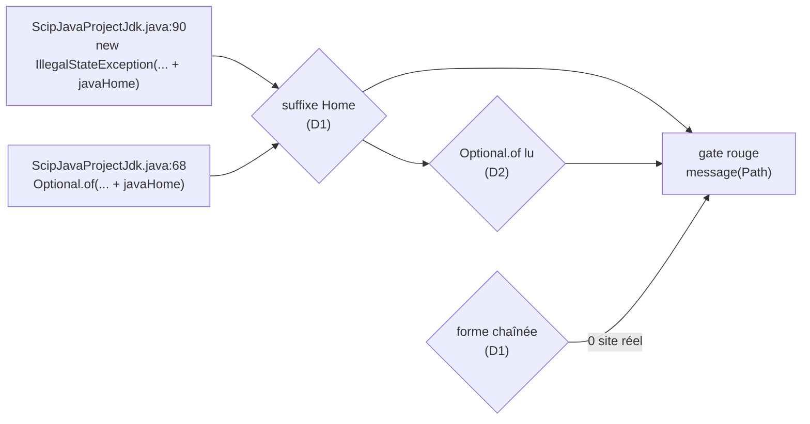
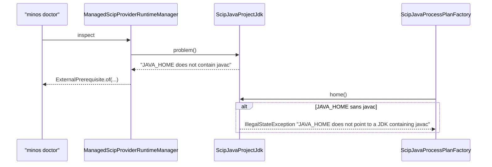

# Design

## Contexte

Motivation : voir `proposal.md` (Why). Deux composants changent : le gate Python
`scripts/architecture/check-private-io.py` (règle `message(Path)`) avec son auto-test
`scripts/architecture/test_check_private_io.py`, et la classe `ScipJavaProjectJdk` de `minos-provider-scip` avec
son test. Aucune autre classe Java ne change : les tests qui lisent ces messages ailleurs ne vérifient qu'un
préfixe, que la correction conserve (voir État vérifié). Windows et Linux : rien de propre à une plateforme.

## État vérifié au HEAD

Relu au HEAD `3cadc4ca` (branche `sec/garder-les-chemins-de-jdk-hors-des-messages`, partie de `develop`), le
2026-11-10. Les preuves de la spécification du propriétaire n'ont pas bougé.

| Fait | Preuve |
|---|---|
| [Existant vérifié] Le diagnostic rend la valeur de `JAVA_HOME` (preuve du propriétaire, inchangée) | `minos-provider-scip/src/main/java/com/minos/adapter/scip/runtime/plan/ScipJavaProjectJdk.java:68` |
| [Existant vérifié] Le refus de `home()` rend la valeur de `JAVA_HOME` (inchangée) | `ScipJavaProjectJdk.java:90` |
| [Existant vérifié] `javaHome` est une `String` locale (`String javaHome = processEnvironment.apply(JAVA_HOME)`), pas un `Path` | `ScipJavaProjectJdk.java:63`, `:84` |
| [Existant vérifié] Le JDK désigné par le réglage est déjà nommé par le réglage seul | `ScipJavaProjectJdk.java:61`, `:80` |
| [Existant vérifié] La classe n'a aucun journal | `ScipJavaProjectJdk.java:1-111` (aucun `Logger`) |
| [Existant vérifié] Suffixes reconnus : `Path|Root|Dir|Directory|File` (preuve du propriétaire, inchangée) | `scripts/architecture/check-private-io.py:142` ; `String` déclarée `:143`, accesseur `:144` |
| [Existant vérifié] La règle ne lit que les exceptions construites et les journaux par niveau | `check-private-io.py:357-363` |
| [Existant vérifié] Un appel sur un nom connu (`+ root.resolve(…)`) n'est pas un rendu | `check-private-io.py:277` (`(?!\s*[.(\w])`) |
| [Existant vérifié] Limites écrites dans la docstring | `check-private-io.py:343-347` |
| [Existant vérifié] Le diagnostic part vers `doctor` préfixé par `ExternalPrerequisite` | `ManagedScipProviderRuntimeManager.java:299`, `ExternalPrerequisite.java:15-16` |
| [Existant vérifié] Le diagnostic part vers la sonde WSL, qui remplace une action portant un chemin | `minos-bootstrap/.../LocalWslJarChecks.java:50`, `minos-runtime-local/.../wsl/WslJarProbeProtocol.java:107-110` |
| [Existant vérifié] Le test actuel fige le chemin dans le diagnostic | `ScipJavaProjectJdkTest.java:76-83` (`assertEquals("JAVA_HOME does not contain javac: " + notAJdk, …)`) |
| [Existant vérifié] Tests hors colonne qui lisent ces messages : préfixe seulement | `ManagedScipProviderRuntimeManagerToolchainTest.java:204` (`contains(...)`), `ScipJavaProcessPlanFactoryToolchainTest.java:93` (`startsWith(...)`) |
| [Existant vérifié] `WslJarProbeProtocolTest.java:35`, `WslLinuxWorkerTest.java:83` portent le texte ancien comme entrée simulée, pas comme attente du code de `ScipJavaProjectJdk` | lu au HEAD |
| [Existant vérifié] Aucun golden ni document ne cite le texte avec chemin | `git grep -n "does not contain javac\|JDK containing javac" -- . ':!*.java'` : seule `docs/user/troubleshooting.md:133`, qui cite les messages sans chemin |
| [Existant vérifié] Aucun gate littéral ne cite `ScipJavaProjectJdk` | `git grep -n ScipJavaProjectJdk -- scripts` : vide |
| [Existant vérifié] `git grep -n "+ javaHome" -- "*.java"` renvoie les deux sites | `ScipJavaProjectJdk.java:68`, `:90` |
| [Existant vérifié] Gate au HEAD : vert, inventaire `TOTAL 0 site(s)` | mesure ci-dessous (variante de référence) |

### Mesures sur copie du gate (sans écrire dans le dépôt)

Script de mesure hors dépôt (scratchpad de session) qui charge le texte de `check-private-io.py` en mémoire,
remplace la ligne 142, et appelle `check()` et `path_rule_sites()` sur l'arbre réel : **653 sources** (tous les
`src/main/java` du reactor et du plugin).

| Variante | Sites `message(Path)` | Violations | Détail |
|---|---|---|---|
| Référence (HEAD) | 0 | 0 | — |
| `+ Home` dans les suffixes | **1** | **1** | `ScipJavaProjectJdk.java:90` `new IllegalStateException`, exposition (a). Aucun autre site, aucun faux positif ; aucun site perdu |
| `+ Home` et expressions chaînées (`getParent`, `normalize`, `resolve`, `resolveSibling`, `getRoot` en chaîne sur un nom ou accesseur connu ; `+ Path.of(…)`, `+ Paths.get(…)`) | 1 (aucun de plus) | 1 | **0 site réel nouveau, 0 faux positif**. Confirmé par `git grep -nE "\+ *[A-Za-z_.]*\.(getParent\|normalize\|resolve)\(\|\+ *Path\.of\(\|\+ *Paths\.get\(" -- "minos-*/src/main/java/*.java"` : vide |
| `+ Home` et `Optional.of(…)`/`ofNullable(…)` lus comme message | 2 | 2 | **1 site de plus : `ScipJavaProjectJdk.java:68`**, le vrai positif ; 0 faux positif |

Fragments vérifiés avec l'expression chaînée prototype : refusés `+ root.getParent()`, `+ root.normalize()`,
`+ root.resolve("bin")`, `+ root.resolve("bin").normalize()`, `+ Path.of(javaHome)`,
`+ project.rootPath().getParent()` ; acceptés `+ root.resolve("bin").getFileName()`,
`+ leafName(root.resolve("bin"))`, `+ Path.of(a).getFileName()`.

Non mesuré : le build Maven et les tests Java (hors phase) ; la sortie réelle de `minos doctor`.

## Écarts

| Écart | Source A | Source B | Suite proposée |
|---|---|---|---|
| Le test fige le chemin que la règle des sorties interdit | `ScipJavaProjectJdkTest.java:80` | `.claude/rules/securite.md` § 7, AUD-SEC-04 | Le test est réécrit dans la tâche 2.1 (rouge) |
| Le suffixe `Home` seul ne ferme que `:90` ; `:68` reste invisible (message dans un `Optional`) | spécification du propriétaire (point 1) | critère de sortie « une mutation qui réintroduit `+ javaHome` rend le gate rouge » | D2 retenue : le gate lit `Optional.of(…)` ; la mutation de `:68` est prouvée par le gate et par le test Java |
| La règle `message(Path)` n'est écrite dans aucune spec de référence | `check-private-io.py:29-34`, `docs/developer/quality-gates.md:135` | `openspec/specs/` | Exigences ajoutées à `stockage-prive-et-secrets` (ce changement) ; la règle d'origine reste à spécifier ailleurs si le propriétaire le veut |
| La spécification propose un message en français | spécification du propriétaire (point 3) | `AGENTS.md` : les messages du code suivent la langue du module (anglais dans `minos-provider-scip`) | D3 : message anglais qui nomme le rôle |

## Exigences couvertes

| Exigence | Section |
|---|---|
| stockage-prive-et-secrets › Le gate des messages reconnaît un chemin nommé par le suffixe Home | D1, Traitements |
| stockage-prive-et-secrets › Le gate des messages reconnaît un chemin dérivé par un appel chaîné | D1, Traitements |
| stockage-prive-et-secrets › Le gate des messages lit un diagnostic préparé dans un Optional | D2 |
| installation-des-providers › Sans JDK de projet, le plan scip-java est refusé avant toute préparation | D3, D4 |
| installation-des-providers › Le diagnostic d'un JAVA_HOME sans javac ne contient pas son chemin | D3, D4 |

## Objectifs et non-objectifs

Objectifs : le gate voit les deux sites ; les deux messages n'ont plus de valeur ; la liste de tolérance reste
sans entrée `message(Path)`. Non-objectifs : typer le gate (il reste lexical), lever les autres limites de sa
docstring, toucher `PublicErrorMessages`.

## Responsabilités et frontières des composants

Aucune dépendance de module ne change (ARCH-0068) : `ScipJavaProjectJdk` reste dans `minos-provider-scip`
(adaptateur) et n'a pas besoin de `PublicErrorMessages` (`minos-domain`) puisque le message nomme le rôle. Le gate
est un script hors reactor.

## Modèle de domaine et invariants

Non applicable : aucun type ni état nouveau.

## Traitements et interactions

Gate, déroulé cible de `path_rule_sites(code)` :
1. noms de chemins : `Path x` / `File x`, `String x` dont le nom finit par un suffixe de `_PATH_LIKE_SUFFIX`
   (désormais avec `Home`), hors noms « relative » ;
2. sites lus : `new …Exception(`/`new …Error(`, journaux par niveau, et (D2) `Optional.of(`/`Optional.ofNullable(` ;
3. rendu : formes existantes de `_renders_path`, plus une forme chaînée — `+` suivi d'un nom connu (ou
   `this.nom`, ou accesseur de chemin) puis une ou plusieurs de `getParent()`, `normalize()`, `resolve(…)`,
   `resolveSibling(…)`, `getRoot()`, non suivie d'un autre `.` (sauf `.toString()`, qui rend encore le chemin),
   ou `+ Path.of(…)` / `+ Paths.get(…)` non suivi d'un `.`.

Un site `Optional.of` reçoit le libellé `Optional.of` et l'exposition (a) dans l'inventaire : un diagnostic peut
atteindre `doctor`.

## États et transitions

Non applicable : aucun cycle de vie.

## Contrats d'interface

- `ScipJavaProjectJdk.problem()` (API Java publique du module) : même type `Optional<String>`. Texte cible
  « JAVA_HOME does not contain javac » au lieu de « JAVA_HOME does not contain javac: <chemin> ». Additif au sens
  du contrat : aucune surface ne promet la valeur.
- `ScipJavaProjectJdk.home()` : même `IllegalStateException`, texte « JAVA_HOME does not point to a JDK containing
  javac » sans suffixe.
- `check-private-io.py` : mêmes arguments (`--inventory` ou rien), mêmes codes (0 / 1), même format de violation ;
  libellé de construct `Optional.of` ajouté à l'inventaire.

## Persistance et intégrité

Non applicable : rien n'est écrit.

## Transactions, concurrence et idempotence

Non applicable.

## Sécurité et isolation

Applique `.claude/rules/securite.md` § 7 (aucun chemin absolu dans une sortie publique). Fail-closed inchangé : le
refus reste un refus, seul son texte change. La valeur de `JAVA_HOME` reste lisible par l'utilisateur dans son
propre environnement ; le message lui dit quelle variable corriger.

## Erreurs et reprise

Erreur d'usage actionnable : le message nomme `JAVA_HOME` et `javac`, ce qui suffit à corriger. Aucun état n'est
laissé : le refus précède toute préparation (inchangé).

## Observabilité

`minos doctor` garde le diagnostic préfixé `machine prerequisite (not shipped by MINOS): `. Aucun journal ajouté
(D4).

## Performance et mesure

Non applicable : une alternative d'expression régulière de plus par site lu ; le gate tourne en quelques secondes.

## Compatibilité, migration et retour arrière

Les préfixes sont conservés, donc les tests hors colonne (`ManagedScipProviderRuntimeManagerToolchainTest.java:204`,
`ScipJavaProcessPlanFactoryToolchainTest.java:93`) restent verts sans modification. Retour arrière : revert du
commit ; aucune donnée.

## Diagrammes

### Quels messages le gate voit-il, avant et après ?

Type : flowchart · Portée : existant et cible · Exigences : stockage-prive-et-secrets › Le gate des messages reconnaît un chemin nommé par le suffixe Home ; › Le gate des messages lit un diagnostic préparé dans un Optional ; › Le gate des messages reconnaît un chemin dérivé par un appel chaîné

Au HEAD, aucune flèche n'atteint le rouge. Le suffixe `Home` fait voir `javaHome` ; il suffit pour `:90`. `:68`
n'est lu que si `Optional.of` devient un site (D2). Les formes chaînées ne trouvent aucun site réel : elles
ferment une voie de contournement.

### Où vont les deux messages corrigés ?

Type : sequenceDiagram · Portée : existant (texte cible) · Exigences : installation-des-providers › Sans JDK de projet, le plan scip-java est refusé avant toute préparation ; › Le diagnostic d'un JAVA_HOME sans javac ne contient pas son chemin

Le diagnostic atteint `doctor` (et la sonde WSL par `LocalWslJarChecks`) ; le refus atteint l'erreur
d'indexation. Aucun des deux ne porte plus la valeur.

## Décisions

### D1 — Ajouter `Home` et les formes chaînées à la règle `message(Path)`

[Décision] (spécification du propriétaire, points 1 et 2, et mesure). `Home` : 1 site, le vrai, 0 faux positif.
Formes chaînées : 0 site réel, 0 faux positif sur 653 sources ; la condition « sans faux positifs mesurés » est
remplie, elles sont donc couvertes plutôt que documentées comme invisibles. La docstring et `path_rule_sites` sont
mises à jour : la liste « still invisible » garde le message préparé dans une variable, le champ ou l'accesseur au
nom non reconnu, la `String` déclarée dans un autre fichier et la cause. Alternative écartée : documenter les
chaînes comme invisibles, alors qu'aucun coût mesuré ne le justifie.

### D2 — Lire `Optional.of(…)` comme un message

[Décision] (option A, retenue par le propriétaire le 10/11). Sans elle, `:68` reste invisible au gate et le critère de sortie
« une mutation qui réintroduit `+ javaHome` rend le gate rouge » ne tient que pour `:90`. Mesure : 1 site (le
vrai), 0 faux positif. Alternatives : (a) ne rien ajouter et prouver `:68` par le test Java seul, en écrivant
cette limite dans la docstring ; (b) lire aussi tout `return … + x;` d'une méthode qui retourne `String`
(non mesuré, faux positifs probables).

### D3 — Message anglais qui nomme le rôle, préfixe conservé

[Décision] (règle `AGENTS.md` : messages du code dans la langue du module ; confirmée par le propriétaire le
10/11). Textes cibles « JAVA_HOME does not
contain javac » et « JAVA_HOME does not point to a JDK containing javac ». Le français proposé par la spécification
mélangerait deux langues dans un fichier anglais. `leafName` écarté : le nom de feuille d'un JDK (`jdk-21`) n'aide
pas, et `leafName(Path)` exigerait un `Path.of` qui peut lever `InvalidPathException` sur une valeur invalide.

### D4 — Pas de journal DEBUG de la valeur

[Décision] (confirmée par le propriétaire le 10/11). La classe n'a pas de journal ; la valeur est dans l'environnement de l'utilisateur, qui la lit
lui-même. Ajouter un journal pour elle ajouterait une sortie sans diagnostic nouveau.

## Qualification des capacités

- `stockage-prive-et-secrets` (gate) : qualifiée après les tâches 1.x, preuve par l'auto-test et le gate sur le
  dépôt réel ; limite lexicale écrite dans la docstring.
- `installation-des-providers` (messages) : qualifiée après la tâche 2.x, preuve par `ScipJavaProjectJdkTest` ; le
  passage par `doctor` est couvert par le test hors colonne existant (préfixe), pas par une assertion d'absence.
- Windows et Linux : identique ; les tests construisent leur JDK factice (`javac` / `javac.exe`).

## Risques et compromis

- [Risque] Un futur nom `…Home` qui ne porte pas de chemin → refus ; atténuation : renommer ou entrée nominative
  justifiée (aucun cas au HEAD).
- [Risque] `Optional.of` lu comme message refuse un `Optional<String>` légitime qui concatène un nom de chemin
  relatif → la règle « relative » s'applique déjà ; entrée nominative sinon (aucun cas au HEAD).
- [Risque] Ordre rouge → correction : ajouter `Home` rend le gate du dépôt rouge tant que `:90` n'est pas corrigé.
  Les tâches 1 et 2 sont livrées dans la même PR ; le rouge est prouvé sur le dépôt réel avant la correction.

## Vérification

- `python -I scripts/architecture/check-private-io.py` (rouge après 1.2 : 1 violation, `message(Path)` aux lignes 68 et 90 ;
  vert après 2.2) et `--inventory` (`TOTAL 0 site(s)` à la fin).
- `python -I scripts/architecture/test_check_private_io.py` (fixtures et témoin du site réel).
- `./mvnw -B -ntp -pl minos-provider-scip -am test` (`ScipJavaProjectJdkTest`,
  `ManagedScipProviderRuntimeManagerToolchainTest`, `ScipJavaProcessPlanFactoryToolchainTest`).
- `python -I scripts/quality/check-comment-language.py`, `python .claude/scripts/run_gates.py --fast`.
- `git grep -n "+ javaHome" -- "*.java"` : vide.
- Non vérifiable localement de façon fiable : SonarCloud (couverture du nouveau code, Linux seul).

## Documentation durable à mettre à jour

- `docs/developer/quality-gates.md:135` : suffixes reconnus, formes chaînées, `Optional.of` (tâche 3.1, même PR).
- À l'archivage : `docs/architecture/diagrams/capacites/stockage-prive-et-secrets.md` (trois lignes de
  traçabilité, exigences ajoutées) et `docs/architecture/diagrams/capacites/installation-des-providers.md` (une
  ligne, exigence ajoutée, et la preuve `ScipJavaProjectJdkTest` sur la ligne existante), exigées par
  `check-capability-dossiers.py` après archivage (tâche 4.2).

### Texte proposé pour les fichiers partagés

`docs/project/audits/2026-10-10/SUIVI.md`, à ajouter à la fin de la colonne « Statut » de la ligne `AUD-SEC-04`
(ligne 505 au HEAD), avant la colonne suivante :

> **Réserve levée** (branche `sec/garder-les-chemins-de-jdk-hors-des-messages`, PR #<n>, <date>) : la règle
> `message(Path)` reconnaît le suffixe `Home`, les chemins dérivés par `getParent()`, `normalize()`,
> `resolve(…)`, `resolveSibling(…)`, `Path.of(…)`, et lit les diagnostics préparés dans `Optional.of(…)`. Rouge
> sur le dépôt réel : **2 sites, tous exposés (a)**, `ScipJavaProjectJdk.java:68` et `:90` (valeur de
> `JAVA_HOME`) ; formes chaînées : 0 site réel, 0 faux positif sur 653 sources. Les deux messages nomment
> `JAVA_HOME` sans sa valeur ; **0 site après**, aucune entrée de liste. Preuve :
> `python -I scripts/architecture/check-private-io.py && python -I scripts/architecture/test_check_private_io.py`,
> `ScipJavaProjectJdkTest` ; une mutation qui remet `+ javaHome` rend le gate rouge ;
> `git grep -n "+ javaHome" -- "*.java"` vide.

`docs/architecture/risks/register.md` : aucun texte (le changement ne touche à aucun risque, R-28 compris).
`docs/developer/supply-chain.md` : aucun texte.

## Traçabilité

| Exigence (capacité › titre) | Scénario | Conception ou diagramme | Tâche | Test ou preuve |
|---|---|---|---|---|
| stockage-prive-et-secrets › Le gate des messages reconnaît un chemin nommé par le suffixe Home | Valeur de JAVA_HOME concaténée dans une exception | D1, diagramme 1 | 1.1, 1.2 | `test_check_private_io.py#test_a_home_a_derived_path_or_a_diagnostic_in_an_optional_fails` ; gate sur le dépôt réel (rouge `:90`, vert après 2.2) |
| idem | Rôle nommé ou nom de feuille | D1 | 1.1, 1.2 | `test_check_private_io.py#test_a_home_named_by_its_role_or_a_path_not_rendered_passes` |
| idem | Mutation du site réel corrigé | D1 | 2.3 | `test_check_private_io.py#test_the_two_real_project_jdk_messages_reverted_to_the_java_home_value_are_caught` |
| idem | Entrée de liste périmée | D1 | 1.1, 1.2 | `test_check_private_io.py#test_a_home_site_takes_a_justified_entry_and_a_stale_entry_is_refused` |
| stockage-prive-et-secrets › Le gate des messages reconnaît un chemin dérivé par un appel chaîné | Parent ou résolution d'un chemin connu | D1 | 1.1, 1.2 | `test_check_private_io.py#test_a_home_a_derived_path_or_a_diagnostic_in_an_optional_fails` |
| idem | Chemin construit dans le message | D1 | 1.1, 1.2 | `test_check_private_io.py#test_a_home_a_derived_path_or_a_diagnostic_in_an_optional_fails` |
| idem | Appel final qui ne rend pas le chemin | D1 | 1.1, 1.2 | `test_check_private_io.py#test_a_home_named_by_its_role_or_a_path_not_rendered_passes` |
| stockage-prive-et-secrets › Le gate des messages lit un diagnostic préparé dans un Optional | Diagnostic qui concatène un chemin | D2 | 1.1, 1.2 | `test_check_private_io.py#test_a_home_a_derived_path_or_a_diagnostic_in_an_optional_fails`, `test_check_private_io.py#test_the_inventory_lists_a_diagnostic_in_an_optional_as_public` ; gate sur le dépôt réel (rouge `:68`) |
| idem | Chemin transporté sans être rendu | D2 | 1.1, 1.2 | `test_check_private_io.py#test_a_home_named_by_its_role_or_a_path_not_rendered_passes` |
| installation-des-providers › Sans JDK de projet, le plan scip-java est refusé avant toute préparation | Variable non posée | inchangé | — | `ScipJavaProjectJdkTest#neitherTheSettingNorJavaHomeIsRefusedByNamingTheSettingWithoutAnyPath` (existant) |
| idem | Dossier sans compilateur | D3, diagramme 2 | 2.1, 2.2 | `ScipJavaProjectJdkTest#theRefusalOfAJavaHomeWithoutJavacNamesTheVariableWithoutItsPath` ; `ScipJavaProcessPlanFactoryToolchainTest#aJavaHomeWithoutJavacIsRefusedBeforeAnythingIsStaged` (existant, préfixe) |
| installation-des-providers › Le diagnostic d'un JAVA_HOME sans javac ne contient pas son chemin | Diagnostic du JDK de projet | D3, diagramme 2 | 2.1, 2.2 | `ScipJavaProjectJdkTest#theDiagnosticOfAJavaHomeWithoutJavacNamesTheVariableWithoutItsPath` |
| idem | Diagnostic du runtime scip-java | D3, diagramme 2 | 2.2 | `ManagedScipProviderRuntimeManagerToolchainTest#aJavaHomeWithoutJavacIsReportedAsAMachinePrerequisite` (existant, inchangé ; `contains` du texte préfixé, l'absence de tout ajout n'est pas assertée) |

## Décisions du propriétaire

Tranchées le 10/11 :

1. **D2, lecture de `Optional.of(…)`** : option A retenue ; l'exigence « Le gate des messages lit un diagnostic
   préparé dans un Optional » reste.
2. **Documents hors colonne** : `docs/developer/quality-gates.md` entre dans la colonne (tâche 3.1, même PR que la
   règle) ; les dossiers de capacité sont mis à jour à l'archivage (tâche 4.2).
3. **Langue du message** : anglais (D3), sans journal DEBUG (D4).
