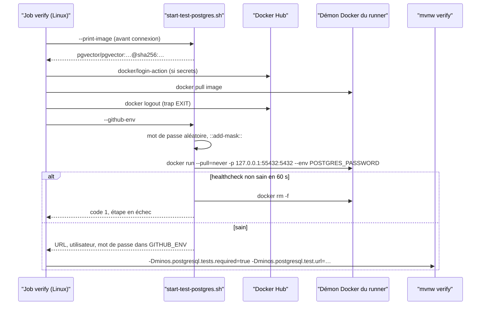
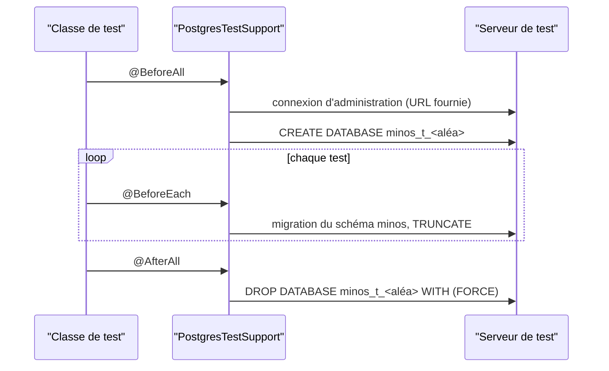
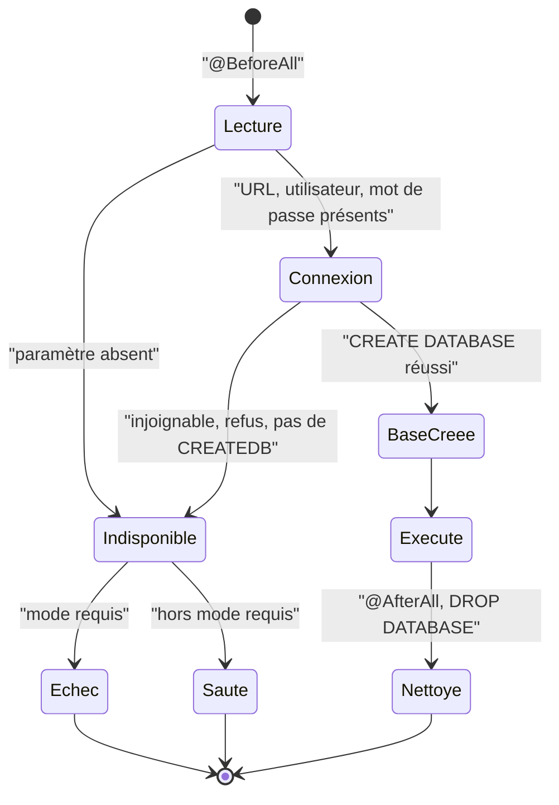

# Design

## Contexte

Motivation : voir `proposal.md` (Why). Le changement est d'outillage de test et de CI : aucune classe de production,
aucune surface publique. Il touche les tests de `minos-storage` (`com.minos.storage.postgresql`), trois POM (racine,
`minos-storage`, `minos-bootstrap`), deux workflows (`pr-ci.yml`, `code-audit.yml`) et les commentaires de deux autres
(`docker-upgrade-qualification.yml`, `release-promotion-gate.yml`), trois gates (`check-image-pins.py`,
`check-workflow-pins.py`, `scripts/docs/check-current-docs.py`) et leurs auto-tests, `.github/dependabot.yml`, et
ajoute un script local en deux variantes (`scripts/dev/`) avec son auto-test câblé dans le job `invariants`.
Colonne arrêtée par le propriétaire le 2026-11-10 (questions ouvertes tranchées, voir « Décisions »).
Plateformes : Linux exécute les tests PostgreSQL ; Windows les saute, en CI comme sur un poste sans serveur.

## État vérifié au HEAD

Relu au commit `3cadc4ca` (`develop`, branche `test/tester-postgresql-sans-testcontainers`). Aucun build Maven
lancé (consigne) ; les comptes viennent de `grep`.

| Fait | Preuve |
|---|---|
| Version Testcontainers 2.0.5 et BOM importé par le POM racine | `pom.xml:62`, `pom.xml:169-171` ; commentaire du profil `pom.xml:462` |
| `minos-storage` déclare `testcontainers`, `testcontainers-junit-jupiter`, `testcontainers-postgresql` (test) | `minos-storage/pom.xml:53-67` |
| `minos-storage` porte le profil Windows `windows-docker-desktop-testcontainers` (`DOCKER_HOST`, `TESTCONTAINERS_DOCKER_SOCKET_OVERRIDE`, `api.version`) | `minos-storage/pom.xml:118-154` |
| `minos-bootstrap` déclare les trois mêmes artefacts et le même profil, **sans aucun test qui les utilise** | `minos-bootstrap/pom.xml:75-89`, `:124-145` ; `grep -rln "PostgresTestSupport\|org.testcontainers" minos-bootstrap/src` : aucun résultat |
| Seuls trois fichiers importent `org.testcontainers` : `PostgresTestSupport`, `PrePulledImagesOnlyPullPolicy`, `PrePulledImagesOnlyPullPolicyTest` | `grep -rl "org.testcontainers" --include=*.java .` (plus la chaîne `"org/testcontainers/"` de `minos-app/src/test/java/com/minos/packaging/ShadedJarCompositionRootIT.java:48`, garde d'absence dans le jar livré, pas un usage) |
| **38** fichiers Java citent `PostgresTestSupport` : **33** classes l'étendent, toutes dans `minos-storage` ; les 5 autres sont la classe elle-même, `PrePulledImagesOnlyPullPolicy`(+`Test`), `PostgresTestPools` (commentaire) et `ShadedJarCompositionRootIT` (garde) | `grep -rl "extends PostgresTestSupport"` → 33, `comm` des deux listes |
| `PostgresTestSupport` démarre un `PostgreSQLContainer` dans un `@BeforeAll` statique, base `minos_test`, utilisateur `minos`, mot de passe figé `test-secret` | `minos-storage/src/test/java/com/minos/storage/postgresql/PostgresTestSupport.java:46-68` (mot de passe `:54`) |
| Mode requis : `Boolean.getBoolean(REQUIRED_PROPERTY)` lève `IllegalStateException` ; sinon `assumeTrue(dockerAvailable, …)` saute | `PostgresTestSupport.java:40,61-66,101-107` |
| Isolation actuelle : un conteneur partagé par classe (redémarré à chaque `@BeforeAll`), schéma `minos`, `TRUNCATE` avant chaque test | `PostgresTestSupport.java:101-111,194-209` |
| L'image est lue dans sa source unique, le défaut de `MINOS_POSTGRES_IMAGE` | `PostgresTestSupport.java:75-90` ; `docker/compose-mcp.connected.yaml:285` (`pgvector/pgvector:0.8.7-pg17@sha256:7d0a…`) |
| `PostgresTestPools` recopie le mot de passe `test-secret` | `minos-storage/src/test/java/com/minos/storage/postgresql/support/PostgresTestPools.java:24-25,33,47` |
| `PostgresSchemaMigratorTest` crée des bases dédiées par `createFreshDatabase` | `PostgresTestSupport.java:151-159` ; seul appelant hors classe : `support/PostgresSchemaMigratorTest.java` |
| `pr-ci.yml` `verify` est une **matrice** Ubuntu + Windows ; `env:` du job : `TESTCONTAINERS_PULL_POLICY`, `TESTCONTAINERS_RYUK_DISABLED` | `.github/workflows/pr-ci.yml:275-287` |
| Étapes Linux : liste (`check-image-pins.py --testcontainers-images`), connexion Docker Hub, tirage puis `docker logout` | `pr-ci.yml:296-330` |
| Le `verify` Linux passe `-Dminos.postgresql.tests.required=true` ; Windows ne le passe pas | `pr-ci.yml:394-399`, `:418-421` |
| Le scope JaCoCo `m30-postgresql-pgvector` est sauté côté Windows | `pr-ci.yml:450-452` ; scope `scripts/quality/check-jacoco.py:259-267` |
| `code-audit.yml` `mutation` : mêmes variables et mêmes trois étapes, module choisi par l'entrée `mutation_module` | `.github/workflows/code-audit.yml:116-162`, `:176-195` |
| `check-image-pins.py` : option `--testcontainers-images`, table `TESTCONTAINERS_IMAGE_VARIABLES`, fonction `testcontainers_images` | `scripts/quality/check-image-pins.py:28-33,61-63,227-260` |
| `check-image-pins.py` refuse qu'une image de service géré soit écrite hors de `docker/compose*.yaml` (scripts, workflows, sources) | `scripts/quality/check-image-pins.py:11-13,169-170` |
| `check-workflow-pins.py` : `DOCKER_LOGIN_KEPT` ne contient que `docker-upgrade-qualification.yml/real-docker-upgrade` et `release-promotion-gate.yml/docker-upgrade-qualification` | `scripts/quality/check-workflow-pins.py:128-133` |
| `check-workflow-pins.py` : règle `TESTCONTAINERS_PREPULL` / `TESTCONTAINERS_GUARD_ENV` / `TESTCONTAINERS_GUARD_CLASS` | `scripts/quality/check-workflow-pins.py:14-21,136-147,309` ; auto-test `scripts/quality/test_check_workflow_pins.py` |
| `check-current-docs.py` affirme des littéraux de `PostgresTestSupport` et du profil Windows | `scripts/docs/check-current-docs.py:19,146-155,189-190` |
| Dependabot groupe `org.testcontainers:*` | `.github/dependabot.yml:14-17` |
| Le scénario « Profils existants » de `frontieres-de-modules` nomme `windows-docker-desktop-testcontainers` | `openspec/specs/frontieres-de-modules/spec.md:53-55` |
| Aucun `forkCount` ni `parallel` Surefire déclaré : les classes s'exécutent l'une après l'autre dans un seul fork | `grep -n "forkCount\|parallel" pom.xml minos-storage/pom.xml` : aucun résultat |
| Docker Hub : `release-promotion-gate.yml` et `docker-upgrade-qualification.yml` citent Testcontainers dans un commentaire | `.github/workflows/docker-upgrade-qualification.yml:46`, `release-promotion-gate.yml:54` |

Non mesuré : `dependency:tree` et le rapport `-Paudit-dependency-check-tests` (pas de build Maven pendant la
spécification) ; le comportement de PIT vis-à-vis des propriétés système (voir D3).

## Écarts

| Écart | Source A | Source B | Suite proposée |
|---|---|---|---|
| Testcontainers est aussi déclaré par deux POM de module, hors de la colonne annoncée (`pom.xml` seul) | demande (colonne) | `minos-storage/pom.xml:53-67`, `minos-bootstrap/pom.xml:75-89` | ajouter les deux POM à la colonne du changement (tâches 2.3) |
| La décision « conteneur de service `services:` » ne tient pas avec « mot de passe généré par le job » ni avec la source unique de l'image | décision du propriétaire | `check-image-pins.py:169` ; `services:` évalué avant les étapes | D2 : étape `docker run` ; décision à confirmer |
| La décision « propriétés système » expose le mot de passe dans la ligne de commande de Maven | décision du propriétaire | argv visible des processus du runner | D3 : repli sur une variable d'environnement ; à confirmer |
| `minos-bootstrap` déclare Testcontainers et le test-jar de `minos-storage` « pour des tests PostgreSQL » qui n'existent pas | commentaire `minos-bootstrap/pom.xml:64-67` | aucun test PostgreSQL sous `minos-bootstrap/src/test` | retirer les dépendances Testcontainers ; le test-jar reste (autres usages non vérifiés, hors périmètre) |
| Le scénario « Store PostgreSQL, sous Linux seulement » présume Docker démarré par les tests | `openspec/specs/persistance-snapshots/spec.md:311-314` | cible | MODIFIED dans le delta |

## Exigences couvertes

| Exigence | Section |
|---|---|
| persistance-snapshots › Les tests PostgreSQL utilisent un serveur fourni de l'extérieur | D1, Contrats d'interface |
| persistance-snapshots › Un serveur absent ou injoignable fait échouer les tests en mode requis | D1, États et transitions, Erreurs |
| persistance-snapshots › Sans mode requis, l'absence de serveur saute les tests et les compte | D1, États et transitions |
| persistance-snapshots › Chaque classe de test PostgreSQL travaille dans sa propre base | D4 |
| persistance-snapshots › Le mot de passe du serveur de test de la CI est généré par le job | D2, D3, Sécurité |
| persistance-snapshots › Le script local démarre le conteneur de test épinglé | D5 |
| persistance-snapshots › L'arbre de dépendances ne contient ni Testcontainers ni docker-java | D6 |
| persistance-snapshots › Les résultats des requêtes sont inchangés | D1, D5 |
| frontieres-de-modules › Les règles de mise en page de build valent aussi dans un profil | D6 |

## Objectifs et non-objectifs

Objectif : supprimer Testcontainers et docker-java de l'arbre sans perdre le mode requis ni la parité des
décomptes. Non-objectif : exécuter PostgreSQL sous Windows en CI, changer le code de production ou le schéma.

## Responsabilités et frontières des composants

- `PostgresTestSupport` (test, `minos-storage`) : lit les paramètres, vérifie la connexion, crée et supprime la base de
  la classe, applique le mode requis. Ne connaît plus Docker.
- `scripts/dev/start-test-postgres.(sh|ps1)` : seul code qui démarre le conteneur, en local et en CI.
- Workflow : génère le mot de passe, tire l'image (connecté à Docker Hub), se déconnecte, puis appelle le script.
Aucune dépendance Maven ajoutée ; la direction ARCH-0068 est inchangée (`minos-storage` reste un adaptateur, ses tests
ne dépendent que du pilote JDBC déjà présent).

## Modèle de domaine et invariants

Non applicable : aucun type de domaine. Invariants du harnais : (I1) aucune classe ne lit une base créée par une autre ;
(I2) une base créée par une classe est supprimée à la fin de cette classe, succès ou échec ; (I3) le mot de passe
n'apparaît dans aucun message d'exception ni journal du harnais.

## Traitements et interactions

Voir les diagrammes « Comment le job Linux obtient-il son serveur ? » et « Que fait une classe de test ? ».

## États et transitions

Voir le diagramme « Quand une classe PostgreSQL échoue-t-elle, se saute-t-elle ou s'exécute-t-elle ? ».

## Contrats d'interface

Contrat de test (non public, non versionné) :

| Paramètre | Source, par ordre | Requis | Exemple |
|---|---|---|---|
| URL JDBC d'administration | `-Dminos.postgresql.test.url`, sinon variable `MINOS_TEST_POSTGRES_URL` (D3) | oui | `jdbc:postgresql://127.0.0.1:55432/postgres` |
| Utilisateur (droit `CREATEDB`) | `-Dminos.postgresql.test.user`, sinon variable `MINOS_TEST_POSTGRES_USER` (D3) | oui | `minos` |
| Mot de passe | `-Dminos.postgresql.test.password`, sinon variable `MINOS_TEST_POSTGRES_PASSWORD` (D3) | oui | généré |
| Mode requis | `-Dminos.postgresql.tests.required=true` | non | inchangé |

Les noms de propriétés de la classe sont des constantes ; `REQUIRED_PROPERTY` et le littéral
`Boolean.getBoolean(REQUIRED_PROPERTY)` restent (gate `check-current-docs.py:154`).

Script local, deux variantes de même contrat :

| Option | Effet |
|---|---|
| (aucune) | démarre `minos-test-postgres` sur `127.0.0.1:55432`, attend le healthcheck (60 s au plus), affiche les trois `-D` et la commande `mvnw` |
| `--port <n>` / `-Port <n>` | autre port local |
| `--print-image` / `-PrintImage` | affiche l'image épinglée lue dans la compose et sort (utilisé par la CI avant la connexion) |
| `--github-env` (sh seulement) | n'affiche pas le mot de passe : écrit `::add-mask::`, puis `MINOS_TEST_POSTGRES_URL`, `MINOS_TEST_POSTGRES_USER` et `MINOS_TEST_POSTGRES_PASSWORD` dans `$GITHUB_ENV` |
| `--stop` / `-Stop` | supprime le conteneur |

Codes : 0 succès ; 1 image absente ou non épinglée, Docker absent, healthcheck non sain dans le délai (le conteneur
est alors supprimé). Le mot de passe local est généré aussi (affiché une fois, puisque le développeur doit le passer à
`mvnw`) ; il n'est jamais passé en argument de `docker` (`--env POSTGRES_PASSWORD` sans valeur, hérité de
l'environnement du script). Le `.ps1` reste compatible Windows PowerShell 5.1 (pas de `&&`, `$LASTEXITCODE` testé).

## Persistance et intégrité

Non applicable : aucune donnée persistée par le produit ne change ; les bases de test sont éphémères.

## Transactions, concurrence et idempotence

Les classes s'exécutent en série dans un fork (état vérifié). La base de la classe porte un nom unique
(`minos_t_` + 12 caractères hexadécimaux aléatoires) : deux builds simultanés contre le même serveur ne se
gênent pas. Suppression par `DROP DATABASE … WITH (FORCE)` (PostgreSQL ≥ 13 ; l'image est en 17) dans le `@AfterAll`,
qui coupe les connexions de pool restées ouvertes. Si un parallélisme Surefire est introduit plus tard, l'état statique
de la classe de base devra devenir un état par classe (question non bloquante).

## Sécurité et isolation

- Mot de passe : généré par `openssl rand -hex 24` (sh) ou `RandomNumberGenerator` (.ps1), masqué par `::add-mask::`
  avant toute écriture dans `$GITHUB_ENV` ; jamais dans un argument de `docker` ni de `mvnw` (D3) ; disparition du
  littéral `test-secret` (scénario `grep`).
- Le port n'est lié qu'à `127.0.0.1`.
- Docker Hub : le jeton n'est présent que pendant l'étape de tirage, qui n'exécute aucun code du dépôt
  (`REPOSITORY_CODE` de `check-workflow-pins.py:141`) ; le script est lancé **avant** la connexion (`--print-image`)
  et **après** la déconnexion (démarrage, `docker run --pull=never`).
- Les messages d'échec du harnais nomment la propriété ou l'état SQL, jamais le mot de passe ni l'URL complète avec
  identifiants.

## Erreurs et reprise

Mode requis : `IllegalStateException` dans le `@BeforeAll`, message « PostgreSQL integration tests are required but
… » suivi de la cause nommée (propriété absente, serveur injoignable, authentification refusée, `CREATEDB` refusé).
Hors mode requis : `assumeTrue(false, raison)` dans le `@BeforeEach`. Une base non supprimée (JVM tuée) se reconnaît
à son préfixe ; `--stop` du script supprime le conteneur entier.

## Observabilité

Surefire compte réussis, échecs et sautés ; la raison du saut nomme la propriété. Le script affiche l'image, le port
et l'état du healthcheck sur stderr ; seules les propriétés vont sur stdout.

## Performance et mesure

Un `CREATE DATABASE` par classe (33 classes) remplace un démarrage de conteneur par classe ; gain attendu, non chiffré.
Mesure : durée de l'étape `Maven clean verify (Unix, PostgreSQL required)` avant et après, sur deux runs. Aucun seuil.

## Compatibilité, migration et retour arrière

Pour un développeur : `mvnw test` sans serveur continue de passer (tests sautés) ; avec Docker, il lance d'abord le
script. Retour arrière : revert du changement (Testcontainers revient avec R-27).

## Diagrammes

### Comment le job Linux obtient-il son serveur ?

Type : sequenceDiagram · Portée : cible · Exigences : persistance-snapshots › Le mot de passe du serveur de test de la CI est généré par le job ; › Les tests PostgreSQL utilisent un serveur fourni de l'extérieur

Le jeton Docker Hub n'est jamais présent pendant l'exécution du script ni de Maven. Windows n'exécute aucune de ces étapes.

### Que fait une classe de test ?

Type : sequenceDiagram · Portée : cible · Exigences : persistance-snapshots › Chaque classe de test PostgreSQL travaille dans sa propre base

`createFreshDatabase` et `createFactoryForDatabase` restent disponibles pour `PostgresSchemaMigratorTest`, sur le même
serveur.

### Quand une classe PostgreSQL échoue-t-elle, se saute-t-elle ou s'exécute-t-elle ?

Type : stateDiagram-v2 · Portée : cible · Exigences : persistance-snapshots › Un serveur absent ou injoignable fait échouer les tests en mode requis ; › Sans mode requis, l'absence de serveur saute les tests et les compte

## Décisions

### D1 — Serveur fourni de l'extérieur, paramètres en propriétés système

[Décision] (propriétaire). Les trois paramètres de « Contrats d'interface ». Alternative écartée : garder un démarrage
par la JVM de test (c'est ce qui tire docker-java).

### D2 — Le conteneur de CI démarre par une étape `docker run`, pas par `services:`

[Décision] (propriétaire, 2026-11-10, sur cette proposition). L'étape appelle `scripts/dev/start-test-postgres.sh` :
image épinglée lue dans la compose et tirée avant `docker logout`, mot de passe généré et masqué (`::add-mask::`) puis
transmis par `$GITHUB_ENV`, conteneur lié à `127.0.0.1` avec healthcheck, mot de passe jamais dans les arguments de
`docker` ni de `mvnw`. Raisons, vérifiées :
1. `services:` est évalué avant toute étape : son `env.POSTGRES_PASSWORD` ne peut venir que d'un secret ou d'une
   expression ; GitHub n'offre aucune fonction aléatoire, et `github.run_id` est public. Un secret n'est pas « généré
   par le job » et il est vide sur une PR de fork et sur une PR Dependabot (secrets Dependabot distincts) : le
   conteneur `postgres` refuse alors de démarrer et le `verify` Linux tombe.
2. `services.<id>.image` doit écrire l'image en clair dans le workflow : seconde source refusée par
   `check-image-pins.py:169`. Une expression ne peut pas lire la compose.
3. `verify` est une matrice avec Windows, où les conteneurs de service ne sont pas pris en charge.
4. Le tirage d'un service a lieu avant les étapes, donc hors du couple connexion/déconnexion Docker Hub qu'impose
   AUD-DEP-13 (il faudrait `credentials:`, sans déconnexion possible).
Variante écartée : `services:` avec `POSTGRES_PASSWORD: ${{ secrets.MINOS_TEST_POSTGRES_PASSWORD }}` (secret créé à
la main), image écrite dans le workflow, job Linux séparé de la matrice ; elle ne tient pas « mot de passe généré ».

### D3 — Paramètres : propriété système, avec repli sur une variable d'environnement

[Décision] (propriétaire, 2026-11-10) pour le mot de passe : propriété `minos.postgresql.test.password`, sinon variable
`MINOS_TEST_POSTGRES_PASSWORD` ; la CI passe par la variable. Un `-D…password=…` sur la ligne de `mvnw` serait visible
dans la liste des processus du runner. Adaptation vérifiée au HEAD pour PIT : `pitest-maven` ne transmet à ses JVM
« minion » que ses `jvmArgs` (`pom.xml:355-362`), pas les propriétés utilisateur de Maven ; ces JVM héritent en revanche
de l'environnement du processus Maven. URL et utilisateur ont donc le même repli (`MINOS_TEST_POSTGRES_URL`,
`MINOS_TEST_POSTGRES_USER`) : le job `mutation` ne passe que par l'environnement, le job `verify` passe en plus URL et
utilisateur en `-D`. La propriété reste prioritaire pour un usage local. Preuve sur runner : tâche 4.5.

### D4 — Une base par classe

[Décision] (propriétaire) ; forme : base plutôt que schéma, parce que `CREATE EXTENSION vector` est par base et que
`PostgresSchemaMigratorTest` exerce justement l'amorçage de la base. Alternative écartée : un schéma par classe
(l'extension et les verrous consultatifs, par base, resteraient partagés).

### D5 — Script local en `scripts/dev/`, réutilisé par la CI

[Décision] (propriétaire pour le chemin et pour la réutilisation par la CI, 2026-11-10 : une seule façon de démarrer
le conteneur). L'image est lue dans la compose par le script (source unique) ; `--print-image` remplace
`check-image-pins.py --testcontainers-images`.

### D6 — Nettoyage

[Décision] (propriétaire). Retraits listés dans `proposal.md` ; s'y ajoutent, vérifiés au HEAD : les profils
`windows-docker-desktop-testcontainers` des deux POM de module (inutiles sans Testcontainers ; littéral de
`check-current-docs.py:148` à retirer ; scénario de `frontieres-de-modules` réécrit), le mot de passe figé de
`PostgresTestPools`. L'étape Docker Hub reste (l'image pgvector vient de Docker Hub), renommée ; `DOCKER_LOGIN_KEPT`
inchangé. La garde `"org/testcontainers/"` de `ShadedJarCompositionRootIT` reste (elle prouve une absence, sans coût).

## Qualification des capacités

- persistance-snapshots (tests PostgreSQL) : **qualifiée sous Linux** (CI en mode requis) ; **non exécutée sous
  Windows** en CI (sautée, comptée ; scope JaCoCo exclu) — inchangé. En local Windows, qualifiable avec Docker Desktop
  et le `.ps1` (preuve manuelle).

## Risques et compromis

- [Risque] base laissée par une JVM tuée → préfixe reconnaissable, conteneur jetable (`--stop`).
- [Risque] Dependabot ne surveille plus rien côté Testcontainers → c'est voulu ; l'image pgvector reste suivie via la
  compose.
- [Risque] PIT sur `minos-storage` sans serveur → le job `mutation` démarre toujours le conteneur (coût faible).
- [Risque] Écart D2/D3 refusé par le propriétaire → variante décrite, tâches 4.x à réécrire.

## Vérification

- Java : `PostgresTestSupportContractTest` (nouveau, `minos-storage`, sans serveur : propriété absente → saut ou
  échec selon le mode ; message sans mot de passe) ; les 33 classes existantes contre le serveur du script.
- Gates : `check-image-pins.py` + `test_check_image_pins.py`, `check-workflow-pins.py` + `test_check_workflow_pins.py`,
  `check-ci-wiring.py`, `check-single-execution.py`, `scripts/docs/check-current-docs.py`,
  `check-module-boundaries.py`, `check-jacoco.py` (scope `m30-postgresql-pgvector`), `python .claude/scripts/run_gates.py`.
- Script : auto-test `scripts/dev/test_start_test_postgres.py` (docker simulé ; câblé dans `invariants`).
- Commandes : `./mvnw -B -ntp -pl minos-storage -am verify` contre le conteneur du script ; `./mvnw -B -ntp dependency:tree`.
- Non vérifiable localement : le job CI lui-même (tâche manuelle) ; Dependency-Check si la base NVD n'est pas à jour
  sur le poste (clé NVD) → tâche CI manuelle.

## Documentation durable à mettre à jour

`docs/developer/testing.md` (section « Tests PostgreSQL » : script, propriétés, mode requis) ;
`docs/developer/quality-gates.md:13,159` ; `docs/architecture/diagrams/capacites/persistance-snapshots.md:215-216`
et `recherche-semantique.md:103` ; arc42 `02-contraintes.md:4,20`, `04-strategie-solution.md:61`,
`07-vue-deploiement.md:4,15`, `08-concepts-transverses.md:126`, `12-glossaire.md:40` ;
`docs/developer/quality/code-audit-couverture.md:49,364-366` ; `docs/project/governance/ROADMAP.md:156` (par
l'orchestrateur, via `minos-doc-sync`). Fichiers partagés : texte ci-dessous.

### Texte proposé pour les fichiers partagés

**`docs/architecture/risks/register.md`** — retirer la ligne R-27 du tableau des risques ouverts et ajouter au tableau
« Risques résolus / reclassés récemment » :

> | R-27 | Quatre CVE de `httpclient5` 5.5.1 / `httpcore5` 5.3.6 recopiés dans `docker-java-transport-zerodep` 3.7.1 (Testcontainers 2.0.5, AUD-DEP-14) | Résolu le <date> par `tester-postgresql-sans-testcontainers` (PR #<n>) : Testcontainers et docker-java retirés ; les tests PostgreSQL se connectent à un conteneur démarré par le job CI ou par `scripts/dev/start-test-postgres.(sh\|ps1)`. Preuve : `./mvnw -B -ntp dependency:tree` sans `org.testcontainers` ni `com.github.docker-java` ; rapport `-Paudit-dependency-check-tests` du <date> sans les quatre CVE. |

**`docs/developer/supply-chain.md`** (section « Durée de la connexion (AUD-DEP-13) ») — remplacer la puce
« `pr-ci.yml` `verify` (Linux) et `code-audit.yml` `mutation` tirent les images de Testcontainers… » par :

> - `pr-ci.yml` `verify` (Linux) et `code-audit.yml` `mutation` tirent l'image PostgreSQL de test, lue avant la connexion par `bash scripts/dev/start-test-postgres.sh --print-image` (le défaut épinglé de `MINOS_POSTGRES_IMAGE`), puis démarrent le conteneur après la déconnexion, avec un mot de passe généré par le job et masqué. Aucun test ne démarre de conteneur ni ne parle au démon Docker : Testcontainers et docker-java ne font plus partie des dépendances (fin de R-27).

et, dans le paragraphe « Le gate refuse… », supprimer « et un job qui tire la liste de Testcontainers sans déclarer les
deux variables ci-dessus » ; remplacer le bloc « Vérifier la liste sans la CI » par :

> **Lancer les tests PostgreSQL sans la CI.** `bash scripts/dev/start-test-postgres.sh` (ou `scripts/dev/start-test-postgres.ps1`) démarre le conteneur épinglé sur `127.0.0.1` et affiche les propriétés à passer à `./mvnw -B -ntp -pl minos-storage -am verify "-Dminos.postgresql.tests.required=true"`.

**`docs/project/audits/2026-10-10/SUIVI.md`** — ligne à ajouter au tableau de suivi des constats :

> | AUD-DEP-14 | `tester-postgresql-sans-testcontainers` | **Fermé** (PR #<n>, <date>) | Testcontainers retiré ; `dependency:tree` sans `org.testcontainers` ni `com.github.docker-java` ; rapport `-Paudit-dependency-check-tests` sans les quatre CVE ; R-27 résolu |

## Traçabilité

| Exigence (capacité › titre) | Scénario | Conception ou diagramme | Tâche | Test ou preuve |
|---|---|---|---|---|
| persistance-snapshots › Les tests PostgreSQL utilisent un serveur fourni de l'extérieur | Serveur démarré par le script local | D1, D5, séquence « classe » | 2.2, 6.1 | `mvnw -o -pl minos-storage -am verify` en mode requis contre le conteneur du script (poste Windows, Docker Desktop, 2026-11-10) : 388 tests PostgreSQL, 0 saut |
| idem | Aucune bibliothèque de pilotage de Docker dans les tests | D6 | 2.3 | `grep -rlF "import org.testcontainers" --include=*.java .` : vide (le motif sans `import` trouve la garde d'absence `"org/testcontainers/"` de `ShadedJarCompositionRootIT`, conservée par D6) ; `check-current-docs.py` refuse `org.testcontainers` dans `PostgresTestSupport` |
| persistance-snapshots › Un serveur absent ou injoignable fait échouer les tests en mode requis | URL absente en mode requis | États | 2.1, 2.2 | `PostgresTestSupportContractTest.missingUrlFailsInRequiredModeNamingTheProperty` |
| idem | Serveur injoignable en mode requis | États | 2.1, 2.2 | `PostgresTestSupportContractTest.unreachableServerFailsInRequiredModeWithoutThePassword` |
| persistance-snapshots › Sans mode requis, l'absence de serveur saute les tests et les compte | Poste sans serveur | États | 2.1, 2.2 | `PostgresTestSupportContractTest.missingUrlIsSkippedWithAReasonThatNamesTheProperty` ; `mvnw -o -pl minos-storage -am test` sans serveur : 183 tests PostgreSQL sautés, raison qui nomme `minos.postgresql.test.url` |
| idem | Job Windows de la CI | Qualification | 4.4 | manquante (run CI, manuelle) ; saut compté prouvé sur poste Windows |
| persistance-snapshots › Chaque classe de test PostgreSQL travaille dans sa propre base | Ordre des classes inversé | D4 | 2.2, 6.1 | `-Dsurefire.runOrder=alphabetical` puis `reversealphabetical` : 388 tests réussis les deux fois |
| idem | Aucune base laissée derrière | D4 | 2.2, 6.1 | `psql` après les trois exécutions : seule la base `postgres` |
| persistance-snapshots › Le mot de passe du serveur de test de la CI est généré par le job | Aucun mot de passe figé dans le dépôt | D3, Sécurité | 2.2 | `grep -rn test-secret minos-storage/src .github/workflows scripts` : vide |
| idem | Deux démarrages, deux mots de passe | D2, D5 | 1.1, 1.2 | `test_start_test_postgres.py` (`test_two_starts_two_passwords_never_in_the_arguments`, bash et PowerShell) |
| persistance-snapshots › Le script local démarre le conteneur de test épinglé | Démarrage nominal | D5 | 1.2, 1.4 | manuelle, faite le 2026-11-10 : `.sh` (Git Bash) et `.ps1` (Windows PowerShell 5.1), `docker port` → `127.0.0.1:55432` seul |
| idem | Image non épinglée | D5 | 1.1, 1.2 | `test_start_test_postgres.py` (`test_unpinned_default_is_refused_before_docker`) |
| persistance-snapshots › L'arbre de dépendances ne contient ni Testcontainers ni docker-java | Arbre de dépendances | D6 | 2.3, 2.4 | `./mvnw -o -B -ntp dependency:tree` (13 modules) : 0 ligne `org.testcontainers` ou `com.github.docker-java` |
| idem | Rapport Dependency-Check des tests | D6 | 5.1 | manquante (manuelle, CI : le greffon refuse le mode hors ligne) |
| persistance-snapshots › Les résultats des requêtes sont inchangés | Goldens de caractérisation | — | 6.1 | inchangé |
| idem | Store PostgreSQL, sous Linux seulement | D1 | 6.1 | même exécution que « Serveur démarré par le script local » (poste Windows) ; run Linux de la CI : tâche 4.4 (manuelle) |
| frontieres-de-modules › Les règles de mise en page de build valent aussi dans un profil | Profils existants | D6 | 2.3 | `check-module-boundaries.py` vert |

## Questions ouvertes

Tranchées par le propriétaire le 2026-11-10 :
1. D2 — étape `docker run` par `scripts/dev/start-test-postgres.sh` (pas `services:`).
2. D3 — propriété système avec repli sur une variable d'environnement ; la CI passe par la variable (étendu à URL et
   utilisateur pour PIT, voir D3).
3. Colonne : `minos-storage/pom.xml`, `minos-bootstrap/pom.xml`, `scripts/docs/check-current-docs.py` et son auto-test,
   `.github/dependabot.yml`, `docs/developer/testing.md`, job `invariants` de `pr-ci.yml` et
   `scripts/dev/test_start_test_postgres.py`, commentaires de `docker-upgrade-qualification.yml` et
   `release-promotion-gate.yml`, documentation de « Documentation durable à mettre à jour » (hors dossiers de capacité).
4. Contrat de `PostgresTestSupport` pour ses sous-classes inchangé (méthodes et champ protégés conservés) : un
   changement parallèle ajoute des sous-classes qui n'utilisent que cette API.
5. Dossiers de capacité `docs/architecture/diagrams/capacites/*.md` : mis à jour à l'archivage, pas pendant
   l'implémentation (tâches 2.5 et 6.2).

Non bloquante : rendre l'état de `PostgresTestSupport` indépendant du statique si un parallélisme Surefire arrive.
