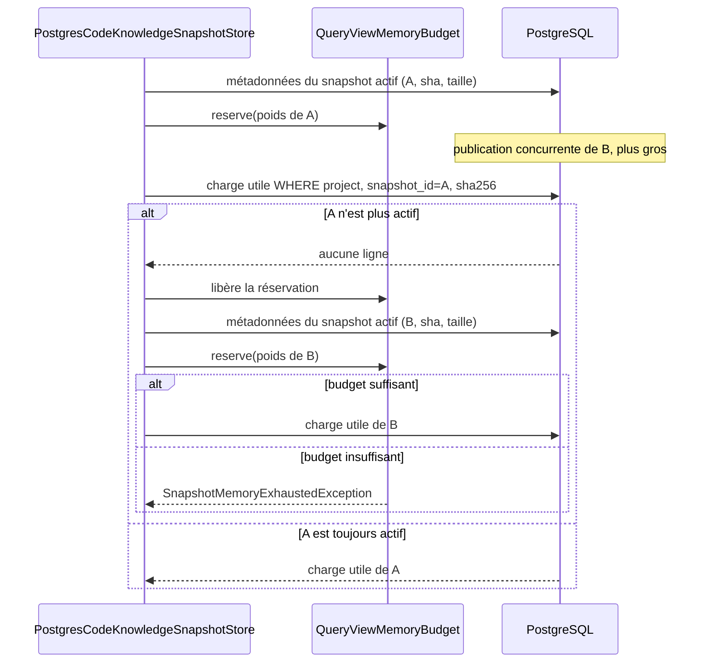
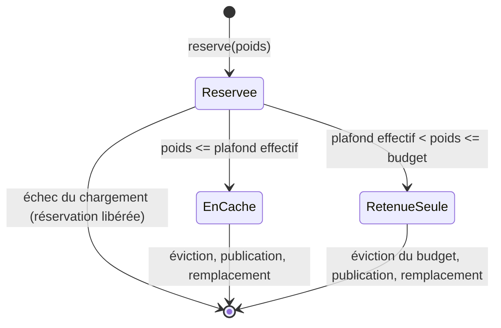

# Design

## Contexte

Le budget de mémoire des vues (ADR DATA-0081, points 14 à 16) borne les chargements de vues d'une JVM. Deux trous y
subsistent, relevés le 2026-11-11 (AUD-PERF-16, AUD-PERF-17) et repris par l'audit du 2026-11-15 (AUD-PERF-05,
AUD-PERF-06) : motivation dans `proposal.md` (Why). Module touché : `minos-storage` (`com.minos.storage.codec`,
`com.minos.storage.local.store`, `com.minos.storage.postgresql.snapshot`) ; un test de `minos-app`. Aucune surface
publique ne change de contrat. Windows et Linux partagent le code.

**Prérequis d'ordre.** Le sprint 4 de l'audit (AUD-PERF-01, -02, -03, -10) modifie avant ce sprint les stores
sémantiques et l'explorateur. Les fichiers de ce changement (`FileSymbolSnapshotStore`,
`PostgresCodeKnowledgeSnapshotStore`, `QueryViewMemoryBudget`, `SnapshotLimits`) ne sont pas cités par les preuves du
sprint 4 ; l'implémentation part néanmoins de `main` après la fusion du sprint 4 et relit les `fichier:ligne`
ci-dessous, qui dérivent.

## État vérifié au HEAD

HEAD `89be3fb4`. Aucune commande de build n'a été lancée : la vérification est une lecture.

| Fait | Preuve |
|---|---|
| La taille est refusée puis la réservation calculée sur `metadata.payloadBytes()` | `minos-storage/src/main/java/com/minos/storage/postgresql/snapshot/PostgresCodeKnowledgeSnapshotStore.java:196-200` |
| Le crochet de test `beforePayloadFetch` s'exécute dans la réservation, avant la requête de charge utile | même fichier `:201`, déclaré `:71`, injecté `:110-116` |
| `activeRow(projectId)` relit la ligne active par `a.project_id=?` seul | même fichier `:403-404` (`ACTIVE_SNAPSHOT_FROM`), `:428-444` |
| Une ligne absente rend `Optional.empty()` ; une discordance d'identifiant ou d'empreinte supprime le fichier temporaire et relance la boucle | même fichier `:203`, `:205-207` |
| La boucle est bornée à 4 tentatives puis échoue par une erreur explicite | même fichier `:58`, `:180`, `:230-231` |
| Une ligne de `knowledge_snapshots` n'est jamais mise à jour : insertion si l'identité est absente, sinon contenu comparé ; la rétention en supprime | même fichier `:293-298`, `:370-382` ; `minos-storage/src/main/java/com/minos/storage/postgresql/project/PostgresStorageRetentionService.java:58` |
| Plafond effectif du cache = `clamp(budget, 1, plafond configuré)` | `minos-storage/src/main/java/com/minos/storage/codec/QueryViewMemoryBudget.java:127-131` |
| Admission : `poids <= budget - réservé - résident` ; le résident est la somme des `residentWeightBytes()` des stores inscrits | même fichier `:167`, `:237-250` |
| `convert` exécute la publication puis libère toujours la réservation | même fichier `:202-215` |
| `WeightedLruCache.put` rend `false` sans rien garder au-delà de son plafond | `minos-engine/src/main/java/com/minos/store/cache/WeightedLruCache.java:80` |
| Le store fichier ignore le résultat de `put` | `minos-storage/src/main/java/com/minos/storage/local/store/FileSymbolSnapshotStore.java:314` |
| Le store PostgreSQL rend le résultat de `put` à `convert`, dont l'appelant ne lit pas la valeur | `PostgresCodeKnowledgeSnapshotStore.java:256-264`, appel `:221-222` |
| Le poids estimé ajoute l'index des arêtes entrantes au plus grand de la somme des comptes et de l'amplification | `FileSymbolSnapshotStore.java:417-427` ; `PostgresCodeKnowledgeSnapshotStore.java:526-535` ; `minos-engine/src/main/java/com/minos/store/SnapshotReadView.java:53-55` |
| Sans relation, les stores ajoutent déjà la part fixe de l'index (1 024 octets) à l'amplification ; un test l'affirme à l'octet | `FileSymbolSnapshotStore.java:425-426` ; `PostgresCodeKnowledgeSnapshotStore.java:533-534` ; `minos-storage/src/test/java/com/minos/storage/postgresql/snapshot/PostgresCodeKnowledgeSnapshotStoreViewAdmissionTest.java:60-61` |
| Des tests affirment qu'une vue au-dessus du plafond est rechargée à chaque lecture | `minos-storage/src/test/java/com/minos/storage/local/store/FileSymbolSnapshotStoreCacheTest.java:57-71` ; `FileSymbolSnapshotStoreViewAdmissionTest.java:60-76`, `:79-92`, `:95-110` ; `PostgresCodeKnowledgeSnapshotStoreViewAdmissionTest.java:65-81`, `:84-101` |
| `largestPersistableViewWeightBytes` = amplification V3 du plafond de persistance, sans index ni somme des comptes | `minos-storage/src/main/java/com/minos/storage/codec/SnapshotLimits.java:127-129` |
| `requireCacheCoversPersistable` compare le plafond configuré à ce seul terme | même fichier `:136-144` |
| Le test de contrat compare le budget par défaut à ce seul terme | `minos-app/src/test/java/com/minos/packaging/M29DockerQueryImageContractTest.java:245-262` |
| Le scénario de référence affirme « non mise en cache, deux chargements » | `openspec/specs/persistance-snapshots/spec.md:137-140` |
| DATA-0081 point 14 : une vue au-dessus du plafond effectif « n'est pas mise en cache et se recharge à chaque requête » | `docs/architecture/adr/DATA-0081-port-de-connaissance-et-persistance-des-snapshots-budget-memoire-des-vues.md:51` |

**Non mesuré.** Les chiffres suivants sont calculés sur les constantes du code, pas observés :

- budget par défaut du plan de requête : 3 Gio × 35 % × 50 % = 563 714 457 octets (537,6 Mio) ; vue V3 maximale sans
  relation : 400 Mio × 1,25 = 524 288 000 octets ; plafond configuré : 536 870 912 octets ;
- l'index des arêtes entrantes pèse 1 024 octets fixes plus 96 octets par relation
  (`minos-engine/src/main/java/com/minos/store/InMemoryCodeKnowledgeStore.java:51-52`, `:167`) : une vue V3 de la
  taille du plafond tient sous le plafond du cache jusqu'à 131 061 relations
  ((536 870 912 − 524 288 000 − 1 024) / 96) et sous le budget par défaut jusqu'à 410 681
  ((563 714 457 − 524 288 000 − 1 024) / 96). Ces deux seuils supposent zéro symbole et zéro occurrence, c'est-à-dire
  que l'amplification domine la somme des comptes ; dès que la somme des comptes domine, ils baissent ;
- pire cas du rapatriement hors réservation : 3,1 × 400 Mio = 1,24 Gio.

Aucune de ces valeurs n'a été reproduite par un chargement réel ; le nombre de relations d'un snapshot réel de
400 Mio n'est pas connu.

## Écarts

| Écart | Source A | Source B | Suite proposée |
|---|---|---|---|
| L'action d'AUD-PERF-05 ajoute le filtre mais ne dit rien de la ligne absente : au HEAD, `row.isEmpty()` rend « aucun snapshot actif » (`:203`). Avec le filtre, une ligne absente signifie aussi « la version a changé » : rendre vide serait une fausse absence | `findings.json` AUD-PERF-05, action | `PostgresCodeKnowledgeSnapshotStore.java:203` | Une ligne absente relance la résolution ; l'absence de snapshot actif n'est conclue que par la lecture des métadonnées (`:181-182`). D2 |
| Le filtre rend inatteignable la branche de discordance (`:205-207`), dont le gate `check-mne.py` exige la chaîne `Files.deleteIfExists(value.payload())` | action de l'audit | `scripts/remediation/check-mne.py:68-70` | La chaîne subsiste dans `decodeVerified` (`:504`, sous la forme `row.payload()`) mais pas à l'identique : mettre l'attente du gate à jour dans la tâche qui retire la branche |
| « Garder la réservation jusqu'à la libération de la vue non mise en cache » suppose un signal de libération : le port rend un `Optional<SnapshotReadView>` que l'appelant ne ferme pas (`:178`) ; seule la collecte par le ramasse-miettes le donnerait | AUD-PERF-06, action, première branche | `PostgresCodeKnowledgeSnapshotStore.java:178` ; `QueryViewMemoryBudget.java:281-287` | D1 : retenir la vue (comptée comme résidente) plutôt que suivre sa libération |
| « Ou la refuser » rend illisibles des snapshots lisibles aujourd'hui : sous un grand tas, un snapshot V1 ou V2 de plus de 256 Mio (poids estimé > 512 Mio) est chargé sans cache | AUD-PERF-06, action, seconde branche | DATA-0081 point 14 (`:51`) | D1 : option écartée |
| « Inclure l'index des arêtes entrantes dans `requireCacheCoversPersistable` » : avec un nombre de relations non borné par le plafond de persistance, aucun plafond de cache constant ne satisfait l'invariant | AUD-PERF-06, action | `SnapshotLimits.java:136-144` ; `FileSymbolSnapshotStore.java:417-427` | D3 : l'invariant garde sa portée (amplification seule), nommée ; le poids complet est calculé et ses seuils publiés |
| Le terme « somme des comptes » (64 Kio + 1 024 par symbole + 640 par occurrence + 1 024 par relation) peut lui aussi dépasser l'amplification ; l'audit ne cite que l'index | AUD-PERF-06 | `FileSymbolSnapshotStore.java:417-427` ; DATA-0081 point 13 (`:50`) | La méthode de poids complet prend les trois comptes et reprend l'estimation des stores (plus grand des deux termes, plus l'index) ; les seuils publiés disent leur hypothèse (zéro symbole, zéro occurrence) |
| Six tests existants encodent « non mise en cache, rechargée » ; trois portent sur V1 et V2 (`…IsNotAdmittedWhereV3Is`) | D1 | fichiers de test cités dans « État vérifié » | Les adapter tous : la vue au-dessus du plafond est retenue seule (un chargement, zéro entrée de cache, poids retenu rapporté). Les cas V1 et V2 gardent ce qu'ils prouvent — l'amplification prudente fait passer la vue au-dessus d'un plafond où la vue V3 est en cache — et sont renommés |
| `SUIVI.md` de l'audit du 2026-10-10 ne mentionne ni AUD-PERF-16 ni AUD-PERF-17 | consigne de sprint | `docs/project/audits/2026-10-10/ETAT-2026-10-13.md:630-639` | Aucune décision antérieure à reprendre ; le dire dans le suivi du sprint (propriétaire) |
| `QueryViewMemoryBudget` n'est dans aucun scope JaCoCo nominatif | `ETAT-2026-10-13.md:628` | `scripts/quality/check-jacoco.py:63-69` | Hors périmètre (constat d'un autre axe) ; la couverture du code neuf est jugée par SonarCloud |

## Exigences couvertes

- persistance-snapshots › PostgreSQL rapatrie la charge utile de la version dont la taille a été réservée — D2,
  « Traitements et interactions ».
- persistance-snapshots › Une vue admise plus lourde que le plafond du cache reste comptée par le budget — D1,
  « États et transitions ».
- persistance-snapshots › Un snapshot de la taille de ce dépôt est admis au cache de vues (modifiée) — D1.
- persistance-snapshots › Le poids de la vue la plus lourde persistable se calcule index dérivés compris — D3.
- distribution-docker › Le contrat de l'image de requête publie les seuils de relations calculés — D4.

## Objectifs et non-objectifs

Objectifs : aucune charge utile rapatriée hors de la réservation calculée pour elle ; aucune vue admise hors compte ;
un contrat Docker qui dit jusqu'où la marge tient. Non-objectifs : compter une vue évincée encore tenue par une
requête ; changer un plafond ; borner l'attente de `buildLock.lock()` (réserve de la revérification du 2026-11-11).

## Responsabilités et frontières des composants

Tout reste dans `minos-storage` (adaptateur) : le budget, les limites et les deux stores. `minos-engine` n'est pas
modifié (`WeightedLruCache` garde son contrat : une entrée plus lourde que son plafond n'est pas gardée). Le test de
contrat vit dans `minos-app`, qui dépend déjà de `minos-storage`. Direction des dépendances (ARCH-0068) inchangée.

## Modèle de domaine et invariants

- Invariant du budget, inchangé et étendu : `réservé + résident <= budget`, où le résident d'un store est le poids de
  son cache **plus** celui de la vue qu'il retient au-dessus du plafond.
- Un store retient au plus une vue au-dessus du plafond effectif ; quand il en retient une, son cache est vide.
- Une charge utile demandée sous une réservation est celle de l'identité `(project_id, snapshot_id, sha256)` dont la
  taille a servi à calculer cette réservation.

## Traitements et interactions

Voir le diagramme « Que se passe-t-il quand le snapshot actif change entre les métadonnées et la charge utile ? ».
Déroulé PostgreSQL : métadonnées → clé de cache → verrou de construction → réservation → requête de charge utile
filtrée → ligne absente : fermeture de la réservation, tentative suivante ; ligne présente : copie, vérification de
l'empreinte, décodage, publication dans le cache ou dans l'emplacement au-dessus du plafond.

## États et transitions

Voir le diagramme « Quel est le sort d'une vue admise selon son poids ? ».

## Contrats d'interface

Aucun contrat public ne change. Contrats internes :

- `SnapshotLimits` : méthode ajoutée qui rend le poids estimé de la vue V3 de la taille du plafond de persistance
  pour des nombres de symboles, d'occurrences et de relations — plus grand de la somme des comptes et de
  l'amplification, plus l'index des arêtes entrantes —, partagée par les deux stores et par le test de contrat. Sans
  aucune entité elle rend « plafond × amplification + part fixe de l'index ». `largestPersistableViewWeightBytes()`
  reste l'amplification seule (terme de l'invariant) pour ne pas casser ses appelants
  (`M29DockerQueryImageContractTest`, `SnapshotLimitsTest`).
- `QueryViewMemoryBudget.Tenant.residentWeightBytes()` : contrat inchangé, la valeur inclut la vue retenue au-dessus
  du plafond ; `evictAll()` la libère aussi.
- Statistiques de cache des stores (`cacheStats()`, `queryCacheStats()`, à usage de test et de mesure) : champ ajouté
  pour le poids retenu au-dessus du plafond ; aucun champ retiré.

## Persistance et intégrité

Aucun format ni schéma ne change. La requête de charge utile devient
`... WHERE a.project_id=? AND s.snapshot_id=? AND s.sha256=?` (paramétrée). L'empreinte copiée reste comparée à
l'empreinte enregistrée (`decodeVerified`, `:494-496`).

## Transactions, concurrence et idempotence

- Ordre des verrous inchangé : projet, budget, cache. L'emplacement au-dessus du plafond est protégé par le verrou de
  cache du store et modifié sous le verrou du budget lors de la conversion (comme `queryCache.put` aujourd'hui).
- La reprise après une ligne absente ferme la réservation avant de relire les métadonnées : pas de double compte.
- Tests de concurrence rejoués 50 fois (règle de revue du dépôt).

## Sécurité et isolation

Requête paramétrée, aucun littéral construit depuis une donnée. Aucun chemin dans les messages : les erreurs
existantes sont réutilisées. E/S privées inchangées (`check-private-io.py` rejoué).

## Erreurs et reprise

Aucun message nouveau. Limite de tentatives atteinte : erreur existante (`:230-231`). Budget insuffisant pour la
nouvelle version : `SnapshotMemoryExhaustedException` existante.

## Observabilité

Statistiques de cache des stores et `QueryViewMemoryBudget.stats()` (résident, réservé), lues par les tests.

## Performance et mesure

Aucun objectif chiffré. Stratégie de mesure, exigée parce que les chiffres de l'audit sont calculés :

- **Rapatriement** (tâche 2.1, manuelle) : `LargePostgresSnapshotMeasurement` sur le serveur de test
  (`scripts/dev/start-test-postgres.sh`), publication d'un snapshot plus gros entre métadonnées et charge utile par le
  crochet `beforePayloadFetch` ; relever le pic de tas avant et après correction.
- **Vue au-dessus du plafond** (tâche 3.1, manuelle) : `LargeSnapshotMeasurement` sous le tas du plan de requête
  (`-Xmx1076m`), corpus dont le poids estimé tombe entre 512 Mio et le budget ; relever le tas retenu, le nombre de
  chargements complets pour deux lectures, et le nombre de relations d'un snapshot réel proche du plafond.
- [Question] non bloquante : les seuils de relations publiés sont-ils atteints par un dépôt réel ? La mesure 3.1 le
  dit ; elle ne change pas les exigences.

## Compatibilité, migration et retour arrière

Aucune migration. Retour arrière : revenir au commit précédent ; rien de persisté ne dépend du changement.

## Diagrammes

### Que se passe-t-il quand le snapshot actif change entre les métadonnées et la charge utile ?

Type : sequenceDiagram · Portée : cible · Exigences : persistance-snapshots › PostgreSQL rapatrie la charge utile de la version dont la taille a été réservée

La charge utile demandée est toujours celle dont la taille a été réservée ; l'absence de ligne n'est jamais lue comme
une absence de snapshot.

### Quel est le sort d'une vue admise selon son poids ?

Type : stateDiagram-v2 · Portée : cible · Exigences : persistance-snapshots › Une vue admise plus lourde que le plafond du cache reste comptée par le budget ; › Un snapshot de la taille de ce dépôt est admis au cache de vues

Dans les deux états le poids est résident, donc compté. Le refus au-delà du budget a lieu avant `Reservee` (inchangé).

## Décisions

### D1 — Une vue admise au-dessus du plafond est retenue seule et comptée

[Proposition] — décision du propriétaire attendue. Le store garde une telle vue dans un emplacement unique, compté par
`residentWeightBytes()`, vidé par `evictAll()`, par une publication et par l'arrivée d'une autre vue ; son cache est
vidé quand il la retient.

Alternatives :

- **Suivre la libération par le ramasse-miettes** (référence fantôme, poids rendu à la collecte) : la vue reste
  comptée tant qu'elle est joignable, mais le budget dépendrait de l'instant d'une collecte ; un second chargement du
  même projet attendrait jusqu'à 30 s puis serait refusé alors que la mémoire est libérable. Écartée.
- **Refuser** une vue au-dessus du plafond effectif : déterministe, mais rend illisibles sous un grand tas des
  snapshots V1 et V2 de plus de 256 Mio lisibles aujourd'hui. Écartée.
- **Plafond effectif = budget** (retirer le `min` avec 512 Mio) : une ligne de code, mais une JVM au grand tas
  retiendrait jusqu'à la moitié de son tas en vues au lieu de 512 Mio. Écartée, proposée en repli si l'emplacement
  unique est jugé trop particulier.

Compromis : une vue retenue seule vide le cache des autres projets du store. Le critère de sortie du sprint (« une vue
hors cache reste comptée jusqu'à sa libération ») est tenu parce qu'il n'existe plus de vue admise hors du store.

### D2 — Une ligne de charge utile absente relance la résolution

[Proposition]. Après le filtre, `Optional.empty()` de la requête de charge utile ne conclut rien : la boucle ferme la
réservation et relit les métadonnées, qui seules concluent à l'absence de snapshot actif. La branche de discordance
devient inatteignable et est retirée, avec mise à jour de `check-mne.py`.

### D3 — L'invariant du plafond garde sa portée, le poids complet est publié

[Proposition] — décision du propriétaire attendue. `requireCacheCoversPersistable` reste « plafond configuré ≥ plafond
de persistance × amplification V3 » et sa documentation dit qu'il ne couvre ni l'index des arêtes entrantes ni la
somme des comptes. Alternative écartée : y inclure l'index, ce qui exigerait une borne sur le nombre de relations d'un
snapshot persistable, qui n'existe pas. Avec D1, dépasser le plafond n'entraîne plus de rechargement à chaque requête :
l'invariant n'est plus ce qui protège ce cas.

### D4 — Le test de contrat calcule les seuils et les confronte à la documentation

[Proposition]. Le test calcule les deux seuils de relations depuis les fichiers compose et `SnapshotLimits`, pour
zéro symbole et zéro occurrence, et exige leur présence dans `docs/user/docker-runtime.md` avec cette hypothèse.
Aucun seuil n'est inventé : la valeur publiée est la valeur calculée (131 061 et 410 681 au HEAD).

### D5 — ADR consolidé qui remplace DATA-0081

[Proposition]. Le point 14 de DATA-0081 change de sens (D1) : selon `.claude/rules/adr.md`, une décision qui change en
partie donne un ADR consolidé. Un seul ADR consolidé `DATA-<NNNN>` (prochain numéro libre à l'écriture) porte les
décisions des trois changements du sprint 5, validées ensemble par le propriétaire ; le premier changement implémenté
l'écrit, les suivants complètent sa « Mise en œuvre ». DATA-0081 passe `Superseded` et part en archive.

## Qualification des capacités

- `persistance-snapshots` : **partielle** jusqu'aux mesures 2.1 et 3.1 (comportement prouvé par tests à plafonds
  abaissés, ordres de grandeur réels non mesurés) ; PostgreSQL prouvé sous Linux (CI), sauté et compté sous Windows.
- `distribution-docker` : **qualifiée** par test de contrat (lecture de fichiers, Windows et Linux).

## Risques et compromis

- [Risque] Une vue retenue seule évince les vues des autres projets du store → atténuation : cas limité aux vues
  au-dessus de 512 Mio ; mesuré en 3.1.
- [Risque] Une publication en rafale épuise les 4 tentatives → comportement existant, erreur explicite.
- [Risque] Sprint 4 fusionné entre-temps → relire les `fichier:ligne` avant d'implémenter.

## Vérification

- Tests : `PostgresCodeKnowledgeSnapshotStoreViewBudgetTest` (version remplacée, budget insuffisant pour la nouvelle
  version, tentatives épuisées), `FileSymbolSnapshotStoreViewBudgetTest` et son pendant PostgreSQL (vue retenue seule,
  comptée, libérée) ; tests existants à adapter : `FileSymbolSnapshotStoreCacheTest`
  (`aViewHeavierThanTheCacheCeilingIsReloadedOnEveryRead`), `FileSymbolSnapshotStoreViewAdmissionTest` (cas V2, V1 et
  `aViewHeavierThanTheCacheCeilingIsNotCachedWhateverItsFormat`), `PostgresCodeKnowledgeSnapshotStoreViewAdmissionTest`
  (cas V2 et `aViewHeavierThanTheCacheCeilingIsNotCachedAndStillReadCorrectly`) ; `SnapshotLimitsTest` (poids
  complet), `QueryViewMemoryBudgetTest`, `M29DockerQueryImageContractTest` (seuils).
- Gates : `check-mne.py`, `check-mnd.py`, `check-p0-p2.py`, `check-module-boundaries.py`,
  `check-comment-language.py`, `check-private-io.py`, `check-current-docs.py`, `check-capability-dossiers.py`.
- JaCoCo : le scope `persistence-cache-indexes` ne couvre que `FileSymbolSnapshotStore`
  (`scripts/quality/check-jacoco.py:63-69`) ; `PostgresCodeKnowledgeSnapshotStore`, `SnapshotLimits` et
  `QueryViewMemoryBudget` n'ont pas de scope nominatif : leur code neuf est jugé par SonarCloud (80 % dans
  `minos-storage`).
- Non vérifiable sur poste Windows sans serveur : les tests PostgreSQL (CI Linux, ou
  `scripts/dev/start-test-postgres.sh` sous WSL). Le mode requis demande aussi l'URL et l'utilisateur du serveur
  (`-Dminos.postgresql.test.url`, `-Dminos.postgresql.test.user`, `.github/workflows/pr-ci.yml:409`).

## Documentation durable à mettre à jour

`docs/user/docker-runtime.md` (« Limites de ressources ») ; `docs/developer/indexing-and-storage.md` ; dossiers de
capacité `persistance-snapshots.md` et `distribution-docker.md` ; ADR consolidé, index
`docs/architecture/adr/README.md` et `docs/architecture/arc42/09-decisions.md`.

## Traçabilité

| Exigence (capacité › titre) | Scénario | Conception ou diagramme | Tâche | Test ou preuve |
|---|---|---|---|---|
| persistance-snapshots › PostgreSQL rapatrie la charge utile de la version dont la taille a été réservée | Publication concurrente d'un snapshot plus gros | D2, séquence | 1.1, 1.2 | à écrire (`PostgresCodeKnowledgeSnapshotStoreViewBudgetTest`) |
| idem | Nouvelle version plus lourde que le budget | D2 | 1.1, 1.2 | à écrire |
| idem | Version active stable | D2 | 1.1, 1.2 | à écrire |
| idem | Version active remplacée à chaque tentative | D2 | 1.1, 1.2 | à écrire |
| persistance-snapshots › Une vue admise plus lourde que le plafond du cache reste comptée par le budget | Vue retenue et comptée | D1, états | 3.2, 3.3 | à écrire (deux stores) |
| idem | Les autres vues du cache lui cèdent la place | D1 | 3.2, 3.3 | à écrire |
| idem | Libération pour admettre un autre chargement | D1 | 3.2, 3.3 | à écrire |
| idem | Publication du projet | D1 | 3.2, 3.3 | à écrire |
| persistance-snapshots › Un snapshot de la taille de ce dépôt est admis au cache de vues | Vue plus lourde que le plafond | D1 | 3.2, 3.3 | tests d'admission existants, à adapter |
| persistance-snapshots › Le poids de la vue la plus lourde persistable se calcule index dérivés compris | Même estimation que les stores ; Somme des comptes dominante ; Sans aucune entité | D3 | 4.1 | à écrire (`SnapshotLimitsTest`) |
| distribution-docker › Le contrat de l'image de requête publie les seuils de relations calculés | Seuils annoncés ; Réglage modifié | D4 | 4.2, 4.3 | à écrire (`M29DockerQueryImageContractTest`) |
| mesures (chiffres calculés de l'audit) | — | Performance et mesure | 2.1, 3.1 | manquante (manuelle) |

## Questions ouvertes

- D1 et D3 : décision du propriétaire attendue, recommandation ci-dessus. Un autre choix pour D1 change deux exigences
  du delta `persistance-snapshots`.
- Numéro de l'ADR consolidé : lu à l'implémentation.
