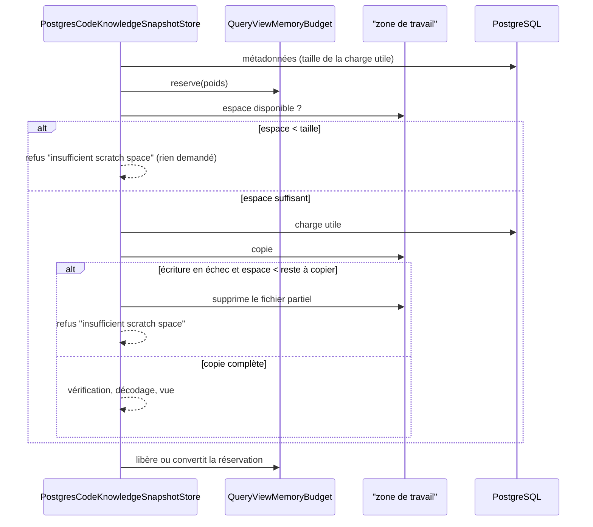

# Design

## Contexte

Dans l'installation Docker connectée à PostgreSQL, le plan de requête monte ses données en lecture seule ; la zone de
travail du store de snapshots PostgreSQL (`MINOS_HOME/postgresql-snapshot-scratch`) y est un tmpfs. Motivation :
`proposal.md` (Why), constat AUD-PERF-09. Composants touchés : `docker/compose-mcp.connected.yaml`,
`PostgresCodeKnowledgeSnapshotStore` (`minos-storage`), un type d'erreur publique (`minos-domain`), son rendu
(`minos-mcp`), des tests (`minos-cli`, `minos-app`).

**Prérequis d'ordre.** Le sprint 4 (changements `paginer-l-index-semantique-local-sans-le-charger`,
`retirer-le-comptage-par-page-des-lectures-postgresql`, `ajuster-la-projection-sur-l-echantillon-en-memoire`) passe
avant ce sprint. Aucun de ses changements ne cite `PostgresCodeKnowledgeSnapshotStore` ni la zone de travail ; ce
changement ne prévoit aucune migration de schéma. Dans le sprint 5, il s'implémente après
`compter-toute-vue-admise-et-lier-le-rapatriement-postgresql`, qui modifie la même boucle de lecture.

## État vérifié au HEAD

HEAD `89be3fb4`. Aucun build ni conteneur lancé : la vérification est une lecture.

| Fait | Preuve |
|---|---|
| `minos-mcp` : tmpfs `postgresql-snapshot-scratch` de `size=256m`, `mode=0700`, uid et gid 10001 | `docker/compose-mcp.connected.yaml:96` (l'audit cite `:95`) |
| `minos-explorer` : même tmpfs, même taille | même fichier `:154` (l'audit cite `:151`) |
| `minos-mcp` est un conteneur `sleep infinity` où chaque client lance sa JVM par `docker exec` | même fichier `:45-48`, `:65-66` ; `docs/user/docker-runtime.md:419` |
| `minos-explorer` lance une seule JVM (`explorer serve`) et a son propre tmpfs | même fichier `:113-114`, `:151-154` |
| Les deux services partagent la limite du rôle requêtes (3 Gio par défaut, sans swap) | même fichier `:11-15`, `:44`, `:109` |
| `minos-explorer` ne repose pas `JAVA_TOOL_OPTIONS` : son tas vient de l'image (35 %), sans le réglage `MINOS_MCP_HEAP_PERCENT` | même fichier `:123-134` ; `docker/Dockerfile.mcp:42`, `docker/Dockerfile.mcp.release:48` |
| `docker/compose-mcp.prod.yaml` ne déclare aucune zone `postgresql-snapshot-scratch` | recherche de `scratch` dans ce fichier : aucune occurrence |
| La zone est créée sous `MINOS_HOME` par le constructeur du store | `minos-storage/src/main/java/com/minos/storage/postgresql/snapshot/PostgresCodeKnowledgeSnapshotStore.java:62`, `:122-128` |
| `readRow` copie toute la charge utile dans un fichier de la zone, puis la décode depuis ce fichier | même fichier `:446-459`, `:492-506` |
| La copie est bornée par le plafond de persistance, pas par l'espace de la zone | même fichier `:453` |
| La réservation de mémoire précède la demande de charge utile | même fichier `:196-202` |
| Aucun code de production ne reconnaît un manque d'espace | recherche de `No space` et `ENOSPC` sous `minos-*/src/main` : aucune occurrence |
| Seule `SnapshotMemoryExhaustedException` est rendue avec son message par le MCP | `minos-mcp/src/main/java/com/minos/mcp/MinosMcpTools.java:201-205`, `:266-269` |
| À chaque mise à jour, les scripts ne reportent dans le `.env` régénéré que les lignes `MINOS_(MCP\|ADMIN\|JOB\|POSTGRES\|OLLAMA\|PGADMIN)_(CPUS\|MEM_LIMIT\|PIDS_LIMIT)=`, validées par `Test-CeilingOverride` ; la fonction existe en deux copies | `docker/scripts/mcp-lifecycle.ps1:530-541`, `:543-549` ; `docker/scripts/prod-mcp.ps1:62-67` |
| `check-compose-limits.py` ne lit que les blocs `x-limits-*` et les clés de plafond ; ni lui ni les tests de `scripts/install/` ne lisent `tmpfs` ou `size=` | `scripts/quality/check-compose-limits.py:76-81` |
| Le test de contrat de l'image de requête ne contrôle pas la taille de la zone | `minos-app/src/test/java/com/minos/packaging/M29DockerQueryImageContractTest.java` : aucune occurrence de `postgresql-snapshot-scratch` |

**Calculé, non mesuré.** Budget par défaut d'une JVM : 3 Gio × 35 % × 50 % = 563 714 457 octets ; charge utile
PostgreSQL admissible par JVM : budget / 3,10 = 181 843 373 octets (173,4 Mio) ; deux JVM : 346,8 Mio, au-dessus des
256 Mio de la zone ; deux tas pleins : 2 150,4 Mio ; deux tas et 346,8 Mio de zone : 2 497,2 Mio sous 3 072 Mio, ce
qui laisse 574,8 Mio à la mémoire hors tas des deux JVM. Le compte du tmpfs dans `mem_limit`, la mémoire hors tas
réelle et l'échec par manque d'espace n'ont pas été observés.

## Écarts

| Écart | Source A | Source B | Suite proposée |
|---|---|---|---|
| « Dimensionner le tmpfs sur le plafond de persistance (400 Mio) » : sous le budget par défaut, une charge utile de plus de 173 Mio environ est refusée à l'admission ; 400 Mio ne sert qu'à une JVM au tas relevé, et ne couvre pas trois JVM au défaut | AUD-PERF-09, action | DATA-0081, Risques (`:119`) ; `SnapshotLimits.java:47`, `:107-113` | D1 : borne = JVM déclarées × charge utile admissible, calculée par le test de contrat |
| Agrandir le tmpfs réduit la mémoire disponible : il est compté dans `mem_limit` selon l'audit ; un tmpfs plein et des tas pleins échangent une erreur explicite contre un arrêt du conteneur par le noyau | AUD-PERF-09, impact | `docker/compose-mcp.connected.yaml:11-15` | Le test de contrat vérifie aussi « tas × JVM + zone ≤ limite » ; mesure 3.1 |
| « Traduire ENOSPC » : le texte de l'erreur du système dépend de la plateforme et de la langue ; un test sur ce texte serait fragile | AUD-PERF-09, action | `.claude/rules/code-review.md` (dépendance à la langue de l'hôte) | D2 : contrôle de l'espace disponible avant la demande, et requalification d'un échec d'écriture seulement si l'espace disponible ne couvre plus le reste à copier |
| L'audit dit le tmpfs « partagé par toutes les JVM du conteneur » pour les deux services ; c'est vrai de `minos-mcp`, pas de `minos-explorer` (une JVM, son propre tmpfs) | AUD-PERF-09, titre | `docker/compose-mcp.connected.yaml:113-114` | Même taille pour les deux services, par simplicité ; le dire dans la documentation |
| Un opérateur qui relève `MINOS_MCP_MEM_LIMIT` ou `MINOS_MCP_HEAP_PERCENT` relève la charge utile admissible sans relever la zone | AUD-PERF-09, impact | `docker/compose-mcp.connected.yaml:13`, `:66` | Taille de la zone réglable par une variable du `.env`, documentée avec la règle de calcul ; le refus explicite couvre le reste |
| Une variable de taille ajoutée au compose seul serait perdue à chaque mise à jour : le `.env` est régénéré et seules les variables de plafond du motif fermé y sont reportées | action de l'audit (« le documenter ») | `docker/scripts/mcp-lifecycle.ps1:545` ; `docker/scripts/prod-mcp.ps1:64` | D5 : étendre le motif et sa validation dans les deux scripts, avec leurs tests ; `docker/.env.example` complété |
| `minos-explorer` monte la même zone mais sa surface ne rend pas ce refus avec son message | exigence de rendu (CLI, MCP) | `docker/compose-mcp.connected.yaml:154` | Hors périmètre : une seule JVM y écrit et la zone dépasse la charge utile admissible au défaut ; le rendu des refus par l'explorateur appartient aux changements de sa surface |
| Décoder depuis le flux sans fichier : le pilote matérialise déjà la ligne ; tenir la charge utile pendant le décodage change le pic de tas que la réserve de 310 % couvre | AUD-PERF-09, action, seconde branche | DATA-0081 point 16 (`:53`) | D3 : écarté pour ce lot |

## Exigences couvertes

- distribution-docker › La zone de travail PostgreSQL du plan de requête est dimensionnée pour le nombre déclaré de
  JVM — D1.
- distribution-docker › Le réglage de taille de la zone de travail survit à la régénération du fichier
  d'environnement — D5.
- persistance-snapshots › Une zone de travail PostgreSQL insuffisante donne un refus explicite — D2.
- persistance-snapshots › Un refus de zone de travail est rendu par la CLI et le MCP avec son message — D2.

## Objectifs et non-objectifs

Objectifs : une zone dont la taille découle d'une règle écrite et contrôlée ; un manque d'espace rendu comme un refus
actionnable. Non-objectifs : borner le nombre de clients MCP ; supprimer le fichier intermédiaire ; coordonner
plusieurs JVM.

## Responsabilités et frontières des composants

`minos-storage` détecte et lève ; `minos-domain` (`com.minos.diagnostics`) porte le type public, comme
`SnapshotMemoryExhaustedException` ; `minos-mcp` le rend ; la CLI le rend déjà comme toute `IOException` de message
public (test seul). Direction ARCH-0068 respectée : `minos-storage` et `minos-mcp` dépendent du domaine, pas l'inverse.
Règle A11 (`check-module-boundaries.py`) : le MCP ne nomme qu'un type du domaine, aucun type nouveau de `minos-engine`.

## Modèle de domaine et invariants

- Avant toute demande de charge utile : `espace disponible de la zone >= taille de la charge utile` (taille lue avec
  les métadonnées).
- Un refus de zone ne laisse ni fichier temporaire ni réservation de mémoire.

## Traitements et interactions

Voir le diagramme. Le contrôle d'espace se place après la réservation de mémoire et avant la requête de charge utile ;
il n'est pas atomique entre JVM : l'échec pendant la copie est donc aussi traité.

## États et transitions

Non applicable : aucun cycle de vie nouveau.

## Contrats d'interface

- **Erreur publique** : message `insufficient scratch space to load this snapshot: its payload is <octets> bytes and
  the scratch area has <octets> bytes free; retry later or raise the size of the PostgreSQL snapshot scratch area`.
  Aucun chemin. CLI : sortie d'erreur, code 1. MCP : `error: ` suivi du message.
- **Compose** : option `size=` de la zone alimentée par une variable du `.env` (nom proposé
  `MINOS_MCP_SCRATCH_SIZE`), avec une valeur par défaut au moins égale à la borne calculée. Additif.
- **Scripts d'installation** : `Get-PreservedCeilingOverrides` reporte aussi cette variable et
  `Test-CeilingOverride` la valide (taille `<n>m` ou `<n>g`, strictement positive ; une valeur invalide est refusée en
  nommant la variable, rien n'est écrit), dans `docker/scripts/mcp-lifecycle.ps1` et `docker/scripts/prod-mcp.ps1`,
  copies gardées identiques. `docker/.env.example` documente la variable.
- Contrat exécutable : `M29DockerQueryImageContractTest` (étendu).

## Persistance et intégrité

Aucun format ni schéma ne change ; aucune migration.

## Transactions, concurrence et idempotence

Le contrôle d'espace et la copie ne sont pas atomiques entre processus ; la requalification d'un échec d'écriture
relit l'espace disponible après l'échec. Une lecture refusée peut être relancée sans effet résiduel.

## Sécurité et isolation

Fail-closed : un manque d'espace refuse la lecture, il ne bascule pas vers un autre emplacement ni vers un décodage
en mémoire. Message sans chemin (`PublicErrorMessages.looksSensitive` faux). Le tmpfs garde `nosuid,nodev,noexec`,
`mode=0700` et son propriétaire ; les E/S restent celles de `PrivateLocalStorage` (`check-private-io.py`).

## Erreurs et reprise

Erreur d'usage actionnable (réessayer, agrandir la zone). Toute autre erreur d'écriture reste interne et opaque.

## Observabilité

Le message porte les deux tailles. `docs/user/docker-runtime.md` gagne une ligne de dépannage.

## Performance et mesure

Aucun objectif chiffré. Mesure exigée (tâche 3.1, manuelle, Docker) parce que le constat est « probable, non
reproduit » : sur l'installation connectée, deux clients MCP chargent en même temps deux snapshots PostgreSQL dont la
somme dépasse la zone actuelle ; relever l'erreur obtenue avant et après, `docker stats` (mémoire du conteneur, zone
pleine), et la mémoire hors tas des JVM. [Question] non bloquante : la marge hors tas calculée (574,8 Mio pour deux
JVM) suffit-elle ? La mesure le dit ; sinon D1 se rejoue avec le propriétaire.

## Compatibilité, migration et retour arrière

Une installation existante prend la nouvelle taille au prochain `docker compose up` (le compose est régénéré par les
scripts d'installation). Retour arrière : restaurer la valeur précédente ; rien de persisté.

## Diagrammes

### Où une zone de travail insuffisante est-elle détectée ?

Type : sequenceDiagram · Portée : cible · Exigences : persistance-snapshots › Une zone de travail PostgreSQL insuffisante donne un refus explicite

Le refus précède le rapatriement quand c'est possible ; sinon l'échec de copie est requalifié sur un fait mesuré
(l'espace restant), pas sur le texte de l'erreur.

## Décisions

### D1 — Borne de la zone : JVM déclarées × charge utile admissible

[Proposition] — décision du propriétaire attendue sur le nombre déclaré : **2**, valeur déjà retenue par DATA-0081
point 17 pour le tas. La taille par défaut est la borne calculée arrondie au-dessus (valeur fixée à l'implémentation,
contrôlée par le test de contrat) ; elle est réglable par variable. Alternatives : 400 Mio (action de l'audit) — ne
dit pas pour combien de JVM ; 400 Mio × 2 — ne tient pas avec deux tas sous 3 Gio (2 150 + 800 Mio, calculé).

### D2 — Refus par contrôle de l'espace, type public voisin du refus de mémoire

[Proposition] — décision du propriétaire attendue sur le type. Recommandation : un type frère de
`SnapshotMemoryExhaustedException` dans `com.minos.diagnostics`, rendu par la même clause du MCP. Alternative :
réutiliser `SnapshotMemoryExhaustedException` (un seul type, mais un préfixe « insufficient memory » faux pour un
manque de disque). Écartée.

### D3 — Pas de décodage depuis le flux dans ce lot

[Proposition]. Le fichier intermédiaire permet de fermer la ligne du pilote avant le décodage ; le retirer change le
pic de tas et la réserve de 310 % (DATA-0081 point 16, mesurée). À reprendre sur une mesure dédiée si la zone reste
une contrainte après ce changement.

### D4 — ADR consolidé commun au sprint 5

[Proposition]. Le point 17 (zone de travail, nombre déclaré de JVM) et le risque « plusieurs JVM » de DATA-0081 sont
complétés dans l'ADR consolidé `DATA-<NNNN>` (prochain numéro libre à l'écriture) qui remplace DATA-0081 et porte les
décisions des trois changements du sprint 5 ; le premier changement implémenté l'écrit, les suivants complètent sa
« Mise en œuvre ».

### D5 — Le réglage de taille est repris par la régénération du `.env`

[Proposition]. Le motif des variables reportées et leur validation sont étendus à la variable de taille, dans les
deux scripts, avec les tests de `scripts/install/`. Alternative écartée : documenter que le réglage se perd à chaque
mise à jour (piège silencieux pour un réglage dont l'absence donne un refus). Alternative de repli si le propriétaire
veut limiter le lot au compose : une taille fixe sans variable, le refus explicite couvrant un tas relevé.

## Qualification des capacités

- `distribution-docker` : **partielle** jusqu'à la mesure 3.1 (règle contrôlée par lecture de fichiers ; comportement
  du conteneur non observé). Docker est Linux ; le test de contrat tourne sous Windows et Linux.
- `persistance-snapshots` : **qualifiée** par tests (zone de test de petite taille ou seam d'espace disponible) ;
  PostgreSQL prouvé sous Linux (CI), sauté et compté sous Windows sans mode requis.

## Risques et compromis

- [Risque] La zone agrandie réduit la marge mémoire du conteneur → contrôle « tas × JVM + zone ≤ limite » et
  mesure 3.1.
- [Risque] Un troisième client MCP dépasse la zone → refus explicite, documenté.
- [Risque] `FileStore.getUsableSpace` peu fiable sur certains systèmes de fichiers → le contrôle préalable n'est
  qu'une anticipation ; la requalification après échec reste la garantie ; seam de test pour l'espace disponible.

## Vérification

- Tests : `PostgresCodeKnowledgeSnapshotStoreScratchSpaceTest` (à créer, `minos-storage`), test du type public
  (`minos-domain`), `MinosMcpSnapshotMemoryRefusalTest` étendu ou son pendant (`minos-mcp`), test CLI pendant de
  `SnapshotMemoryRefusalCliTest`, `M29DockerQueryImageContractTest` (borne, somme, documentation).
- Seul `M29DockerQueryImageContractTest` prouve le dimensionnement : `check-compose-limits.py` et les tests de
  `scripts/install/` ne lisent ni `tmpfs` ni `size=` ; ils sont rejoués comme non-régression. La reprise de la
  variable est prouvée par un test de `scripts/install/test_mcp_lifecycle_*.py` (définitions réelles extraites par
  l'analyseur PowerShell).
- Gates : `check-compose-limits.py` et `test_check_compose_limits.py`, `scripts/install/test_mcp_lifecycle_*.py`,
  `test_docker_script_contexts.py`, `check-twin-script-functions.py` et son auto-test, `check-mne.py`,
  `check-mnd.py`, `check-module-boundaries.py`, `check-private-io.py`, `check-comment-language.py`,
  `check-current-docs.py`.
- JaCoCo : scope `mcp-mapping`.
- Non vérifiable localement sans Docker : la mesure 3.1.

## Documentation durable à mettre à jour

`docs/user/docker-runtime.md` (« Limites de ressources » : nombre de JVM, règle de calcul, variable ; table de
dépannage) ; dossiers de capacité `distribution-docker.md` et `persistance-snapshots.md` ; ADR consolidé et ses index.

## Traçabilité

| Exigence (capacité › titre) | Scénario | Conception ou diagramme | Tâche | Test ou preuve |
|---|---|---|---|---|
| distribution-docker › La zone de travail PostgreSQL du plan de requête est dimensionnée pour le nombre déclaré de JVM | Taille suffisante | D1 | 2.1, 2.2 | à écrire (`M29DockerQueryImageContractTest`) |
| idem | Zone réduite sous la borne | D1 | 2.1 | à écrire |
| idem | Nombre de JVM non annoncé | D1 | 2.1, 2.2 | à écrire |
| distribution-docker › Le réglage de taille de la zone de travail survit à la régénération du fichier d'environnement | Valeur reprise ; Valeur invalide refusée | D5 | 2.3 | à écrire (`scripts/install/`) |
| persistance-snapshots › Une zone de travail PostgreSQL insuffisante donne un refus explicite | Espace insuffisant avant le rapatriement | D2, séquence | 1.1, 1.2 | à écrire |
| idem | Zone épuisée pendant la copie | D2, séquence | 1.1, 1.2 | à écrire |
| idem | Message sans chemin | D2 | 1.1, 1.2 | à écrire |
| idem | Échec d'écriture qui n'est pas un manque d'espace | D2 | 1.1, 1.2 | à écrire |
| persistance-snapshots › Un refus de zone de travail est rendu par la CLI et le MCP avec son message | Outil MCP ; Commande CLI | Contrats d'interface | 1.3 | à écrire |
| mesure (constat non reproduit) | — | Performance et mesure | 3.1 | manquante (manuelle) |

## Questions ouvertes

- D1 (nombre déclaré de JVM) et D2 (type public) : décision du propriétaire attendue, recommandations ci-dessus.
- Nom de la variable de taille et valeur par défaut arrondie : fixés à l'implémentation, sans effet sur les exigences.
