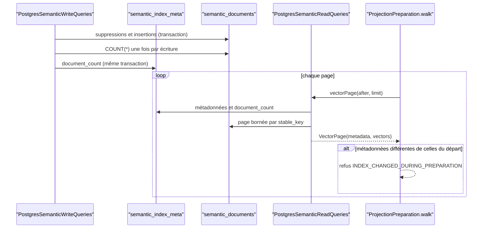

# Design

## Contexte

Motivation : voir `proposal.md` (Why). Le changement est limité à `minos-storage`, côté PostgreSQL : les requêtes de lecture de l'index sémantique (`PostgresSemanticReadQueries`), ses écritures (`PostgresSemanticWriteQueries`) et la migration de schéma (`PostgresSchemaMigrator`). Deux consommateurs lisent ces pages : `ProjectionPreparation.walk` (`minos semantic projection prepare`) et `SemanticCorpusQueryService` (liste, détail, voisins de l'explorateur). Le port `SemanticVectorStore` (`minos-domain`) ne change pas.

Prérequis non livré au HEAD : le banc de AUD-PERF-13 (sprint 1). Sans lui, aucune mesure avant/après n'est possible et ce changement ne démarre pas.

## État vérifié au HEAD

HEAD `89be3fb4`. Aucune commande n'a été exécutée contre un PostgreSQL : tout ce qui suit est une lecture du code.

| Fait | Preuve |
|---|---|
| `vectorPage` : sous-requête `SELECT COUNT(*) FROM semantic_documents c WHERE c.project_id=… AND c.snapshot_id=…` dans la requête de page | `minos-storage/src/main/java/com/minos/storage/postgresql/semantic/PostgresSemanticReadQueries.java:211-213` |
| `documentPage` : même sous-requête | même fichier `:133-135` |
| `storedDocument` : même sous-requête, pour une seule ligne rendue | même fichier `:177-179` |
| `metadata` : `COUNT(d.stable_key)` par `LEFT JOIN` et `GROUP BY` | même fichier `:46-49` |
| Prédicat de reprise `(CAST(? AS text) IS NULL OR p.stable_key > ?)` dans les deux requêtes de page | même fichier `:141`, `:217` |
| Les vecteurs sont rendus en texte (`embedding::text`) puis analysés valeur par valeur | même fichier `:215`, `:328-342` |
| Taille maximale d'une page de vecteurs et de documents : 1 000 | `minos-domain/src/main/java/com/minos/semantic/SemanticVectorStore.java:74`, `:131` |
| La préparation fait une passe `select`, une passe `center`, jusqu'à 40 passes `fit`, une passe `project`, chacune sur tout l'index | `minos-application/src/main/java/com/minos/application/semantic/ProjectionPreparation.java:73-81`, `:102`, `:148-162` ; `SemanticProjectionService.java:24` |
| Chaque page est comparée aux métadonnées de départ, compte compris ; un écart refuse la préparation | `ProjectionPreparation.java:155` ; `SemanticVectorStore.java:236-244` (`documentCount` dans le `record`) |
| `semantic_index_meta` n'a pas de colonne de compte ; `semantic_documents` a la clé primaire `(project_id, stable_key)` et un index `(project_id)` | `minos-storage/src/main/java/com/minos/storage/postgresql/support/PostgresSchemaMigrator.java:96-98` |
| Version de schéma courante : 5 ; un schéma plus récent que le runtime est refusé | même fichier `:10`, `:55-56` |
| La migration s'exécute dans une transaction (`:20`), derrière un verrou consultatif (`:42-43`) | même fichier |
| Un test encode la version 5 : `assertEquals(List.of(1, 2, 3, 4, 5), versions())`, et `downgradeToV4` ne retire que la colonne et la ligne de la version 5 | `minos-storage/src/test/java/com/minos/storage/postgresql/support/PostgresSchemaUpgradeFromV4Test.java:36`, `:49-57` |
| Les textes SQL des lectures sont des variables locales de leurs méthodes : aucun test ne peut les nommer | `PostgresSemanticReadQueries.java:133`, `:177`, `:211` |
| Une clé de reprise vide est déjà refusée avant toute requête | `minos-storage/src/main/java/com/minos/storage/postgresql/semantic/PostgresSemanticVectorStore.java:59`, `:83` |
| Le refus d'une préparation dont l'index est remplacé entre deux pages est déjà prouvé, sur un faux store | `minos-application/src/test/java/com/minos/application/semantic/SemanticProjectionServiceTest.java:199-211` |
| `minos-application` ne dépend que de `minos-domain` et `minos-engine` ; `PostgresTestSupport` n'existe que dans `minos-storage` | `minos-application/pom.xml:23-35` ; `minos-storage/src/test/java/com/minos/storage/postgresql/PostgresTestSupport.java` |
| La synchronisation refuse de construire un index au-delà de 250 000 documents ou de 192 Mio de vecteurs comptés à 8 octets par dimension, quel que soit le stockage | `minos-application/src/main/java/com/minos/application/semantic/SemanticIndexBudget.java:15-19`, `:59-75` ; `SemanticIndexService.java:137-138` ; `SemanticDocumentFactory.java:73` |
| Gate qui lit le migrateur | `scripts/remediation/check-p0-p2.py:182`, `:299` |
| Les métadonnées sont écrites par un seul `INSERT … ON CONFLICT DO UPDATE` | `minos-storage/src/main/java/com/minos/storage/postgresql/semantic/PostgresSemanticWriteQueries.java:142-148` |
| Tests de contrat des lectures existants | `minos-storage/src/test/java/com/minos/storage/postgresql/semantic/PostgresSemanticDocumentReadsContractTest.java`, `PostgresSemanticVectorStoreContractTest.java` |
| La préparation PostgreSQL est écrite « non qualifiée » | `docs/user/semantic-explorer.md:24` |

**Non mesuré** : la durée d'une préparation PostgreSQL, le plan réellement choisi par le serveur après le passage de pgjdbc en requête préparée côté serveur, la part du `COUNT` dans la durée d'une page. Le nombre réel de passes d'une préparation n'est pas dans l'audit, mais la commande le rend déjà (`passes`, `minos-cli/src/main/java/com/minos/cli/command/SemanticProjectionCommand.java:109`).

## Écarts

| Écart | Source A | Source B | Suite proposée |
|---|---|---|---|
| L'audit cite le `COUNT` de `vectorPage`, `documentPage` et `metadata` ; `storedDocument` porte la même sous-requête et sert le détail et les voisins | `findings.json` AUD-PERF-01 | `PostgresSemanticReadQueries.java:177-179` | Le site est inclus (exigence « … ne recompte pas les documents ») |
| L'action « lire le compte une seule fois par parcours » n'a pas de place dans le port : `vectorPage(projectId, after, limit)` rend à chaque page un `IndexMetadata` complet, et c'est l'égalité de ce `record` qui détecte un index remplacé | `findings.json` AUD-PERF-01, action | `SemanticVectorStore.java:143`, `ProjectionPreparation.java:155` | D1 : tenir le compte à l'écriture (seconde option de l'audit) |
| L'action demande de « vérifier par EXPLAIN » le prédicat de reprise ; rien ne garantit le plan après le passage en plan générique, et une vérification manuelle ne protège pas d'une régression | `findings.json` AUD-PERF-01, action | `PostgresSemanticReadQueries.java:141`, `:217` | D2 : scinder sans condition, et garder le plan par un test |
| Le coût annoncé (4,3·10^8 visites à 100 000 documents) est un calcul | `findings.json` AUD-PERF-01, impact | aucun banc (AUD-PERF-13) | Mesure avant/après exigée en tâche ; aucun gain écrit avant |
| Le calcul de l'audit porte sur 100 000 et 1 000 000 de documents ; la synchronisation n'en construit pas plus de 32 768 à 768 dimensions (98 304 à 256), ni plus de 250 000 | `findings.json` AUD-PERF-01, impact | `SemanticIndexBudget.java:15-19`, `:59-75` | Mesure sur un index constructible ; les tailles supérieures ne valent que pour un index synthétique écrit par le harnais, et sont dites telles |
| Un test « remplacement entre deux pages → préparation refusée » sur PostgreSQL n'a pas de module possible : la préparation est dans `minos-application`, le support PostgreSQL de test dans `minos-storage` | critère de l'exigence | `minos-application/pom.xml:23-35` | Dans `minos-storage`, prouver que deux pages lues de part et d'autre d'un remplacement portent des métadonnées différentes ; le refus qui en découle est celui de `SemanticProjectionServiceTest.java:199-211` |
| L'exigence de migration recouvre des garanties générales déjà spécifiées | exploration-semantique › La migration du schéma PostgreSQL reprend le nombre de documents de chaque index sémantique | persistance-snapshots › Une base PostgreSQL peuplée migre jusqu'à la version courante sans perte ; › Une migration rejouée laisse le schéma à la version courante | L'exigence ajoutée ne porte que sur la reprise du compte ; transaction, rejeu et refus d'un schéma plus récent restent ceux de `persistance-snapshots` |
| `embedding::text` est cité dans la preuve sans action | `findings.json` AUD-PERF-01 | `PostgresSemanticReadQueries.java:215` | Hors périmètre ; repris seulement si la mesure le désigne |
| Un runtime antérieur déjà ouvert sur la base au moment de la migration n'a pas de colonne `document_count` dans ses requêtes d'écriture : sa prochaine écriture d'un index sémantique échoue sur la contrainte `NOT NULL`, sans message dédié ; un runtime démarré après est refusé par le contrôle de version | `PostgresSchemaMigrator.java` (`CURRENT_VERSION`, refus d'un schéma plus récent) | revue d'architecture | Conséquence de D1, déjà consignée au retour arrière ; mentionnée dans `docs/user/production-installation.md` |
| `documents`, `checksums` et `load` calculent encore le compte à partir des lignes lues, les trois lectures de page utilisent la colonne : les deux sources ne sont jamais comparées | `PostgresSemanticReadQueries.java` | revue d'architecture | Acceptable : la comparaison des métadonnées de page à page de `ProjectionPreparation.walk` détecte un écart ; la tenue du compte est gardée par `PostgresSemanticDifferentialSyncTest` |
| `PostgresSchemaUpgradeFromV1Test` fixe aussi la liste des versions (`List.of(1, 2, 3, 4, 5)`) ; la spécification ne nommait que `PostgresSchemaUpgradeFromV4Test` | `PostgresSchemaUpgradeFromV1Test.java:34` | tâche 2.4 | Adapté dans la même tâche |
| Le plan lu au HEAD montre que le `COUNT` de la page est un `SubPlan` rejoué pour chaque ligne rendue (`Aggregate`, `loops=201` pour une page de 200 sur 3 000 documents, 13 467 blocs lus), et non une seule fois par page : le coût de la préparation croît comme le carré du nombre de documents | `perf-index/perf01-plan-avant.txt` (plan lu par `EXPLAIN (ANALYZE) EXECUTE`) | calcul de l'audit (4,3·10^8 visites à 100 000 documents) | Confirme la forme du calcul ; mesuré : préparation 2 098 s → 163 s sur 25 000 documents synthétiques |

## Exigences couvertes

- exploration-semantique › Une page PostgreSQL de l'index sémantique ne recompte pas les documents — « Persistance et intégrité », D1.
- exploration-semantique › Une page suivante PostgreSQL est bornée par la clé stable dans l'index — « Contrats d'interface », D2.
- exploration-semantique › La migration du schéma PostgreSQL reprend le nombre de documents de chaque index sémantique — « Compatibilité, migration et retour arrière ».

## Objectifs et non-objectifs

Objectif : qu'aucune lecture de l'index sémantique PostgreSQL ne coûte un parcours de l'index pour produire un nombre. Non-objectifs : changer le nombre de passes, le format des vecteurs transférés, ou le contrat du port.

## Responsabilités et frontières des composants

Tout reste dans `minos-storage` (`storage`), sans dépendance nouvelle : la direction `domain → engine → runtime/storage → adapters → application → surfaces` (ARCH-0068) est inchangée. `minos-application` continue de comparer les métadonnées d'une page à l'autre ; elle ne sait pas d'où vient le compte.

## Modèle de domaine et invariants

`IndexMetadata.documentCount` garde son sens. Invariant ajouté côté stockage : pour tout projet, `semantic_index_meta.document_count` est égal au nombre de lignes de `semantic_documents` de même `project_id` et `snapshot_id`, à la fin de toute transaction d'écriture [Exigence].

## Traitements et interactions

Voir le diagramme. L'écriture (remplacement complet, synchronisation différentielle, suppression) met à jour le compte dans la transaction qui écrit les documents ; la lecture le prend dans la ligne de métadonnées qu'elle joint déjà.

## États et transitions

Non applicable : aucun cycle de vie nouveau.

## Contrats d'interface

Format persisté (schéma PostgreSQL, version 6) : `semantic_index_meta.document_count integer NOT NULL CHECK (document_count >= 0)`. Requêtes : les textes SQL de `documentPage`, `vectorPage` et `storedDocument` deviennent des constantes visibles du package (`static final String`), que le test de plan prépare telles quelles. `documentPage` et `vectorPage` en ont chacune deux, l'une sans borne (première page), l'autre avec `p.stable_key > ?` ; `afterStableKey == null` choisit la première. Les bornes de `limit` et le refus d'une clé de reprise vide restent ceux de `SemanticVectorStore.requireVectorPageBounds` et `requireDocumentPageBounds`. Aucune surface publique ne change.

## Persistance et intégrité

- Écriture : `upsertMetadata` reçoit le nombre de documents de l'index écrit. Pour une synchronisation différentielle, le compte est recalculé dans la transaction (`SELECT COUNT(*)` une fois par écriture, après les suppressions et insertions) plutôt que dérivé par arithmétique : une écriture coûte déjà un parcours, et le compte ne peut pas dériver [Proposition].
- Suppression de l'index : la ligne de métadonnées disparaît avec son compte (`PostgresSemanticWriteQueries.java:58-66`).
- Lecture : aucune agrégation ; `m.document_count` remplace la sous-requête.

## Transactions, concurrence et idempotence

Le compte et les documents changent dans la même transaction : un lecteur voit l'ancien couple ou le nouveau, jamais un mélange. La migration 6 est rejouable (`ADD COLUMN IF NOT EXISTS`, reprise par `UPDATE … SET document_count = (SELECT COUNT(*) …)`, puis `SET NOT NULL`), dans la transaction et sous le verrou consultatif existants.

## Sécurité et isolation

Requêtes paramétrées, textes SQL constants. Fail-closed conservé : un index remplacé entre deux pages change `snapshot_id`, `built_at` ou le compte, et l'égalité des métadonnées le refuse comme aujourd'hui. Le rôle d'inspection (`docs/user/inspecter-postgresql-avec-pgadmin.md`) lit une colonne de plus, sans donnée sensible.

## Erreurs et reprise

Inchangé. Un runtime antérieur ouvert sur un schéma 6 est refusé par le contrôle existant (`PostgresSchemaMigrator.java:55-56`) : voir « Compatibilité ».

## Observabilité

Le test de plan écrit le plan lu dans le message d'échec. La commande `semantic projection prepare` rend déjà `passes` et `durationMillis`.

## Performance et mesure

Aucun objectif chiffré : aucune source. Stratégie [Exigence du sprint] :

1. **Avant** (sur `main`, avant la première tâche de correction) : banc de AUD-PERF-13, scénario PostgreSQL — index construit par la synchronisation à 25 000 documents et 768 dimensions (ou 32 768, la plus grande taille constructible), puis, à part, index synthétique de 100 000 documents écrit par le harnais ; durée et `passes` de `semantic projection prepare`, latence p50/p95 des routes liste, détail, voisins.
2. **Après** : même banc, même machine, même corpus.
3. Les deux sorties sont consignées dans `docs/project/audits/2026-11-15/SUIVI.md` par le propriétaire et dans la PR. Le seuil d'acceptation est une [Question] : il se fixe sur la mesure « avant ».

Tailles des jeux. La synchronisation ne construit pas d'index au-delà de `SemanticIndexBudget.DEFAULT` (`minos-application/src/main/java/com/minos/application/semantic/SemanticIndexBudget.java:15-19`, `:59-75` ; appliqué par `SemanticIndexService.java:137-138` et `SemanticDocumentFactory.java:73`) : 250 000 documents, et 192 Mio de vecteurs comptés à 8 octets par dimension, soit 32 768 documents à 768 dimensions et 98 304 à 256, quel que soit le stockage. Un index réel se mesure donc à ces tailles au plus. Un jeu plus grand (100 000 documents à 768 dimensions) n'existe que par écriture directe dans le store par le harnais : c'est un index synthétique, écrit comme tel dans le relevé. Le critère de sortie du sprint, « gain mesuré avant/après sur un index réel », n'est tenable qu'aux tailles constructibles.

Un gain non mesuré n'est écrit nulle part ; si la mesure « après » ne montre pas d'écart, le changement garde sa valeur de structure (aucun agrégat par page) et le dit.

## Compatibilité, migration et retour arrière

- Migration 6 automatique à l'ouverture, sans réindexation.
- Retour arrière : un runtime antérieur refuse un schéma 6 (« PostgreSQL schema is newer than this MINOS runtime »). Revenir en arrière suppose de restaurer la base ou de retirer la ligne 6 de `schema_version` et la colonne à la main. C'est la conséquence de D1, à accepter par le propriétaire.
- Le numéro 6 est le suivant au HEAD ; si un autre changement (sprint 5) ajoute une migration avant, le numéro libre suivant est pris.

## Diagrammes

### Qui paie le compte des documents, avant et après ?

Type : sequenceDiagram · Portée : cible proposée · Exigences : exploration-semantique › Une page PostgreSQL de l'index sémantique ne recompte pas les documents

Au HEAD, la flèche `COUNT(*)` est dans la boucle, côté lecture. La cible la déplace à l'écriture, une fois par transaction.

## Décisions

### D1 — Tenir le compte à l'écriture (migration 6) [Proposition, décision du propriétaire attendue]

Choix recommandé : colonne `document_count` dans `semantic_index_meta`. Alternative écartée : lire le compte une fois par parcours et le mémoriser dans le store par `(projet, snapshot, built_at)`. Raisons : le port n'a pas de notion de parcours ; une mémoire par clé affaiblit la détection d'un index remplacé (le compte ne serait plus relu) ; l'explorateur ne « parcourt » pas, il lit des pages isolées. Compromis : une migration de schéma, donc un retour arrière non transparent.

### D2 — Scinder première page et page suivante sans condition [Proposition]

Deux textes SQL par lecture paginée. Alternative écartée : garder le prédicat `CAST(? AS text) IS NULL OR …` et vérifier le plan à la main ; le plan générique dépend du serveur et de `plan_cache_mode`. Le test prouve la propriété indépendamment du pilote : il prépare la requête sur le serveur (`PREPARE`), fixe `plan_cache_mode = force_generic_plan`, puis lit `EXPLAIN (ANALYZE) EXECUTE`. Un `EXPLAIN` d'une requête à paramètres liés serait planifié pour ces valeurs et ne prouverait rien du plan générique ; `EXPLAIN (GENERIC_PLAN)` est l'autre voie, sans exécution. Aucune des deux n'a été essayée ; l'image de référence est PostgreSQL 17 (`docker/compose-mcp.connected.yaml:350`).

### D3 — Pas d'index secondaire, pas de transfert binaire des vecteurs [Décision de périmètre]

Ni l'un ni l'autre n'est demandé par l'action de l'audit ; ils se décident sur la mesure « après ».

## Qualification des capacités

`exploration-semantique` sur PostgreSQL reste au niveau écrit dans `docs/user/semantic-explorer.md` : lectures testées contre PostgreSQL/pgvector, préparation complète **non qualifiée**. Ce changement ne la qualifie pas ; seule une mesure du banc sur un index réel peut le faire. Comportement identique sous Windows et Linux (code commun, serveur distant).

## Risques et compromis

- [Risque] dérive du compte si une écriture future oublie de le tenir → test qui compare `document_count` à `COUNT(*)` après chaque chemin d'écriture (remplacement, différentiel, réutilisation de vecteurs, suppression).
- [Risque] collision de numéro de migration avec le sprint 5 → numéro pris à l'implémentation.
- [Risque] gain réel inférieur au calcul (le `COUNT` peut être servi par un parcours d'index seul) → mesure avant, aucun gain annoncé.

## Vérification

- `PostgresSemanticDocumentReadsContractTest`, `PostgresSemanticVectorStoreContractTest`, `PostgresSemanticDifferentialSyncTest` (existants, étendus) ; nouveau `PostgresSemanticPagePlanTest` (plans) ; `PostgresSchemaUpgradeFromV4Test` adapté (liste des versions, `downgradeToV4` qui retire aussi la nouvelle version et `document_count`) et complété du cas de reprise du compte.
- Commande : `./mvnw -B -ntp -pl minos-storage -am test "-Dtest=PostgresSemantic*Test" "-Dsurefire.failIfNoSpecifiedTests=false" "-Dminos.postgresql.tests.required=true"` avec un PostgreSQL/pgvector fourni.
- Gates : `python .claude/scripts/run_gates.py --fast`, `scripts/remediation/check-p0-p2.py`, `scripts/quality/check-comment-language.py` ; scope JaCoCo `m30-postgresql-pgvector`.
- Non vérifiable sans PostgreSQL local : tout test `Postgres*` (CI Linux, ou poste avec Docker). La mesure du banc est manuelle.

## Documentation durable à mettre à jour

`docs/architecture/diagrams/capacites/exploration-semantique.md` ; `docs/developer/quality/code-audit-couverture.md:64` (`CURRENT_VERSION`) ; `docs/user/inspecter-postgresql-avec-pgadmin.md` si la colonne y est décrite ; `docs/user/semantic-explorer.md` seulement avec une mesure ; `docs/project/audits/2026-11-15/SUIVI.md` (propriétaire).

## Traçabilité

| Exigence (capacité › titre) | Scénario | Conception ou diagramme | Tâche | Test ou preuve |
|---|---|---|---|---|
| exploration-semantique › Une page PostgreSQL de l'index sémantique ne recompte pas les documents | Plan d'une requête de page | D1, diagramme | 2.1, 2.2, 2.4 | `PostgresSemanticPagePlanTest#noPlanOfAReadStatementCountsTheRowsOfTheIndex`, `#everyPageAnnouncesTheCountOfTheIndex` |
| idem | Compte après une synchronisation différentielle | Persistance et intégrité | 2.3, 2.4 | `PostgresSemanticDifferentialSyncTest` (assertion `assertAnnouncedCountIsTheRowCount`) |
| idem | Index remplacé entre deux pages | Sécurité et isolation | 2.5 | `PostgresSemanticDocumentReadsContractTest#twoPagesReadOnEachSideOfAReplacementCarryDifferentMetadata` ; refus de la préparation : `SemanticProjectionServiceTest.java:199-211` (existant) |
| exploration-semantique › Une page suivante PostgreSQL est bornée par la clé stable dans l'index | Plan générique forcé | D2 | 3.1, 3.2 | `PostgresSemanticPagePlanTest#aPageThatFollowsAKeyIsBoundedByTheKeyInTheIndexEvenInAGenericPlan` |
| idem | Borne absente sur une page suivante | Contrats d'interface | 3.2 | `PostgresSemanticDocumentReadsContractTest#aBlankResumeKeyIsRefusedBeforeAnyStatementIsSent` |
| exploration-semantique › La migration du schéma PostgreSQL reprend le nombre de documents de chaque index sémantique | Migration d'un index existant | Compatibilité | 2.2, 2.4 | `PostgresSchemaUpgradeFromV4Test#aV4DatabaseRecordsTheDocumentCountOfItsSemanticIndexWithoutResynchronizing` |
| idem | Migration rejouée | Transactions | 2.4 | `PostgresSchemaUpgradeFromV4Test#theMigrationReplayedKeepsTheDocumentCountAndTheVersions` |
| (mesure du sprint) | — | Performance et mesure | 1.2, 4.1 | relevés `avant-pg25000.tsv` et `apres-pg25000.tsv` du dossier de notes de la session ; une exécution, poste bruité, jeu synthétique ; référence sur la machine de référence : manuelle |

## Questions ouvertes

- D1 retenue : compte tenu à l'écriture, migration 6 et son retour arrière non transparent.
- Seuil d'acceptation du gain : aucun seuil chiffré, les gains se lisent tels que mesurés.
- Coût de `embedding::text` : la mesure « après » ne l'établit pas comme coût dominant (une passe vaut 3,8 s sous PostgreSQL contre 0,48 s en local sur 25 000 documents, écart non attribué) ; un changement distinct ne se justifie que sur une mesure qui l'isole.
