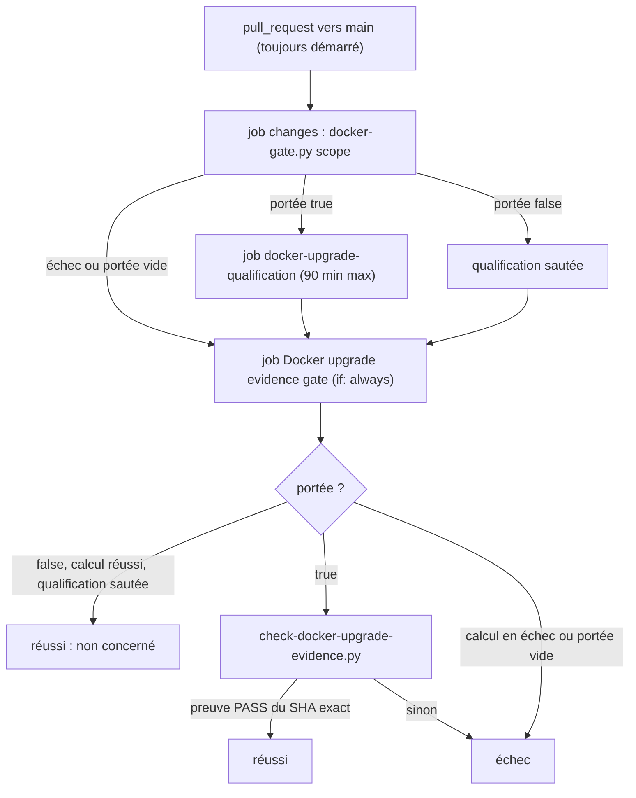

# Design

Changement d'outillage et de configuration CI : seules les sections Contexte, État vérifié, Écarts, Diagrammes, Décisions, Vérification et Traçabilité sont développées. Les autres sections du modèle sont « Non applicable : aucun code du produit, aucune surface publique, aucune donnée persistée n'est touché ».

## Contexte

Motivation : `proposal.md` (Why). Fichiers touchés : `.github/workflows/release-promotion-gate.yml`, un nouveau script `scripts/ci/docker-gate.py` et son auto-test `scripts/ci/test_docker_gate.py`, `.github/workflows/pr-ci.yml` (câblage de l'auto-test dans le job `invariants`), les attentes littérales de trois gates, la documentation des gates.

Le point dur est le ruleset : `Docker upgrade evidence gate` est un check exigé. S'il ne rend pas de verdict (workflow non démarré, job sauté sans job de verdict), **toute** pull request est bloquée. Le design garde donc le workflow sur toute PR et déplace la restriction dans un `if:` de job, admis par l'exigence `controles-de-fusion › Un check exigé peut toujours rendre un verdict`.

## État vérifié au HEAD

HEAD `89be3fb4`. Lecture ; aucun workflow exécuté, aucune durée mesurée.

| Fait | Preuve |
|---|---|
| [Existant vérifié] Déclencheurs : `pull_request` vers `main`, `workflow_dispatch` ; pas de `paths` | `.github/workflows/release-promotion-gate.yml:20-23` |
| [Existant vérifié] Job `docker-upgrade-qualification` : `timeout-minutes: 90`, login Docker Hub conditionnel, deux `setup-java`, `qualify-docker-upgrade.ps1` avec A = `pull_request.base.sha` | `release-promotion-gate.yml:34-107` |
| [Existant vérifié] Job `docker-upgrade-evidence`, nommé `Docker upgrade evidence gate`, `needs: docker-upgrade-qualification`, `if: always()`, lance `check-docker-upgrade-evidence.py` | `release-promotion-gate.yml:118-161` |
| [Existant vérifié] Le ruleset « Release promotion gate (main only) » exige ce seul contexte | `.github/required-checks.json` (bloc du second ruleset) |
| [Existant vérifié] `check-ci-wiring.py` refuse `paths` / `paths-ignore` sous `pull_request` pour un check exigé | `scripts/quality/check-ci-wiring.py:143`, `:212-222` |
| [Existant vérifié] `check-docker-upgrade-evidence.py` exige un artefact `docker-upgrade-<sha>-*`, un job de qualification conclu `success` et un manifeste `PASS` ; il reconnaît le nom du job de qualification | `scripts/release/check-docker-upgrade-evidence.py:1-25`, `:73-81` |
| [Existant vérifié] Littéraux exigés dans le workflow par un gate de remédiation, dont `needs: docker-upgrade-qualification` | `scripts/remediation/check-audit-remediation-v2.py:169-187` (le littéral `needs: docker-upgrade-qualification` est à la ligne 184) |
| [Existant vérifié] `DOCKER_LOGIN_KEPT` exempte ce job : « Candidate A is real main, whose Dockerfile may name other base-image digests than the candidate's » | `scripts/quality/check-workflow-pins.py:126-131` |
| [Existant vérifié] Sans les secrets (forks, Dependabot sans secret dédié), les pulls sont anonymes ; limite de débit observée le 2026-10-09 | `release-promotion-gate.yml:51-56` |
| [Existant vérifié] Modèle existant : job `changes` + `plugin-gate.py scope|verdict`, doute = concerné, portée vide = concernée | `.github/workflows/intellij-plugin.yml:22-49` ; `scripts/ci/plugin-gate.py:51-82`, `:109-111` |
| [Existant vérifié] La qualification construit le jar du produit par Maven et l'image par `docker/Dockerfile.mcp.release` | `scripts/ci/qualify-docker-upgrade.ps1:75-99`, `:231`, `:297-299` |
| [Existant vérifié] La preuve est indexée sur le SHA de tête de la PR (nom de l'artefact) ; `main` reçoit un commit de fusion, d'un autre SHA | `release-promotion-gate.yml:113` ; historique de `main` (« Merge pull request #… ») |
| [Existant vérifié] La qualification construit sans les tests : `-DskipTests -DskipITs clean package` | `scripts/ci/qualify-docker-upgrade.ps1:89`, `:93` |
| [Existant vérifié] Les deux jobs exigés qui déclarent `needs:` portent `if: always()` ; aucun gate ne le garde | `release-promotion-gate.yml:120-121` ; `.github/workflows/intellij-plugin.yml:169-170` ; `scripts/quality/check-ci-wiring.py` (aucune lecture de `if:`) |
| [Existant vérifié] Dependabot : cinq écosystèmes vers `main` (maven, gradle du plugin, github-actions, docker, docker-compose) | `.github/dependabot.yml:3-79` |
| [Existant vérifié] Aucun autre workflow n'appelle `check-docker-upgrade-evidence.py` (les workflows de release ne revérifient pas la preuve) | `rg "check-docker-upgrade-evidence" .github` : `release-promotion-gate.yml:161` seul |

## Écarts

| Écart | Source A | Source B | Suite proposée |
|---|---|---|---|
| E1. L'audit propose de « filtrer le déclenchement sur les chemins » | action d'AUD-DEP-03 | un check exigé d'un workflow filtré reste en attente ; `check-ci-wiring.py:216` le refuse | Portée calculée dans un job, verdict toujours rendu (D2) — c'est la seconde moitié de la phrase de l'audit (« job `gate` toujours présent ») |
| E2. La liste de chemins de l'audit (`docker/**`, packaging, `scripts/install/**`, poms, `minos-storage`) est une liste d'inclusion, trop étroite | action d'AUD-DEP-03 | l'image embarque le jar ombré de tout le reactor : un changement de n'importe quel `minos-*/src/main` change le candidat B et peut casser la mise à niveau d'une installation | Liste d'**exclusion** fermée (D3) : hors portée seulement si tout le diff est sans effet sur l'image |
| E3. « Garder le gate pour les seules PR de release » | alternative de l'audit | il n'existe plus de PR de release distincte : une release est un tag posé sur `main` | Écartée ; la qualification d'un candidat de release reste possible et obligatoire par déclenchement manuel (D4) |
| E4. Le job de verdict doit attendre deux jobs ; le littéral `needs: docker-upgrade-qualification` est affirmé par un gate | `check-audit-remediation-v2.py:184` | forme cible `needs: [changes, docker-upgrade-qualification]` | Mettre à jour l'attente du gate dans la même tâche (skill `minos-literal-gates`) |
| E5. Aucun commit de `main` n'a de preuve pour son SHA exact, avant comme après le changement : la preuve porte le SHA de tête de la PR, `main` reçoit un commit de fusion | `release-promotion-gate.yml:113` | la procédure de release cite ce check comme preuve du candidat | La procédure de release (`minos-release-promotion`) lance **toujours** la qualification manuelle sur le SHA à taguer (D4) |
| E6. « Exécuté même si un job amont a été sauté » repose sur `if: always()`, qu'aucune commande locale ne vérifie | `release-promotion-gate.yml:121` | exigence `controles-de-fusion › Le gate de preuve Docker rend un verdict sur toute pull request` | Contrôle littéral ajouté à `check-ci-wiring.py` : job exigé avec `needs:` ⇒ `if: always()` (`controles-de-fusion › Un job exigé qui attend d'autres jobs s'exécute quel que soit leur résultat`, D7) |

## Diagrammes

### Comment le check exigé rend-il toujours un verdict ?

Type : flowchart · Portée : cible proposée · Exigences : `controles-de-fusion › Le gate de preuve Docker rend un verdict sur toute pull request`, `controles-de-fusion › Une pull request n'échappe à la qualification Docker que par une liste fermée de chemins`

Le job de verdict est le seul dont le nom est exigé ; il s'exécute dans tous les cas et ne réussit hors portée que si le calcul de portée a lui-même réussi.

## Décisions

### D1 — Borner la qualification aux PR concernées — **en attente du propriétaire**

[Proposition] Options : (a) borner par portée calculée (ce changement) ; (b) garder la qualification sur toute PR (décision du 2026-11-13, état actuel) et n'ajouter que les secrets Dependabot ; (c) retirer le check du ruleset et ne qualifier qu'à la release (affaiblit un contrôle exigé). Recommandation : **(a)**, après la mesure de durée demandée par la décision du 2026-11-13 (tâche 1.1). Elle garde le check exigé, n'en change pas le nom, et reste fail-closed. Si le propriétaire retient (b), seules les tâches 1.1 et 3.1 à 3.2 s'appliquent et ce changement est réduit par `/opsx:update`.

### D2 — Portée dans un job, verdict dans le job exigé

[Décision, sous D1] Job `changes` (checkout `fetch-depth: 0`, Python, `docker-gate.py scope`) ; `docker-upgrade-qualification` reçoit `needs: changes` et `if: needs.changes.outputs.docker == 'true'` ; `docker-upgrade-evidence` garde son `name:` exact, `if: always()`, attend les deux jobs et appelle `docker-gate.py verdict` puis, si concerné, `check-docker-upgrade-evidence.py`. Écarté : `paths:` (E1) ; un second workflow de verdict (deux déclencheurs à garder en phase).

### D3 — Liste d'exclusion fermée, à valider par le propriétaire

[Proposition] Chemins proposés comme sans effet sur l'image ni sur sa mise à niveau : `docs/`, `openspec/`, `.claude/`, `minos-intellij/`, les fichiers `*.md` de la racine, et les sources de test (`*/src/test/`). Tout le reste est concerné, dont `.github/`, `scripts/`, `docker/`, `pom.xml`, `*/pom.xml`, `mvnw*`, `.mvn/`, `*/src/main/`, `fixtures/`. L'auto-test refuse qu'une entrée de la liste couvre `docker/`, un POM, `.github/workflows/release-promotion-gate.yml`, `scripts/ci/`, `scripts/release/` ou un `src/main`. Conséquence pour Dependabot : `gradle` (plugin) est hors portée ; `maven`, `docker`, `docker-compose` et `github-actions` restent concernés. Les sources de test sont exclues à bon droit : la qualification construit par `-DskipTests -DskipITs clean package` (`qualify-docker-upgrade.ps1:89`, `:93`). Les tests restent compilés par cette commande (`skipTests` n'empêche pas `test-compile`) : une PR qui ne modifie que des tests ne change pas le jar, et sa compilation est jugée par `Verify`.

### D4 — Un déclenchement manuel est toujours concerné ; la release s'y appuie

[Décision] `workflow_dispatch` rend la portée `true`. La procédure de release lance toujours la qualification (`release-promotion-gate.yml` ou `docker-upgrade-qualification.yml`, par déclenchement manuel) sur le SHA à taguer, quelle que soit la portée des dernières PR : la preuve d'une PR porte le SHA de sa tête, jamais celui du commit de fusion (E5). `.claude/skills/minos-release-promotion/SKILL.md` le dit.

### D5 — Script propre au gate Docker, sur le modèle de `plugin-gate.py`

[Proposition] `scripts/ci/docker-gate.py` (`scope`, `verdict`) et `scripts/ci/test_docker_gate.py`, câblé dans le job `invariants`. La fonction de lecture du diff est la même que celle de `plugin-gate.py:51-62` : soit elle est extraite dans un module partagé de `scripts/ci/`, soit elle est recopiée et déclarée au gate des fonctions recopiées (`controles-de-fusion › Les fonctions de scripts recopiées restent identiques`). Recommandation : module partagé, si le gate des copies ne couvre pas `scripts/ci/` ; à trancher à l'implémentation.

### D7 — Garder `if: always()` des jobs exigés par un contrôle littéral

[Décision] `check-ci-wiring.py` résout déjà chaque contexte exigé vers un job : pour un job résolu qui déclare `needs:`, il exige une ligne `if:` de niveau job contenant `always()`. Deux jobs sont concernés au HEAD et la portent déjà. Écarté : s'en remettre à la preuve en CI seule (un `if:` retiré ne se verrait que sur la première PR hors portée, bloquée).

### D6 — Réévaluer l'entrée `DOCKER_LOGIN_KEPT` par la mesure

[Proposition] Le candidat A étant la base de la PR, les images de base de A et de B sont lisibles (`git show <base>:docker/Dockerfile.mcp.release`) avant la connexion : le job pourrait tirer ces images, se déconnecter, puis lancer le script. Condition : connaître **toutes** les images tirées par la qualification (Dockerfile des deux candidats et fichiers compose). Recommandation : lister les pulls sur un run réel (tâche 3.1) ; retirer l'entrée seulement si la liste est fermée et lisible avant le login, sinon réécrire sa raison (« A est la base de la PR » ne suffit plus à la justifier). Le refus des entrées périmées (`check-workflow-pins.py:420-424`) garde la table en phase.

## Vérification

- Auto-tests : `python scripts/ci/test_docker_gate.py` (portée : documentation seule, mélange, chemin inconnu, base vide, `workflow_dispatch`, liste interdite ; verdict : hors portée, échec, saut injustifié, calcul en échec), `python scripts/ci/test_plugin_gate.py` (inchangé), `python scripts/release/test_check_docker_upgrade_evidence.py`.
- Gates : `python scripts/quality/check-ci-wiring.py` et `python scripts/quality/test_check_ci_wiring.py` (check exigé résolu, nouvel auto-test câblé, condition `if: always()` des jobs exigés à `needs:`), `python scripts/remediation/check-audit-remediation-v2.py`, `python scripts/quality/check-workflow-pins.py`, `python scripts/quality/check-toolchain-baseline.py`, `python scripts/quality/check-single-execution.py`, `python .claude/scripts/run_gates.py`.
- Preuve en CI (à la demande du propriétaire) : la PR du changement est elle-même concernée (elle modifie le workflow) et doit passer la qualification complète ; une PR documentaire ultérieure doit montrer la qualification sautée et le check `Docker upgrade evidence gate` vert en quelques minutes.
- Contrôle du ruleset : `python scripts/quality/verify-ruleset.py` contre GitHub (manuel) — le contexte exigé garde son nom.
- Non mesuré : durée de la qualification par PR ; liste exhaustive des images tirées.

## Traçabilité

| Exigence (capacité › titre) | Scénario | Conception ou diagramme | Tâche | Test ou preuve |
|---|---|---|---|---|
| controles-de-fusion › Le gate de preuve Docker rend un verdict sur toute pull request | Pull request hors portée | D2, diagramme | 2.1, 2.2 | `test_docker_gate.py#VerdictTest.test_a_pull_request_out_of_scope_with_a_skipped_qualification_passes_for_that_reason` (rouge : le test ne se charge pas sans le script, `FileNotFoundError`) |
| idem | Pull request concernée dont la qualification échoue | D2 | 2.1, 2.2 | `VerdictTest.test_a_concerned_pull_request_whose_qualification_fails_or_is_cancelled_fails` |
| idem | Saut injustifié | D2 | 2.1, 2.2 | `VerdictTest.test_a_skip_that_the_scope_does_not_justify_fails` |
| idem | Calcul de portée en échec | D2 | 2.1, 2.2 | `VerdictTest.test_a_scope_computation_that_did_not_succeed_fails_whatever_it_said`, `…test_an_empty_scope_is_treated_as_in_scope` |
| idem | Check exigé toujours joignable | D2 (E1) | 2.3 | `check-ci-wiring.py` (8 contextes résolus) ; run CI d'une PR documentaire — **manquante** (tâche 2.4) |
| controles-de-fusion › Un job exigé qui attend d'autres jobs s'exécute quel que soit leur résultat | Job exigé sans la condition | D7 (E6) | 2.3 | `test_check_ci_wiring.py#RequiredJobWithNeedsTest.test_a_required_job_with_needs_and_without_the_condition_is_refused` (rouge observé : 6 échecs avant la règle) |
| idem | Dépôt réel | D7 | 2.3 | `check-ci-wiring.py` ; `RequiredJobWithNeedsTest.test_the_required_jobs_of_the_repository_that_wait_carry_the_condition` |
| idem | Job exigé sans dépendance | D7 | 2.3 | `RequiredJobWithNeedsTest.test_a_required_job_without_needs_is_not_concerned` |
| controles-de-fusion › Une pull request n'échappe à la qualification Docker que par une liste fermée de chemins | Documentation seule | D3 | 2.1, 2.2 | `ScopeTest.test_documentation_alone_is_out_of_scope`, `ChangedFilesTest.test_a_pull_request_that_only_changes_documents_is_out_of_scope` |
| idem | Un fichier de l'image parmi des documents | D3 | 2.1, 2.2 | `ScopeTest.test_a_file_of_the_image_among_documents_puts_the_pull_request_in_scope`, `ChangedFilesTest.test_a_file_of_the_image_among_documents_is_in_scope` |
| idem | Chemin absent de la liste | D3 | 2.1, 2.2 | `ScopeTest.test_a_path_the_list_does_not_name_is_in_scope`, `ChangedFilesTest.test_an_unknown_directory_is_in_scope` |
| idem | Base introuvable ou déclenchement manuel | D3, D4 | 2.1, 2.2 | `ChangedFilesTest.test_an_empty_base_an_unknown_base_and_a_git_failure_are_in_scope`, `…test_a_manual_dispatch_is_in_scope` |
| idem | Liste élargie à un chemin de l'image | D3 | 2.1, 2.2 | `ExclusionListTest.test_a_list_widened_to_a_path_of_the_image_is_refused_by_entry`, `…test_a_pattern_that_covers_a_pom_or_a_main_source_is_refused_by_entry` |

## Questions ouvertes

- [Question] Durée réelle de la qualification par PR (tâche 1.1) : elle motive D1 mais ne change ni les specs ni les tâches.
- [Question] Sort de l'entrée `DOCKER_LOGIN_KEPT` (D6) : tranché par la mesure de la tâche 3.1.

## Ordre de fusion

Après `solder-les-restes-de-java-25-et-de-develop` (même fichier `release-promotion-gate.yml`) et après `separer-le-jeton-sonarcloud-de-la-compilation-de-la-pr` (même `check-workflow-pins.py`, autre table). Le job `changes` ajouté ici ne pose aucun `secrets.` dans son `env:`.

## Écarts constatés à l'implémentation

- **Décisions non prises, recommandations appliquées** : D1 (borner par portée) et la liste d'exclusion de D3 sont appliquées telles que le design les propose, sans la mesure de durée (1.1) ni la décision du propriétaire (1.2). Si le propriétaire retient « garder sur toute PR », ce changement se réduit par `/opsx:update` aux groupes 1 et 3.
- **D5** : la lecture du diff n'est pas recopiée : `docker-gate.py` charge `changed_files` de `plugin-gate.py` par `importlib` (le gate des fonctions recopiées ne lit que les `.ps1`). `plugin-gate.py` est inchangé.
- Un diff vide est « concerné » (aucun fichier ne prouve l'absence d'effet), en plus des cas du design.
- **D6 / groupe 3 non faits** : l'entrée `DOCKER_LOGIN_KEPT` de `release-promotion-gate.yml` reste telle quelle ; elle exige la liste des images tirées sur un run réel (3.1) et, pour Dependabot, des secrets du dépôt (3.2).
- Le verdict n'évalue pas la preuve : le pas suivant, `check-docker-upgrade-evidence.py`, ne s'exécute que si la portée n'est pas `false`. Le littéral exigé par `check-audit-remediation-v2.py` devient `needs: [changes, docker-upgrade-qualification]`.
- Un check exigé qui déclare `needs:` sans `if:` à `always()` est refusé (règle 8 de `check-ci-wiring.py`) ; les deux jobs concernés du dépôt la portent.
- Non mesuré : la durée de la qualification, tout run de CI (2.4), l'état du ruleset GitHub.
