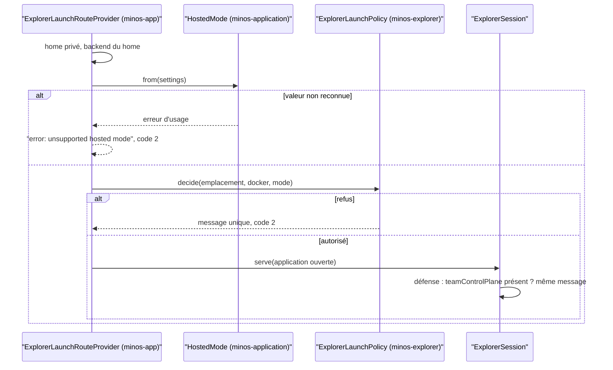

# Design

## Contexte

Motivation : voir `proposal.md` (Why). Modules touchés : `minos-application` (interprétation du mode équipe), `minos-explorer` (politique de lancement), `minos-app` (route), garde de frontières. Surface publique : texte d'un refus de `minos explorer serve`. Windows et Linux : la lecture du backend du home ne concerne que le lanceur d'un poste ; dans le runtime Docker elle n'a pas lieu.

## État vérifié au HEAD

Relu au commit `89be3fb4`.

| Fait | Preuve |
|---|---|
| La route lit `MINOS_HOSTED_MODE` et refuse toute valeur différente de `disabled` (minuscules `Locale.ROOT`) | `minos-app/src/main/java/com/minos/app/ExplorerLaunchRouteProvider.java:77-81` |
| La configuration d'exécution : absent ou `disabled` → rien ; `enabled` → clés d'équipe ; autre → `IllegalArgumentException("unsupported hosted mode: …")` | `minos-application/src/main/java/com/minos/application/MinosApplicationRuntimeConfiguration.java:62-70` |
| `MinosRuntimeSettings.value` rend `null` pour une valeur vide | `minos-engine/src/main/java/com/minos/storage/MinosRuntimeSettings.java:94-99` |
| `ExplorerSession` refuse sur l'application ouverte quand `teamControlPlane()` est présent | `minos-explorer/src/main/java/com/minos/explorer/ExplorerSession.java:71-74` |
| Les noms du réglage sont des constantes de `MinosApplication`, qu'un gate exige à cet endroit ; `MinosApplication` importe déjà `com.minos.application.team` | `MinosApplication.java:12`, `:71-72` ; `scripts/quality/check-hosted-control-plane-consistency.py:97-98` |
| L'emplacement d'exécution est `com.minos.domain.registry.ProjectPathMapping.RuntimeLocation`, type du domaine | `ExplorerLaunchRouteProvider.java:6`, `:71` |
| Le test de la route boucle sur `enabled`, `ENABLED` et `anything-else` et attend pour les trois le message du mode équipe | `minos-app/src/test/java/com/minos/app/ExplorerLaunchRouteProviderTest.java:104-118` |
| Deux textes `TEAM_MODE_REFUSED` : celui de la route cite `MINOS_HOSTED_MODE / minos.hosted.mode`, celui de la session `MINOS_HOSTED_MODE` seul | `ExplorerLaunchRouteProvider.java:32-34` ; `ExplorerSession.java:22-24` |
| Le refus Docker s'appuie sur `McpBackendConfigurationStore` et `McpBackend.DOCKER`, lus sans création | `ExplorerLaunchRouteProvider.java:93-97` |
| Le fichier du réglage est `MINOS_HOME/runtime/backend.properties`, nom déjà neutre | `minos-app/src/main/java/com/minos/app/McpBackendConfigurationStore.java:` constantes `RUNTIME_DIRECTORY`, `FILE_NAME` |
| `minos-app` : 8 classes de production (7 sous `com.minos.app`, `com.minos.integration.nexus.NexusExportBridgeMain`), 635 lignes ; 2 `new ProcessBuilder` dans `DockerMcpTransport` | décompte ; `DockerMcpTransport.java:114`, `:190` |
| Gates qui citent ces classes | `scripts/remediation/check-post-mne.py:94`, `:185` ; `scripts/remediation/check-p0-p2.py:178`, `:288-294` ; `scripts/quality/check-jacoco.py:236-237` ; `scripts/install/configure-runtime-settings.ps1:263` (commentaire) |
| Gate qui affirme `"enabled"` et `"disabled"` dans la configuration d'exécution | `scripts/quality/check-hosted-control-plane-consistency.py:100-102` |
| `minos-explorer` dépend de `minos-application` et non de `minos-app` ni de `minos-cli` | `scripts/architecture/check-module-boundaries.py:83` |

Non mesuré : aucun test exécuté ; le contenu des tests de `ExplorerSession` n'a pas été relu.

## Écarts

| Écart | Source A | Source B | Suite proposée |
|---|---|---|---|
| Une valeur non reconnue du mode équipe est annoncée « mode équipe activé » par la route, « unsupported hosted mode » par l'ouverture | `ExplorerLaunchRouteProvider.java:79` | `MinosApplicationRuntimeConfiguration.java:66-68` | Règle unique ; la route rend l'erreur d'usage de la valeur |
| L'audit demande d'utiliser la fonction unique sur « les trois sites » | `findings.json`, AUD-ARC-05, action | `ExplorerSession` n'a que l'application ouverte, pas les réglages ; son contrôle est une défense en profondeur sur l'état effectif | La session garde `teamControlPlane().isPresent()` et partage le message (D2) |
| L'audit demande de « renommer ou généraliser McpBackendConfiguration » | action de l'audit | 3 gates littéraux, 1 scope JaCoCo et 1 script d'installation citent ces noms ; le fichier persisté a déjà un nom neutre | D3 : pas de renommage, Javadoc corrigée |
| L'audit demande de « garder dans minos-app uniquement le câblage ServiceLoader » | action de l'audit | `DockerMcpTransport` et la persistance du backend y vivent par décision antérieure (AUD-ARC-11 du 2026-10-10) | Ce changement sort la politique de lancement et fige le reste par liste fermée |

## Exigences couvertes

- exploration-semantique › Le mode équipe est interprété par une seule règle au lancement de l'explorateur — D1.
- exploration-semantique › Chaque refus de lancement de l'explorateur a un seul texte — D2.
- frontieres-de-modules › Les classes de production de minos-app sont tenues par liste fermée — D4.

## Objectifs et non-objectifs

Objectif : une règle, un texte par refus, et un module d'assemblage dont le contenu est surveillé. Non-objectif : changer quand l'explorateur démarre (hors valeur non reconnue), déplacer le transport MCP.

## Responsabilités et frontières des composants

- `minos-application`, package `com.minos.application` : `HostedMode` (`DISABLED`, `ENABLED`) et `HostedMode.from(MinosRuntimeSettings)`, qui lit `MinosApplication.HOSTED_MODE_PROPERTY` et `HOSTED_MODE_ENV`. La configuration d'exécution l'utilise. Le package `com.minos.application.team` est exclu : `MinosApplication` l'importe déjà, et une classe de ce package qui lirait les constantes de `MinosApplication` fermerait un cycle `application ↔ application.team` (A8). [Proposition]
- `minos-explorer` : `ExplorerLaunchPolicy` — fonction pure `(ProjectPathMapping.RuntimeLocation, home sur backend Docker, HostedMode) → autorisé | refus(message)` ; l'emplacement d'exécution est le type du domaine `com.minos.domain.registry.ProjectPathMapping.RuntimeLocation`, que `minos-explorer` peut nommer (dépendance `minos-domain` permise) ; détient `DOCKER_BACKEND_REFUSED` et `TEAM_MODE_REFUSED`. `ExplorerSession` réutilise la constante.
- `minos-app` : `ExplorerLaunchRouteProvider` valide le home, lit le backend (classe de `minos-app`), charge les réglages, appelle la politique, ouvre et sert. Direction ARCH-0068 : `app → explorer → application`, arêtes existantes.

## Modèle de domaine et invariants

`HostedMode.from` : `null` (absent ou vide) et `disabled` → `DISABLED` ; `enabled` → `ENABLED` ; comparaison `Locale.ROOT` insensible à la casse ; sinon `IllegalArgumentException("unsupported hosted mode: <valeur>")`. Si le changement `distinguer-l-erreur-d-usage-de-l-echec-interne` est fusionné avant, l'exception levée est sa `UsageException` (`minos-domain`, `com.minos.diagnostics`), sous-classe d'`IllegalArgumentException` : le message est le même, et la route la rend en erreur d'usage. Ce changement ne passe pas par la façade `com.minos.application.diagnostics.InternalFailureReporter` du même changement : un refus de lancement est une erreur d'usage, pas un échec interne.

## Traitements et interactions

Voir le diagramme. L'ordre du HEAD est conservé : home privé, refus Docker, puis mode équipe, puis ouverture.

## États et transitions

Non applicable.

## Contrats d'interface

CLI `minos explorer serve` : codes de sortie inchangés (0, 1, 2). Texte du refus en mode équipe : celui de la route au HEAD (le plus complet, il cite la variable et la propriété). Valeur non reconnue : `error: unsupported hosted mode: <valeur>`, code 2. Compatibilité : texte d'erreur sur stderr ; `ExplorerLaunchRouteProviderTest.java:104-118` l'affirme pour `anything-else` et change avec D1 ; la présence du texte dans un golden est contrôlée par la tâche 2.3.

## Persistance et intégrité

Non applicable : `runtime/backend.properties` est lu comme au HEAD, jamais créé par l'explorateur.

## Transactions, concurrence et idempotence

Non applicable.

## Sécurité et isolation

Fail-closed renforcé : une valeur illisible du mode équipe ne peut plus mener à un démarrage, ni être confondue avec un état connu. Le home est rendu privé avant toute lecture (inchangé). Aucun chemin absolu dans les messages ; la valeur citée est celle du réglage, comme à l'ouverture de l'application.

## Erreurs et reprise

Refus = erreur d'usage, code 2, rien n'est ouvert ni écouté.

## Observabilité

Non applicable.

## Performance et mesure

Non applicable.

## Compatibilité, migration et retour arrière

Aucune donnée ; retour arrière par annulation de la PR.

## Diagrammes

### Qui décide du lancement de l'explorateur ?

Type : sequenceDiagram · Portée : cible · Exigences : exploration-semantique › Le mode équipe est interprété par une seule règle au lancement de l'explorateur ; › Chaque refus de lancement de l'explorateur a un seul texte

## Décisions

### D1 — Une valeur non reconnue est une erreur d'usage, pas « mode équipe activé » [Proposition]

Aligne la route sur l'ouverture de l'application. Le refus et le code 2 demeurent ; seul le texte change. Le cas `anything-else` de `ExplorerLaunchRouteProviderTest.java:104-118` encode le comportement du HEAD : il est modifié (la boucle garde `enabled` et `ENABLED`, un cas distinct attend `unsupported hosted mode` pour `anything-else`). Sur un poste au backend Docker, le refus Docker reste premier (le mode équipe n'est pas lu), comme au HEAD.

### D2 — La session garde son contrôle sur l'application ouverte [Proposition]

Elle est appelée aussi par des tests et par toute route future ; son contrôle porte sur l'état effectif. Elle partage la constante de la politique.

### D3 — Ne pas renommer `McpBackend*` [Proposition, attend le propriétaire]

Recommandation : garder les noms. Le renommage toucherait `check-post-mne.py`, `check-p0-p2.py`, `check-jacoco.py`, le commentaire de `configure-runtime-settings.ps1` et les tests, sans effet observable ; le fichier `runtime/backend.properties` porte déjà un nom neutre. La Javadoc dit que le réglage est le backend d'exécution du home, lu par les routes MCP et explorateur.

### D4 — Liste fermée des classes de `minos-app` [Proposition]

Table du garde (nom proposé : `ASSEMBLY_CLASSES`, classe → rôle), 8 entrées au HEAD. Elle répond à la réserve « rien ne surveille le contenu de minos-app ». AUD-ARC-04 (sprint 8) la fera lire depuis la source unique.

### D5 — Aucun ADR [Décision de forme]

Le changement applique ARCH-0082 et ARCH-0042 ; il ne fixe pas de choix nouveau entre options durables.

## Qualification des capacités

exploration-semantique : comportement de lancement qualifié sur Windows et Linux par les tests de la route (emplacement d'exécution injecté). Runtime Docker : la lecture du backend n'a pas lieu, comportement conservé.

## Risques et compromis

- [Risque] Conflit de fichier avec `fiabiliser-la-surface-de-l-explorateur` (sprint 3), qui touche `ExplorerSession`, `ExplorerServer` et `ExplorerApi` → ce changement ne modifie d'`ExplorerSession` que la constante `TEAM_MODE_REFUSED` (`:22-24`) et son usage (`:71-74`) ; fusionner le sprint 3 d'abord, puis rebaser.
- [Risque] Conflit avec `unifier-le-contrat-des-codes-de-sortie` sur `ExplorerLaunchRouteProvider.java:101` (ce dernier ne modifie pas `ExplorerSession`) → fusionner ce dernier d'abord (mécanique).
- [Risque] Conflit avec `cabler-les-adaptateurs-embarques-par-la-racine-de-composition` sur `MinosApplicationRuntimeConfiguration` (méthodes distinctes) → rebase simple.
- [Risque] Gate littéral `check-hosted-control-plane-consistency.py:100-102` → attente `"enabled"` / `"disabled"` déplacée vers `HostedMode.java` ; l'attente de `:97-98` reste satisfaite, les constantes ne quittent pas `MinosApplication.java`.

## Vérification

- Tests : `HostedModeTest` (nouveau, `minos-application`), `ExplorerLaunchPolicyTest` (nouveau, `minos-explorer`), `ExplorerLaunchRouteProviderTest`, tests d'`ExplorerSession`, `M23`/hosted existants de `minos-bootstrap`.
- Gates : `check-module-boundaries.py` et auto-test, `check-hosted-control-plane-consistency.py`, `check-post-mne.py`, `check-p0-p2.py`, `check-comment-language.py`, `check-ci-wiring.py`.
- JaCoCo : scope de `check-jacoco.py:236-237`.
- Commandes : `./mvnw -B -ntp -pl minos-explorer -am test`, `./mvnw -B -ntp -pl minos-app -am test`.

## Documentation durable à mettre à jour

`docs/user/semantic-explorer.md` (refus de lancement), `docs/user/team-hosted-mode.md` (valeurs admises), dossiers `docs/architecture/diagrams/capacites/exploration-semantique.md` et `frontieres-de-modules.md`.

## Traçabilité

| Exigence (capacité › titre) | Scénario | Conception ou diagramme | Tâche | Test ou preuve |
|---|---|---|---|---|
| exploration-semantique › Le mode équipe est interprété par une seule règle au lancement de l'explorateur | Mode équipe activé ; désactivé ou absent | séquence | 2.1 | `ExplorerLaunchRouteProviderTest#aHomeInTeamModeIsRefusedBeforeAnythingIsOpened` (`enabled`, `ENABLED`, `Enabled`), `#aHomeWhoseTeamModeIsDisabledIsServed` ; `ExplorerLaunchPolicyTest` |
| idem | Valeur non reconnue | D1 | 2.1 | `ExplorerLaunchRouteProviderTest#anUnsupportedTeamModeIsAUsageErrorBeforeAnythingIsOpened` |
| idem | Même règle que l'application | Modèle | 1.1 | `HostedModeTest` (classement par la règle et par l'ouverture ; `enabled` classé par la règle seule, l'ouverture demandant la racine de composition) |
| exploration-semantique › Chaque refus de lancement de l'explorateur a un seul texte | Une seule définition | D2 | 2.2 | recherche `is not available when the team mode is enabled` : une ligne, `ExplorerLaunchPolicy.java` |
| idem | Même texte avant et après l'ouverture | D2 | 2.1 | `ExplorerLaunchRouteProviderTest` et `ExplorerSessionTest` comparent la sortie à `ExplorerLaunchPolicy.TEAM_MODE_REFUSED` |
| idem | Home au backend Docker sur un poste | séquence | 2.1 | `ExplorerLaunchRouteProviderTest#aHomeOnTheDockerBackendIsNotOpenedOnTheHost`, `#theDockerBackendIsRefusedFirstWithoutReadingTheTeamMode` |
| frontieres-de-modules › Les classes de production de minos-app sont tenues par liste fermée | les quatre scénarios | D4 | 3.1, 3.2 | `AssemblyClassesRuleTest` (`test_check_module_boundaries.py`), règle A20 |

## Questions ouvertes

- D3 : décision du propriétaire (recommandation : pas de renommage).
