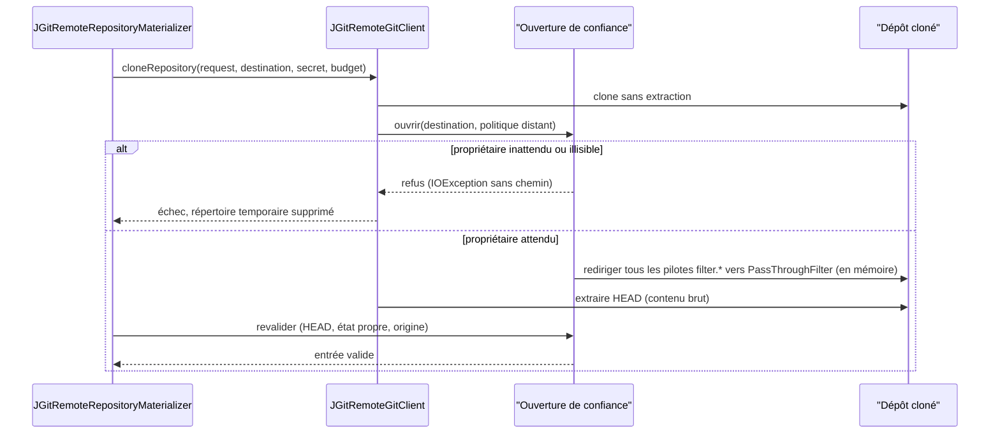

# Design

## Contexte

Motivation : `proposal.md` (Why). Module touché : `minos-integration-git` seul. Deux chemins lisent un dépôt Git non fiable : l'analyse locale (`GitIntelligenceService`, couverte par la décision du 2026-10-13) et la matérialisation d'un dépôt distant (`JGitRemoteRepositoryMaterializer` et `JGitRemoteGitClient`), qui ne l'est pas. Windows et Linux sont concernés à l'identique.

## État vérifié au HEAD

HEAD `89be3fb4`. Aucun test ni build exécuté : lecture du code.

| Fait | Preuve |
|---|---|
| [Existant vérifié] Le clone est un `Git.cloneRepository()` avec extraction complète (`setDepth(1)`, sous-modules désactivés), sans registre de filtres ni configuration isolée | `minos-integration-git/src/main/java/com/minos/integration/git/JGitRemoteGitClient.java:25-35` |
| [Existant vérifié] `validateCheckout` ouvre par `Git.open(repositoryRoot.toFile())`, résout HEAD, appelle `git.status().call()` et compare l'URL d'origine | `JGitRemoteRepositoryMaterializer.java:282-293` |
| [Existant vérifié] `validateCheckout` est appelé après le clone et à la réutilisation d'une entrée du cache | `JGitRemoteRepositoryMaterializer.java:202` et `:253` |
| [Existant vérifié] L'ouverture de confiance (`open`) contrôle le propriétaire du répertoire Git et du répertoire commun, puis redirige les pilotes déclarés par la configuration du dépôt vers `PassThroughFilter` | `GitIntelligenceService.java:218-249`, `:257-272`, `:323-341` |
| [Existant vérifié] Cette ouverture est privée à `GitIntelligenceService` ; `Git.open` et `FileRepositoryBuilder` n'apparaissent qu'à deux endroits du code principal du reactor | `rg "Git.open\|FileRepositoryBuilder" minos-*/src/main` : `GitIntelligenceService.java:226`, `JGitRemoteRepositoryMaterializer.java:283` |
| [Existant vérifié] Aucun `SystemReader` ni `GIT_CONFIG_NOSYSTEM` dans le code principal | même recherche, zéro occurrence |
| [Existant vérifié] Un test fixe le choix « filtre de l'utilisateur appliqué » pour un dépôt local, dans une JVM fille au répertoire personnel redirigé | `minos-integration-git/src/test/java/com/minos/integration/git/GitIntelligenceTrustTest.java:150-171` (`aFilterOfTheUserConfigurationIsStillApplied`, sonde `UserConfigurationProbe` `:175-179`) |
| [Existant vérifié] Un gate littéral lit les deux fichiers à modifier | `scripts/quality/check-remote-distributed-consistency.py:60-72` (exige `isClean`, `expectedCommit`, `new JGitRemoteGitClient`, `setCloneSubmodules(false)`, `setDepth(1)`, `credentials.clear`, `JGitCloneDeadline.configure`, `CloneProgressMonitor`) |
| [Existant vérifié] Scope JaCoCo qui nomme `JGitRemoteRepositoryMaterializer` et `JGitCloneDeadline` | `scripts/quality/check-jacoco.py:148`, plancher `:162` |

Lu dans les sources de JGit 7.8.1 (`pom.xml`, `jgit.version` ; jar de sources du dépôt Maven local) :

| Fait | Preuve |
|---|---|
| [Existant vérifié] À l'extraction, la commande `smudge` du pilote choisi par les attributs est exécutée : filtre intégré si elle est enregistrée, commande externe sinon | `org/eclipse/jgit/dircache/DirCacheCheckout.java:1493-1497` |
| [Existant vérifié] La commande d'un pilote vient de la configuration fusionnée du dépôt (dépôt, utilisateur, système) | `org/eclipse/jgit/treewalk/TreeWalk.java:1600-1601` |
| [Existant vérifié] `filter.<pilote>.useJGitBuiltin = true` remplace la commande configurée par le filtre intégré `jgit://builtin/<pilote>/<type>` s'il est enregistré | `TreeWalk.java:1602-1611` |
| [Existant vérifié] JGit ne lit que les types `clean` et `smudge` ; `filter.<pilote>.process` n'est pas implémenté | recherche de `"process"` dans `TreeWalk.java` : aucune occurrence |
| [Existant vérifié] Un clone sans extraction positionne tout de même HEAD ; seule l'extraction est sautée | `org/eclipse/jgit/api/CloneCommand.java:378-391` (`if (!bare && !noCheckout)`) |
| [Existant vérifié] `validateCheckout` est `private static` : le matérialiseur n'a aucune couture pour le propriétaire attendu | `JGitRemoteRepositoryMaterializer.java:282` |
| [Existant vérifié] Le gate littéral ne lit que cinq fichiers nommés, n'a ni `--self-test` ni `test_*.py`, et s'exécute par `check-post-mne.py` | `scripts/quality/check-remote-distributed-consistency.py:46-50`, `:259` ; `scripts/remediation/check-post-mne.py:19` |

Non exécuté : aucun de ces comportements n'a été observé par un test ; le test rouge de la tâche 2.1 le fait avant toute correction.

## Écarts

| Écart | Source A | Source B | Suite proposée |
|---|---|---|---|
| E1. L'audit propose un « `SystemReader` dédié » pour neutraliser la configuration de l'utilisateur et du système au clone | action d'AUD-SEC-01 | `SystemReader.setInstance` est un état statique du processus : il changerait aussi l'analyse locale faite dans la même JVM (serveur MCP), dont l'exigence « Les filtres de l'utilisateur ne sont pas retirés » (`openspec/specs/analyse-git/spec.md:32`) reste en vigueur | Ne pas toucher au `SystemReader`. Cloner sans extraction, ouvrir par l'ouverture de confiance en politique « distant », puis extraire (D2) |
| E2. L'audit demande que `validateCheckout` passe par « l'ouverture de confiance de `GitIntelligenceService` » | action d'AUD-SEC-01 | cette ouverture ne redirige que les pilotes déclarés par la configuration du dépôt (`GitIntelligenceService.java:331`) ; un dépôt fraîchement cloné n'en déclare aucun, donc `status()` appliquerait encore un pilote de l'utilisateur | L'ouverture de confiance reçoit une politique de filtres : « dépôt local » (pilotes du dépôt) ou « dépôt distant » (tous les pilotes de la configuration effective) (D2) |
| E3. L'audit propose un test « dépôt de fixture avec `* filter=x` et un `~/.gitconfig` de test » | action d'AUD-SEC-01 | `JGitRemoteGitClient` clone `request.canonicalRepositoryUri()`, et `RemoteRepositoryRequest` refuse tout URI non HTTPS (`check-remote-distributed-consistency.py:57`) : un dépôt de fixture local n'est pas clonable par l'entrée publique | Extraire dans `JGitRemoteGitClient` une méthode de portée paquet qui reçoit l'URI ; le test l'appelle avec un dépôt local, dans une JVM fille (modèle `UserConfigurationProbe`) |
| E4. La règle 5 dit « tout nouvel appel JGit […] passe par cette ouverture », sans contrôle outillé | `.claude/rules/securite.md` | aucun gate ne refuse `Git.open` ; le gate existant ne lit que des fichiers nommés et n'a pas d'auto-test | Le gate parcourt tout `minos-integration-git/src/main` en exemptant le type d'ouverture, et reçoit un auto-test (`analyse-git › Aucun dépôt analysé n'est ouvert hors de l'ouverture de confiance`, D4) |
| E5. Rediriger `clean` et `smudge` ne suffit pas quand le pilote porte `useJGitBuiltin = true` | `GitIntelligenceService.java:337-338` | `TreeWalk.java:1602-1611` | La redirection écrit aussi `useJGitBuiltin = false` sur chaque pilote redirigé, dans les deux politiques (D2) |
| E6. Le scénario « entrée du cache d'un autre compte » n'est pas testable : `validateCheckout` est statique et privée | `JGitRemoteRepositoryMaterializer.java:282` | `GitIntelligenceService.java:93` (constructeur de test à propriétaire attendu) | Le matérialiseur reçoit, par un constructeur de portée paquet, le fournisseur de propriétaire attendu qu'il transmet à l'ouverture (D2) |

## Comportement observé et écarts constatés à l'implémentation

Observé par `RemoteMaterializationFilterTest` (JVM fille au répertoire personnel redirigé), avant puis après la correction :

- À l'extraction par `CloneCommand`, la commande `smudge` d'un pilote de la configuration de l'utilisateur s'exécute (témoin créé) ; une fois le clone fait sans extraction et les pilotes redirigés, elle ne s'exécute plus. Le jeu de pilotes à rediriger est celui de `Config.getSubsections("filter")` de la configuration effective : un pilote déclaré seulement par l'utilisateur est redirigé.
- Un pilote qui porte `useJGitBuiltin = true` avec un filtre intégré enregistré le remplace : la redirection écrit donc `useJGitBuiltin = false` (écart E5 confirmé).
- À la revalidation, `status()` exécutait le filtre `clean` de l'utilisateur sur une entrée du cache dont la date a changé ; l'ouverture de confiance en politique « distant » l'évite. Une entrée d'un autre compte était acceptée avant ; elle est refusée.
- Écart E7 : sur un poste où `core.autocrlf` est vrai (configuration système), l'extraction convertit les fins de ligne ; ce n'est pas un filtre, la revalidation l'applique à l'identique, et le test normalise les fins de ligne avant de comparer au contenu brut.
- Écart E8 : l'extraction utilise `DirCacheCheckout` comme `CloneCommand` (et non `ResetCommand`) pour garder le moniteur de budget du clone.
- Écart E9 : la garde du gate est exprimée par des faits `forbid` par fichier (le gate lit tous les `*.java` de `src/main` du module), ce que `--self-test` mute seul ; aucune table de mutations n'est ajoutée.
- Revue de sécurité indépendante (agent `minos-security-reviewer`) : le commit est analysé avant la prise du verrou d'index à l'extraction ; la revalidation demande l'état en ignorant les sous-modules (`IgnoreSubmoduleMode.ALL`) ; le gate interdit aussi `Git.init(`, `Git.wrap(`, `new FileRepository`, `new RepositoryBuilder` et `RepositoryCache`, y compris sur plusieurs lignes. Les autres constats, hors périmètre de ce changement, sont transmis au propriétaire hors dépôt.
- Non exécuté : le contrôle d'un dépôt appartenant à un vrai second compte (simulé par le fournisseur de propriétaire attendu) ; le rapport JaCoCo agrégé.

## Exigences couvertes

- `analyse-git › La matérialisation d'un dépôt distant n'exécute aucun pilote de filtre` : D1, D2, « Traitements et interactions ».
- `analyse-git › La revalidation d'une extraction distante passe par l'ouverture de confiance` : D2, D3.
- `analyse-git › Aucun dépôt analysé n'est ouvert hors de l'ouverture de confiance` : D4.

## Objectifs et non-objectifs

Objectifs : une décision écrite pour le clone distant ; une seule ouverture JGit d'un dépôt analysé dans le module ; un test qui fixe le comportement retenu. Non-objectifs : changer l'analyse locale ; isoler la configuration Git du processus ; exécuter un filtre dans un bac à sable.

## Responsabilités et frontières des composants

Tout reste dans `minos-integration-git` (adaptateur ; dépend de `minos-domain` et `minos-engine`, `scripts/architecture/check-module-boundaries.py:71`). L'ouverture de confiance sort de `GitIntelligenceService` vers un type de portée paquet du même package (`com.minos.integration.git`), utilisé par `GitIntelligenceService` et par `JGitRemoteRepositoryMaterializer`. Aucun nouveau module, aucun nouveau package, aucune dépendance ajoutée : la direction ARCH-0068 est respectée et aucun cycle de packages n'apparaît (règle A8).

## Modèle de domaine et invariants

Non applicable : aucun type de domaine ajouté. Invariant du module : un `Repository` JGit d'un dépôt analysé n'existe que s'il sort de l'ouverture de confiance.

## Traitements et interactions

Voir le diagramme « Dans quel ordre le dépôt distant est-il ouvert et extrait ? ». Déroulé cible : cloner sans extraction ; ouvrir par l'ouverture de confiance (politique « distant ») ; extraire ; revalider (HEAD, état propre, origine) sur le même dépôt ouvert. À la réutilisation du cache : ouvrir par l'ouverture de confiance, revalider ; tout refus rend l'entrée inutilisable (`readValidEntry` rend déjà `Optional.empty()` sur toute exception, `JGitRemoteRepositoryMaterializer.java:256-258`).

## États et transitions

Non applicable : le cycle de vie d'une entrée du cache (temporaire, publiée, évincée) est inchangé.

## Contrats d'interface

Aucune surface publique modifiée. Interne : `JGitRemoteRepositoryMaterializer` gagne un constructeur de portée paquet qui reçoit le fournisseur de propriétaire attendu (défaut : le propriétaire du processus), et `validateCheckout` cesse d'être statique pour l'utiliser ; la méthode de clone de `JGitRemoteGitClient` garde sa signature (`RemoteGitClient.cloneRepository`) ; une méthode de portée paquet reçoit l'URI pour le test (E3). Les littéraux exigés par `check-remote-distributed-consistency.py` (`setCloneSubmodules(false)`, `setDepth(1)`, `credentials.clear`, `JGitCloneDeadline.configure`, `CloneProgressMonitor`, `isClean`, `expectedCommit`) restent présents dans leurs fichiers ; si `isClean` migre vers le nouveau type, l'attente du gate est déplacée dans la même tâche.

## Persistance et intégrité

Non applicable : format et emplacement du cache inchangés (`formatVersion`, métadonnées). Une entrée extraite avant le changement avec un filtre appliqué échoue à la revalidation (état non propre sur le contenu brut) et est rematérialisée : comportement voulu, sans migration.

## Transactions, concurrence et idempotence

Inchangé : le verrou de l'entrée (`BoundedFileLease`) et la publication atomique couvrent déjà le clone et la revalidation. L'ouverture de confiance n'écrit rien dans le dépôt (la redirection des filtres est en mémoire, `GitIntelligenceService.java:314-322`).

## Sécurité et isolation

Règles 1 et 5 de `.claude/rules/securite.md`. Le propriétaire est contrôlé avant toute lecture du contenu ; un propriétaire illisible échoue (comportement existant de `requireExpectedOwner`). Aucun pilote n'est exécuté ; aucune requête sortante autre que celle du transport épinglé n'est déclenchée par l'extraction. Les messages de refus ne contiennent ni chemin absolu ni cause interne (constantes existantes, `GitRefusalMessagePathTest`).

## Erreurs et reprise

Après clone : un refus de l'ouverture ou une extraction non propre fait échouer la matérialisation, le répertoire temporaire est supprimé (`finally`, `JGitRemoteRepositoryMaterializer.java:220-222`). À la réutilisation : l'entrée est ignorée puis rematérialisée.

## Observabilité

La limitation `REPOSITORY_FILTERS_NOT_APPLIED` existe pour l'analyse locale. [Question] Faut-il la déclarer aussi dans la sortie d'une indexation distante quand un attribut `filter` est présent ? Voir « Questions ouvertes ».

## Performance et mesure

Aucun objectif chiffré. Une ouverture de dépôt en moins à la matérialisation (le dépôt ouvert sert à l'extraction puis à la revalidation). Non mesuré.

## Compatibilité, migration et retour arrière

Surfaces inchangées. Écart de fidélité : un dépôt distant à git-lfs est indexé sur ses pointeurs (option B). Retour arrière : revenir à l'extraction par `CloneCommand` ; le cache se régénère seul.

## Diagrammes

### Dans quel ordre le dépôt distant est-il ouvert et extrait ?

Type : sequenceDiagram · Portée : cible proposée (option B) · Exigences : `analyse-git › La matérialisation d'un dépôt distant n'exécute aucun pilote de filtre`, `analyse-git › La revalidation d'une extraction distante passe par l'ouverture de confiance`

Le dépôt n'est jamais extrait avant que ses pilotes soient redirigés ; la revalidation réutilise la même politique, y compris pour une entrée du cache.

## Décisions

### D1 — Filtres à la matérialisation d'un dépôt distant — option B retenue le 2026-11-15 (recommandation, à confirmer par le propriétaire ; ADR `SEC-0083`, `Proposed`)

[Proposition] Deux options réelles :

- **A — étendre D3 en l'assumant** : les pilotes de l'utilisateur et du système s'appliquent au clone distant comme pour un `git clone` natif. Aucun changement de code du clone ; la revalidation passe par l'ouverture de confiance en politique « dépôt local » ; un test fixe que le pilote de l'utilisateur est appliqué. Le dépôt distant choisit alors, par ses attributs, lequel des pilotes installés par l'utilisateur s'exécute sur son contenu.
- **B — aucun pilote exécuté** : politique « dépôt distant » (D2). Le contenu indexé est le contenu brut.

Recommandation : **B**. Un dépôt distant est désigné par une requête, pas par un répertoire que l'utilisateur a déjà cloné lui-même ; l'indexation de code n'a pas besoin des objets que produit un filtre (binaires LFS) ; la règle 1 (fail-closed) et la règle 8 (pas de sortie réseau décidée par un contenu non fiable) vont dans ce sens. Si le propriétaire retient A, seule l'exigence « La matérialisation d'un dépôt distant n'exécute aucun pilote de filtre » est remplacée par son inverse (pilote de l'utilisateur appliqué, pilote du dépôt jamais), et les tâches 2.1 à 2.3 s'inversent ; les deux autres exigences et le gate restent.

Décision structurante (modèle de confiance, inversion coûteuse pour les utilisateurs de LFS) : ADR `SEC-0083`, tâche 1.2.

### D2 — Une ouverture de confiance, deux politiques de filtres

[Proposition] L'ouverture (`open`, `requireExpectedOwner`, `redirectRepositoryFiltersToPassThrough`) devient un type de portée paquet. Elle reçoit la politique : « dépôt local » redirige les pilotes déclarés par la configuration du dépôt (comportement actuel, inchangé) ; « dépôt distant » redirige tous les pilotes `filter.*` de la configuration effective. Pour chaque pilote redirigé, dans les deux politiques, la redirection écrit `clean`, `smudge` et `useJGitBuiltin = false` (E5). L'ouverture reçoit le fournisseur de propriétaire attendu de son appelant : `GitIntelligenceService` l'a déjà, le matérialiseur le reçoit par un constructeur de portée paquet (E6). Écarté : `SystemReader` dédié (E1) ; une seconde ouverture propre au matérialiseur (deux implémentations du contrôle de propriétaire).

### D3 — Cloner sans extraction, puis extraire sur le dépôt ouvert

[Proposition] Le clone n'extrait plus lui-même : l'extraction se fait après la redirection des pilotes. Écarté : laisser `CloneCommand` extraire puis réécrire les fichiers (le pilote aurait déjà été exécuté).

### D4 — Garde littérale dans le gate existant

[Décision] `check-remote-distributed-consistency.py` reçoit une fonction qui parcourt tous les `*.java` de `minos-integration-git/src/main` et refuse `Git.open(` et `new FileRepositoryBuilder` hors du fichier du type d'ouverture, nommé par une constante du gate. Le script n'a pas d'auto-test au HEAD : le changement `doter-chaque-gate-d-un-auto-test` (AUD-TST-09, sprint 1) lui donne une option `--self-test` à table de mutations et la câble dans le job `invariants`. Ce changement-là se fusionne d'abord ; celui-ci ajoute ses trois cas (ouverture directe dans un fichier quelconque, constructeur hors du type d'ouverture, type d'ouverture exempté) à cette table. Le gate lui-même continue de s'exécuter par `scripts/remediation/check-post-mne.py:19`. Écarté : interdire les littéraux dans les deux seuls fichiers lus aujourd'hui (un troisième fichier échapperait à la garde) ; un nouveau script.

## Qualification des capacités

`analyse-git` : **qualifiée** pour la matérialisation distante après les tests de la tâche 2 verts sur `Verify (ubuntu-24.04)` et `Verify (windows-2022)`. Limite déclarée : contenu brut pour les fichiers à filtre (option B). Le contrôle du propriétaire d'un autre compte est simulé par le fournisseur de propriétaire attendu (constructeur de test existant de `GitIntelligenceService`, `:93` ; constructeur de portée paquet à ajouter au matérialiseur), pas par un second compte réel.

## Risques et compromis

- [Risque] Régression de fidélité pour un dépôt distant à LFS → documentée dans `docs/user/remote-indexing.md`, décision du propriétaire (D1).
- [Risque] `clone sans extraction + extraction` se comporte autrement que `CloneCommand` (branche, HEAD détaché, profondeur) → les tests existants `JGitRemoteRepositoryMaterializerTest` et `JGitCloneDeadlineTest` restent verts sans modification de leurs attentes ; le budget (`CloneBudget.checkpoint`) est contrôlé après l'extraction.
- [Risque] Déplacement de littéraux lus par un gate → rejouer `check-remote-distributed-consistency.py` dans la même tâche.

## Vérification

- Tests : `RemoteMaterializationFilterTest` (nouveau, JVM fille), `GitIntelligenceTrustTest` (inchangé, doit rester vert : l'analyse locale garde les filtres de l'utilisateur), `JGitRemoteRepositoryMaterializerTest`, `JGitRemoteRepositoryMaterializerLockTest`, `JGitRemoteRepositoryMaterializerPublicationTest`, `JGitCloneDeadlineTest`, `GitRefusalMessagePathTest`.
- Commande : `./mvnw -B -ntp -pl minos-integration-git -am test`.
- Gates : `python scripts/quality/check-remote-distributed-consistency.py`, `python scripts/quality/check-remote-distributed-consistency.py --self-test`, `python scripts/remediation/check-post-mne.py`, `python scripts/quality/check-ci-wiring.py`, `python scripts/quality/check-jacoco.py` (scope des classes `JGitRemoteRepositoryMaterializer` / `JGitCloneDeadline`, après `verify`), `python scripts/architecture/check-module-boundaries.py`, `python scripts/quality/check-comment-language.py`, `python .claude/scripts/run_gates.py --fast`.
- SonarCloud : le nouveau type compte comme code neuf de `minos-integration-git` ; ses tests vivent dans ce module.
- Non vérifiable localement : le contrôle réel d'un dépôt appartenant à un autre compte sous Windows.

## Documentation durable à mettre à jour

`docs/architecture/diagrams/capacites/analyse-git.md` (vue de l'ouverture, traçabilité, écart E1 du 13/10 mis à jour) ; `docs/user/remote-indexing.md` (contenu brut, LFS) ; `.claude/rules/securite.md` règle 5 (nommer le type d'ouverture et le gate) ; ADR `SEC-<prochain numéro libre>`, index `docs/architecture/adr/README.md`, `docs/architecture/arc42/09-decisions.md`.

## Traçabilité

| Exigence (capacité › titre) | Scénario | Conception ou diagramme | Tâche | Test ou preuve |
|---|---|---|---|---|
| analyse-git › La matérialisation d'un dépôt distant n'exécute aucun pilote de filtre | Pilote de la configuration de l'utilisateur choisi par le dépôt distant | D1, D2, D3, diagramme | 2.1, 2.2 | `RemoteMaterializationFilterTest#aUserSmudgeFilterIsNotRunWhenARemoteRepositoryIsCloned` — écrit |
| idem | Dépôt distant sans filtre | D3 | 2.2 | `JGitRemoteRepositoryMaterializerTest` (existant) |
| analyse-git › La revalidation d'une extraction distante passe par l'ouverture de confiance | Revalidation d'une entrée du cache à filtre piégé | D2 | 2.1, 2.3 | `RemoteMaterializationFilterTest#aCachedEntryIsRevalidatedWithoutRunningAUserFilter` — écrit |
| idem | Entrée du cache appartenant à un autre compte | D2 (E6) | 2.1, 2.3 | `RemoteMaterializationFilterTest#anEntryOfAnotherAccountIsRefusedAtRevalidation` — écrit (propriétaire attendu injecté au matérialiseur) |
| idem | Extraction dont le HEAD ne correspond pas | D2 | 2.3 | `JGitRemoteRepositoryMaterializerTest` (existant) |
| analyse-git › La matérialisation d'un dépôt distant n'exécute aucun pilote de filtre | Pilote déclaré avec un filtre intégré | D2 (E5) | 2.1, 2.2 | `RemoteMaterializationFilterTest#aDriverThatAsksForABuiltInFilterIsNotRunEither` — écrit |
| analyse-git › Aucun dépôt analysé n'est ouvert hors de l'ouverture de confiance | Ouverture directe réintroduite | D4 | 3.1, 3.2 | faits `forbid` du gate, mutés par `--self-test` — écrit |
| idem | Type d'ouverture exempté | D4 | 3.1, 3.2 | fait `require` sur `TrustedRepositoryOpening.java` (le type exempté doit exister et porter l'ouverture) — écrit |
| idem | Dépôt réel | D4 | 3.2 | `check-remote-distributed-consistency.py` |

## Questions ouvertes

- [Question] Déclarer une limitation dans la sortie de l'indexation distante quand un attribut `filter` est présent (pendant de `REPOSITORY_FILTERS_NOT_APPLIED`) ? Recommandation : oui, par un changement additif séparé si le propriétaire retient B ; hors de ce lot, qui ne modifie aucune sortie.
