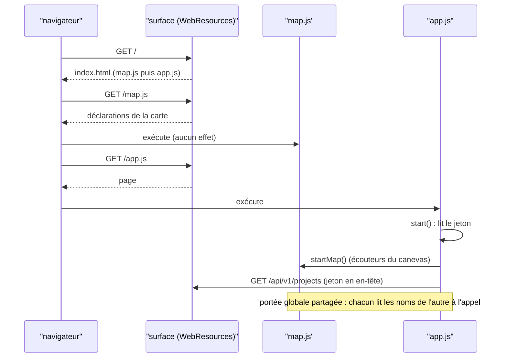

# Design

## Contexte

Motivation : voir `proposal.md` (Why). Le changement coupe la ressource `app.js` de l'explorateur en deux scripts classiques et en tire les conséquences sur ce qui la nomme : la liste fermée de `WebResources`, l'exception de lecture de page de la surface, les tests qui lisent son contenu, le harnais et le gate du front, la documentation. Il vient après `rendre-le-survol-de-la-carte-independant-du-nombre-de-points` (même fichier) et avant `trancher-la-langue-du-contrat-de-l-explorateur` (sprint 8).

## État vérifié au HEAD

HEAD : `38365e2b` de la branche `perf/survol-carte-independant-du-nombre-de-points`, empilée sur `c388df1b`. La page a été exécutée sous Node (36 tests) ; elle n'a pas été ouverte dans un navigateur pour ce changement.

| Fait | Preuve |
|---|---|
| `app.js` : 926 lignes ; la section « 2D map » en occupe 432 (`:467-898`), le reste 494 | `wc -l` ; `app.js:467`, `:898` |
| La section carte ne s'exécute pas au chargement : elle déclare `const`, fonctions et `startMap`, appelé par `start()` | `app.js:470-496`, `:866`, `:900-904` |
| Le code hors carte référence la carte (`startMap`, `map`, `loadMap`, `drawMap`, `markRowsOnMap`, `visiblePoints`) et la carte référence la page (`$`, `el`, `clear`, `api`, `report`, `project`, `view`, `selectedKey`, `projectPath`, `showDetail`) | lecture du fichier |
| `index.html` charge un seul script, `app.js`, en fin de `<body>` | `index.html:92` |
| `WebResources` : liste fermée de quatre chemins, chacun lu par `getResourceAsStream` | `WebResources.java:36-41`, `:46-57` (au `38365e2b`) |
| Seuls `/`, `/app.css` et `/app.js` sont lisibles depuis une autre origine | `ExplorerServer.java:57`, `:211` |
| La CSP de la page autorise `script-src 'self'` : un second script du même site passe | `ExplorerServer.java:51` ; `ExplorerServerTest.java:245` |
| Contrôles qui lisent `app.js` : `WebResourcesContentTest` (puits, jeton, carte), `ExplorerServerTest`, `ExplorerUnitsTest`, `ExplorerCitedCommandsTest`, `ShadedJarExplorerEntryPointIT` | `grep` sur `app.js` |
| Le harnais charge `app.js` seul ; `check-explorer-front.py` contrôle la syntaxe d'un seul fichier et ancre une mutation sur `MAP_CAPTURE_PIXELS` | `harness.mjs:13`, `:244` ; `check-explorer-front.py:44`, `:81-92`, `:232-233` |

## Écarts

| Écart | Source A | Source B | Suite proposée |
|---|---|---|---|
| Les textes qui nomment la commande `minos semantic projection prepare` (`PROJECTION_HELP`) passent dans `map.js` : `ExplorerCitedCommandsTest` ne les verrait plus | `ExplorerCitedCommandsTest.java:34` | `app.js:472-476` | La liste des sources du test gagne `map.js` |
| ARCH-0082 dit « deux ressources statiques » (`/`, `/app.css`, `/app.js`) et « trois ressources » ; avec `/map.js` la liste compte quatre chemins | `ARCH-0082-…md:144-145` | `WebResources.java` | Clarification du texte (même décision : statiques, sans donnée, jeton dans le fragment) ; à confirmer par le propriétaire (D3) |
| L'assertion « une seule balise `<script>` » de `WebResourcesContentTest` encode le fichier unique | `WebResourcesContentTest.java:66` | `index.html` | Remplacée par l'ordre exact `map.js`, `app.js` : l'ordre importe (D2) |

## Exigences couvertes

Non applicable : aucun delta de spec (`skip_specs: true`). Exigences existantes à tenir sans modification : `exploration-semantique` › La page de l'explorateur est exécutée par des tests et contrôlée avant toute fusion ; › Aucun contenu indexé n'atteint un puits de balisage, prouvé par exécution ; › Toute requête d'API exige le jeton de session et une origine locale.

## Objectifs et non-objectifs

Objectifs : chaque script sous 500 lignes ; zéro différence observable ; les contrôles de sécurité de la page (aucun puits de balisage, jeton hors de l'adresse, un seul point d'envoi de requêtes) valent sur les deux fichiers. Non-objectifs : bundler, modules ES, dépendance, nouveau découpage.

## Responsabilités et frontières des composants

| Fichier | Porte | Ne fait pas |
|---|---|---|
| `app.js` (494 lignes) | jeton, `api`, bannière, en-tête, liste, recherche, détail, voisins, `start()` | ne dessine ni ne cherche de point |
| `map.js` (437 lignes) | état `map`, liste affichée et grille, lecture des points, tracé, survol, zoom, `startMap` | ne s'exécute pas au chargement ; n'envoie aucune requête autrement que par `api` |

Dépendance : `map.js` lit les globaux de `app.js` (`$`, `el`, `clear`, `api`, `report`, `project`, `view`, `selectedKey`, `projectPath`, `showDetail`) et `app.js` lit ceux de `map.js` ; tous les accès ont lieu dans des fonctions appelées après les deux chargements. Direction des dépendances ARCH-0068 : sans objet (aucun code Java de production hors liste de chemins).

## Modèle de domaine et invariants

- Invariant d'ordre : `map.js` est chargé avant `app.js` ; `app.js` appelle `start()` en dernière ligne, donc `startMap` existe quand il est appelé. Un ordre inverse ferait échouer `start()` sur une référence non définie.
- Invariant de portée : aucun `const`, `let` ou nom de fonction n'est défini dans les deux fichiers (une redéclaration `const` ou `let` entre scripts lève une erreur de syntaxe au chargement du second).

## Traitements et interactions

Inchangés : le navigateur charge deux scripts à la suite au lieu d'un ; aucun ne s'exécute avant que le DOM soit présent (balises en fin de `<body>`).

## États et transitions

Non applicable.

## Contrats d'interface

Contrat HTTP : `GET /map.js` répond comme `/app.js` (`200`, `text/javascript; charset=utf-8`, mêmes en-têtes de sécurité, aucun cookie) ; `HEAD`, `POST` et tout autre chemin gardent leur refus. Aucune route d'API ne change.

## Persistance et intégrité

Non applicable : rien dans `localStorage` (contrôlé sur les deux scripts).

## Transactions, concurrence et idempotence

Non applicable : un seul fil dans le navigateur.

## Sécurité et isolation

Une ressource statique de plus est lisible depuis une autre origine (D3) : elle ne porte aucune donnée, comme `/app.js`, et le jeton reste dans le fragment de l'adresse. Les contrôles de contenu qui portaient sur `app.js` portent sur les deux fichiers : aucun des puits listés par `WebResourcesContentTest`, aucune URL externe, aucun commentaire de code qui échappe à la lecture. La liste de `WebResources` reste fermée (aucun chemin de requête n'atteint le chargeur de classes).

## Erreurs et reprise

Si `map.js` n'est pas servi ou ne se charge pas, `start()` échoue sur `startMap` : la page reste sans liste. La ressource manquante est détectée à la construction par `WebResources.find` (`IOException`) et par `ShadedJarExplorerEntryPointIT`.

## Observabilité

Non applicable.

## Performance et mesure

Une requête de plus au chargement, de 17 Kio environ, sur la boucle locale. Aucune mesure : l'effet est sans objet.

## Compatibilité, migration et retour arrière

Aucune migration. Retour arrière par revert : le fichier unique est restitué.

## Diagrammes

### Dans quel ordre la page charge-t-elle ses deux scripts, et qui appelle qui ?

Type : sequenceDiagram · Portée : cible proposée · Exigences : conservées (aucune ajoutée)

Au HEAD, un seul script porte les deux rôles.

## Décisions

### D1 — La carte devient son propre script, nommé `map.js` [Proposition]

Choix : un fichier pour la section « 2D map », coupé à ses bornes naturelles (de la constante `MAP_PAGE` à `startMap`), sans réécriture de code. Alternatives écartées : modules ES (`type="module"`) — chaque import exigerait des exports, donc modifier le code et le harnais de test, pour un gain nul ici ; bundler — contredit l'absence de chaîne de build ; découpage en plus de deux fichiers — chaque coupure ajoute une ressource à la frontière de sécurité.

### D2 — Scripts classiques, `map.js` d'abord [Décision] de conception

La portée globale partagée évite tout changement de code. L'ordre `map.js` puis `app.js` est exigé par `index.html` et vérifié par `WebResourcesContentTest` et par le harnais (qui lit l'ordre des balises).

### D3 — La liste de lecture croisée gagne `/map.js` [Décision de périmètre, à confirmer par le propriétaire]

`/map.js` doit être servi comme `/app.js` : un lien suivi depuis une autre page ouvre `/`, dont les deux scripts se chargent avec `Sec-Fetch-Site: cross-site`. Sans l'ajout, la page se chargerait sans carte. Recommandation : accepter ; la ressource ne porte aucune donnée.

## Qualification des capacités

Carte 2D : reste en **qualification partielle** (parcourue dans Chrome sous Windows seulement). Ce changement ne qualifie aucun navigateur. Tests Node identiques sous Windows et Linux.

## Risques et compromis

- [Risque] Ordre de chargement inversé ou second script absent → test de l'ordre des balises, `ExplorerServerTest` (200 sur `/map.js`), `ShadedJarExplorerEntryPointIT`.
- [Risque] Nom défini deux fois → le harnais charge les deux fichiers dans un même contexte comme le navigateur : une redéclaration échoue aux 36 tests.
- [Risque] Une chaîne qu'affirme un test de contenu a changé de fichier → `WebResourcesContentTest` rejoué ; chaînes de la carte lues dans `map.js`.
- [Risque] Conflit avec `trancher-la-langue-du-contrat-de-l-explorateur` → zones distinctes (`api`, `report` restent dans `app.js`) ; relire les numéros de ligne de ce changement à sa fusion.
- [Risque] Une page servie par une version précédente du serveur et un `map.js` neuf : sans objet (les deux ressources sont dans le même JAR).

## Vérification

- `python scripts/quality/check-explorer-front.py` et `--self-test`.
- `./mvnw -B -ntp -pl minos-explorer,minos-cli -am test "-Dtest=WebResourcesContentTest,ExplorerServerTest,ExplorerUnitsTest,ExplorerCitedCommandsTest" "-Dsurefire.failIfNoSpecifiedTests=false"`.
- `python .claude/scripts/run_gates.py`, `openspec validate --all --strict`, `python scripts/docs/check-current-docs.py`, `python scripts/docs/check-capability-dossiers.py`.
- Non exécuté ici : `ShadedJarExplorerEntryPointIT` (paquetage complet) ; le parcours dans un navigateur réel.

## Documentation durable à mettre à jour

`docs/developer/semantic-explorer.md`, `docs/developer/quality-gates.md`, `docs/user/semantic-explorer.md`, `docs/project/governance/STATUS.md`, `docs/architecture/adr/ARCH-0082-surface-http-locale-optionnelle-de-consultation.md` (clarification), `docs/architecture/diagrams/capacites/exploration-semantique.md` (écart E12).

## Traçabilité

| Exigence (capacité › titre) | Scénario | Conception ou diagramme | Tâche | Test ou preuve |
|---|---|---|---|---|
| aucune (remaniement) — comportement de la page constant | — | D1, D2, diagramme | 2.1, 2.2 | les 36 tests `node:test` de `minos-explorer/src/test/js/` sans attente modifiée (à l'exception de l'ordre de chargement du harnais) |
| aucune — ressources servies et lisibles depuis une autre origine | — | D3, Contrats d'interface | 3.1, 3.2 | `ExplorerServerTest`, `ExplorerUnitsTest`, `WebResourcesContentTest` : à rejouer |
| aucune — les contrôles de sécurité portent sur les deux scripts | — | Sécurité et isolation | 3.2 | `WebResourcesContentTest` (puits, jeton, un seul `fetch`, aucun `POST` dans `map.js`) |
| aucune — les gates suivent | — | Responsabilités | 2.3 | `check-explorer-front.py` et son auto-test (cas `map.js`) |

## Questions ouvertes

- D3 : confirmation du propriétaire (recommandation : accepter `/map.js` dans l'exception de lecture croisée).
