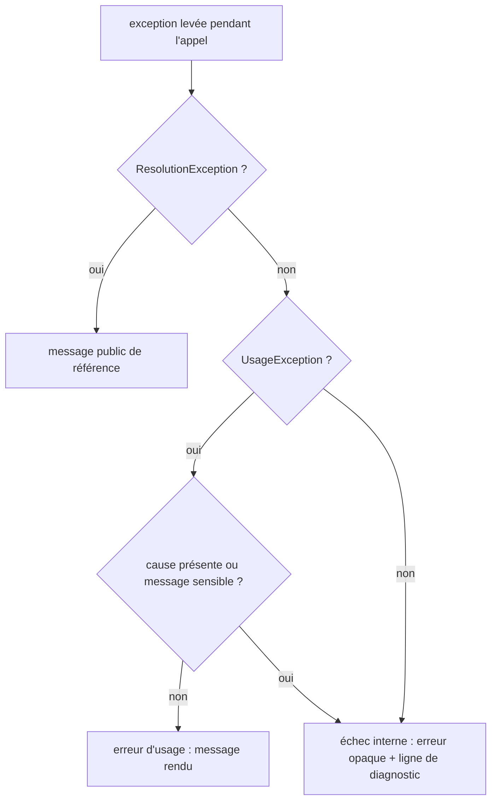

# Design

## Contexte

Motivation : voir `proposal.md` (Why). Le changement introduit un type d'erreur d'usage et change la classification
des erreurs d'argument dans deux surfaces : le serveur MCP et l'API Java. Modules : `minos-domain`, `minos-mcp`,
`minos-api`, et les validations de requête atteintes dans `minos-application`, `minos-engine`, `minos-domain`.
Il s'appuie sur la ligne de diagnostic du changement `tracer-les-echecs-internes-des-surfaces` (AUD-QUA-02).

## État vérifié au HEAD

HEAD `89be3fb4`. Vérification par lecture ; aucun build ni test exécuté.

| Fait | Preuve |
|---|---|
| [Existant vérifié] `MinosMcpTools.execute` attrape `IllegalArgumentException` avant `Exception` et la confie à `clientError` | `minos-mcp/src/main/java/com/minos/mcp/MinosMcpTools.java:195-196` |
| [Existant vérifié] `clientError` rend le message, sauf cause présente ou contenu jugé sensible (alors erreur générique journalisée) | `MinosMcpTools.java:240-256` |
| [Existant vérifié] Les autres échecs sont journalisés puis rendus par l'erreur générique | `MinosMcpTools.java:197-208`, `:259-263` |
| [Existant vérifié] La validation d'un identifiant du MCP lève une IAE **sans cause** (`workspaceId must be a UUID`) : rendue comme erreur d'usage | `minos-mcp/src/main/java/com/minos/mcp/MinosApplicationMcpBackend.java:328-334` |
| [Existant vérifié] La validation du genre de symbole lève une IAE **avec cause**, dont le message recopie la valeur envoyée : `clientError` la rend par l'erreur générique journalisée | `MinosApplicationMcpBackend.java:362-368` ; `MinosMcpTools.java:241-243` |
| [Existant vérifié] `DocumentNotFoundException` est une `IllegalArgumentException` finale ; aucune façade de `minos-api` ne l'attrape, elle atteint donc `INVALID_REQUEST` par la branche IAE, ce que le contrat publie | `minos-application/src/main/java/com/minos/application/semantic/SemanticCorpusQueryService.java:447` ; `MinosApiSupport.java:70-71` ; `minos-api/src/main/java/com/minos/api/SemanticExplorationApi.java:11-12` |
| [Existant vérifié] `IndexChangedException` et `RefusedException` sont des `IllegalStateException` attendues (index remplacé, préparation refusée) | `SemanticCorpusQueryService.java:438` ; `minos-application/src/main/java/com/minos/application/semantic/SemanticProjectionService.java:189` ; `SemanticExplorationApi.java:12-13` |
| [Existant vérifié] `TeamCommand` déclare déjà une `UsageException` privée (code 2, texte de confiance) | `minos-cli/src/main/java/com/minos/cli/command/TeamCommand.java:362` |
| [Existant vérifié] `MinosApiSupport.execute` : IAE → `INVALID_REQUEST`, ISE → `UNAVAILABLE`, autre → `EXECUTION_FAILURE` | `minos-api/src/main/java/com/minos/api/MinosApiSupport.java:59-78` |
| [Existant vérifié] `required` lève une IAE simple pour un paramètre `null` | `MinosApiSupport.java:115-120` |
| [Existant vérifié] L'ouverture d'une façade applique la même table | `MinosApiSupport.java:97-112` |
| [Existant vérifié] La référence de projet a déjà son type et son message public | `minos-application/src/main/java/com/minos/application/resolution/ProjectResolver.java:33-56` ; `MinosMcpTools.java:188-191` ; `MinosApiSupport.java:68-69` |
| [Existant vérifié] La CLI sépare analyse des options (code 2) et corps de commande (code 1) | `minos-cli/src/main/java/com/minos/cli/support/CliCommandSupport.java:93-107` |
| [Existant vérifié] Un test attend le message d'une IAE brute du backend | `minos-mcp/src/test/java/com/minos/mcp/MinosMcpToolsTest.java:239-244` |
| [Existant vérifié] Décompte des `new IllegalArgumentException` de production par module | `proposal.md`, « Statut des informations » |
| Non relevé : la liste exacte des validations atteintes depuis chaque outil MCP et chaque méthode de l'API | tâche 1.2 |

## Écarts

| Écart | Source A | Source B | Suite proposée |
|---|---|---|---|
| L'audit place `UsageException` dans `minos-application` ; des validations de requête vivent dans des records de `minos-domain` et de `minos-engine`, qui ne peuvent pas dépendre de l'application | `findings.json`, AUD-QUA-01, action | ARCH-0068 ; décompte par module | Type dans `minos-domain` (D1) |
| L'audit demande de « ne mapper en 400 que ce type » ; un type sans lien avec IAE casserait les `catch (IllegalArgumentException …)` de la CLI et des tests | AUD-QUA-01, action | `CliCommandSupport.java:95` et 89 clauses `catch` de production qui nomment `IllegalArgumentException` (82 seules, 7 en multi-catch) | Sous-classe d'IAE (D1) |
| Une bascule sans précaution ferait d'un document inconnu un `EXECUTION_FAILURE`, contre le contrat publié | AUD-QUA-01, action | `SemanticCorpusQueryService.java:447` ; `SemanticExplorationApi.java:11-12` | `DocumentNotFoundException` hérite de `UsageException` (D6) |
| Tracer toute ISE rendue `UNAVAILABLE` tracerait deux refus attendus | AUD-QUA-01, action (ISE résiduelle) | `SemanticCorpusQueryService.java:438` ; `SemanticProjectionService.java:189` | Les deux types sont exclus de la trace (D2) |
| Le genre de symbole inconnu est aujourd'hui opaque pour le client du MCP, alors que c'est une erreur d'usage | « surfaces-publiques › Les échecs internes restent opaques et sans fuite » (message porteur de valeur) | `MinosApplicationMcpBackend.java:362-368` | Erreur d'usage au message fixe, sans valeur recopiée : changement de réponse voulu (D7) |
| L'audit veut qu'une ISE résiduelle suive la voie interne ; `UNAVAILABLE` sur ISE est un contrat documenté de l'API | AUD-QUA-01, action | `SemanticExplorationApi.java:12-13` ; « surfaces-publiques › Tout échec d'ouverture de l'API Java… » | Code inchangé, échec tracé (D2) |
| L'audit cite `MinosApiSupport.java:106-107` (ouverture) ; l'exigence existante y veut « erreur de configuration en requête invalide » | AUD-QUA-01, preuve | `openspec/specs/surfaces-publiques/spec.md` (exigence d'ouverture) | Ouverture hors périmètre (D4) |
| Convertir toutes les IAE du dépôt est hors de proportion (plusieurs centaines de sites) | AUD-QUA-01, action (« levé par les validations de paramètres ») | décompte | Migration bornée aux chemins atteints, tenue par une table testée (D5) |
| L'audit demande 500 + journal « comme `MinosMcpTools.logInternalFailure` » ; le MCP a déjà ce garde-fou partiel (cause présente ou message sensible) | AUD-QUA-01, action | `MinosMcpTools.java:241-254` | Garde-fou conservé pour l'erreur d'usage explicite |

## Exigences couvertes

| Exigence | Section |
|---|---|
| surfaces-publiques › Le MCP ne rend comme erreur d'argument que l'erreur d'usage explicite | D1, « Traitements » |
| surfaces-publiques › L'API Java ne classe en requête invalide que l'erreur d'usage explicite | D1, D3 |
| surfaces-publiques › Une indisponibilité non classée de l'API Java est tracée | D2 |
| surfaces-publiques › Les erreurs d'usage de chaque surface sont tenues par une table testée | D5 |

## Objectifs et non-objectifs

Objectif : qu'une erreur d'argument ne soit publique que si quelqu'un l'a voulue publique. Non-objectifs : une
hiérarchie d'exceptions du domaine, un code d'erreur par validation, la conversion générale des IAE.

## Responsabilités et frontières des composants

- `UsageException` (`minos-domain`, `com.minos.diagnostics`, à côté de `PublicErrorMessages`) : type sans dépendance.
- Validations d'entrée : chaque surface valide ses arguments et lève `UsageException` ; les services gardent leurs
  validations de requête, converties quand la surface les relaie.
- `MinosMcpTools` et `MinosApiSupport` : seuls points de classification ; ils ne lisent jamais le message pour décider.

Direction ARCH-0068 respectée : le type est au plus bas de la chaîne ; aucun package partagé (`com.minos.diagnostics`
appartient à `minos-domain`).

## Modèle de domaine et invariants

`UsageException extends IllegalArgumentException`, **non finale** (les erreurs d'usage typées en héritent), message
obligatoire non vide, **sans cause** (une cause la fait traiter comme interne par le MCP, garde existant).
`DocumentNotFoundException` en devient une sous-classe. Invariant : son message est écrit pour l'appelant et ne recopie
pas une valeur qui pourrait être un chemin ou un secret ; les surfaces gardent le filtre `PublicErrorMessages`.

## Traitements et interactions

Voir le diagramme « Comment une erreur d'argument est-elle classée ? ». Ordre des branches du MCP : référence de
projet, registre illisible, `UsageException`, puis tout le reste (dont IAE simple) vers la voie interne.

## États et transitions

Non applicable : aucune machine à états.

## Contrats d'interface

- **MCP** : texte des erreurs d'usage inchangé (`error: <message>`), erreur générique inchangée pour l'interne.
- **API Java** : `ErrorCode` inchangé (aucune valeur ajoutée ni retirée, `MinosApi.java:132-134`) ; seule change
  l'attribution : IAE non explicite → `EXECUTION_FAILURE`. Message redacté et absence de cause conservés.
- **`UsageException`** : type public de `minos-domain`, donc visible de l'API interne ; il n'entre pas dans la surface
  publique de `minos-api` (l'appelant ne voit que `MinosApiException`).

## Persistance et intégrité

Non applicable : aucune donnée persistée.

## Transactions, concurrence et idempotence

Non applicable : classification pure, sans état.

## Sécurité et isolation

Le changement réduit ce qui sort : un message d'exception interne ne peut plus atteindre un client du MCP par la
voie « argument ». Règle 7 : erreurs d'usage actionnables, erreurs internes opaques. Le filtre de contenu sensible
reste appliqué à l'erreur d'usage (scénario « Erreur d'usage au message sensible »).

## Erreurs et reprise

| Échec | MCP | API Java |
|---|---|---|
| `ResolutionException` | message public partagé | `INVALID_REQUEST` |
| `UsageException` (dont `DocumentNotFoundException`) | `error: <message>` | `INVALID_REQUEST` |
| `IndexChangedException`, `RefusedException` | inchangé | `UNAVAILABLE`, message public, **sans** diagnostic |
| autre `IllegalArgumentException` | erreur générique + diagnostic | `EXECUTION_FAILURE` + diagnostic |
| `IllegalStateException` | erreur générique + diagnostic (inchangé) | `UNAVAILABLE` + diagnostic |
| autre | inchangé | inchangé |

## Observabilité

Toute erreur d'argument requalifiée écrit la ligne de diagnostic (classe, cause racine, origine, référence) du
changement `tracer-les-echecs-internes-des-surfaces`. Si ce changement n'est pas encore fusionné, la ligne existante
du MCP (`logInternalFailure`) et un `System.Logger` WARNING sans message dans l'API en tiennent lieu.

## Performance et mesure

Non applicable : chemin d'erreur seulement.

## Compatibilité, migration et retour arrière

- Sous-typage : aucun `catch` existant ne casse.
- Régression possible : une validation légitime non convertie devient opaque. Garde : la table testée (D5) et les
  tests existants d'erreurs d'usage, qui passent au rouge tant que la validation n'est pas convertie.
- API Java : reclassement signalé en note de version (D3).
- Retour arrière : rétablir les deux branches `catch` ; `UsageException` peut rester.

## Diagrammes

### Comment une erreur d'argument est-elle classée ?

Type : flowchart · Portée : cible · Exigences : surfaces-publiques › Le MCP ne rend comme erreur d'argument que
l'erreur d'usage explicite ; surfaces-publiques › L'API Java ne classe en requête invalide que l'erreur d'usage
explicite

Existant : la branche « UsageException » est aujourd'hui « IllegalArgumentException » (toute IAE). Cible : seule
l'erreur voulue publique atteint « message rendu ».

## Décisions

### D1 — `UsageException` sous-classe d'`IllegalArgumentException`, dans `minos-domain`

[Proposition] Alternatives écartées : type dans `minos-application` (les records de requête de `minos-domain` et de
`minos-engine` ne pourraient pas le lever) ; exception vérifiée ou sans lien avec IAE (casse les `catch` existants et
impose une migration en une fois) ; interface marqueur (une exception du JDK ne peut pas la porter, mais un tiers
pourrait l'ajouter à n'importe quoi).

### D2 — `IllegalStateException` : code inchangé, échec tracé

[Proposition] `UNAVAILABLE` reste le code ; la ligne de diagnostic est ajoutée quand l'ISE n'a pas été classée par la
façade et n'est pas un refus attendu : `IndexChangedException` et `RefusedException` sont attrapées avant la branche
ISE et ne sont pas tracées. Alternative écartée : ISE → `EXECUTION_FAILURE` (contredit un contrat documenté et
l'exigence d'ouverture).

### D3 — Reclassement dans l'API Java (en attente du propriétaire)

Options : (a) IAE non explicite → `EXECUTION_FAILURE`, noté en version ; (b) garder `INVALID_REQUEST` et seulement
tracer. **Recommandation : (a)** — (b) laisse l'appelant sur la fausse piste que le constat dénonce ; aucune valeur
d'`ErrorCode` ne change. (b) retirerait la seconde phrase de l'exigence sur l'API.

### D4 — Ouverture de l'API Java (en attente du propriétaire)

Options : (a) hors de ce lot ; (b) `MODIFIED` de « Tout échec d'ouverture de l'API Java est une erreur publique
classée et redactée » pour réserver la requête invalide aux erreurs de configuration explicites.
**Recommandation : (a)** — à l'ouverture, l'IAE vient presque toujours d'une valeur de configuration ; le gain est
faible et un `MODIFIED` se heurterait aux autres changements de la capacité.

### D5 — Migration bornée et table testée

[Proposition] Convertir seulement les validations atteintes depuis les outils MCP publiés et les méthodes de l'API,
relevées par la tâche 1.2, et les tenir par un test paramétré par surface. Alternative écartée : gate littéral
interdisant `new IllegalArgumentException` dans les surfaces (trop de faux positifs : conversions internes légitimes).

### D6 — `DocumentNotFoundException` hérite de `UsageException`

[Proposition] Le type garde son nom, son message et ses `catch` existants (`ExplorerApi.java:126`), perd `final` côté
parent seulement (`UsageException` non finale) et reste `INVALID_REQUEST` par l'API Java, comme le publie
`SemanticExplorationApi`. Alternative écartée : une clause `catch` dédiée dans `MinosApiSupport` (un second point de
classification à tenir à jour pour chaque erreur d'usage typée).

### D7 — Genre de symbole inconnu : erreur d'usage au message fixe

[Proposition] `parseKind` du MCP lève une `UsageException` sans cause dont le message nomme l'argument `kind` sans
recopier la valeur envoyée. La réponse du MCP **change dès la conversion** (tâche 2.2) : de l'erreur générique à une
erreur d'usage. C'est le seul cas connu où la conversion, avant la bascule, modifie une réponse ; la tâche 1.2 relève
les autres IAE avec cause sur les chemins de validation.

### D8 — Nom du type face à `TeamCommand.UsageException`

[Proposition] Le type du domaine s'appelle `UsageException` ; la classe privée homonyme de `TeamCommand` (code 2,
texte de confiance) reste telle quelle : imbriquée et privée, elle ne se confond pas à l'import, et elle étend déjà
`IllegalArgumentException`. La faire hériter du type du domaine est possible plus tard, hors de ce lot (la CLI n'est
pas dans le périmètre).

## Qualification des capacités

`surfaces-publiques` : classification visée **qualifiée** pour le MCP et l'API Java, Windows et Linux (même code,
aucun comportement propre). **Partielle** par construction : une validation hors de la table reste opaque jusqu'à
sa conversion — c'est l'échec sûr.

## Risques et compromis

- [Risque] Erreur d'usage légitime devenue opaque après la bascule → table testée, tests existants, bascule faite
  après la conversion (ordre des tâches).
- [Risque] Un développeur lève `UsageException` avec une valeur recopiée → filtre de contenu sensible conservé.
- [Compromis] Deux conventions coexistent (IAE simple = interne, `UsageException` = publique) ; documentées dans
  `docs/developer/`.

## Vérification

- Tests à écrire : `UsageExceptionTest` (`minos-domain`), `MinosMcpUsageErrorTest`, `MinosApiUsageErrorTest`.
- Tests à adapter : `MinosMcpToolsTest.java:239-244` (IAE brute → erreur générique ; `UsageException` → message) ;
  tests du genre de symbole inconnu (réponse d'usage sans valeur) ; tests de `SemanticExplorationApi` (document
  inconnu toujours `INVALID_REQUEST`).
- Gates : `check-p0-p2.py`, `check-post-mne.py`, `check-module-boundaries.py`, `check-private-io.py`,
  `check-comment-language.py`, `check-runtime-dynamic-consistency.py`, `check-hosted-control-plane-consistency.py`,
  `product-facts.py --check` ; JaCoCo `mcp-mapping`, `m19-m20-mcp-catalogue` ; SonarCloud nouveau code ≥ 80 %.
- Tout est vérifiable localement sur les deux plateformes.

## Documentation durable à mettre à jour

`docs/architecture/diagrams/capacites/surfaces-publiques.md` ; `docs/developer/` (convention d'erreur d'usage) ;
note de version de l'API Java (`docs/user/release-notes/`) ; `CONTRIBUTING.md` si la convention y est citée.

## Traçabilité

| Exigence (capacité › titre) | Scénario | Conception ou diagramme | Tâche | Test ou preuve |
|---|---|---|---|---|
| surfaces-publiques › Le MCP ne rend comme erreur d'argument que l'erreur d'usage explicite | Entrée invalide de l'appelant | D1, diagramme | 2.1, 2.2 | `MinosMcpUsageErrorTest` |
| idem | Précondition violée dans un service | diagramme | 2.1, 2.3 | `MinosMcpUsageErrorTest` |
| idem | Sous-classe du JDK | diagramme | 2.1, 2.3 | `MinosMcpUsageErrorTest` (`NumberFormatException`, `InvalidPathException`, `PatternSyntaxException`) |
| idem | Erreur d'usage au message sensible | « Sécurité » | 2.1 | `MinosMcpUsageErrorTest` |
| idem | Genre de symbole inconnu | D7 | 2.1, 2.2 | `MinosMcpUsageErrorTest` (table) |
| surfaces-publiques › L'API Java ne classe en requête invalide que l'erreur d'usage explicite | Paramètre invalide ; Erreur d'argument interne ; Référence de projet inconnue | D1, D3 | 3.1, 3.2 | `MinosApiUsageErrorTest` |
| idem | Document inconnu de l'exploration sémantique | D6 | 3.1, 3.2 | `MinosApiUsageErrorTest` ; tests du contrat de `SemanticExplorationApi` inchangés |
| surfaces-publiques › Une indisponibilité non classée de l'API Java est tracée | État illégal levé par un service ; Refus attendu du service ; Indisponibilité classée par la façade | D2 | 3.1, 3.2 | `MinosApiUsageErrorTest` ; `RefusedException` : preuve manquante côté API (inatteignable) |
| surfaces-publiques › Les erreurs d'usage de chaque surface sont tenues par une table testée | Table du MCP ; Validation oubliée | D5 | 1.2, 2.1, 3.1 | `MinosMcpUsageErrorTest` (table du MCP) ; **table de l'API limitée aux cas de `MinosApiUsageErrorTest`** : pas de table paramétrée par méthode de façade (preuve partielle) |

## Inventaire des validations atteintes (tâche 1.2, relevé à l'implémentation)

Relevé par lecture du code au HEAD de l'implémentation ; les numéros de ligne cités plus haut dans cette conception
dataient de `89be3fb4` (la capture du MCP est en `MinosMcpTools.java:210`, `clientError` en `:254`, `execute` de l'API en
`MinosApiSupport.java:93`).

| Surface | Sites convertis en `UsageException` | Réponse qui change |
|---|---|---|
| MCP, helpers de `MinosMcpTools` | 12 : `required`, `optionalString`, `bounded`, entiers (3), `minimumScore` (2), booléen, `stringValue`, format du graphe, argument inconnu | aucune (déjà rendus comme erreurs d'usage) |
| MCP, `MinosApplicationMcpBackend` | `parseUuid`, `parseKind` (sans cause, message fixe qui nomme `kind`), format du graphe | `kind` inconnu : erreur générique → erreur d'usage (D7) |
| Services relayés par des outils MCP | `ImpactAnalysisService` (2), `ArchitectureIntelligenceService` (3), `RuntimeIntelligenceService` (6), `HybridContextBuilder` (5), `HybridSearchService` (4), `SemanticSearchService` (4), `SecurityAnalysisService` (3), `ProgramGraphService` (1), `CodeSearchCriteria` (4), `ImpactAnalysisRequest` (3), `HostedWorkspaceService` (4) | aucune |
| API Java, façades | `MinosApiSupport.required`, `LocalMinosApi` (3, dont l'énumération inconnue sans cause), `LocalMinosTeamApi` (2, dont le rôle inconnu sans cause), records de requête (`MinosApi` 3, `AdvancedCodeIntelligenceApi` 2, `SemanticCodeIntelligenceApi` 3, `MinosMultiRepositoryApi` 2, `SemanticExplorationApi` 1) | aucune |
| Services relayés par l'API Java | `SemanticCorpusQueryService` (15), `SemanticProjectionService` (2), `ProviderPlatformService` (2), `WorkspaceIntelligenceService` (7), `LocalProjectOperations` (1), `ProviderId`, `HostedPrincipal` (3), `HostedRetentionPolicy` (3), `HostedTenantService`, `HostedTokenService` (2), `HmacHostedIdentityProvider`, `HostedMembershipService` (2), `HostedWorkspaceService` (4) | aucune |
| Domaine | `Preconditions.requireText`, `SymbolSearchCriteria` (3), `RelationshipSearchCriteria`, `CodeEntityRef` (2) | aucune |
| Type typé | `DocumentNotFoundException` hérite de `UsageException` | aucune |

Volontairement **non** converties (invariants internes ou états, donc défauts ou indisponibilités) : les DTO de sortie
(`ProviderPlatformApi`, `MinosApi` `index`/`commitStatus`, `MinosMultiRepositoryApi` `workspace`), `LocalSourceReader:36`
et `:219` (racine disparue, donnée stockée), `ProgramGraphService` constructeurs, les invariants de doublons de
`ArchitectureIntelligenceService` et `ImpactAnalysisService:90`, les `IllegalStateException` « projet sans snapshot actif »
(MCP : erreur générique ; API : `UNAVAILABLE` tracée), et la CLI (`SemanticProjectionService` `PrepareRequest`,
`ActivityQuery`, `TeamCommand`). La conversion des validations déjà refusées en amont par les bornes du MCP ou du DTO
(« préval. ») est une défense en profondeur : celles de `minos-domain` et d'`minos-application` listées ci-dessus le sont,
`ActivityQuery` et `SemanticProjectionService.PrepareRequest` ne le sont pas.

Écarts relevés à l'inventaire :

- `RefusedException` n'est atteignable ni depuis l'API Java ni depuis le MCP (la CLI seule prépare une projection) : elle
  est exclue de la trace par cohérence avec `IndexChangedException`, sans scénario réel côté API.
- `MinosApiSupport.logFailure` écrivait déjà une ligne de classe pour tout code ; le changement la retire pour les cas
  classés (`INVALID_REQUEST`, refus attendus), faute de quoi « aucune ligne de diagnostic » n'est pas tenable.
- `LocalMinosTeamApi` rendait « mode équipe désactivé » par une `IllegalStateException` : la façade lève désormais
  elle-même l'indisponibilité classée, qui n'est pas tracée.
- `LocalSourceReader:36` (`projectRoot must be a directory`) était rendue comme erreur d'usage par le MCP et est
  maintenant une erreur générique : c'est un état de l'environnement, pas une entrée.
- Des messages convertis recopient encore la valeur envoyée (`unknown symbol in snapshot: <id>`, `unknown module`,
  `unsupported architecture graph format`) : le filtre `PublicErrorMessages` des surfaces reste appliqué, et un message
  jugé sensible rend l'erreur générique (le journal privé est limité en débit).
- Les compact-constructeurs des records de requête de l'API s'exécutent chez l'appelant, hors de `MinosApiSupport.execute` :
  leur conversion ne change aucune classification de façade.

## Questions ouvertes

- D3 et D4 : décisions du propriétaire, recommandations ci-dessus.
- [Question] non bloquante : faut-il, plus tard, un cliquet qui compte les `catch (IllegalArgumentException` des
  modules de surface ? Proposition : à réévaluer après la bascule de l'explorateur.
