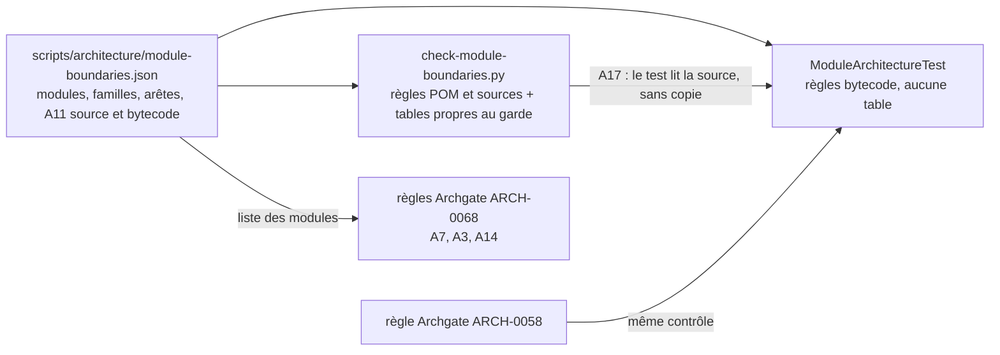

# Design

Changement d'outillage : le modèle est réduit ; les sections sans objet le disent sur une ligne.

## Contexte

Motivation : voir `proposal.md` (Why). Deux lecteurs d'une même politique : le garde Python (job `invariants`, sources et POM) et `ModuleArchitectureTest` (jobs `Verify` Linux et Windows, bytecode). Aucune classe de production, aucune surface publique.

## État vérifié au HEAD

Commit relu : `89be3fb4` (`main`).

| Fait | Preuve |
|---|---|
| Tables de politique du garde : modules, adaptateurs, surfaces, couples en portée test, dépendances autorisées | `scripts/architecture/check-module-boundaries.py:19-34`, `:42-47`, `:51`, `:56`, `:60-90` |
| Vue source de la dette A11 | `scripts/architecture/check-module-boundaries.py:566-592` |
| Copies dans le test : sorties par module (liste des 14 modules), `ALLOWED`, `ADAPTERS`, `SURFACES` | `minos-app/src/test/java/com/minos/app/architecture/ModuleArchitectureTest.java:48-55`, `:58-79`, `:81-84` |
| Vue bytecode de la dette A11, propre au test | `minos-app/src/test/java/com/minos/app/architecture/ModuleArchitectureTest.java:93-108` |
| A17 compare `ALLOWED` à `ALLOWED_DEPENDENCIES`, rien d'autre | `scripts/architecture/check-module-boundaries.py:1652-1682` |
| La règle Archgate d'ARCH-0058 analyse les deux tables littérales par expressions régulières (constantes `SCRIPT` et `TEST`) | `docs/architecture/adr/ARCH-0058-declarer-les-usages-de-modules.rules.ts:7-8`, `:21-48` |
| Les règles Archgate d'ARCH-0068 (A7, A3, A14) lisent le tuple `MODULES` du script par expression régulière ; tuple introuvable = violation | `docs/architecture/adr/ARCH-0068-modules-dependances-et-propriete-des-packages.rules.ts:12`, `:60-70`, `:80-90` |
| Le sprint 7 ajoute au garde trois tables et écrit qu'AUD-ARC-04 les fera lire depuis la source unique ; il vide aussi `MINOS_APPLICATION_ENGINE_ACCESSORS` et s'appuie sur la lecture du type `test-jar` par le garde | `openspec/changes/cabler-les-adaptateurs-embarques-par-la-racine-de-composition/design.md:181` ; `openspec/changes/centraliser-la-politique-de-lancement-de-l-explorateur/design.md:143` ; `openspec/changes/injecter-les-collaborateurs-des-cas-d-usage/design.md:183-198` |
| Une exigence parle d'une table tenue par le test | `openspec/specs/frontieres-de-modules/spec.md:622`, `:630` |
| ARCH-0058 demande de « garder identiques » les deux tables | `docs/architecture/adr/ARCH-0058-declarer-les-usages-de-modules.md:37` |
| `check-p0-p2.py` exige la chaîne `ALLOWED_DEPENDENCIES` dans le script | `scripts/remediation/check-p0-p2.py:252` |
| Taille : garde 1 912 lignes, auto-test 2 146 lignes ; 82 commits sur le garde | `wc -l` ; `git log --oneline --follow -- scripts/architecture/check-module-boundaries.py \| wc -l` |
| Documentation des règles A11 et A17 | `docs/developer/quality-gates.md:69`, `:76` ; `docs/developer/archgate.md:64` |

Non mesuré : la présence effective de Jackson sur le classpath de test de `minos-app` (déduite des POM, pas d'un `dependency:tree`) ; aucun build exécuté.

## Écarts

| Écart | Source A | Source B | Suite proposée |
|---|---|---|---|
| L'audit dit l'égalité de `ENGINE_TYPES_USED_BY_SURFACE_BYTECODE` « vérifiée par A17 » ; A17 ne lit que `ALLOWED` | `findings.json` (AUD-ARC-04) | `check-module-boundaries.py:1652-1682` | La vue bytecode n'est pas une copie (autre mesure, autres compteurs) : elle rejoint la vue source dans le même fichier, sans égalité imposée |
| L'audit cite six tables Python comme « recopiées » ; une seule l'est (`ALLOWED_DEPENDENCIES`) | `findings.json` (AUD-ARC-04) | `ModuleArchitectureTest.java:58-108` | D2 : seules les tables lues par les deux côtés entrent dans le fichier |
| Trois copies que l'audit ne cite pas et qu'aucun contrôle ne compare : liste des modules, adaptateurs, surfaces | `ModuleArchitectureTest.java:48-51`, `:81-84` | `check-module-boundaries.py:19-34`, `:42-51` | Elles entrent dans la source unique |
| Un fichier JSON n'a pas de commentaires, alors que les tables portent des raisons en commentaire (ADR, décision) | `check-module-boundaries.py:62-83`, `:567-591` | format JSON | Chaque entrée justifiée porte un champ `reason` ; une entrée de dette sans raison échoue |

## Exigences couvertes

- `frontieres-de-modules` › La politique de frontières partagée a une source unique : D1, D2.
- `frontieres-de-modules` › Une source de politique illisible fait échouer les deux lecteurs : D3.
- `frontieres-de-modules` › Le test ArchUnit ne redéclare aucune table de politique : D4.
- `frontieres-de-modules` › Les types du moteur utilisés par le bytecode d'une surface le sont par liste fermée (modifiée) : D2, D4.

## Objectifs et non-objectifs

Objectif : une édition par mouvement de cliquet, sans règle affaiblie. Non-objectifs : réduire la taille du garde, changer une valeur de la politique, changer un message d'échec existant.

## Responsabilités et frontières des composants

Le fichier de données ne contient que des faits ; les règles restent du code dans chaque lecteur. Aucune dépendance Maven n'est ajoutée ; le test lit un fichier du dépôt par chemin relatif à la racine du reactor, comme il lit déjà les `target/classes`. Direction des dépendances (ARCH-0068) : sans objet, aucun module de production touché.

## Modèle de domaine et invariants

Sections du fichier [Proposition] : `modules` (liste ordonnée ; chaque module porte `family` parmi `core`, `adapter`, `application`, `composition`, `contract`, `surface`, `assembly`), `allowedDependencies`, `testOnlyDependencies`, `engineTypesNamedBySurface` (vue source, compteur de fichiers), `engineTypesUsedBySurfaceBytecode` (vue bytecode, compteur de classes), puis les trois tables du sprint 7 sous les noms qu'il aura retenus (classes d'adaptateur embarquées et leur justification, utilisateurs d'API d'infrastructure, classes de `minos-app` et leur rôle). Invariants vérifiés par les deux lecteurs : chaque module de `allowedDependencies` et de chaque vue A11 figure dans `modules` ; chaque module de `modules` a une entrée de dépendances ; les clés des vues A11 sont des modules de famille `surface` ou `contract`.

## Traitements et interactions

Non applicable : lecture d'un fichier au chargement de chaque lecteur.

## États et transitions

Non applicable.

## Contrats d'interface

Non applicable : la sortie du garde garde ses lignes ; la ligne A17 change de libellé.

## Persistance et intégrité

Fichier versionné, UTF-8, clés triées dans l'ordre d'écriture ; aucune donnée produite à l'exécution.

## Transactions, concurrence et idempotence

Non applicable.

## Sécurité et isolation

Fail-closed (D3). Le fichier est une donnée du dépôt, pas une entrée non fiable ; il n'est ni exécuté ni interpolé.

## Erreurs et reprise

Chaque lecteur nomme le fichier par son chemin relatif au dépôt, jamais par un chemin absolu, puis la cause (absent, non analysable, clé inconnue, clé en double, module inconnu, famille inconnue).

## Observabilité

Non applicable au-delà des lignes de résumé existantes.

## Performance et mesure

Non applicable : un fichier de quelques kilo-octets.

## Compatibilité, migration et retour arrière

Les attributs du script gardent leurs noms : l'auto-test, `check-p0-p2.py` et les exigences existantes qui nomment `ALLOWED_DEPENDENCIES` et `ModuleArchitectureTest.ALLOWED` restent vrais (`ALLOWED` devient un champ chargé). Retour arrière : remettre les littéraux.

## Diagrammes

### Qui lit la politique, et que reste-t-il dans chaque lecteur ?

Type : flowchart · Portée : cible · Exigences : `frontieres-de-modules` › La politique de frontières partagée a une source unique ; › Le test ArchUnit ne redéclare aucune table de politique

Une seule flèche d'édition humaine arrive sur le fichier de données. A17 et la règle Archgate ne comparent plus deux tables : elles vérifient qu'il n'en existe plus qu'une.

## Décisions

### D1 — Un fichier JSON sous `scripts/architecture/`

Statut : [Proposition]. JSON se lit par la bibliothèque standard de Python (règle des gates) et par Jackson côté test. Emplacement à côté du garde, qui en est le premier lecteur. Écarté : un fichier `.properties` (pas de structure imbriquée pour les compteurs par surface) ; faire exécuter le script Python par le test (dépendance du build Maven à Python) ; générer la classe Java depuis le script (fichier généré de plus à garder synchronisé). Si Jackson n'est pas sur le classpath de test de `minos-app`, la dépendance de test s'ajoute avec sa raison écrite, à la version déjà gérée par le parent.

### D2 — Entrent dans le fichier les tables lues par les deux lecteurs et celles du sprint 7

Statut : [Proposition], recommandation pour le propriétaire. Entrent : les tables partagées (modules, familles, arêtes, couples en portée test, deux vues A11) et les trois tables que le sprint 7 ajoute en annonçant leur lecture depuis la source unique et en s'interdisant d'en faire une copie dans `ModuleArchitectureTest`. Ces trois tables sont des listes classe → justification, qui se prêtent au champ `reason` ; les placer dans le fichier permet à une règle bytecode de les lire plus tard sans copie. Ce changement n'ajoute pas cette règle bytecode. Restent dans le script : exports A10, accesseurs A11 (table vide après le sprint 7), A12, A13 et ses raisons, A14 (lue par les règles Archgate d'ARCH-0068), A15, A18, cycles ; elles ont une seule source et un seul lecteur Python. Alternative : tout déplacer pour vider le script de ses données ; à reprendre seulement si le propriétaire veut réduire le script.

### D3 — Les deux lecteurs échouent sans valeur par défaut

Statut : [Décision] de conception. Lecture stricte : clés inconnues et clés en double refusées (détection stricte des doublons côté Jackson ; `object_pairs_hook` côté Python), sections obligatoires, références croisées vérifiées. Chaque motif de refus a un cas dans l'auto-test du garde et un test Java.

### D4 — A17 vérifie l'absence de copie

Statut : [Décision] de conception. A17 lit la source du test, commentaires neutralisés, et échoue si le chemin du fichier de politique n'y figure pas ou si une déclaration littérale de table réapparaît (`Map.ofEntries`, `Map.entry("minos-`, ensemble littéral de noms de modules affecté à un champ). La règle Archgate `allowed-dependency-tables-identical` est réécrite sur le même contrôle et lit les mêmes fichiers ; ARCH-0058 reçoit une note datée de « Mise en œuvre », sa décision (une seule politique) étant inchangée.

### D5 — Chaque lecteur d'un littéral bascule avec lui

Statut : [Décision] de conception. Aucune tâche ne laisse un contrôle rouge à la suivante :

| Littéral retiré | Lecteurs adaptés dans la même tâche |
|---|---|
| `MODULES` et `ALLOWED_DEPENDENCIES` du script (bascule Python) | règles Archgate d'ARCH-0068 (`rules.ts:12`) : lisent la liste des modules dans le fichier de données ; règle d'ARCH-0058 (`rules.ts:22`) : compare le fichier de données à la table `ALLOWED` encore littérale du test |
| `ALLOWED` et les autres tables du test (bascule Java) | A17 (`check-module-boundaries.py:1656`, `:1666-1667`) et règle d'ARCH-0058 : passent au contrôle d'absence de copie (D4) |

Les règles Archgate d'ARCH-0068 gardent leur échec quand la liste des modules est illisible : le motif devient « fichier de politique absent ou sans section `modules` ».

## Qualification des capacités

`frontieres-de-modules` : qualifiée ; même comportement sous Windows et Linux (chemin construit par segments, UTF-8 explicite).

## Risques et compromis

- [Risque] Conflits d'édition avec le sprint 7 (`cabler-les-adaptateurs-embarques-par-la-racine-de-composition`, `injecter-les-collaborateurs-des-cas-d-usage`, `porter-l-historique-d-import-derriere-un-port`, `centraliser-la-politique-de-lancement-de-l-explorateur`) et avec AUD-ARC-08, qui modifient les tables → ce changement se fait après eux ; les noms définitifs des trois tables du sprint 7 se lisent sur le `main` du moment ; la bascule recopie les valeurs du moment, vérifiées par un test d'égalité temporaire avant suppression des littéraux.
- [Risque] L'auto-test substitue des tables par affectation d'attribut → les noms d'attributs restent ; relever ces usages avant la bascule.
- [Risque] Perte des raisons écrites en commentaire → champ `reason` obligatoire pour toute entrée de dette.

## Vérification

- `python scripts/architecture/check-module-boundaries.py` (sortie comparée ligne à ligne avant et après, A17 exceptée), `python scripts/architecture/test_check_module_boundaries.py`.
- `./mvnw -B -ntp -pl minos-app -am test "-Dtest=ModuleArchitectureTest*" "-Dsurefire.failIfNoSpecifiedTests=false"` sous Windows ; le job `Verify (ubuntu-24.04)` pour Linux.
- `python scripts/remediation/check-p0-p2.py`, `python scripts/quality/check-ci-wiring.py`, `archgate check`, `python .claude/scripts/run_gates.py`.

## Documentation durable à mettre à jour

`docs/developer/quality-gates.md` (A11 « réduire une liste », A17), `docs/developer/archgate.md` (lignes ARCH-0058 et ARCH-0068), ARCH-0058 (« Mise en œuvre » ; la consigne de `:37` est tenue par l'absence de copie), dossier `docs/architecture/diagrams/capacites/frontieres-de-modules.md`.

## Traçabilité

| Exigence (capacité › titre) | Scénario | Conception ou diagramme | Tâche | Test ou preuve |
|---|---|---|---|---|
| frontieres-de-modules › La politique de frontières partagée a une source unique | Dépôt réel | D1, D2 | 1.3, 2.2 | sortie du garde identique octet pour octet à la référence ; `ModuleArchitectureTest` 16 règles, autant qu'avant |
| idem | Arête retirée de la source unique | diagramme | 1.1, 2.1 | `scripts/architecture/test_check_module_boundaries.py#test_an_edge_removed_from_the_file_fails_the_dependency_policy` ; côté ArchUnit, la règle `everyModuleOnlyUsesItsAllowedModules` lit `ALLOWED` dans le fichier (aucune mutation Java exécutée) |
| idem | Compteur de la vue bytecode | D2 | 2.1 | `ModuleArchitectureTest#theBytecodeRatchetRefusesANewTypeAChangedCountAndADeadEntry` (comparaison du cliquet) ; aucune mutation du fichier exécutée |
| frontieres-de-modules › Une source de politique illisible fait échouer les deux lecteurs | Fichier absent | D3 | 1.1, 2.1 | `scripts/architecture/test_check_module_boundaries.py#test_a_missing_file_is_refused`, `minos-app/src/test/java/com/minos/app/architecture/ModuleBoundaryPolicyTest.java#aMissingFileIsRefused` ; garde sur le dépôt sans le fichier : code 1, aucune ligne de succès |
| idem | Clé inconnue | D3 | 1.1, 2.1 | `scripts/architecture/test_check_module_boundaries.py#test_an_unknown_key_is_refused`, `minos-app/src/test/java/com/minos/app/architecture/ModuleBoundaryPolicyTest.java#anUnknownKeyIsRefused` |
| idem | Module inconnu dans une arête | D3 | 1.1 | `scripts/architecture/test_check_module_boundaries.py#test_an_unknown_module_in_an_edge_is_refused`, `minos-app/src/test/java/com/minos/app/architecture/ModuleBoundaryPolicyTest.java#anUnknownModuleInAnEdgeIsRefused` |
| frontieres-de-modules › Le test ArchUnit ne redéclare aucune table de politique | Table recopiée dans le test | D4 | 2.1, 2.2 | `scripts/architecture/test_check_module_boundaries.py#test_a_copied_allowed_table_is_refused`, `test_a_copied_module_set_is_refused` ; mutation du vrai test : A17 et Archgate rouges |
| idem | Test qui ne lit plus la source | D4 | 2.1, 2.2 | `scripts/architecture/test_check_module_boundaries.py#test_a_test_that_no_longer_reads_the_policy_is_refused`, `test_a_reader_that_no_longer_names_the_file_is_refused` |
| idem | Dépôt réel | D4, D5 | 1.3, 2.2 | `scripts/architecture/test_check_module_boundaries.py#test_the_real_test_reads_the_single_source` ; `archgate check` vert après chaque bascule (rouge noté entre les deux temps de 1.3) |
| frontieres-de-modules › Les types du moteur utilisés par le bytecode d'une surface le sont par liste fermée (modifiée) | les trois scénarios | D2, D4 | 2.1, 2.2 | `ModuleArchitectureTest#surfacesUseOnlyListedEngineTypes` et `#theBytecodeRatchetRefusesANewTypeAChangedCountAndADeadEntry`, rejoués verts sur la vue lue dans le fichier |

## Questions ouvertes

- D2 : périmètre du fichier (recommandation : tables partagées seulement). Un élargissement ultérieur ne change ni les specs ni l'approche.
