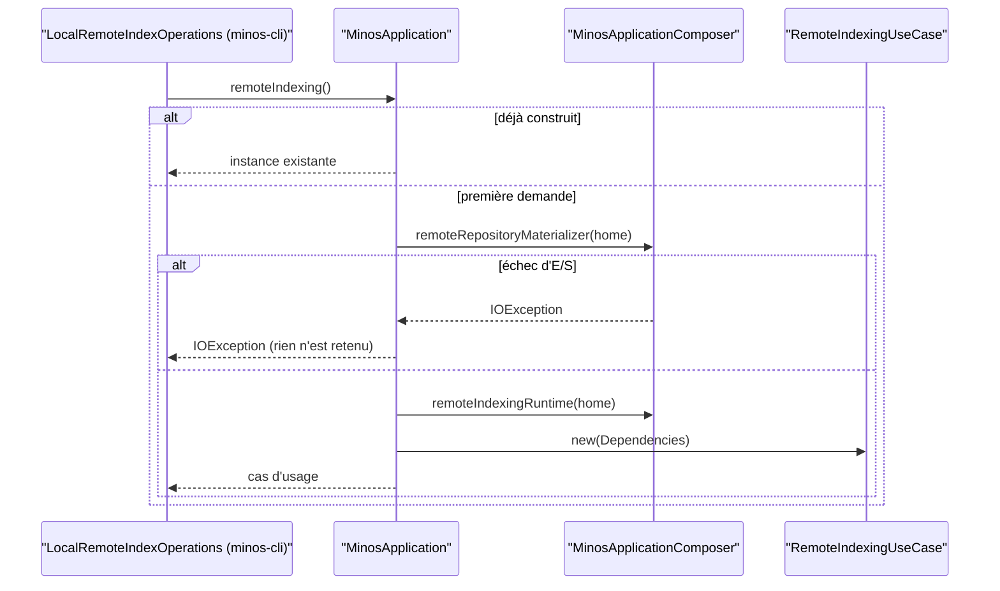
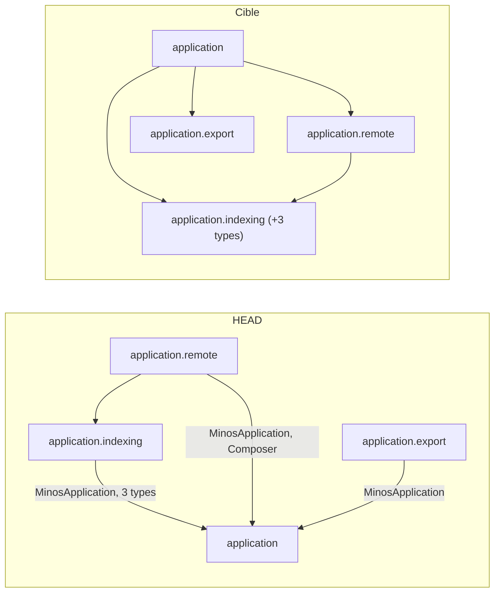

# Design

## Contexte

Motivation : voir `proposal.md` (Why). Le changement touche la façade `MinosApplication`, les trois cas d'usage de `com.minos.application.{indexing,remote,export}`, trois types du package de la façade, leurs appelants dans `minos-cli` et `minos-nexus`, le garde A11 et les tests de sept modules. Aucune sortie publique ne change. Windows et Linux : même comportement ; la voie WSL2 reste offerte par la racine de composition sous Windows seulement.

## État vérifié au HEAD

Relu au commit `89be3fb4`.

| Fait | Preuve |
|---|---|
| 36 méthodes publiques d'instance avant `Builder` (identité 3, stockage 7, indexation 9, requêtes 9, sémantique 6, équipe 1, `close`) | `minos-application/src/main/java/com/minos/application/MinosApplication.java:256-352` |
| `compositionRoot()` est publique | `MinosApplication.java:263` |
| 15 accesseurs publics typés moteur, tenus par A11 | `scripts/architecture/check-module-boundaries.py:599-616` |
| `runtimeObservationStore` n'est gardé que pour un test | `check-module-boundaries.py:610-611` ; `minos-mcp/src/test/java/com/minos/mcp/MinosMcpWriteProtectedHomeTest.java:114` |
| `ProjectIndexingUseCase` puise 14 collaborateurs dans la façade, dont deux par `compositionRoot()` | `minos-application/src/main/java/com/minos/application/indexing/ProjectIndexingUseCase.java:207-250` (`:223`, `:248`) |
| `com.minos.application.indexing` importe du package de la façade `MinosApplication`, `ProjectIndexStateReconciler`, `PublishedSnapshotRetention` et `ProviderRuntimeSummary` | `ProjectIndexingUseCase.java:3-5` ; `minos-application/src/main/java/com/minos/application/indexing/IndexPlanSummary.java:3` |
| `com.minos.application.remote` importe `MinosApplication` et `MinosApplicationComposer` ; `export` importe `MinosApplication` | `RemoteIndexingUseCase.java:3-4` ; `KnowledgeExportUseCase.java:3` |
| Aucune source du package `com.minos.application` n'importe `indexing`, `remote` ni `export` | recherche des imports dans `minos-application/src/main/java/com/minos/application/*.java` |
| Aucun cycle de packages toléré | `check-module-boundaries.py:1453` |
| Les trois types à déplacer n'importent aucun type du package de la façade ; aucun gate ne les cite | lecture de `ProjectIndexStateReconciler.java`, `PublishedSnapshotRetention.java`, `ProviderRuntimeSummary.java` ; recherche dans `scripts/` |
| Leurs lecteurs en production : `ProjectInspectionService` (réconciliateur), `LocalProjectOperations` (rétention), `ProviderPlatformService` et `minos-cli/.../LocalAutonomousIndexOperations.java` (résumé) | recherche dans `minos-*/src/main` |
| `RemoteIndexingUseCase.of` crée matérialiseur puis moteur par la racine, et rappelle `ProjectIndexingUseCase.of(application, decorator)` | `RemoteIndexingUseCase.java:99-116` |
| Un gate exige `compositionRoot.remoteRepositoryMaterializer(` et `compositionRoot.remoteIndexingRuntime(` dans `RemoteIndexingUseCase.java` | `scripts/quality/check-remote-distributed-consistency.py:141-143` |
| `KnowledgeExportUseCase` a déjà un constructeur à deux ports | `minos-application/src/main/java/com/minos/application/export/KnowledgeExportUseCase.java:54-63` |
| Appelants de production des fabriques : 4 sites, tous dans des surfaces | `minos-cli/.../LocalAutonomousIndexOperations.java:39`, `:66` ; `LocalRemoteIndexOperations.java:28` ; `minos-nexus/.../NexusExportService.java:38` |
| Appelants de test des fabriques : 10 fichiers (`minos-app` 1, `minos-application` 5, `minos-cli` 4) | recherche dans `minos-*/src/test` |
| `compositionRoot()` est appelée par 5 fichiers de test | `ProviderCatalogPortTest.java:26`, `WslIndexingRouteWiringTest.java:41-43`, `DefaultMinosApplicationComposerTest.java:63`, `SnapshotScalabilityBenchmark.java:258`, `LocalRemoteIndexOperationsRefusalTest.java:50` |
| Les fabriques créent des adaptateurs liés au home | `minos-bootstrap/src/main/java/com/minos/bootstrap/DefaultMinosApplicationComposer.java:197-211` |
| Précédent : quatre accesseurs rendus non publics en 1.3.0, documentés comme rupture de la classe interne | `docs/user/java-api.md:373-375` |
| Les sept modules consommateurs ont `minos-application` dans leurs dépendances permises ; le garde accepte un module déclaré deux fois (jar et `test-jar`) et garde la portée la plus forte | `check-module-boundaries.py:73-91`, `:202` |
| Deux refus antérieurs d'un `test-jar` sont consignés dans le garde | `check-module-boundaries.py:1215`, `:1221` |

Non mesuré : le nombre exact de fichiers de test qui appellent un accesseur à retirer (la recherche textuelle confond les accesseurs homonymes d'autres types ; plusieurs dizaines, dans sept modules). Aucun build exécuté.

## Écarts

| Écart | Source A | Source B | Suite proposée |
|---|---|---|---|
| L'audit propose de construire les cas d'usage « dans `MinosApplicationAssembler` » | `findings.json`, AUD-ARC-02, action | Trois fabriques du composeur touchent le home ; surfaces-publiques › « Tout outil MCP répond sur un répertoire de données qu'il ne peut pas écrire » | D3 : construction à la première demande, dans `com.minos.application` |
| L'audit propose d'« exposer les cas d'usage sur la façade » | action de l'audit | La façade rendrait des types de packages qui importent le sien : cycle `application ↔ application.indexing` (et `remote`, `export`), refusé par A8 | D4 : déplacer trois types et retirer les fabriques `of` dans la même tâche que l'ajout de la façade |
| L'audit propose de rendre les accesseurs « package-private (ou supprimés) » | action de l'audit | Des tests de sept modules lisent ces ports sur une application ouverte | D2 : accès de test par `test-jar` |
| L'audit propose de donner au test l'accès à `runtimeObservationStore` « par le Builder » | action de l'audit | `MinosMcpWriteProtectedHomeTest` prépare les données par une application ouverte sur le backend réel | même accès de test que D2 |
| Le scénario « Table à jour au HEAD » annonce 15 accesseurs | `openspec/specs/frontieres-de-modules/spec.md:992-995` | la table sera vide | Exigence modifiée par ce changement (seul ce scénario change) ; aucun autre changement actif ne modifie cette exigence |

## Exigences couvertes

- frontieres-de-modules › Les cas d'usage reçoivent leurs collaborateurs et non l'application — D4, « Responsabilités ».
- frontieres-de-modules › La façade expose les cas d'usage, construits à la demande — D3, diagramme de séquence.
- frontieres-de-modules › La façade ne rend ni type du moteur ni racine de composition — D1, D5.
- frontieres-de-modules › Les tests lisent un port de l'application par un accès de test — D2.
- frontieres-de-modules › L'injection des cas d'usage ne change aucune sortie publique — « Vérification ».
- frontieres-de-modules › Les accesseurs de MinosApplication typés moteur sont tenus par un cliquet (modifiée) — D5.

## Objectifs et non-objectifs

Objectif : une surface qui tient un `MinosApplication` n'atteint que des services applicatifs et des cas d'usage. Non-objectif : réduire le `Builder`, changer l'orchestration de l'indexation, toucher aux services de requête.

## Responsabilités et frontières des composants

- `com.minos.application` (façade) : seul lieu qui assemble les `Dependencies` des cas d'usage à partir des ports et de la racine de composition. Il dépend désormais de `indexing`, `remote` et `export`. [Proposition]
- `com.minos.application.indexing` : reçoit `ProjectIndexStateReconciler`, `PublishedSnapshotRetention` et `ProviderRuntimeSummary` ; n'importe plus le package de la façade. `remote` dépend d'`indexing` (existant) ; `export` ne dépend d'aucun des deux.
- Graphe de packages visé : `application → {indexing, remote, export}`, `remote → indexing`, aucune arête en retour : A8 reste vert.
- Surfaces : appellent la façade. Direction ARCH-0068 inchangée, aucune dépendance Maven ajoutée (le `test-jar` de `minos-application` en portée `test` double une arête existante).

## Modèle de domaine et invariants

Les enregistrements `Dependencies` existants (`ProjectIndexingUseCase`, `RemoteIndexingUseCase`) deviennent le seul point d'entrée ; chaque composante est requise non nulle par le constructeur (ARCH-0045 : constructeur unique et point d'entrée nommé).

## Traitements et interactions

Voir le diagramme de séquence. L'indexation distante garde son ordre : matérialiseur, puis moteur, puis cas d'usage (`RemoteIndexingUseCase.java:99-104`).

## États et transitions

Un cas d'usage de la façade a deux états : non construit, construit. Un échec de construction laisse « non construit » (la demande suivante retente) ; `close()` n'a rien à libérer de plus qu'au HEAD.

## Contrats d'interface

Classes internes de `minos-application` (noms à confirmer à l'implémentation) :

- ajoutées à `MinosApplication` : `indexing()` → `ProjectIndexingUseCase` ; `indexingViaWsl(Optional<String> distribution)` → `Optional<ProjectIndexingUseCase>` ; `remoteIndexing()` → `RemoteIndexingUseCase`, `throws IOException` ; `knowledgeExport()` → `KnowledgeExportUseCase`.
- retirées des cas d'usage, au même temps (**RUPTURE**, imposée par A8) : `ProjectIndexingUseCase.of` (deux variantes) et `viaWsl`, `RemoteIndexingUseCase.of` (deux variantes), `KnowledgeExportUseCase.of`.
- déplacées (**RUPTURE** d'import) : `ProjectIndexStateReconciler`, `PublishedSnapshotRetention`, `ProviderRuntimeSummary` → `com.minos.application.indexing`.
- retirées du public de `MinosApplication` (**RUPTURE**, D1) : `compositionRoot()`, `projectRegistry()`, `snapshotStore()`, `indexStateStore()`, `fingerprintStore()`, `runtimeObservationStore()`, `retentionService()`, `discoveryService()`, `fingerprintService()`, `invalidationService()`, `incrementalIndexingPlanner()`, `providerRuntimeManager()`, `indexerDescriptors()`, `indexerRegistry(String)`, `snapshotStager()`, `snapshotPromoter()`.

`com.minos.api`, la CLI, le MCP, le protocole du plugin et NEXUS : aucun changement.

## Persistance et intégrité

Non applicable : aucune donnée écrite ni format modifié.

## Transactions, concurrence et idempotence

La construction à la demande est synchronisée comme `semanticProjectionService()` (`MinosApplication.java:327-334`) : une seule instance par application, y compris sous appels concurrents.

## Sécurité et isolation

Fail-closed conservé : le refus de l'indexation distante (ARCH-0041) reste celui du cas d'usage. Réduire la façade retire aux surfaces l'accès technique aux ports de persistance et à la racine de composition. L'accès de test n'existe dans aucun jar livré.

## Erreurs et reprise

`remoteIndexing()` propage l'`IOException` de la racine de composition, comme `RemoteIndexingUseCase.of` au HEAD.

## Observabilité

Non applicable.

## Performance et mesure

Non applicable : même nombre d'objets ; la construction est différée, pas ajoutée.

## Compatibilité, migration et retour arrière

Trois temps fusionnables seuls : (1) déplacement des trois types, sans changement de comportement ; (2) façade, retrait des fabriques `of` et bascule des surfaces et des tests, d'un seul tenant (un état intermédiaire où la façade rend les cas d'usage pendant que ceux-ci importent `MinosApplication` est refusé par A8) ; (3) retrait des accesseurs, après décision. Un code tiers migre selon la table de `docs/user/java-api.md`. Retour arrière : annuler la PR du temps concerné.

## Diagrammes

### Qui assemble l'indexation distante après le changement ?

Type : sequenceDiagram · Portée : cible · Exigences : frontieres-de-modules › La façade expose les cas d'usage, construits à la demande

### Quelles arêtes de packages restent ?

Type : flowchart · Portée : existant et cible · Exigences : frontieres-de-modules › Les cas d'usage reçoivent leurs collaborateurs et non l'application

Le sens des trois arêtes s'inverse ; aucune ne subsiste dans les deux sens.

## Décisions

### D1 — Retirer du public `compositionRoot()` et les 15 accesseurs typés moteur [Proposition, attend le propriétaire ; objet de l'ADR]

Options : (a) retrait en une version, documenté comme rupture de la classe interne (précédent 1.3.0, `docs/user/java-api.md:373`) ; (b) dépréciation `@Deprecated(forRemoval = true)` pendant une version mineure, puis retrait ; (c) statu quo sous cliquet, seule `compositionRoot()` étant fermée.
Recommandation : **(a)**. `MinosApplication` n'est pas l'API Java publiée (`com.minos.api` l'est) ; aucune surface de production n'appelle ces accesseurs ; le précédent existe.

### D2 — Accès de test par le `test-jar` de `minos-application` [Proposition, attend le propriétaire]

Classe de test dans le package `com.minos.application` (nom proposé : `MinosApplicationTestAccess`), publiée par `maven-jar-plugin:test-jar`, consommée en portée `test`. A3 est respectée : la classe est déclarée par les sources de test du module qui possède le package. Faisabilité : les sept consommateurs ont déjà `minos-application` dans `ALLOWED_DEPENDENCIES` (`check-module-boundaries.py:73-91`) et le garde accepte la double déclaration (`:202`).
Précédent contraire : le garde consigne deux refus d'un `test-jar` (`:1215`, `ProgramGraphEvaluator`, « a test-jar would cost more » ; `:1221`, `InMemoryIndexStateStore`, « moving it needs a test-jar, not done here »). Il ne vaut pas ici : dans ces deux cas le `test-jar` n'aurait servi qu'à sortir une classe sans appelant de production, pour un gain d'une ligne dans une liste ; ici il est la condition du retrait de seize méthodes publiques de la façade, et rien d'autre ne laisse aux tests de sept modules l'accès aux ports d'une application ouverte par `MinosApplication.open`. Le garde gagne un contrôle : ce `test-jar` n'est admis qu'en portée `test`.

### D3 — Construction à la première demande, dans la façade [Proposition]

Contre l'action littérale de l'audit (assembleur) : voir « Écarts ». Les champs suivent le patron de `semanticProjectionService()`.

### D4 — Les packages des cas d'usage ne dépendent plus du package de la façade [Proposition]

`ProjectIndexStateReconciler`, `PublishedSnapshotRetention` et `ProviderRuntimeSummary` passent dans `com.minos.application.indexing`, package que leurs lecteurs du package de la façade peuvent importer une fois l'arête inversée. Même module : aucune classe ne change de jar ; les tests dédiés (`ProjectIndexStateReconcilerStoreFailureTest`, `PublishedSnapshotRetentionTest`) suivent leur classe si elles en lisent un membre non public. Les fabriques `of` disparaissent dans la tâche qui ajoute la façade. Alternative écartée : placer les méthodes de façade dans une classe d'un autre package — elle aurait besoin des accesseurs publics que ce changement retire.

### D5 — Garde A11 [Proposition]

`MINOS_APPLICATION_ENGINE_ACCESSORS` devient vide (le commentaire et l'entrée `runtimeObservationStore`, `:610-611`, disparaissent avec les autres) et `minos_application_accessors` reste : toute réintroduction échoue. Le garde refuse aussi une méthode publique d'instance rendant `MinosApplicationComposer`, et le `test-jar` de `minos-application` déclaré hors portée `test`. La table miroir `ENGINE_TYPES_USED_BY_SURFACE_BYTECODE` de `ModuleArchitectureTest` n'est pas concernée. `COMPOSITION_ROOT_USE` (`:869`) est conservé.

### D6 — ADR et ordre de fusion [Décision de forme]

Même ADR que le changement `cabler-les-adaptateurs-embarques-par-la-racine-de-composition` (domaine `ARCH`, prochain numéro libre à l'écriture, non réservé) : sa tâche 1.2 l'écrit `Proposed` ; la tâche 4.1 d'ici le complète (D1, D2) et le fait passer `Accepted` par le propriétaire. Si ce changement atteint son groupe 4 avant que `cabler` n'ait écrit l'ADR, la tâche 4.1 l'écrit. Ordre de fusion sur `MinosApplicationComposer` et `MinosApplicationComposersTest.FirstComposer` (`:90`) : `porter-l-historique-d-import-derriere-un-port`, puis `cabler`, puis celui-ci, qui n'ajoute aucune méthode au port mais en déplace les appelants.

## Qualification des capacités

Aucune capacité produit nouvelle. Voie WSL2 : comportement inchangé, propre à Windows ; hors Windows la façade rend un résultat vide.

## Risques et compromis

- [Risque] Volume de tests à adapter (sept modules) → temps 3 séparé, mécanique, vérifié par `./mvnw -B -ntp verify`.
- [Risque] SonarCloud : le code neuf de la façade doit être couvert dans `minos-application` → tests des cas d'usage par doubles, dans le module ; les trois types déplacés restent dans leur module avec leurs tests.
- [Risque] Gate littéral `check-remote-distributed-consistency.py:141-143` → son attente passe de `RemoteIndexingUseCase.java` à `MinosApplication.java` dans la tâche qui retire `RemoteIndexingUseCase.of`.
- [Risque] Conflit avec `supprimer-les-vues-miroirs-de-la-cli` sur `LocalRemoteIndexOperations` et `LocalAutonomousIndexOperations` (lignes de construction ici, lignes de conversion là-bas) → rebase simple.
- [Compromis] Le `test-jar` donne aux tests un accès aux ports ; c'est voulu, et absent des jars livrés.

## Vérification

- Tests : nouveaux tests des cas d'usage par doubles (`minos-application`), `WslIndexingRouteWiringTest`, `LocalRemoteIndexOperationsRefusalTest`, `LocalRemoteIndexOperationsIntegrationTest`, `MinosMcpWriteProtectedHomeTest`, `ProviderCatalogPortTest`, `DefaultMinosApplicationComposerTest`, `ProjectIndexStateReconcilerStoreFailureTest`, `PublishedSnapshotRetentionTest`, `ProviderPlatformServiceRuntimesTest`, `ModuleArchitectureTest`, `A2SurfaceCharacterizationTest`, `ShadedJarCompositionRootIT`.
- Gates : `check-module-boundaries.py` et son auto-test ; `check-remote-distributed-consistency.py` ; `check-polyglot-provider-consistency.py`, `check-post-mne.py`, `check-mnd.py`, `check-mne.py` (citent les cas d'usage) ; `check-hosted-control-plane-consistency.py`, `check-runtime-dynamic-consistency.py` (citent `MinosApplicationAssembler`).
- JaCoCo : scopes de `check-jacoco.py` citant `RemoteIndexingUseCase` et `LocalRemoteIndexOperations`.
- Commandes : `./mvnw -B -ntp verify` (tout le reactor : sept modules de test touchés), `python .claude/scripts/run_gates.py`.

## Documentation durable à mettre à jour

`docs/architecture/diagrams/capacites/frontieres-de-modules.md` ; `docs/user/java-api.md` (sections de rupture avec table de remplacement, et ligne `:371` sur `KnowledgeExportUseCase.of`) ; ADR commun, index et `09-decisions.md` ; ARCH-0057 (« Mise en œuvre », point 6).

## Traçabilité

| Exigence (capacité › titre) | Scénario | Conception ou diagramme | Tâche | Test ou preuve |
|---|---|---|---|---|
| frontieres-de-modules › Les cas d'usage reçoivent leurs collaborateurs et non l'application | Cas d'usage sans import du package de la façade | D4, flowchart | 1.2, 2.2 | `UseCasePackagesDependencyTest` |
| idem | Aucun cycle de packages | D4 | 1.2, 2.2 | `check-module-boundaries.py` |
| idem | Cas d'usage construit sans application | D3 | 2.1 | `ProjectIndexingDependenciesTest#aUseCaseBuiltFromItsCollaboratorsAloneAcceptsTheIdentityDecorator` ; tests existants sur `IndexingFixture` (plan sans application) |
| idem | Collaborateur manquant refusé | Modèle | 2.1 | `ProjectIndexingDependenciesTest#aMissingCollaboratorIsRefusedByName`, `#aMissingDecoratorIsRefusedByName` |
| frontieres-de-modules › La façade expose les cas d'usage, construits à la demande | Surfaces servies par la façade | séquence | 2.2 | recherche `UseCase.of(` / `UseCase.viaWsl(` vide ; `UseCaseFacadeTest#theLocalIndexingAndTheExportAreBuiltOnceOnFirstRequest` |
| idem | Ouverture sans écriture | D3 | 2.2 | `MinosMcpWriteProtectedHomeTest` ; `UseCaseFacadeTest#openingAsksNoUseCaseCollaboratorOfTheCompositionRoot` |
| idem | Voie WSL2 absente | Contrats | 2.1 | `WslIndexingRouteWiringTest` ; `UseCaseFacadeTest#noWslRouteYieldsEmptyWithoutResolvingAnything` |
| idem | Échec de création du moteur distant | séquence | 2.1 | `UseCaseFacadeTest#aFailingMaterializerIsPropagatedAndTheNextRequestTriesAgain` |
| frontieres-de-modules › La façade ne rend ni type du moteur ni racine de composition | les trois scénarios | D1, D5 | 4.2, 4.3 | `test_check_module_boundaries.py`, à écrire |
| frontieres-de-modules › Les tests lisent un port de l'application par un accès de test | Jar de production sans accès de test | D2 | 4.2 | à écrire (test de packaging) |
| idem | Test d'une surface | D2 | 4.3 | `MinosMcpWriteProtectedHomeTest` |
| idem | Accès de test hors portée de test refusé | D2, D5 | 4.2 | `test_check_module_boundaries.py`, à écrire |
| frontieres-de-modules › L'injection des cas d'usage ne change aucune sortie publique | Goldens inchangés ; Refus conservé | Vérification | 3.1, 4.4 | caractérisation, `LocalRemoteIndexOperationsRefusalTest` |
| frontieres-de-modules › Les accesseurs de MinosApplication typés moteur sont tenus par un cliquet | Table à jour au HEAD (0 accesseur) | D5 | 4.3 | `check-module-boundaries.py` |

## Questions ouvertes

- D1 et D2 : décisions du propriétaire attendues avant le groupe 4 (recommandations : D1 = a, D2 = `test-jar`).
- Noms des méthodes de façade : fixés à l'implémentation.
